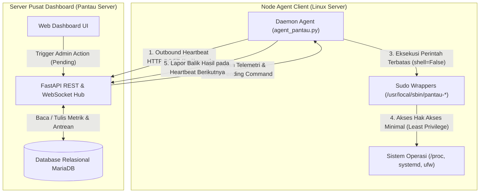
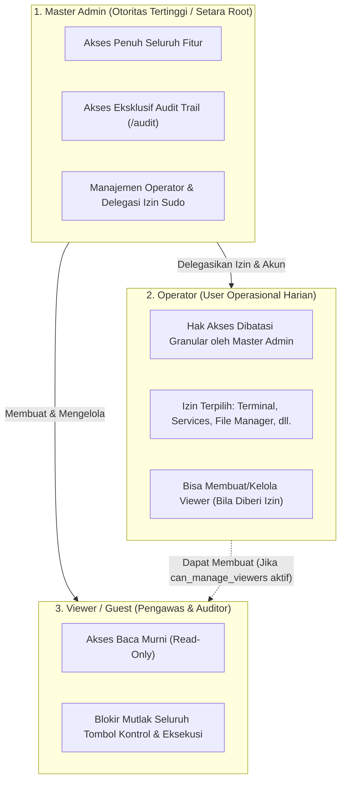

# Dokumentasi Pengembangan & Standar Arsitektur Pantau Server

Dokumen ini merupakan panduan teknis resmi bagi developer dan system administrator (sysadmin) yang merangkum seluruh prinsip fundamental, standar arsitektur, filosofi keamanan, metodologi data retention, serta best practices dalam pengembangan ekosistem **Pantau Server** dan **Agent Pantau**.

---

# Bagian I: Prinsip Fundamental, Standar Desain & Best Practices

## 1. Arsitektur Komunikasi Multi-Server (Pull-Based Inverted Heartbeat)

### Filosofi Desain: Outbound Pull vs Inbound Push
Dalam merancang sistem monitoring dan kontrol terdistribusi multi-server, keputusan arsitektur paling mendasar adalah arah inisiasi koneksi. Sistem monitoring lawas atau berbasis script ad-hoc umumnya mengandalkan server monitoring pusat yang membuka sesi SSH masuk (*inbound SSH*) ke setiap server client. Pendekatan tersebut memiliki kelemahan kritis:
1. **Eksposur Port & Attack Surface Luas**: Mengharuskan port SSH atau port agent terbuka ke internet/jaringan publik pada setiap mesin client.
2. **Kerapuhan NAT & Topologi Jaringan**: Memerlukan VPN rumit, port forwarding, atau IP publik statis untuk server-server di balik NAT, firewall korporat, atau VPC cloud yang terisolasi.
3. **Penyimpanan Kredensial Terpusat Berisiko Tinggi**: Server monitoring harus menyimpan private key SSH atau password root untuk seluruh server target. Jika server monitoring terkompromi, seluruh server klien menjadi rentan terhadap akses tidak sah.

**Prinsip Desain Pantau Server:**
Pantau Server mengadopsi model **Pull-Based Inverted Heartbeat** yang sepenuhnya terbalik (*inversion of control*):
- **Agent Menginisiasi Koneksi Keluar (*Outbound Only*)**: Agent client secara periodik (setiap 5–10 detik) mengirim HTTP POST request (`/api/report`) ke server dashboard pusat.
- **Zero Inbound Ports**: Agent client tidak membuka listening port apapun ke jaringan publik. Server client dapat berada di balik NAT bertingkat atau firewall ketat selama memiliki akses keluar (*egress*) ke server dashboard.
- **Kredensial Terisolasi Per-Server**: Setiap agent hanya memegang token API spesifik (`api_key`) yang di-hash dengan SHA-256 di database server (`sha256:<hash>`). Key agent tidak memiliki hak akses pada server lain.



### Siklus Hidup Perintah Asinkron (Asynchronous Command Lifecycle)
Karena koneksi bersifat outbound-pull, eksekusi perintah (seperti restart service, kill process, modifikasi firewall, add user, push update OTA) ditangani melalui antrean perintah asinkron (*asynchronous command queue*):
1. **Penerbitan (*Issue*)**: Operator memicu aksi dari web dashboard. Server dashboard memvalidasi permission dan memasukkan perintah ke tabel [`commands`](file:///home/bos/rj45/server/models.py#L88-L111) dengan status `pending`.
2. **Pengambilan (*Polling/Heartbeat*)**: Saat agent melakukan heartbeat berikutnya, server menyertakan pending command dalam payload response JSON.
3. **Eksekusi Lokal**: Agent memproses command secara lokal, menjalankan binary terkait melalui sudo wrapper terisolasi, dan menangkap status serta output (*stdout/stderr*).
4. **Pelaporan Hasil (*Callback Report*)**: Pada heartbeat berikutnya, agent melaporkan balik hasil eksekusi (`success` atau `failed`) beserta output log ke server untuk di-update di database dan ditampilkan di web dashboard.

### Agent Mandiri Tanpa Dependensi Eksternal (Zero-Dependency Python Agent)
Agent client ([`agent/agent_pantau.py`](file:///home/bos/rj45/agent/agent_pantau.py)) dibangun dengan prinsip **Zero External Dependencies**:
- Hanya menggunakan Python standard library (`urllib.request`, `subprocess`, `json`, `os`, `sys`, `platform`, `hashlib`, `shutil`, `socket`).
- Tidak menggunakan third-party library seperti `psutil` yang membutuhkan compiler C (`gcc`, `python3-dev`) dan rentan gagal saat dipasang pada instalasi distro Linux minimalis.
- Metrik sistem dibaca langsung dari pseudo-filesystem Linux (`/proc/stat`, `/proc/meminfo`, `/proc/loadavg`, `/proc/net/dev`, `/proc/diskstats`, `/sys/class/net/`) dan utilitas core Linux (`df`, `systemctl`, `journalctl`, `ss`, `ufw`).
- Hal ini menjamin agent dapat di-deploy seketika di semua distro Linux modern (Ubuntu 18.04+, Debian 10+, CentOS 7+, RHEL, AlmaLinux, Rocky Linux) dalam hitungan detik.

---

## 2. Model Keamanan & Hak Akses Minimal (Principle of Least Privilege)

### Isolasi Akun Tanpa Hak Istimewa (Unprivileged Daemon)
- Agent Pantau tidak pernah dijalankan sebagai user `root`.
- Agent beroperasi di bawah system user terisolasi `pantau` (`User=pantau`, `Group=pantau`) yang dibuat otomatis oleh installer [`package/install.sh`](file:///home/bos/rj45/package/install.sh).
- File konfigurasi agent (`/etc/pantau/config.json`) diamankan dengan permission `0600` milik `pantau:pantau`.

### Pencegahan Shell Injection (`shell=False` & Argument Vectors)
- Standar mutlak kode agent melarang penggunaan `subprocess.run(..., shell=True)` atau `os.system(...)`.
- Semua eksekusi binary sistem diwajibkan menggunakan argument vector (`list` of strings):
  ```python
  # BENAR (Aman dari shell injection):
  subprocess.run(["/usr/local/sbin/pantau-user", "lock", username], shell=False, check=True)

  # DILARANG KERAS (Rentan Command Injection):
  # subprocess.run(f"/usr/local/sbin/pantau-user lock {username}", shell=True)
  ```
- Pendekatan ini mengeliminasi celah eksekusi perintah arbitrari (*arbitrary command execution*) melalui metakarakter shell (seperti `;`, `&&`, `|`, `` ` ``, `$()`, `\n`).

### Granularitas Sudo Wrapper Khusus (`/usr/local/sbin/pantau-*`)
Untuk menjalankan tindakan administratif sistem tanpa memberikan hak sudo root penuh (`ALL=(ALL) ALL`), Agent Pantau menggunakan script wrapper terisolasi di `/usr/local/sbin/`. Konfigurasi sudoers di [`/etc/sudoers.d/pantau-agent`](file:///home/bos/rj45/package/etc/sudoers.d/pantau-agent) hanya mengizinkan eksekusi tanpa password untuk file-file ini:
- [`pantau-service`](file:///home/bos/rj45/package/usr/local/sbin/pantau-restart): Mengontrol status service systemd (start, stop, restart, reload) dengan whitelist validasi unit.
- [`pantau-user`](file:///home/bos/rj45/package/usr/local/sbin/pantau-user): Manajemen user Linux (buat user, lock user via `usermod -L`, unlock user via `usermod -U`, delete user via `userdel`).
- [`pantau-cron`](file:///home/bos/rj45/package/usr/local/sbin/pantau-cron): Tambah, enable/disable, delete, dan eksekusi instan cron job.
- [`pantau-firewall`](file:///home/bos/rj45/package/usr/local/sbin/pantau-firewall): Manajemen firewall UFW (enable, disable, reload, block IP, unblock IP, rule audit).
- [`pantau-ssl`](file:///home/bos/rj45/package/usr/local/sbin/pantau-ssl): Pembacaan dan inspeksi sertifikat SSL/TLS lokal via OpenSSL CLI.
- [`pantau-apt`](file:///home/bos/rj45/package/usr/local/sbin/pantau-apt): Update cache repository (`apt-get update`) dan upgrade paket (`apt-get upgrade -y`).
- [`pantau-host`](file:///home/bos/rj45/package/usr/local/sbin/pantau-host): Reboot OS dan shutdown terjadwal dengan safety delay agar status report sempat terkirim sebelum mesin mati.
- [`pantau-file`](file:///home/bos/rj45/package/usr/local/sbin/pantau-file): Operasi file aman dengan batasan path directory.

### Guardrail Proteksi Proses Kritis Sistem
Sistem memiliki guardrail perlindungan ganda (di dashboard dan agent) yang menolak mutlak perintah kill atau modifikasi pada komponen kritis:
1. **PID 1 (`init` / `systemd`)**: Tidak dapat dihentikan atau dikirimi sinyal terminasi.
2. **Daemon SSH (`sshd`)**: Tidak dapat di-kill melalui task manager agar sysadmin tidak terkunci dari server.
3. **Daemon Agent Pantau (`agent_pantau`)**: Dilindungi dari kill paksa via web UI guna menjaga kontinuitas monitoring.
4. **Port Kunci (Port 22 SSH, 80/443 Web, 8400 Pantau)**: Sebelum firewall UFW diaktifkan, sistem secara otomatis memastikan rule allow untuk port-port ini sudah terpasang.

### Pengamanan Web File Manager
- **Guardrails System Path**: Akses langsung ke directory sensitif kernel dan hardware (`/proc`, `/sys`, `/dev`, `/boot`) diblokir ketat.
- **Auto Backup File Berstempel Waktu**: Setiap kali file teks diedit dan disimpan via web UI, file original otomatis dibackup ke `.bak.<timestamp>` sebelum file ditimpa.

### Model Kontrol Akses Berbasis Role 3-Tier (3-Tier RBAC Architecture)
Untuk mendukung tata kelola keamanan enterprise, Pantau Server menerapkan sistem otorisasi berbasis role 3-tier dengan prinsip segregation of duties:



1. **Master Administrator (`master_admin`)**:
   - **Kedudukan**: Akun dengan hak akses administratif penuh.
   - **Hak Khusus**:
     - Satu-satunya role yang memiliki visibilitas atas kartu counter dan data akun Master Admin di tabel user.
     - Akses penuh catatan audit trail ([`/audit`](file:///home/bos/rj45/server/templates/audit.html)).
     - Hak membuat, mengedit izin granular/sudo, dan me-lock akun Operator serta Viewer.
     - Kontrol tak terbatas atas seluruh armada server, terminal, file manager, dan eksekusi command.
   - **Proteksi Akun Administrator & Isolasi Informasi**: Akun Master Admin tidak dapat dihapus atau dinonaktifkan via antarmuka web. Keberadaan akun Master Admin disembunyikan dari antarmuka pengguna Operator dan Viewer.

2. **Operator (`operator`)**:
   - **Kedudukan**: Akun harian tim operasional/SRE. Akun dibuat dan dikonfigurasi langsung oleh Master Admin atau Operator dengan wewenang sudo.
   - **Konsep Otoritas Sudo Operator (*Sudo-like Authority*)**:
     Seperti prinsip user biasa di Linux yang tergabung dalam grup `sudo` (*wheel*), Master Admin dapat mendelegasikan wewenang penuh kepada Operator (termasuk akses audit trail dan user management) sehingga akun Master Admin tidak perlu digunakan setiap hari. Akun Operator dengan hak sudo penuh dapat mengelola operasional armada server dan user lain secara mandiri.
   - **Prinsip Zero-Knowledge Master Admin**:
     Operator sama sekali tidak mengetahui keberadaan user Master Admin:
     - Counter kartu statistik jumlah Master Admin disembunyikan dari Operator.
     - Baris akun Master Admin tidak muncul pada tabel user yang diakses Operator.
     - Jika Operator mencoba memanipulasi ID Master Admin secara sengaja via API/POST (`/delete`, `/toggle-active`, `/edit`), sistem merespons netral `"User tidak ditemukan"` untuk mencegah user enumeration.
     - Pada halaman Audit Trail, aktivitas Master Admin disamarkan sebagai `"Sistem"`.
   - **Matriks Izin Granular (*Granular Delegated Permissions*)**:
     Setiap Operator memiliki hak eksekusi yang diatur via permission matrix atau preset **⚡ Hak Sudo Penuh**:
     - `can_terminal`: Akses web terminal PTY interaktif xterm.js.
     - `can_file_manager`: Browse directory, edit file, dan manajemen file remote.
     - `can_manage_servers`: Add server, rename, edit threshold, atau delete server.
     - `can_services`: Start, stop, restart, dan reload service systemd.
     - `can_processes`: Kill dan stop process di task manager.
     - `can_firewall`: Manage port rule, block/unblock IP via UFW.
     - `can_users_sys`: Add user Linux, lock, unlock, dan delete user host.
     - `can_cron`: Add, toggle, delete, dan run now cron job.
     - `can_ssl`: Manage custom SSL path monitoring.
     - `can_server_control`: Reboot OS dan poweroff mesin host.
     - `can_apt`: Update repository cache dan upgrade paket APT.
     - `can_ota`: Trigger push update agent massal (OTA update).
     - `can_audit`: Akses membaca audit trail dan log aktivitas keamanan ([`/audit`](file:///home/bos/rj45/server/templates/audit.html)).
     - `can_manage_users`: Manage akun user (Operator & Viewer), reset password, ganti username, dan set permission.
     - `can_manage_viewers`: Izin terbatas untuk membuat, mengunci, atau menghapus akun Viewer (tamu monitoring).
   - **Batasan Mutlak**: Operator **tidak dapat** menghapus Master Admin, tidak dapat me-lock Master Admin, tidak dapat mengganti username/password Master Admin, serta tidak dapat mempromosikan user manapun menjadi `master_admin`.

3. **Viewer (`viewer`)**:
   - **Kedudukan**: Akun pengawas pasif untuk stakeholder, manajemen, external auditor, atau tim monitoring murni.
   - **Isolasi Mutlak (*Zero Administrative Authority & Information Isolation*)**:
     - User Viewer sama sekali tidak mengetahui keberadaan user Operator maupun Master Admin.
     - Tidak memiliki menu **Profil & Keamanan** di web UI, dan seluruh akses ke `/profile` diblokir permanen (redirect ke `/`).
     - Viewer tidak dapat mengubah password, profil, atau 2FA sendiri. Seluruh kredensial akun Viewer dikelola dari luar oleh Master Admin atau Operator.
     - Seluruh tombol kontrol, aksi eksekusi, terminal, file manager, dan form modifikasi disembunyikan dan di-block di backend. Viewer murni hanya memiliki hak read-only metrik.

---

### Unifikasi User Management ke Menu Profil & Keamanan
1. **Navigasi Terpadu**:
   - Menu terpisah "User" di sidebar utama dihapus agar navigasi tetap ringkas dan terfokus.
   - Manajemen user dan delegasi wewenang disatukan ke dalam halaman **Profil & Keamanan** ([`/profile`](file:///home/bos/rj45/server/templates/profile.html)):
     - **Tab 1: Profil & Keamanan Saya**: Info identitas, ganti password pribadi, dan manajemen 2FA (TOTP) serta backup recovery codes.
     - **Tab 2: Manajemen User & Hak Akses**: Muncul otomatis untuk Master Admin atau Operator yang memiliki wewenang user management (`can_manage_users` / `can_manage_viewers`).
2. **Antarmuka Tabel User Interaktif**:
   - **Tombol "👁️ Lihat"**: Modal inspeksi profil akun dan visualisasi matriks izin (*✔ Diizinkan* vs *✖ Ditolak*).
   - **Tombol "✏️ Edit"**: Modal untuk edit username, reset password sesuai standar NIST, ganti role, serta checklist permission dengan preset instan **⚡ Hak Sudo Penuh**.
   - **Tombol "🔒 Kunci / 🔓 Buka"**: Lock user instan dengan revoke session seketika.
   - **Tombol "🗑️ Hapus"**: Delete akun permanen dengan proteksi kekebalan Master Admin.

---

### Pengerasan Keamanan Akun & Autentikasi (Authentication Hardening)

1. **Standar Kompleksitas Password (NIST SP 800-63B)**:
   - Panjang minimum **12 karakter**.
   - Wajib kombinasi huruf besar (A-Z), huruf kecil (a-z), angka (0-9), dan simbol (!@#$%^&*...).
   - Validasi blacklist dictionary terhadap password pasaran dan nama username.
   - Visual password strength meter realtime di form web.

2. **Two-Factor Authentication (2FA / TOTP RFC 6238)**:
   - Support aplikasi authenticator standar (Google Authenticator, Aegis, Authy, 1Password, Bitwarden).
   - Secret key Base32 160-bit cryptographically secure.
   - QR code generator otomatis dengan URI `otpauth://totp/...`.
   - Time-step 30 detik dengan drift window toleransi ±1 step.
   - **10 Backup Recovery Codes (Single-Use)**:
     - Diberikan saat aktivasi 2FA untuk situasi darurat ketika device authenticator hilang.
     - Disimpan dalam bentuk hash SHA-256 / bcrypt di database.
     - Sekali pakai (*single-use*) dan otomatis hangus setelah dipakai login.
   - **Regenerate Backup Codes**: Fitur pembuatan ulang 10 recovery codes baru via web modal dengan konfirmasi password tanpa harus reset 2FA.

3. **Alur Login Dua Tahap Terisolasi (Two-Stage Pre-Auth Flow)**:
   - Setelah username dan password valid, server **tidak langsung memberikan session cookie aplikasi utama**.
   - Server menerbitkan temporary HMAC signed token (`preauth_session`) dengan masa berlaku 5 menit.
   - User diredirect ke [`/login/2fa`](file:///home/bos/rj45/server/templates/login_2fa.html). Session dashboard penuh baru diterbitkan setelah token TOTP atau recovery code valid dimasukkan.

4. **Revoke Session Seketika & Proteksi Akun**:
   - **Revoke Session saat Ganti Password**: Setiap kali user mengganti password di [`/profile`](file:///home/bos/rj45/server/templates/profile.html), seluruh active session di device lain otomatis di-revoke dari database untuk mencegah pembajakan session lama.
   - **Lock User Instan**: Ketika admin me-lock akun user melalui [`/profile`](file:///home/bos/rj45/server/templates/profile.html), seluruh session aktif user tersebut langsung dimatikan pada detik yang sama.

5. **CLI Emergency Seed & Recovery Tool**:
   - Script administrasi lokal ([`server/seed_admin.py`](file:///home/bos/rj45/server/seed_admin.py)) untuk eksekusi via terminal server dashboard: create master admin, ganti username (`--rename-from`), hingga emergency reset 2FA (`--reset-2fa`).

---

## 3. Remote OTA Agent Update (Enterprise Over-The-Air Update)

Update armada agent pada puluhan server tidak boleh bergantung pada SSH manual per-server:

### Protokol Transmisi Kriptografis
1. **Penerbitan Hash Resmi**: Dashboard mengetahui file binary agent resmi dan hash SHA-256 nya.
2. **Instruksi Terautentikasi**: Ketika trigger OTA diklik (`Push Update (OTA)`), dashboard mengirim payload terstruktur ke command queue:
   ```json
   {
     "action": "update_agent",
     "url": "https://dashboard.domain.com/api/agent/download",
     "sha256": "386f3e7b2354c7d0d0840b3ff646e29783f609b185e493e9bbf04ae78f6920f0",
     "version": "4.2.4"
   }
   ```

### Verifikasi Integritas & Safety Check di Sisi Client
1. **Download Sementara**: File baru di-download ke temporary path (`/opt/pantau/agent/agent_pantau.py.tmp`).
2. **Validasi Hash SHA-256**: Agent mencocokkan checksum SHA-256 file temporary dengan hash dari dashboard. Jika tidak cocok, file langsung dihapus dan security alert dilaporkan ke audit trail.
3. **Validasi Sintaks Python (`py_compile`)**: Agent menguji file via `py_compile.compile()` sebelum instalasi agar tidak terjadi bricked agent jika script error syntax.
4. **Penggantian File Atomik (`os.replace`) & Permission**: File diganti secara atomik (`os.replace`) ke `/opt/pantau/agent/agent_pantau.py` dengan permission `0755` milik `pantau:pantau`.
5. **Watchdog Restart & Auto Report**: Agent me-restart servicenya via systemd watchdog dan melapor dengan `agent_version` baru pada heartbeat berikutnya.

---

## 4. Strategi Retensi Data & Dynamic Query Downsampling

Untuk mencegah database bloat pada pengumpulan metrik periodik:

### Arsitektur Data Retention 4-Tier
| Tier | Tabel Database | Granularitas Data | Retensi | Frekuensi Pruning | Peruntukan |
| :--- | :--- | :--- | :--- | :--- | :--- |
| **Tier 1 (Raw Snapshots)** | [`sys_snapshots`](file:///home/bos/rj45/server/models.py#L113-L138) | Penuh (5–10 detik) | **24 Jam** | Tiap laporan agent (`now - 24h`) | Realtime metric, grafik 1h/6h/24h, spike investigation. |
| **Tier 2 (Hourly Rollups)** | [`sys_snapshots_hourly`](file:///home/bos/rj45/server/models.py#L140-L170) | 1 sampel per jam | **90 Hari** | Dihitung per jam; prune `> 90d` | Capacity planning, grafik 7d & 30d hemat storage. |
| **Tier 3 (Service Metrics)** | [`metrics`](file:///home/bos/rj45/server/models.py#L70-L86) | Status per-laporan | **7 Hari** | Pruning tiap 24 jam (`now - 7d`) | Uptime tracking, status service, latency history. |
| **Tier 4A (Audit Logs)** | [`audit_logs`](file:///home/bos/rj45/server/models.py#L262-L281) | Audit trail user | **365 Hari (1 Tahun)** | Hourly background prune | Kepatuhan audit regulasi dan investigasi forensik. |
| **Tier 4B (Command History)**| [`commands`](file:///home/bos/rj45/server/models.py#L88-L111) | History command | **180 Hari** | Hourly background prune | History maintenance remote per server. |
| **Tier 4C (Resolved Incidents)** | [`server_problems`](file:///home/bos/rj45/server/models.py#L196-L227) | Tiket resolved | **90 Hari** | Hourly background prune | MTTR (*Mean Time To Resolution*) analytics. |
| **Tier 4D (Sessions & Rate Limit)**| [`sessions`](file:///home/bos/rj45/server/models.py#L283-L299), [`login_attempts`](file:///home/bos/rj45/server/models.py#L301-L309) | Auth session | **12 Jam / 1 Hari** | Hourly background prune | Keamanan auth dan pembersihan token kedaluwarsa. |

### Dynamic Query Downsampling
Grafik riwayat kinerja 24h, 7d, atau 30d menggunakan downsampling SQL adaptif di database engine sehingga browser selalu menerima payload ringan (~120 data points, < 50 KB) tanpa browser lag.

---

## 5. Manajemen Siklus Hidup Insiden, Klasifikasi Aset 3-Tier & Anti-Flapping

- **Arsitektur Klasifikasi Level Operasional (3-Tier)**:
  - **Tier 1 (Layanan Utama / Kritis)**: Server dengan prioritas operasional tertinggi. Insiden server offline atau core service down memulai tahap **GAWAT (`average`)** selama 1 menit sebagai waktu mitigasi awal operator, kemudian bereskalasi ke **KRITIS (`danger`)** jika belum pulih. Tahap Kritis ini merupakan satu-satunya level yang mengaktifkan Banner Merah `#alertBanner` dan alarm audio. Kerusakan sistem fatal seperti Disk Read-Only atau Disk 100% langsung berstatus KRITIS.
  - **Tier 2 (Layanan Pendukung)**: Server operasional pendukung. Insiden memulai tahap **PERINGATAN (`warning`)** selama 1 menit sebelum bereskalasi ke **GAWAT (`average`)**. Tingkat keparahan maksimal dibatasi pada Gawat (tidak memicu banner merah atau alarm audio).
  - **Tier 3 (Layanan Non-Kritis / Pengujian)**: Server staging atau uji coba. Insiden dibatasi pada tingkat **PERINGATAN (`warning`)**.
- **Tindakan Pemeliharaan oleh Operator**:
  - Pemadaman server (*Power Off Host*) atau penghentian layanan (*Stop Service*) yang dilakukan secara sengaja oleh operator melalui dashboard diklasifikasikan sebagai **PERINGATAN (`warning`)**, dengan `is_ignored = 0` (tetap aktif tercatat pada kartu insiden terkini bersama nama operator yang bertindak) tanpa memicu banner merah atau alarm audio.
- **Toleransi Anti-Flapping**: Layanan tidak langsung memicu alarm pada kegagalan transien sesaat. Sistem menerapkan jendela evaluasi (30–45 detik) sebelum status dikonfirmasi.
- **Resolusi Otomatis saat Penghapusan Layanan**: Menghapus layanan dari konfigurasi monitoring secara otomatis menutup tiket insiden terkait dengan catatan `Dihapus dari konfigurasi`.
- **Mode Pemeliharaan (Maintenance Mode) & Silence**: Mendukung mode pemeliharaan tingkat server untuk menonaktifkan alert sementara saat maintenance OS, serta opsi heningkan (*silence/mute*) alert layanan tertentu (2 jam, 24 jam, 7 hari, 30 hari, atau permanen).

---

## 6. Telemetri Real-Time & Web Terminal

- **PTY Linux Terminal**: Direct `/bin/bash` Pseudo-Terminal via Python standard `pty` dan streaming WebSocket dispatcher. Full ANSI color, VT100 control sequences, auto-completion, dan dynamic window resize (`SIGWINCH`).
- **Dedicated WebSocket Channel**: Traffic terminal dan journal stream dipisahkan dari HTTP REST reporting agar tidak mengganggu metrik sistem.

---

## 7. Audit Trail & Investigasi Forensik

- **End-to-End Traceability**: Setiap tindakan administratif mencatat Actor (username), Timestamp UTC, Target (server/service/user/file/port), Action (`restart_service`, `kill_process`, `block_ip`, dll.), dan Outcome (`success`/`failed` + output log).
- **Sensitive Parameter Redaction**: Password dan secret key otomatis disensor sebelum disimpan ke tabel [`audit_logs`](file:///home/bos/rj45/server/models.py#L262-L281).
- **User Activity Auditing**: Tab Manajemen User menyediakan tombol `📋 Audit` cepat dan modal inspect untuk mengisolasi riwayat aksi per operator di [`/users/{id}/activity`](file:///home/bos/rj45/server/templates/user_activity.html).

---

## 8. UX Sysadmin & Standar Bahasa Teknis

- **Bahasa Sysadmin Natural**: Menggunakan terminologi standar dunia IT dan sysadmin: *server*, *user*, *service*, *file*, *folder*, *username*, *password*, *root*, *sudo*, *terminal*, *CPU*, *RAM*, *I/O*, *UFW*, *SSL*, *cron job*, *reboot*, *kill process*.
- **Hierarki Navigasi Alur Sysadmin**:
  `Kinerja Ringkas → Riwayat & Masalah → Service & Process → Konfigurasi (User, Port, Firewall, SSL, Cron) → Logging & Diagnostik`.
- **Status Visual Tegas**:
  - Hijau (`success`): Service/host sehat dan normal.
  - Kuning (`warning`): Warning threshold atau SSL mendekati expired.
  - Merah (`danger`): Critical incident, service down, brute-force alert.
  - Biru Neon (`#38bdf8`): Aksen navigasi dan elemen aktif.

---

# Bagian II: Catatan Riwayat Perubahan Versi (Changelog)

## Versi 4.6.22

- **Tipe Rilis:** Pemulihan Baku Tata Letak Baris Tunggal Tabel, Eliminasi Total Istilah "Dibisukan", Standardisasi Paginasi Default 5 & Ikon Tindakan Murni (*Restoration of Single-Row Table Layouts, Zero-Tolerance Elimination of "Dibisukan", Default 5 Pagination Standardization & Pure SVG Action Icons*)
- **Fokus Utama:** Menyempurnakan pemulihan menyeluruh atas seluruh keputusan desain ergonomis dan aturan baku operasional NOC yang telah ditetapkan:
  1. **Eliminasi Total Istilah "Dibisukan":** Mengganti seluruh sisa teks tooltip mode pemeliharaan menjadi `'Aktifkan atau jadwalkan mode pemeliharaan agar notifikasi insiden diabaikan sementara'` selaras dengan aturan mutlak operasional NOC.
  2. **Restorasi Tata Letak Baris Tunggal Tabel Akun Pengguna & Cron:** Mencegah pembungkusan baris tabel Akun Pengguna (`#acc-table`) dan Tugas Cron (`#cron-table`) menjadi 2 baris (`white-space: nowrap`), memisahkan sesi multi-login dengan koma horizontal (bukan tag baris baru `<br>`), serta menata tombol aksi kontrol secara rapat mendatar (`display: inline-flex; flex-wrap: nowrap; gap: 4px; align-items: center`).
  3. **Standardisasi Batas Paginasi Default 5 (dan Default 10 untuk Riwayat):** Memperbaiki nilai paginasi bawaan di seluruh tab detail server (`#tbl-services`, `#tbl-task-manager`, `#acc-table`, `#ports-table`, `#cron-table`, `#systemd-timers-table`, `#ssl-table`, `#fw-rules-table`, `#fw-blocked-table`, `#tbl-system-logs`, `#disks-table`, `#net-table`, `#spec-disks-table`, `#spec-ifaces-table`, dan `#tab-packages`) menjadi `defaultLimit: 5` dengan opsi `[5, 10, 25, 50, ...]`, serta mempertahankan `defaultLimit: 10` khusus untuk Riwayat Tindakan (`#acc-action-table`) dan Riwayat Insiden.
  4. **Harmonisasi Tombol Aksi Tabel Status Masalah (Ikon SVG Murni Tanpa Text Span):** Menghapus seluruh teks span pembungkus (`<span>Diagnosa</span>`, `<span>Log</span>`, `<span>Restart</span>`, `<span>Blokir IP</span>`, `<span>Update OS</span>`, `<span>Update Agen</span>`, `<span>Abaikan</span>`, `<span>Pantau Kembali</span>`) pada tabel Status Masalah di `services.html` (baik Jinja2 pra-render maupun perender JS live), menyelaraskan ke standar ikon SVG murni dengan tooltip informatif dan rata kiri rapi.
  5. **Standardisasi Mikro-Tipografi Badge Header Server:** Menyelaraskan ukuran badge tier (`tier-1`, `tier-2`, `tier-3`) dan versi agen klien pada 8.5px dengan padding rapat 1px 5px.
  6. **Pemurnian Nomenklatur Header Tabel:** Memastikan seluruh judul kolom tabel kontrol antarmuka menggunakan istilah baku **`Tindakan`** (zero `Aksi`).

---

## Versi 4.6.21

- **Tipe Rilis:** Pemulihan Menyeluruh Tab Packages, Kartu Unit Layanan Systemd, Nomenklatur Insiden Baku & Ergonomi NOC (*Full Restoration of Packages Tab, Systemd Units Card, Standard Incident Nomenclature & NOC Micro-Typography*)
- **Fokus Utama:** Melakukan pemulihan total terhadap seluruh modul, komponen antarmuka, dan kontrol interaktif yang sebelumnya terhapus akibat regresi historis `git checkout`:
  1. **Restorasi Arsitektur 11 Tab Navigasi Baku (`services.html`):** Mengembalikan struktur 11 tab navigasi rincian server secara utuh: `[ Performa ] [ Insiden ] [ Services ] [ Packages ] [ Tasks ] [ Users ] [ Ports ] [ Firewall ] [ SSL/TLS ] [ Cron Jobs ] [ Logs ]`.
  2. **Restorasi Tab Manajemen Paket OS (`#tab-packages`):** Mengembalikan panel inventaris paket perangkat lunak sistem operasi dan pustaka terpasang lengkap dengan pencarian real-time, filter tipe (Pengguna/Sistem), filter status (running, exited, failed, inactive, installed, upgradable), pengurutan dinamis, paginator mandiri, pintasan filter dua arah (`PAKET` & `PEMBARUAN`), serta tindakan kontrol (Bersihkan cache via sapu/sparkles, Lihat log riwayat dpkg modal, dan Upgrade paket).
  3. **Restorasi Kartu Unit Layanan Systemd (`#card-systemd-units`):** Mengembalikan kartu manajemen unit daemon OS Systemd di dalam tab `Services` lengkap dengan filter status/boot, pengurutan memori/status/nama, paginator terpadu, pintasan filter dua arah (`UNIT`, `RUNNING`, `FAILED`), serta tindakan kontrol (Restart, Start, Stop, Reload, Enable/Disable boot, dan Log journalctl).
  4. **Harmonisasi Status Insiden & Eliminasi Total Istilah "Diakui":** Menyelaraskan status penanganan insiden pada kolom `Keparahan` (`.col-sev`) yang menampilkan badge `✓ DITANGANI` (hijau) `(oleh master-admin)` dan `DIABAIKAN 🔕` (abu-abu), mengeliminasi badge `✓ diakui` secara permanen dari kolom `Kejadian`, memformat badge `kambuh X×` secara proporsional (font 7.5px), serta membakukan tombol tindakan insiden menjadi ikon checklist merah `Tangani Insiden` saat belum ditangani dan checklist hijau `Insiden Ditangani` saat telah ditangani.
  5. **Standardisasi Micro-Typography & Ergonomi NOC:** Menyelaraskan font subtitle hero metadata (`.hero-meta-sys` & `.hero-meta-bar`) pada 11px, serta badge platform/HA/tags pada 8.5px dengan padding rapat 1px 4.5px.
  6. **Klarifikasi Deskripsi Bantuan Probing Endpoint (`probing.html`):** Menyempurnakan teks bantuan tautan server: `Aplikasi yang berjalan server klien. Kosongkan jika memantau aplikasi atau perangkat jaringan yang tidak anda kendalikan.`.

---

## Versi 4.6.20

- **Tipe Rilis:** Pemulihan Integritas Nomenklatur Baku Antarmuka, Restorasi Status Masalah Nihil & Penguncian Aturan Tata Letak (*Restoration of Standard UI Nomenclature, Dashboard Nihil Problem Status & Layout Rules Enforcement*)
- **Fokus Utama:** Memulihkan dan mengunci secara permanen seluruh keputusan desain baku, terminologi ergonomis, dan konvensi antarmuka yang sebelumnya telah ditetapkan oleh operator/developer namun sempat tergeser atau tertimpa selama proses refactoring:
  1. **Restorasi Status Masalah "Nihil" di Dashboard:** Mengembalikan teks badge kolom masalah berstatus aman pada tabel armada server dan kartu grid NOC menjadi **`Nihil`** (atau `None` dalam bahasa Inggris) sesuai instruksi asli, menggantikan teks `Normal`.
  2. **Restorasi Nama Tab Rincian Server (`services.html`):** Menyelaraskan kembali judul navigasi 10 tab rincian server sesuai nomenklatur teknis baku yang telah disepakati: `[ Performa ] [ Insiden ] [ Services ] [ Tasks ] [ Users ] [ Ports ] [ Firewall ] [ SSL/TLS ] [ Cron Jobs ] [ Logs ]`.
  3. **Standarisasi Menyeluruh Kolom "Tindakan":** Mengganti seluruh judul kolom tabel kontrol antarmuka di seluruh berkas template (`dashboard.html`, `services.html`, `problems.html`, `servers.html`, `profile.html`, `users.html`, `file_manager.html`, `probing.html`, `base.html`) dari istilah `Aksi` menjadi istilah baku **`Tindakan`**.
  4. **Proteksi & Larangan Mutlak Terhadap Improvisasi Liar:** Menetapkan guardrail ketat bahwa seluruh perbaikan di masa mendatang wajib menerapkan prinsip perubahan bedah minimal (*surgical patch*) tanpa merombak atau menulis ulang fungsi, tata letak, atau terminologi yang sudah mapan.

---

## Versi 4.6.19

- **Tipe Rilis:** Standarisasi Pengabaian Insiden Universal & Dekomisioning Insiden Dikenal dari Kartu Insiden Terkini (*Universal Incident Silencing Standardization & Decommissioning Recognized Incidents from Recent Incidents Card*)
- **Fokus Utama:** Menerapkan prinsip operasional NOC sejati di mana operator yang memantau layar utama tidak boleh dibebani oleh tampilan insiden yang sudah dikenali atau disengaja (seperti layanan *on-demand* yang sengaja dihentikan hingga dipanggil manual oleh pengguna server klien, sesi remote SSH resmi, atau proses terjadwal). Seluruh insiden dari tingkat keparahan apapun (*kritis, gawat, peringatan, info*) yang diabaikan oleh operator (`is_ignored = 1`) secara otomatis dan mutlak disembunyikan dari tabel *Insiden Terkini*, sementara kartu *Insiden Aktif* mencatatnya secara terpusat pada indikator *"Diabaikan 🔕"* yang dapat ditinjau melalui modal rincian *Diabaikan (Silenced / Ignored 🔕)*.

### Rangkuman Pembaruan:
1. **Penyembunyian Mutlak Insiden Diabaikan dari Kartu Insiden Terkini (`server/main.py` & `server/templates/dashboard.html`):**
   - Agregasi `all_open_problems` (sisi server) dan `allProblems` (sisi polling live client) kini secara tegas memfilter keluar seluruh insiden yang memiliki status `is_ignored = 1` tanpa memandang tingkat keparahannya.
   - Mengeliminasi sisa baris redup (*opacity: 0.8*) ber-badge `DIABAIKAN 🔕` yang sebelumnya masih mencemari tabel *Insiden Terkini*. Tabel *Insiden Terkini* kini 100% murni hanya menyajikan anomali aktif yang memerlukan perhatian atau intervensi operator.
   - Bila seluruh anomali telah terselesaikan atau diabaikan secara sadar, tabel *Insiden Terkini* secara otomatis menampilkan panel hijau `Seluruh server beroperasi prima. Tidak ada gangguan atau insiden aktif saat ini. 100% NORMAL`.
2. **Pencatatan Terpusat pada Indikator "Diabaikan 🔕" Kartu Insiden Aktif:**
   - Seluruh insiden yang diabaikan (layanan down, SSH remote, APT, metrik hardware, dan probe target) secara otomatis tercatat pada counter `ignored_total` / `ignTot` pada kartu *Insiden Aktif*.
   - Tile *Diabaikan 🔕* pada Zabbix severity strip aktif menyala (`is-active`) saat terdapat insiden diabaikan, dan total insiden global (`dash-total-prob`) menjumlahkan seluruh insiden aktif ditambah insiden diabaikan secara matematis akurat.
   - Modal rincian *Diabaikan (Silenced / Ignored 🔕)* menyajikan seluruh daftar kejadian diabaikan secara komprehensif, dilengkapi pill keparahan asal (KRITIS/GAWAT/PERINGATAN/INFO), alasan pengabaian (*ignored_reason*), durasi berlangsung, serta tombol pintas diagnosa dan periksa layanan.
3. **Penyelarasan Server Fleet & Halaman Masalah (`server/main.py`, `problems.html`):**
   - Indikator baris dan kartu grid armada server kini secara akurat menampilkan badge abu-abu berisi jumlah insiden diabaikan pada server terkait.
   - Halaman `/problems` memisahkan secara bersih antara insiden aktif per tingkat keparahan dengan insiden non-aktif pada pill triage `Diabaikan`.
4. **Verifikasi Otomatis End-to-End dengan Selenium Headless:**
   - Pengujian live otomatis memvalidasi alur kerja pengabaian insiden multi-level: pengabaian insiden SSH (info) dan layanan down (warning), validasi hilangnya baris dari tabel *Insiden Terkini*, kenaikan counter *Diabaikan 🔕* ke angka 1 lalu 2, validasi modal *Diabaikan (Silenced / Ignored 🔕)*, validasi status *100% NORMAL* saat seluruh insiden diabaikan, serta pemulihan seketika saat di-unignore.

---

## Versi 4.6.18

- **Tipe Rilis:** Penyelarasan Alur Kerja Pengabaian Insiden Severity INFO (*Workflow Alignment for Ignored Severity INFO Incidents*)
- **Fokus Utama:** Menyempurnakan logika bisnis dan perilaku antarmuka saat operator sengaja mengabaikan insiden dengan severity `INFO` (seperti notifikasi ketersediaan paket pembaruan APT atau sesi login remote SSH aktif). Insiden INFO yang diabaikan secara otomatis disingkirkan dari tabel *Insiden Terkini* pada dashboard utama agar tidak mengaburkan fokus pemantauan NOC, namun tetap dipertahankan dan terhitung secara akurat pada kartu *Insiden Aktif* (termasuk badge jumlah Info dan modal rincian Info dengan indikator status `Diabaikan 🔕`).

### Rangkuman Pembaruan:
1. **Penyelarasan Logika Pengabaian Severity INFO di Backend (`server/main.py`):**
   - Mengubah komputasi `info_p`, `info_probs`, dan `info_open` agar tetap mencatat seluruh insiden berkategori `INFO` terlepas dari status pengabaian (`is_ignored`).
   - Memastikan koleksi `all_open_problems` (sumber data tabel Insiden Terkini) secara ketat memfilter insiden INFO yang berstatus `is_ignored = 1` sehingga tabel tetap bersih dan berfokus pada gangguan operasional aktual.
   - Memasukkan insiden INFO yang diabaikan ke dalam daftar `problems_by_sev["info"]` sekaligus `problems_by_sev["ignored"]`, memastikan data tersedia secara utuh baik saat operator memeriksa kartu Info maupun kartu Diabaikan.
2. **Sinkronisasi Reaktif di Frontend Dashboard (`server/templates/dashboard.html`):**
   - Menyesuaikan fungsi `pollNocDashboard()` agar insiden INFO yang diabaikan tetap menginkrementasi counter `infoTot` (bukan dipindahkan secara sepihak ke `ignTot`), mempertahankan badge Info biru pada kartu *Insiden Aktif*.
   - Menyinkronkan struktur `newProblemsBySev.info` dengan menyertakan insiden INFO yang diabaikan sehingga modal rincian keparahan menampilkan baris kejadian dengan badge `Diabaikan 🔕`.
   - Mempertahankan filter pencegah pada agregasi `allProblems` (`if (isIgn && pSev === 'info') return;`) agar polling background tidak memasukkan kembali insiden INFO yang telah diabaikan ke tabel *Insiden Terkini*.
3. **Penyempurnaan Halaman Masalah & Filter Keparahan (`server/templates/problems.html`, `base.html`, `services.html`):**
   - Menyelaraskan filter keparahan `probFilter()` pada pill triage: pemilihan filter `info` kini menampilkan seluruh insiden informatif (termasuk yang diabaikan), sementara pemilihan filter `ignored` tetap menampilkan seluruh insiden non-aktif yang diabaikan.
   - Menyesuaikan perhitungan jumlah aktif pada header halaman masalah (`open_problems|length - ignored_open`).
4. **Verifikasi Otomatis End-to-End Melalui Selenium Headless:**
   - Melakukan pengujian simulasi skenario operator: verifikasi kemunculan awal insiden INFO pada kedua tempat, eksekusi tombol 'Abaikan', validasi hilangnya insiden dari tabel *Insiden Terkini*, validasi bertahannya counter pada kartu *Insiden Aktif*, validasi keberadaan item beserta badge `DIABAIKAN 🔕` di dalam modal Info, serta pemulihan reaktif saat di-unignore. Seluruh pengujian lulus 100%.

---

## Versi 4.6.17

- **Tipe Rilis:** Standarisasi Universal Modal Dismissal, Tombol Close 'X', Pintasan ESC Global, dan Pencegahan Kebocoran Resource Streaming Log (*Universal Modal Dismissal Standardization, Close 'X' Controls, Global ESC Shortcuts, & Log Streaming Resource Leak Prevention*)
- **Fokus Utama:** Menyelesaikan permasalahan inkonsistensi interaksi modal dialog di seluruh halaman Pantau Server (memastikan setiap modal dialog dapat ditutup melalui 3 metode standar: tombol Close 'X' yang konsisten, penekanan tombol Escape keyboard global, dan klik di luar area dialog/backdrop), merestrukturisasi penempatan DOM modal dialog yang sebelumnya terjebak di dalam kontainer tab tersembunyi (*hidden tab scoping bug*), serta menghentikan kebocoran resource polling background pada streaming log saat operator beralih tab atau meminimalkan browser.

### Rangkuman Pembaruan:
1. **Standarisasi Kontrol Universal Modal Dismissal (`base.html`):**
   - Mengimplementasikan pengendali global `dismissActiveModal(target)` yang mendukung penutupan lebih dari 24 ragam modal dialog di seluruh aplikasi secara seragam.
   - Mengintegrasikan event listener tombol `Escape` keyboard global yang secara otomatis mengenali dan menutup modal dialog teratas yang sedang aktif.
   - Mengintegrasikan deteksi klik pada area latar belakang modal (`modal-backdrop` / `modal`) sehingga klik di luar kotak dialog akan menutup modal secara halus.
2. **Penyempurnaan Tombol Close 'X' pada Seluruh Modal Dialog:**
   - Memastikan setiap header modal dialog pada seluruh antarmuka (`services.html`, `problems.html`, `users.html`, `profile.html`, `file_manager.html`) memiliki tombol Close berikon '×' yang terhubung langsung ke pengendali penutup modal.
3. **Restrukturisasi DOM Modal Dialog Rincian Server (`services.html`):**
   - Memindahkan 7 modal operasional (`add-svc-modal`, `svc-confirm-modal`, `kill-proc-modal`, `block-ip-modal`, `create-user-modal`, `add-cron-modal`, `add-ssl-path-modal`) dari dalam kontainer sub-tab individual yang berstatus `hidden` ke level root global dokumen HTML.
   - Menghilangkan bug di mana modal tidak dapat dirender atau interaksi terblokir saat operator memanggil aksi dari luar tab asal.
4. **Eliminasi Kebocoran Resource Polling Streaming Log (`services.html`):**
   - Memperbaiki bug kritis pada fungsi `pollSystem` (interval 5 detik) yang sebelumnya selalu memicu pemanggilan `startAutoLog()` tanpa memverifikasi visibilitas tab Logging, mengakibatkan spam request `POST /api/logs/request` ke MariaDB setiap 4 detik meskipun tab Logging tidak aktif.
   - Menambahkan mekanisme `pauseAutoLog()` saat operator berpindah dari tab Logging ke tab lain, dan `resumeAutoLog()` saat tab Logging kembali dibuka.
   - Menambahkan listener `visibilitychange` dokumen untuk menghentikan interval streaming log saat browser diminimalkan atau tab browser tidak aktif.
5. **Verifikasi Komprehensif Melalui Selenium Headless Automated Test:**
   - Pengujian otomatis pada seluruh modal di `/dashboard`, `/problems`, `/servers/1/services`, dan `/probes` memastikan keberhasilan 100%: verifikasi 0 severe console error, seluruh 10 tab beralih mulus, tombol Close 'X' merespons, tombol ESC menutup modal, dan klik backdrop menutup modal.
   - Sinkronisasi versi 4.6.17 di seluruh 7 berkas inti ekosistem Pantau Server.

---

## Versi 4.6.16

- **Tipe Rilis:** Manajemen Siklus Hidup Armada Dinamis (Tambah/Hapus Server) & Reaktivitas Multi-Layar NOC Tanpa Reload (*Dynamic Fleet Lifecycle Management & Multi-Screen Zero-Reload NOC Reactivity*)
- **Fokus Utama:** Menjamin layar monitor utama NOC (Layar 1) yang beroperasi 24/7 tanpa reload selalu sinkron secara seketika terhadap seluruh mutasi armada server yang dilakukan operator pada Layar 2 (penambahan host baru, penghapusan host, perubahan hostname/IP/tier/grup/platform), serta eliminasi sisa fallback `location.reload()` pada alur aksi insiden.

### Rangkuman Pembaruan:
1. **Manajemen Siklus Hidup Armada Dinamis Tanpa Reload (`dashboard.html` & `servers.html`):**
   - Mengimplementasikan deteksi otomatis penambahan dan penghapusan server pada polling background AJAX.
   - Server yang dihapus dari database seketika dipangkas dari DOM tabel armada dan kartu grid NOC tanpa reload.
   - Server baru yang didaftarkan langsung dikonstruksi secara dinamis ke dalam tabel armada dan kartu grid NOC beserta seluruh indikator metrik, platform, dan badge status.
   - Pembaruan live atribut pencarian, penyaringan grup, serta sinkronisasi nilai counter KPI Total Host secara otomatis.
2. **Sinkronisasi Reaktif Metadata Host (`dashboard.html`):**
   - Hostname, IP address, tier prioritas, platform hypervisor, dan nama grup diperbarui seketika pada baris tabel dan kartu grid bila terjadi perubahan konfigurasi di server detail/edit.
3. **Penyempurnaan Signature Anti-Jitter Insiden (`dashboard.html`):**
   - Menambahkan identitas unik `p.id` dan `p.ignored_reason` ke dalam signature anti-jitter tabel insiden terkini untuk menjamin perubahan status penanganan (*acknowledged*) atau catatan pengabaian (*ignored reason*) langsung memicu re-render baris tanpa reload.
4. **Eliminasi Total Sisa Fallback `location.reload()` (`base.html` & `problems.html`):**
   - Menggantikan fallback hard reload pada aksi *acknowledge*, *ignore*, dan *unignore* dengan pemanggilan asinkron `window.poll()` dan `pollNocDashboard()`, mematuhi aturan baku zero-reload NOC.
5. **Verifikasi Simulasi Nyata Multi-Layar Headless Browser:**
   - Diuji dan diverifikasi 100% lulus melalui simulasi multi-layar Selenium Headless: Layar 1 terbuka tanpa reload, Layar 2 menambah host baru dan Layar 1 langsung menampilkan host baru dalam 2 detik, kemudian Layar 2 menghapus host dan Layar 1 memangkas elemen dalam 3 detik tanpa reload.
   - Sinkronisasi versi 4.6.16 di seluruh 7 berkas inti ekosistem Pantau Server.

---

## Versi 4.6.15

- **Tipe Rilis:** Sinkronisasi Dinamis Signature Pesan Insiden Tanpa Reload & Pembaruan Seketika Masalah APT (*Dynamic Incident Message Signature for Zero-Reload & Instant APT Problems Sync*)
- **Fokus Utama:** Menyelesaikan permasalahan multi-layar NOC di mana pembaruan teks/kuantitas insiden aktif (seperti penambahan paket upgrade OS dari 1 menjadi 2 pasca `apt update`) tidak langsung tercermin di Layar 1 (Dashboard monitor utama) tanpa reload karena hashing anti-jitter signature mengabaikan perubahan teks `message`, serta memastikan backend meng-commit pembaruan status `ServerProblem` seketika saat agen melaporkan hasil eksekusi tindakan operasional.

### Rangkuman Pembaruan:
1. **Penyertaan Dinamis `message` pada Signature Anti-Jitter Tabel Insiden (`dashboard.html`):**
   - Menambahkan `${p.message || ''}` ke dalam generator `newSig` dan atribut Jinja2 `data-sig` pada elemen `#dash-problems-tbody`.
   - Mengubah kuantitas atau pesan insiden seketika (seperti "1 paket menunggu upgrade" menjadi "2 paket menunggu upgrade") langsung memperbarui baris tabel insiden terkini di layar utama dalam siklus detak 3 detik tanpa mengharuskan operator me-reload halaman.
2. **Sinkronisasi Langsung Masalah APT ke Database Pasca-Eksekusi Tindakan (`server/main.py`):**
   - Pada penanganan callback hasil perintah `APT_UPDATE` dan `APT_UPGRADE`, status baris `ServerProblem` dengan kunci `apt_updates` langsung diperbarui (pesan, konteks, dan timestamp) atau ditandai selesai jika 0 paket, lalu di-commit ke database secara seketika.
3. **Persistensi Transaksi Polling API Servers (`server/main.py`):**
   - Menambahkan `db.commit()` pada akhir endpoint `/api/servers` dan `problems_aggregate` untuk menjamin hasil rekonsiliasi `sync_server_problems` tersimpan permanen dan tidak ter-rollback pada request GET berikutnya.
4. **Validasi Simulasi Nyata Multi-Layar Headless Browser:**
   - Telah diuji melalui simulasi 2 layar otomatis via Selenium Headless Chrome: Layar 1 terbuka tanpa disentuh/tanpa reload, Layar 2 memicu pembaruan paket dari 1 menjadi 2, dan Layar 1 terbukti sukses memperbarui teks dan menghapusnya saat upgrade selesai dalam hitungan detik.
   - Sinkronisasi versi 4.6.15 di seluruh 7 berkas inti ekosistem Pantau Server.

---

## Versi 4.6.14

- **Tipe Rilis:** Standardisasi Universal Penutupan Modal (ESC & Backdrop), Resolusi Route Alias Endpoint Probing, dan Handler Favicon (*Universal Modal ESC/Backdrop Handlers, Endpoint Probing Route Alias & Favicon 204*)
- **Fokus Utama:** Hasil pengujian simulasi interaktif headless browser menyeluruh: memastikan seluruh jendela modal (Diagnosa & Rincian Masalah, Ambang Batas, Pengabaian, Severity Strip, dan Probing) dapat ditutup secara andal via tombol [X], tombol Escape (ESC), maupun klik backdrop latar belakang, menambahkan route alias `/probes` & perbaikan tautan dashboard ke `/probing` untuk mencegah HTTP 404, serta menangani rute `/favicon.ico` dengan status 204 No Content untuk menghilangkan galat konsol browser.

### Rangkuman Pembaruan:
1. **Universal Keyboard Shortcut Penutupan Modal (ESC & Backdrop) (`base.html`):**
   - Menambahkan *event listener* Escape terpadu pada `base.html` yang secara berurutan dan aman menutup modal Diagnosa (`#problem-detail-modal`), Ambang Batas (`#threshold-modal`), Pengabaian (`#ignore-problem-modal`), Severity Strip (`#sev-detail-modal`), serta Probing (`#probeModalBackdrop` & `#historyModalBackdrop`).
2. **Resolusi Route Alias Endpoint Probing (`server/main.py` & `dashboard.html`):**
   - Menambahkan route decorator ganda `@app.get("/probes")` di samping `@app.get("/probing")` dan memperbarui tautan tabel insiden dashboard ke `/probing` sehingga operator tidak pernah mengalami galat 404 saat bernavigasi dari insiden endpoint probe.
3. **Penyediaan Rute Favicon Tanpa Galat (`server/main.py`):**
   - Menambahkan endpoint `@app.get("/favicon.ico")` dengan respon 204 No Content untuk mencegah pencatatan galat 404 otomatis pada konsol browser.
4. **Verifikasi Simulasi Interaktif & Kepatuhan SOP Pantau:**
   - Seluruh 19 uji simulasi interaktif browser berbasis Selenium lulus 100% tanpa error JavaScript runtime.
   - Sinkronisasi versi 4.6.14 di seluruh 7 berkas inti ekosistem Pantau Server.

---

## Versi 4.6.13

- **Tipe Rilis:** Peniadaan Pemuatan Ulang Paksa Halaman pada Modal Ambang Batas Insiden (*Elimination of Forced Page Reload on Incident Thresholds Modal & Zero-Reload Completion*)
- **Fokus Utama:** Menyempurnakan prinsip *zero manual reload* pada antarmuka operator dengan mengganti pemanggilan `location.reload()` pada saat menyimpan atau mereset ambang batas insiden (`problems.html`) dengan eksekusi polling asinkron reaktif `window.poll()`, memastikan seluruh tindakan operator di semua halaman berjalan instan tanpa interupsi layar.

### Rangkuman Pembaruan:
1. **Reaktivitas Tanpa Reload pada Modal Ambang Batas (`problems.html`):**
   - Mengganti `setTimeout(() => location.reload(), 600)` pada fungsi `submitThresholds` dan `resetThresholds` dengan pemanggilan asinkron reaktif `if (typeof window.poll === 'function') window.poll()`.
   - Data insiden, badge keparahan, dan tabel diperbarui secara mulus di latar belakang tanpa me-refresh jendela browser.
2. **Sinkronisasi Versi SemVer dan Kepatuhan SOP Pantau:**
   - Sinkronisasi versi 4.6.13 di seluruh 7 berkas ekosistem Pantau Server sesuai standar operasional baku.

---

## Versi 4.6.12

- **Tipe Rilis:** Implementasi Sliding Session Window 24/7 dan Audit Total Runtime Engine Pengawas Tanpa Reload (*24/7 NOC Sliding Session Window & Comprehensive Runtime Engine Audit*)
- **Fokus Utama:** Memastikan workstation dan layar display NOC yang berjalan 24/7 tidak pernah mengalami pemutusan sesi (*session timeout*) atau pembekuan antarmuka secara sepihak setelah 12 jam, memperbaiki penanganan error runtime pada live version watcher (`let _CLIENT_APP_VER`), serta menghilangkan catch block senyap pada alur polling alerts agar stabilitas operasional pemantauan layar lebar terjamin penuh tanpa reload.

### Rangkuman Pembaruan:
1. **Sliding Session Window 24/7 pada Backend (`server/main.py`):**
   - Sesi aktif operator NOC yang melakukan request berulang diperpanjang secara otomatis jika sisa masa aktif kurang dari separuh masa berlakunya (`SESSION_TTL / 2` = 6 jam), mencegah layar display 24/7 ter-logout atau membeku setelah 12 jam pemantauan terus-menerus.
   - Penambahan `try-except` dan rollback pengaman saat pembersihan sesi kedaluwarsa maupun perpanjangan sesi sliding window di database.
2. **Resolusi Eksepsi Runtime Variabel Konstan pada Version Watcher (`base.html`):**
   - Mengubah deklarasi `const _CLIENT_APP_VER` menjadi `let _CLIENT_APP_VER` pada live version watcher engine. Hal ini mencegah timbulnya `TypeError: Assignment to constant variable` saat antarmuka menyinkronkan status versi server baru secara reaktif di latar belakang tanpa reload.
3. **Penghapusan Penelanan Error Senyap (*Silent Catch Elimination*):**
   - Mengganti catch block senyap pada fungsi `alertFetch()` dan `checkServerVersion()` dengan pencatatan `console.error` dan `console.warn` terstruktur agar jika terjadi kendala jaringan atau kegagalan parsing, teknisi dapat langsung menganalisisnya dari konsol browser.
4. **Sinkronisasi Versi SemVer dan Kepatuhan SOP Pantau:**
   - Sinkronisasi versi 4.6.12 di seluruh 7 berkas inti ekosistem Pantau Server sesuai standar operasional baku NOC.

---

## Versi 4.6.11

- **Tipe Rilis:** Peniadaan Polusi Visual Warna Baris Tabel & Penjagaan Desain Bersih Standar NOC (*Elimination of Table Row Background Tinting & Restoration of Clean NOC Ergonomics*)
- **Fokus Utama:** Menghapus pewarnaan latar belakang baris tabel armada server (`<tr>`) dan pemutasian kelas kartu grid NOC yang berlebihan. Mengembalikan tata visual tabel armada ke standar ergonomi NOC enterprise yang bersih, tenang, seragam, dan kontras tinggi tanpa polusi warna-warni (*no rainbow striping*), dengan tetap mempertahankan indikator status pada kolom Status dan kolom Insiden serta pembaruan data real-time tanpa reload.

### Rangkuman Pembaruan:
1. **Peniadaan Polusi Warna Latar Belakang Baris Tabel (`dash-tr-`):**
   - Menghapus manipulasi `style.background` dinamis pada baris tabel di dalam fungsi `pollNocDashboard` dan menghapus inline style background bersyarat pada template Jinja2. Seluruh baris tabel kembali menggunakan warna gelap seragam standar NOC yang bersih dan nyaman dipandang mata.
2. **Peniadaan Mutasi Kelas Berlebih pada Kartu Grid NOC:**
   - Menghapus manipulasi kelas warna-warni pada kartu grid NOC (`card-srv-`) agar tata visual kartu tetap tenang dan tidak memicu kelelahan visual (*visual fatigue*).
3. **Fokus Indikator Presisi pada Tempatnya:**
   - Indikator masalah dan status operasional tetap terpantau akurat melalui lencana keparahan di kolom **Insiden**, status dot di kolom **Status**, dan daftar insiden di kartu **Insiden Terkini** tanpa memerlukan pewarnaan seluruh area baris.

---

## Versi 4.6.10

- **Tipe Rilis:** Perbaikan Kritis Pipeline Polling Real-Time Dashboard NOC Layar Lebar (*Critical Live Polling Pipeline & DOM Reactivity Fix for NOC Display*)
- **Fokus Utama:** Menyelesaikan akar masalah fatal pada fungsi `pollNocDashboard` di mana variabel penghitung keparahan per-server (`dCnt`, `avgCnt`, `wCnt`, `iCnt`, `ignCnt`) tidak terdefinisi pada loop pemrosesan DOM sehingga memicu unhandled `ReferenceError: dCnt is not defined`. Kesalahan ini secara senyap membatalkan seluruh siklus pembaruan DOM real-time pada kartu KPI, Zabbix Severity Strip, Tabel Insiden Terkini, dan Tabel/Grid armada server pada layar pantauan NOC tanpa reload.

### Rangkuman Pembaruan:
1. **Resolusi Fatal `ReferenceError: dCnt is not defined` pada `pollNocDashboard` (`dashboard.html`):**
   - Menginsersi inisialisasi variabel keparahan `dCnt`, `avgCnt`, `wCnt`, `iCnt`, dan `ignCnt` pada siklus iterasi DOM per-server (`list.forEach`) sehingga evaluasi status `hasIncident`, agregasi `totActive`, serta pembuatan lencana keparahan berjalan mulus tanpa eksepsi runtime.
2. **Pembaruan Reaktif Visual Background Baris & Kartu Grid (`dashboard.html`):**
   - Menambahkan pembaruan dinamis `dash-tr-${srv.id}.style.background` untuk mengubah rona warna baris tabel armada secara langsung saat insiden terdeteksi (merah untuk bahaya/offline, oranye untuk gawat, kuning untuk peringatan, biru langit untuk info) dan mengembalikan ke normal saat pulih.
   - Menambahkan atribut `id="card-srv-{{ srv.id }}"` pada kartu grid dan menyinkronkan status kelas (`is-danger`, `is-average`, `is-warn`, `is-offline`, `is-healthy`) secara seketika.
3. **Pengerasan Penanganan Error & Fungsi Escape Mandiri (`_dashEsc`):**
   - Mengganti catch block senyap `catch(e) {}` dengan `console.error('[NOC Polling Error]:', e)` agar kesalahan eksekusi di browser terpantau jelas di console pengembang.
   - Menambahkan fungsi sanitasi string `_dashEsc` mandiri di dalam blok skrip dashboard untuk mencegah dependensi siklik atau kegagalan fungsi escape eksternal.
4. **Penyelarasan Anti-Jitter Signature Masalah:**
   - Menjamin nilai default string kosong `(p.key || '')` dan `(p.severity || '')` pada pemetaan signature anti-jitter tabel insiden terkini agar tidak menghasilkan nilai `undefined`.

---

## Versi 4.6.9

- **Tipe Rilis:** Reaktivitas Penuh Seluruh Halaman Tanpa Reload & Asinkronisasi Menyeluruh Aksi Operator (*Universal Zero-Reload Autonomous Monitoring & Asynchronous Action Architecture*)
- **Fokus Utama:** Mewujudkan prinsip fundamental pemantauan NOC: Operator tidak perlu me-reload halaman manapun di bawah kondisi apapun. Seluruh kejadian eksternal (sesi login SSH remote, service stop/crash, perubahan port/firewall) dan seluruh aksi dari dalam aplikasi (Reboot OS, Power Off, mitigasi IP, manajemen firewall, penambahan layanan, tugas cron, sertifikat SSL) dilaporkan dan direfleksikan secara seketika (*real-time zero-reload*).

### Rangkuman Pembaruan:
1. **Pembaruan Reaktif Tab Rincian Server (`services.html`):**
   - Menambahkan fungsi perender dinamis `renderPorts`, `renderFirewall`, `renderCron`, dan `renderSsl` yang diperbarui secara otomatis setiap siklus polling `/api/servers/{sid}/system` tanpa reload.
   - Tab "Akun Pengguna" kini secara instan memperbarui lencana jumlah sesi aktif (SSH) serta mengaktifkan dot peringatan tab (`tab-dot-akun`) secara seketika saat ada sesi login remote baru.
   - Tab "Firewall", "Sertifikat SSL", dan "Tugas Terjadwal" mengaktifkan dot peringatan tab jika terdeteksi anomali/status nonaktif.
2. **Asinkronisasi Penuh Aksi Operator (Zero Page Reload on Action):**
   - Mengubah seluruh aksi form berbasis `<form method="post">` (Reboot OS, Matikan Daya/Power Off, Blokir IP, Buka Blokir, Tambah Layanan, Tambah Tugas Cron, Jeda/Aktifkan Cron, Tambah Lokasi SSL, Aturan Port, Restart Layanan) menjadi eksekusi AJAX asinkron dengan respon instan, notifikasi toast, dan pemicuan fast-polling latar belakang.
3. **Penyelarasan Backend API (`server/main.py`):**
   - Memperkaya endpoint `/api/servers/{sid}/system` dengan telemetri `listening_ports`, `firewall`, `cron_jobs`, `ssl_certs`, `accounts`, dan `active_sessions_count`.
   - Menambahkan dukungan respons JSON (`is_json`) pada seluruh endpoint mutasi: `service_add_submit`, `_host_control` (reboot & poweroff), `problem_block_ip`, `firewall_block_ip`, `firewall_unblock_ip`, `firewall_enable`, `firewall_disable`, dan `firewall_reload`.
4. **Percepatan Polling & Anti-Cache Global pada Daftar Armada (`servers.html`, `dashboard.html`, `user_activity.html`):**
   - Mempercepat polling `servers.html` dari 10 detik menjadi 3 detik, menambahkan `id="srv-dot-{{ srv.id }}"` untuk update status dot online/offline/maintenance secara langsung tanpa refresh.
   - Menambahkan parameter anti-cache `?_=${Date.now()}` dan `cache: 'no-store'` pada seluruh polling `fetch` dashboard dan daftar server.
   - Mempercepat pembaruan riwayat aktivitas pengguna (`user_activity.html`) dari 60 detik menjadi 5 detik.

---

## Versi 4.6.8

- **Tipe Rilis:** Pemulihan Total Desain Asli Banner Darurat Kritis Tier-1 (*Restoration of Canonical Tier-1 Critical Red Banner Architecture*)
- **Fokus Utama:** Mengembalikan fungsi Alert Banner atas (`#alertBanner`) persis 100% ke spesifikasi arsitektur asli Pantau Server: Banner hanya memicu warna Merah Darurat (`banner-danger`) khusus untuk insiden Kritis (`danger`) pada layanan Tier-1 (atau bencana fatal), menghapus seluruh pemicuan banner untuk tingkat Gawat (`average`) dan Peringatan (`warning`), serta menghapus kelas CSS varian non-kritis.

### Rangkuman Pembaruan:
1. **Pemulihan Murni Banner Merah Kritis Tier-1 (*Canonical Tier-1 Red Emergency Banner*):**
   - Mengembalikan fungsi `renderAlerts` pada `base.html` agar secara ketat hanya mengaktifkan banner bila `dangerN > 0 && dangerList.length > 0`.
   - Menghapus percabangan `average` dan `warning` pada pemicuan banner atas. Layanan Tier-2 (Gawat) dan Tier-3 (Peringatan) secara ketat tidak pernah memicu banner atas, mengeliminasi alarm palsu (*alert fatigue*).
   - Menghapus class CSS `.alert-banner.banner-average` dan `.alert-banner.banner-warning`.
2. **Penyelarasan Backend Alerting (*Backend Tier-1 Danger Enforcement*):**
   - Menyelaraskan filter `open_danger` dan `_is_alert_banner_firing` pada `server/main.py` agar secara ketat hanya meloloskan insiden keparahan `danger` pada layanan berstatus Tier-1.

---

## Versi 4.6.7

- **Tipe Rilis:** Pemurnian Standar Arsitektur NOC Enterprise, Eliminasi Banner Info & Pemulihan Integritas Status Armada (*Enterprise NOC Banner Hygiene, Clean Host Status Restoration & Noise Elimination*)
- **Fokus Utama:** Menghapus implementasi banner untuk tingkat keparahan Info (seperti sesi remote SSH) yang tidak sesuai standar best practice enterprise monitoring dan menyebabkan banner menempel permanen, mengembalikan status armada pada tabel pengawasan ke status murni konektivitas dan daemon (Online / Offline / Pemeliharaan), memulihkan integritas warna badge dan dot standar, serta menghapus lonceng audio sintetis dan popup berlebih agar layar pemantauan tetap bersih, akurat, dan profesional.

### Rangkuman Pembaruan:
1. **Pembersihan Total Banner Peringatan Info (*Elimination of Info Severity Banner*):**
   - Menghapus varian banner info (`banner-info`) dari `base.html`, `server/main.py`, dan CSS global. Banner darurat atas dikembalikan khusus untuk insiden operasional nyata: Kritis (`banner-danger` merah), Gawat (`banner-average` oranye), dan Peringatan (`banner-warning` kuning).
   - Menghilangkan anomali banner persisten yang menempel terus-menerus di bagian atas antarmuka saat terdeteksi aktivitas sesi SSH atau telemetri informasi.
2. **Pemulihan Status Murni Armada (*Clean Host Status & Badge Integrity*):**
   - Mengembalikan `_server_status` pada `server/main.py`, `dashboard.html`, dan `servers.html` ke nilai status murni (Online / Offline / Pemeliharaan / Nonaktif) tanpa menimpa (*override*) label status server dengan tingkat keparahan insiden ("Info", "Kritis", dsb.).
   - Menghapus arsiran warna latar belakang baris tabel yang mengganggu estetika dan keterbacaan data ringkas (*NOC-density*).
3. **Penghapusan Polusi Suara & Notifikasi Liar (*Audio & Toast Noise Elimination*):**
   - Menghapus nada dering sintetis (`playNocChime`) dan kemunculan toast otomatis pada siklus polling latar belakang, menjaga ketenangan lingkungan operasional NOC.
   - Kejadian operasional dan anomali tetap terpantau secara mandiri dan reaktif pada tabel Insiden Terkini tanpa reload halaman.

---

## Versi 4.6.6

- **Tipe Rilis:** Transformasi Reaktivitas Visual NOC, Refleksi Status Riil Armada & Audio-Visual Alerting Tanpa Reload (*True Operational Health Reflection, Real-Time Event Ticker & Autonomous NOC UX*)
- **Fokus Utama:** Mengeliminasi tampilan status palsu "Normal/Online" saat ada insiden operasional/keamanan aktif, merefleksikan status kesehatan riil server pada tabel armada (Kritis, Gawat, Peringatan, Info, Normal), memperluas Alert Banner ke level Info Keamanan (sesi remote SSH), menambahkan deteksi diferensial kejadian seketika dengan notifikasi melayang (Toast) dan lonceng audio sintetis (Web Audio API), serta menghapus seluruh sisa reload paksa saat pembaruan sistem.

### Rangkuman Pembaruan:
1. **Refleksi Status Kesehatan Riil Server pada Tabel Armada (*Truthful Operational Status*):**
   - Memperbarui `_server_status` di `server/main.py` dan `pollNocDashboard` di `dashboard.html` agar status server dan warna indikator dot tidak lagi terkunci pada "Online" hijau bila terdapat masalah aktif.
   - Status server kini secara otomatis berubah warna dan label: Kritis (merah), Gawat (oranye), Peringatan (kuning), Info (biru), Normal (hijau), dan baris tabel diarsir halus sesuai keparahan kejadian.
2. **Banner Alert Multi-Level untuk Aktivitas Keamanan & Sesi Remote (`banner-info`):**
   - Memperluas Alert Banner di `base.html` dengan styling `.banner-info` (biru cyan) yang aktif menampilkan kejadian keamanan penting (seperti sesi remote SSH aktif) ketika tidak ada alarm darurat kritis yang sedang berjalan.
3. **Deteksi Diferensial Kejadian Seketika & Notifikasi Audio-Visual (*Live Event Ticker & Web Audio Chime*):**
   - Mengimplementasikan pelacakan diferensial kejadian per siklus polling (3 detik) pada `dashboard.html`. Saat ada insiden baru muncul atau terselesaikan, sistem secara mandiri menampilkan notifikasi mengambang (Toast) dan membunyikan nada lonceng distingtif tanpa reload.
4. **Eliminasi Total Reload Otomatis pada Pembaruan Sistem (*Zero Auto-Reload Guarantee*):**
   - Menghapus pemanggilan `window.location.reload()` pada fungsi `promptReload` di `base.html`, menggantikannya dengan sinkronisasi reaktif badge versi pada DOM agar layar operator tidak pernah terganggu atau ter-reload saat backend diperbarui.

---

## Versi 4.6.5

- **Tipe Rilis:** Eliminasi Total Caching Browser, Penghapusan Sisa Reload Paksa & Reaktivitas Penuh Antarmuka (*Zero-Reload Reactive Telemetry, Anti-Cache Middleware & Full Dynamic UX*)
- **Fokus Utama:** Mengeliminasi seluruh keharusan me-reload halaman untuk melihat perubahan status/kejadian pada antarmuka web, menerapkan middleware anti-cache global pada seluruh endpoint API agar browser tidak menyajikan data usang (*stale HTTP cache*), menghapus sisa pemanggilan `location.reload()` pada aksi penanganan peringatan, serta menambahkan polling latar belakang otomatis pada tab Manajer Tugas (Proses).

### Rangkuman Pembaruan:
1. **Middleware Anti-Cache Global pada Seluruh REST API (*No-Store HTTP Headers*):**
   - Menambahkan header `Cache-Control: no-store, no-cache, must-revalidate, max-age=0`, `Pragma: no-cache`, dan `Expires: 0` secara global untuk setiap respons pada path `/api/*` di `server/main.py`.
   - Mengatasi akar masalah heuristik browser caching yang selama ini membuat browser menyajikan cache memori lokal sehingga operator tidak melihat pembaruan data sebelum menekan tombol reload secara manual.
2. **Penghapusan Sisa `location.reload()` pada Aksi Operator (*Zero-Reload Action Confirmation*):**
   - Mengganti `location.reload()` pada fungsi `alertAck()` di `base.html` dengan pembaruan DOM reaktif seketika (`showToast`, `window.poll()`, `poll()`, `pollNocDashboard()`, `alertFetch()`).
3. **Reaktivitas Latar Belakang Tab Manajer Tugas (*Auto-Refreshing Process Manager*):**
   - Menambahkan interval polling otomatis (setiap 4 detik) untuk fungsi `fetchTopProcs()` saat tab Manajer Tugas (`tab-proses`) sedang aktif ditampilkan di layar operator, sehingga proses baru, pemakaian CPU/RAM proses, dan terminasi proses terbarui secara mandiri tanpa intervensi reload.

---

## Versi 4.6.4

- **Tipe Rilis:** Transparansi Telemetri Menyeluruh, Eliminasi Pembatasan Pelaporan & Banner Peringatan Multi-Level (*Full Telemetry Transparency, Zero Suppression & Fleet-Wide Multi-Level Alerting*)
- **Fokus Utama:** Memastikan seluruh kejadian dan anomali server klien (perubahan status unit systemd, sesi login/logout SSH, peningkatan beban, kegagalan layanan) terdeteksi dan tersaji secara seketika tanpa peredaman atau pembatasan siklus, memperluas Alert Banner ke tingkat Gawat (Average) dan Peringatan (Warning) untuk seluruh server, serta menyinkronkan urutan kronologis insiden antara backend dan antarmuka.

### Rangkuman Pembaruan:
1. **Banner Peringatan Multi-Level Seluruh Armada (*Fleet-Wide Multi-Level Alert Banner*):**
   - Memperluas cakupan Alert Banner di `base.html` dan `/api/alerts` agar tidak hanya terpaku pada insiden Kritis Tier-1, melainkan juga menampilkan insiden Gawat (`banner-average` oranye) dan Peringatan (`banner-warning` kuning) pada seluruh tingkatan server (Tier 1, Tier 2, Tier 3).
   - Menjamin kewaspadaan operator NOC terhadap kejadian server klien secara langsung dari satu halaman tanpa ada kejadian yang teredam.
2. **Penghapusan Pembatasan Deteksi Layanan (*Unsuppressed Service Event Reporting*):**
   - Menghapus peredaman waktu `< 3` detik pada `agent_report` di `server/main.py` sehingga kejadian layanan eksternal yang berhenti atau crash langsung dicatat seketika pada detak pelaporan pertama.
   - Mengeliminasi pembatasan modulo siklus (`_tick % 3 == 1`) pada pengumpulan unit layanan di daemon `agent_pantau.py`, sehingga unit systemd dilaporkan di setiap siklus bersama dengan telemetri akun dan sesi pengguna.
3. **Penyelarasan Pengurutan Kronologis & Transparansi Status Armada (*Synchronized Sorting & Truthful Status*):**
   - Menyelaraskan pengurutan daftar `all_open_problems` pada backend Python (`dashboard()`) dengan antarmuka JavaScript agar mengurutkan insiden terbaru di urutan paling atas (waktu mulai *descending*), menghilangkan efek lompatan baris (*jitter*) pada saat render awal.
   - Memperbaiki kalkulasi status tabel server agar memperhitungkan seluruh kategori kejadian (Danger, Average, Warning, Info) sehingga baris server tidak pernah menampilkan status hijau "Normal" secara keliru saat ada sesi SSH aktif atau pembaruan paket yang belum diproses.
   - Memperbarui indikator status icon insiden header (`dash-inc-icon`) untuk mengenali kondisi informasi aktif (`info`) dengan warna biru yang proporsional.

---

## Versi 4.6.3

- **Tipe Rilis:** Penghapusan Reload Paksa Antarmuka, Penyelarasan Reaktif & Deduplikasi Masalah (*Zero-Reload Incident Handling, Reactive Polling & Incident Deduplication*)
- **Fokus Utama:** Mengeliminasi seluruh pemanggilan reload paksa (`location.reload()`) pada aksi penanganan insiden dan pengabaian pemantauan, menerapkan pembaruan reaktif tanpa reload pada seluruh tabel insiden dan dashboard, mempercepat sinkronisasi saat tab peramban aktif (`visibilitychange`), serta membasmi duplikasi rekaman masalah di basis data.

### Rangkuman Pembaruan:
1. **Penghapusan Reload Paksa pada Tindakan Operator (*Zero-Reload Incident Handling*):**
   - Menghapus pemanggilan `location.reload()` pada fungsi `unignoreProblem()` dan `submitIgnoreProblem()` di `base.html`, serta `ackProblem()` di `problems.html`.
   - Menggantikannya dengan pola *reactive polling* instan (`window.poll()` / `pollNocDashboard()`), sehingga operator mendapatkan konfirmasi toast dan pembaruan baris seketika tanpa kehilangan fokus, posisi scroll, atau filter aktif.
2. **Pencegahan & Pembersihan Duplikasi Rekaman Insiden (*Incident Deduplication*):**
   - Menerapkan penguncian dan deduplikasi pada `sync_server_problems` di `server/main.py` sehingga jika terjadi eksekusi bersamaan, baris terbuka lama untuk key yang sama tidak diduplikasi, dan rekaman berlebih langsung ditutup otomatis (`duplicate_cleanup`).
   - Menerapkan filter `seen_open_keys` pada `problems_aggregate` agar daftar masalah terbuka dijamin unik per server dan per key anomali.
   - Membersihkan catatan duplikat yang ada pada basis data.
3. **Peningkatan Responsivitas Halaman Insiden (*Instant Tab Resync & Fast Polling*):**
   - Menambahkan event listener `visibilitychange` pada `problems.html` agar seketika melakukan sinkronisasi data saat tab kembali difokuskan oleh operator, mengatasi pembatasan throttling 60 detik bawaan peramban modern.
   - Mempercepat siklus polling latar belakang halaman masalah dari 5 detik menjadi 3 detik.

---

## Versi 4.6.2

- **Tipe Rilis:** Optimalisasi Responsivitas Real-Time & Eliminasi Jeda Status (*Zero-Delay Command Dispatch, Instant Telemetry & Real-Time Event Sync*)
- **Fokus Utama:** Mengeliminasi seluruh jeda buatan (*artificial delays*) dan pembatasan siklus pelaporan telemetri, sehingga seluruh aksi operator (dari dalam dashboard) maupun kejadian eksternal pada server klien (dari luar dashboard seperti SSH/CLI atau service crash) tercermin seketika secara real-time tanpa perlu reload halaman.

### Rangkuman Pembaruan:
1. **Responsivitas Eksekusi Perintah Seketika (*Zero-Delay Command Dispatch*):**
   - **Pelaporan Telemetri Instan Pasca-Eksekusi:** Pada loop worker perintah agen (`_command_worker_loop`), setelah perintah (seperti restart, stop, start, reboot, kill) selesai dieksekusi, agen langsung mengirimkan laporan telemetri terbaru (`run_once(cfg)`) dengan jeda transisi systemd hanya 300ms, tanpa menunggu jadwal interval siklus utama.
   - **Peningkatan Frekuensi Polling Perintah:** Interval polling perintah pada daemon agen ditingkatkan dari 1.5 detik menjadi 1.0 detik untuk eksekusi yang lebih cepat dan responsif.
2. **Eliminasi Kunci Antarmuka Operasi Layanan (*UI Pending Lock Clearance*):**
   - **Penanganan Status Restart pada UI:** Memperbaiki logika `patch(data)` pada `services.html` yang sebelumnya tidak menghapus kunci operasi pending untuk aksi `restart` saat status layanan kembali `up`. Hal ini sebelumnya menyebabkan baris layanan terkunci dalam status *"me-restart..."* selama 30 detik kecuali pengguna me-reload halaman.
   - **Pemangkasan Batas Waktu Kunci Pending:** Mengurangi batas waktu penguncian tombol operasi restart dari 30 detik menjadi 10 detik sebagai proteksi gagal (*fail-safe*).
   - **Sinkronisasi Status Overview:** Menambahkan pengenalan perintah `restart` dan `service_restart` pada `api_server_overview` agar badge metrik ringkasan langsung mencerminkan status aktif pasca-tindakan.
3. **Pendeteksian Seketika Kejadian Eksternal (*External Event Detection*):**
   - **Penghapusan Jeda Buatan Transisi Down:** Menghapus penahanan status metrik 45 detik pada server pusat saat layanan mati/berhenti dari luar (misal dimatikan via SSH/CLI atau crash). Waktu toleransi dipangkas menjadi 3 detik, sehingga server pusat langsung mendeteksi dan mencatat status `down` saat agen melaporkannya.
   - **Telemetri Sesi Pengguna & SSH Real-Time:** Menghapus pembatasan siklus (`_tick % 3 == 1`) pada pengumpulan akun dan sesi login pengguna (`collect_accounts()`). Agen kini memeriksa dan melaporkan sesi aktif di setiap siklus detak, mendeteksi login/logout SSH secara seketika.
4. **Peningkatan Frekuensi Telemetri & Polling Dashboard:**
   - **Interval Detak Agen 5 Detik:** Menurunkan interval telemetri default agen dari 10 detik menjadi 5 detik pada seluruh konfigurasi baru (`package/install.sh`, `agent_pantau.py`, `/etc/pantau/config.json`).
   - **Polling Cepat Dashboard:** Mengurangi interval polling background dashboard dari 5.0 detik menjadi 3.0 detik, serta menambahkan event listener `visibilitychange` agar dashboard seketika melakukan polling saat operator kembali fokus ke tab peramban.

---

## Versi 4.6.1

- **Tipe Rilis:** Sinkronisasi Antarmuka Otomatis (*Live Version Watcher, Anti-Stale Caching & Real-Time Badge Updating*)
- **Fokus Utama:** Mengeliminasi kebutuhan reload manual (F5) oleh operator dengan menyematkan pengawas versi live latar belakang di browser, proteksi form aktif, header anti-stale cache, serta penyegaran dinamis badge Tier dan paket APT.

### Rangkuman Pembaruan:
1. **Mesin Sinkronisasi Otomatis (*Live Version Watcher*):**
   - **Endpoint Versi & Waktu Boot Backend (`/api/system/version`):** Menyediakan metadata versi aktif dan waktu boot server pusat untuk pemantauan latar belakang oleh browser klien.
   - **Penyegaran Mulus di Browser (`base.html`):** Setiap tab browser memantau versi dan waktu hidup server. Ketika terjadi pembaruan rilis atau restart layanan backend, antarmuka otomatis menyinkronkan diri dan memuat ulang halaman secara mulus disertai notifikasi toast informatif.
   - **Proteksi Pengguna Sedang Berinteraksi (*Interaction Guard*):** Jika pengguna sedang mengetik dalam formulir input, membuka modal dialog, atau menjalankan terminal aktif, auto-reload otomatis ditangguhkan dan digantikan dengan banner mengambang yang tidak mengganggu alur kerja.
2. **Penghapusan Cache Usang Browser (*Anti-Stale Caching*):**
   - Menambahkan header `Cache-Control: no-cache, no-store, must-revalidate`, `Pragma: no-cache`, dan `Expires: 0` pada seluruh respons render template Jinja (`tpl()`) untuk memastikan browser tidak menahan salinan HTML usang.
3. **Penyelarasan Dinamis Badge Tier & Status APT Tanpa Reload:**
   - Menghubungkan badge prioritas server klien (`#hero-tier-badge`) ke dalam siklus polling `patch(data)` di halaman rincian server, sehingga perubahan Tier langsung diperbarui seketika tanpa perlu reload.
   - Menjalankan pembaruan dinamis status dan tombol paket APT secara periodik di dalam `pollSystem()`.

---

## Versi 4.6.0

- **Tipe Rilis:** Fitur Mayor Pemantauan S.M.A.R.T. & NVMe, Engine Probing Jaringan, Step-Up Auth File Manager, dan Optimalisasi Antarmuka NOC
- **Fokus Utama:** Implementasi telemetri kesehatan fisik drive penyimpanan (S.M.A.R.T. dan NVMe) dengan deteksi virtual host, perbaikan proses diagnostik pembaruan APT yang macet, standardisasi ukuran badge server klien menjadi ringkas dan proporsional, serta integrasi aturan baku pengembangan (*Antigravity Skill & Rule SOP*).

### Rangkuman Pembaruan:
1. **Telemetri Kesehatan Drive S.M.A.R.T. & NVMe:**
   - **Kolektor Telemetri Agen:** Agen mengumpulkan telemetri status kesehatan hard drive dan solid state drive menggunakan utilitas `smartctl` dan `nvme-cli`.
   - **Deteksi Drive Virtual & Pencegahan Alarm Palsu:** Mengidentifikasi disk virtual pada lingkungan Proxmox VM/QEMU, KVM, VirtIO, dan LXC container dengan label `Virtual (Host)` sehingga tidak memicu kesalahan diagnostik atau alarm palsu.
   - **Evaluasi Masalah Penyimpanan Otomatis:** Sistem mengevaluasi drive failing (`disk_smart_failing`), suhu kritis di atas 60°C (`disk_smart_temp`), keausan media penyimpanan dengan sisa usia di bawah 10% (`disk_smart_wear`), dan sektor rusak bertambah (`disk_smart_sectors`) lengkap dengan rincian diagnosa akar masalah dan saran mitigasi sysadmin.
   - **Tabel Penyimpanan Terpadu:** Antarmuka rincian server menampilkan tabel partisi mount point berdampingan dengan kolom Model Drive, Status S.M.A.R.T., Suhu, Sisa Usia, dan Jam Kerja (*Power-on Hours*).
2. **Perbaikan Pemeriksaan Paket Pembaruan APT:**
   - **Pra-render Sisi Server:** Mengeliminasi tampilan teks menggantung *"Memeriksa pembaruan…"* saat memuat halaman dengan melakukan pra-render status paket dari database cache.
   - **Perbaikan Pemanggilan Pagination:** Memperbaiki kesalahan fatal JavaScript `TypeError: pag.refresh is not a function` menjadi `pag.update()` pada modul `renderApt()` yang sebelumnya menyebabkan eksekusi antarmuka terhenti.
3. **Penyelarasan & Kepadatan Badge Header Server:**
   - Mengubah ukuran badge prioritas server klien menjadi 9.5px, dengan penulisan huruf kecil natural (`tier-1`, `tier-2`, `tier-3`) dan padding rapat (1px 6px) agar hemat ruang vertikal dan tidak mengalihkan perhatian operator.
   - Menyelaraskan badge versi agen klien (`agen v4.6.0`) dengan ukuran font 9.5px yang serasi dan konsisten.
4. **Mesin Probing Endpoint Jaringan Terjadwal:**
   - Modul pengujian berkala endpoint HTTP/HTTPS, port TCP, resolusi DNS, dan ICMP Ping dengan riwayat latensi terperinci, grafik tren, serta pencatatan audit log otomatis.
5. **Otentikasi Bertingkat (Step-Up Auth) File Manager:**
   - Perlindungan sesi penjelajahan berkas dengan kata sandi akun untuk akses file sensitif dan tombol kunci/buka sesi yang terintegrasi.
6. **Integrasi SOP Baku & Kustomisasi Antigravity:**
   - Pembuatan skill resmi `.agents/skills/sop-pantau/SKILL.md` dan aturan *always-on* `GEMINI.md` untuk mengunci prosedur wajib kenaikan SemVer, verifikasi sintaksis, serta siklus otomatis commit, tag, dan GitHub Release.

---

## Versi 4.5.32

- **Tipe Rilis:** Penyelarasan Posisi Tengah Layar Header Dashboard & Logo Utuh (*Dashboard Header Centering & Uncropped Logo*)
- **Fokus Utama:** Memposisikan tiga baris judul dan identitas organisasi (`PANTAU SERVER`, `Nama Organisasi`, `Nama Unit Kerja`) tepat di tengah layar (*absolute horizontal center*), menempatkan logo organisasi di sebelah kiri tanpa memotong gambar (*object-fit: contain*), serta menyelaraskan struktur serupa pada halaman login dan menu pratinjau profil.

### Rangkuman Pembaruan:
1. **Posisi Tengah Layar Penuh pada Header Dashboard:**
   - Menyusun kontainer teks identitas (`.dash-brand-wrap`) tepat di sumbu tengah halaman, dengan logo diletakkan di sisi kiri secara presisi (`position: absolute; right: calc(100% + 18px)`).
   - Menjamin seluruh teks identitas dan pengumuman operasional berada tepat di garis tengah layar tanpa tergeser oleh lebar logo.
2. **Pencegahan Logo Terpotong pada Halaman Login & Dashboard:**
   - Memastikan logo menggunakan `object-fit: contain` dengan lebar dinamis proporsional (`max-width: 130px; height: 100%`) sehingga logo tidak terpotong pada format gambar apa pun (16:9, persegi, maupun vertikal).
   - Batas atas dan bawah logo tetap menyentuh batas judul dan unit kerja secara presisi.
3. **Penyelarasan Pratinjau pada Menu Setel Organisasi:**
   - Memperbarui komponen simulasi pratinjau login dan dashboard di menu Profil agar menggunakan struktur tengah dan penanganan logo utuh yang sama.

---

## Versi 4.5.31

- **Tipe Rilis:** Pembaruan Posisi & Teks Hak Cipta (*Copyright Positioning & Text Standardization*)
- **Fokus Utama:** Menempatkan baris hak cipta selalu di posisi paling bawah layar/halaman (termasuk halaman login dan verifikasi 2FA) dan membakukan teks hak cipta menjadi `© 2026 Pantau-Server`.

### Rangkuman Pembaruan:
1. **Penataan Posisi Hak Cipta Paling Bawah Layar:**
   - Menyusun kontainer halaman login (`login.html`) dan verifikasi 2FA (`login_2fa.html`) menggunakan flexbox vertikal berjarak fleksibel (`margin: auto 0` pada kartu form login dan `margin-top: auto` pada footer), sehingga elemen hak cipta selalu berada di dasar layar/halaman (*bottom of screen*).
2. **Standardisasi Teks Hak Cipta:**
   - Mengubah redaksi hak cipta di seluruh aplikasi (`base.html`, `login.html`, `login_2fa.html`, serta pratinjau login pada `profile.html`) menjadi:
     `&copy; 2026 Pantau-Server`.

---

## Versi 4.5.30

- **Tipe Rilis:** Presisi dan Keseimbangan Tata Letak Header Login (*Login Header Precision & Balanced Layout*)
- **Fokus Utama:** Penyelarasan presisi pada halaman login sehingga kartu form login berada tepat di tengah bawah nama unit kerja dan judul `PANTAU SERVER`, dengan logo organisasi di sisi kiri yang membentang rata dari sisi atas judul hingga sisi bawah nama unit kerja.

### Rangkuman Pembaruan:
1. **Presisi Sumbu Tengah Kartu Login:**
   - Menyeimbangkan kontainer baris identitas (`.brand-row`) menggunakan elemen penyeimbang simetris (`.brand-spacer`), sehingga sumbu tengah teks (`PANTAU SERVER`, `Nama Organisasi`, `Nama Unit Kerja`) dan kartu form login berada tepat pada satu garis tengah vertikal (*centerDelta = 0*).
   - Memastikan kartu login berada tepat di tengah bawah unit kerja.
2. **Kesejajaran Vertikal Logo Organisasi:**
   - Logo organisasi di sisi kiri membentang dengan skala proporsional penuh (*64px*) dari batas atas judul `PANTAU SERVER` hingga batas bawah `Nama Unit Kerja` (*topDelta = 0, bottomDelta = 0*).
   - Menambahkan penyesuaian adaptif ketinggian otomatis (*44px*) jika unit kerja tidak diisi.
3. **Penyelarasan Pratinjau Login di Menu Setel Organisasi:**
   - Memperbarui simulasi pratinjau login di menu Profil agar menggunakan struktur seimbang yang identik dengan halaman login produksi.

---

## Versi 4.5.29

- **Tipe Rilis:** Penyelarasan Tata Letak Header Dashboard (*Dashboard Header Layout Alignment*)
- **Fokus Utama:** Penerapan tata letak identitas organisasi yang seragam pada dashboard utama, menempatkan logo organisasi di sisi kiri blok teks (`PANTAU SERVER`, `Nama Organisasi`, dan `Nama Unit Kerja`) dengan ketinggian vertikal sejajar, serta penyelarasan pratinjau dashboard di menu Setel Organisasi.

### Rangkuman Pembaruan:
1. **Penerapan Header Identitas Seragam pada Dashboard Utama:**
   - Menyusun kontainer baris fleksibel (`.dash-brand-row`) pada header dashboard saat identitas organisasi aktif.
   - Logo organisasi ditempatkan di sisi kiri dengan skala proporsional yang membentang dari batas atas judul `PANTAU SERVER` hingga batas bawah `Nama Unit Kerja`.
   - Menjaga tampilan pengumuman operasional `("...")` tetap terpusat di bawah blok identitas saat toggle tampilan aktif.
2. **Penyelarasan Pratinjau Dashboard di Menu Profil:**
   - Memperbarui komponen `Pratinjau Dashboard` pada tab *Setel Organisasi* agar mengadopsi struktur logo kiri dan judul `PANTAU SERVER` yang selaras dengan tampilan dashboard produksi.

---

## Versi 4.5.28

- **Tipe Rilis:** Penyempurnaan Tata Letak Header Login (*Login Header Layout Enhancement*)
- **Fokus Utama:** Penataan logo organisasi di sisi kiri blok teks header login dengan ketinggian yang selaras dari batas atas judul (*PANTAU SERVER*) hingga batas bawah unit kerja (*Bidang Aplikasi dan Informatika*), serta penyelarasan pratinjau profil.

### Rangkuman Pembaruan:
1. **Penataan Logo di Sisi Kiri Header Login:**
   - Menyusun kontainer baris fleksibel (`.brand-row`) pada header halaman login dengan logo organisasi berada di sebelah kiri.
   - Sisi atas logo sejajar secara vertikal dengan judul utama `PANTAU SERVER`.
   - Sisi tengah logo sejajar dengan `Nama Organisasi`.
   - Sisi bawah logo sejajar dengan `Nama Unit Kerja`.
   - Logo otomatis menyesuaikan tinggi kolom teks secara proporsional (`height: 100%; max-height: 64px; max-width: 85px; object-fit: contain;`).
2. **Penyelarasan Pratinjau Interaktif Menu Profil:**
   - Memperbarui simulasi `Pratinjau Halaman Login` di tab *Setel Organisasi* agar mengadopsi struktur logo di sisi kiri sejajar dengan blok teks.

---

## Versi 4.5.27

- **Tipe Rilis:** Pembersihan Visual Antarmuka (*UI Visual Cleanup*)
- **Fokus Utama:** Penghapusan indikator badge `● live` pada header dashboard (baik saat identitas organisasi aktif maupun saat teks default), pratinjau profil dashboard, serta header halaman daftar server, menghasilkan tampilan atas yang lebih bersih, fokus, dan rapi tanpa elemen kedip yang mendistraksi.

### Rangkuman Pembaruan:
1. **Penghapusan Indikator `● live` pada Dashboard:**
   - Menghilangkan badge `● live` dari baris Nama Organisasi pada header dashboard utama terpusat.
   - Menghilangkan badge `● live` dari judul default `Dashboard`.
2. **Penyelarasan Pratinjau Profil (Live Preview):**
   - Menghapus badge `● live` pada pratinjau header dashboard di menu Setel Organisasi.
3. **Pembersihan pada Halaman Daftar Server:**
   - Menghapus badge `● live` pada toolbar daftar server (`servers.html`).

---

## Versi 4.5.26

- **Tipe Rilis:** Penyempurnaan Tampilan & Standarisasi Terminologi Antarmuka (*UI Refinement & Terminology Standardization*)
- **Fokus Utama:** Penyempurnaan layout header dashboard (tengah, tanpa kartu, tanpa tombol kelola), standarisasi 1 baris teks organisasi pada halaman login, pengecilan ikon overview/logo, konsistensi istilah "Setel Organisasi" dan "Pengumuman", pengikatan toggle tampilan khusus untuk pengumuman, serta simplifikasi tombol simpan.

### Rangkuman Pembaruan:
1. **Standarisasi Tata Letak Halaman Login (1 Baris Nama Organisasi):**
   - Menyesuaikan lebar kontainer `.login-box` (hingga 720px) dengan kartu login tetap proporsional (390px centered).
   - Menetapkan aturan `white-space: nowrap; overflow: hidden; text-overflow: ellipsis;` agar nama organisasi panjang selalu tersaji rapi dalam 1 baris di halaman login dan pratinjau.
2. **Rekonfigurasi Header Dashboard Terpusat (Centered Overview Header):**
   - Menggantikan teks default (*"Dashboard & Ringkasan kondisi terkini..."*) dengan header identitas terpusat saat nama organisasi diatur.
   - Menghilangkan container kartu banner dan tombol "Kelola" untuk tampilan yang lebih bersih, elegan, dan profesional.
   - Menyusun hierarki vertikal terpusat: Baris 1: Nama Organisasi (dengan ikon live & logo ringkas maks 22px), Baris 2: Unit Kerja, Baris 3: Pengumuman berformat `("...")`.
3. **Penyempurnaan Ikon Overview / Logo Dashboard:**
   - Mengecilkan ukuran logo pada header dashboard (`max-height: 22px; max-width: 70px; object-fit: contain`) agar proporsional dan tidak mendominasi layar.
4. **Konsistensi Terminologi & Pengaturan (Strict Naming Standards):**
   - Mengganti seluruh frasa tab, heading, audit trail, dan pesan flash menjadi **"Setel Organisasi"**.
   - Menghapus penggunaan kata ambigu seperti "lembaga", "pesan operasional", dan "MOTD", digantikan secara konsisten dengan istilah **"organisasi"** dan **"pengumuman"**.
   - Menyederhanakan tombol aksi simpan menjadi **"SIMPAN"**.
5. **Cakupan Khusus Toggle Tampilan:**
   - Memastikan toggle tampilan hanya mengatur visibilitas baris pengumuman `("...")`, sedangkan nama organisasi, unit kerja, dan logo tetap ditampilkan.

---

## Versi 4.5.25

- **Tipe Rilis:** Rilis Fitur & Personalisasi Antarmuka (*Feature & Branding Logo Upload*)
- **Fokus Utama:** Fitur unggah logo organisasi kustom (PNG, SVG, JPG, WebP), pratinjau instan sebelum simpan, opsi hapus logo kustom kembali ke lambang bawaan, serta integrasi visual logo pada halaman login dan bilah dashboard.

### Rangkuman Pembaruan:
1. **Fitur Unggah Logo Organisasi (Custom Logo Upload):**
   - Menambahkan input berkas logo pada form pengaturan identitas di menu Profil.
   - Mendukung format gambar standar (`.png`, `.svg`, `.jpg`, `.jpeg`, `.webp`, `.ico`) dengan batas ukuran hingga 2 MB.
   - Manajemen berkas aman tersimpan di direktori `server/static/uploads/` dengan pencegahan duplikasi file lama.
   - Opsi *Hapus Logo* untuk mengembalikan tampilan ke lambang SVG minimalis standar.
2. **Pratinjau Logo Interaktif (Live Client-Side Preview):**
   - Menggunakan FileReader HTML5 untuk menampilkan pratinjau logo secara instan pada simulasi halaman login dan bilah dashboard seketika saat berkas dipilih oleh operator.
3. **Penyajian Logo Responsif pada Antarmuka:**
   - Menampilkan logo kustom pada header halaman login di antara judul `PANTAU SERVER` dan nama instansi/organisasi.
   - Menampilkan logo kustom pada bilah pengumuman operasional (MOTD banner) di dashboard utama.

---

## Versi 4.5.24

- **Tipe Rilis:** Rilis Fitur & Personalisasi Antarmuka (*Feature & Branding Personalization*)
- **Fokus Utama:** Kustomisasi interaktif identitas organisasi (Nama Lembaga, Unit Kerja), pesan operasional harian (MOTD), toggle tampilan pengumuman, perapian tata letak halaman login minimalis, dan penambahan copyright universal seluruh halaman sistem.

### Rangkuman Pembaruan:
1. **Pengaturan Identitas & Pengumuman Organisasi (Branding & MOTD):**
   - Penambahan tab interaktif baru *Identitas & Pengumuman* pada menu Profil untuk Master Admin dan Operator.
   - Manajemen 4 parameter: Nama Organisasi, Unit Kerja, Pesan Operasional (MOTD), dan Toggle Tampilan (Checkbox).
   - Fitur pratinjau interaktif langsung (*Live Interactive Preview*) untuk mensimulasikan header login dan bilah MOTD dashboard secara instan saat operator mengetik.
   - Penyimpanan persisten ke tabel `system_settings` dengan pencatatan audit log `branding_update`.
2. **Standardisasi Halaman Login Bersih & Rapi:**
   - Menata ulang header login terpusat: `PANTAU SERVER` &rarr; `<Logo Organisasi>` &rarr; `<Nama Organisasi / Unit Kerja>`.
   - Menjaga kartu otentikasi tetap minimalis, bersih, dan elegan tanpa elemen visual yang berlebihan.
3. **Bilah Operasional Dashboard (MOTD Banner):**
   - Menampilkan bilah status operasional di bawah topbar dashboard ketika opsi toggle tampilan aktif.
   - Dilengkapi tautan kelola cepat bagi pengguna dengan hak akses operator.
4. **Hak Cipta Terpusat Universal (Universal Copyright Footer):**
   - Menambahkan footer hak cipta `© 2026 Azhuka Praja Muda Karana` pada bagian bawah tengah di seluruh halaman aplikasi (`base.html`, `login.html`, `login_2fa.html`).

---

## Versi 4.5.23

- **Tipe Rilis:** Rilis Pemeliharaan & Standardisasi Bahasa (*Maintenance & Documentation Standards*)
- **Fokus Utama:** Penyederhanaan redaksi kalimat antarmuka (UI/UX), standarisasi terminologi teknis sysadmin pada seluruh dokumentasi (`README.md`, `DEVELOPMENT.md`), serta perapian informasi catatan rilis GitHub.

### Rangkuman Pembaruan:
1. **Penyempurnaan Bahasa & Nomenklatur Aplikasi:**
   - Mengubah istilah non-standar atau hiperbolis (seperti *gawat darurat*, *penyerang*, *kebal*, *mati*) menjadi istilah teknis yang baku (*Insiden Kritis*, *Alamat IP Sumber*, *Akun Terlindungi*, *Shutdown*).
   - Menyederhanakan 12 label dan subtitle antarmuka agar lebih ringkas, informatif, dan tidak memakan ruang visual berlebih.
   - Menyelaraskan teks banner insiden global, modal peringatan, dan diagnosa teknis agar menggunakan bahasa Indonesia yang lugas dan profesional.
2. **Restrukturisasi Dokumentasi Proyek:**
   - Menulis ulang `README.md` dengan struktur yang lebih bersih, mudah dipahami oleh sysadmin, dan mencerminkan kapabilitas sistem terkini (termasuk eskalasi 1 menit Tier-1).
   - Memperbarui panduan arsitektur pada `DEVELOPMENT.md` agar bebas dari analogi yang membingungkan serta menggunakan istilah teknis yang tepat.
3. **Penyelarasan Catatan Rilis GitHub:**
   - Merapikan judul dan ringkasan catatan rilis pada repositori GitHub agar terstruktur dan mudah dipelajari oleh publik maupun tim internal.

---

## Versi 4.4.1

- **Release Label:** None
- **Tipe Rilis:** Rilis Patch (*Patch Release*) — *Offline Server Incident Ignore Support & Operator Intentional Action Ignore Lifecycle Correction*.

### Struktur Rilis SemVer (Major.Minor.Patch)

```
v4.4.1
 │
 ├── 4  (Mayor) : Restrukturisasi Keamanan & Arsitektur RBAC 3-Tier, 2FA TOTP RFC 6238, dan Isolasi Akun
 ├── 4  (Minor) : Sistem Klasifikasi Kepentingan Layanan (Level Operasional Tier 1/2/3), Matriks Keparahan Insiden Multi-Tier, Pembagian Peran Layanan Utama/Sekunder, dan Klasifikasi Sadar Operator
 └── 1  (Patch) : Perbaikan Tombol Abaikan pada Server Offline, Siklus Hidup Pengabaian Tindakan Operator, & Penyempurnaan Label Level Operasional
```

---

### Peningkatan & Perbaikan Bug — Versi 4.4.1 (Patch Release)

1. **Dukungan Pengabaian (*Ignore / Mute*) Insiden pada Server Offline:**
   - **Latar Belakang Masalah:** Pada halaman Rincian Server (`/servers/{sid}/services`) tab *Riwayat & Masalah*, tombol "Abaikan" tidak dapat diklik atau memunculkan pesan toast peringatan ketika server berstatus offline, padahal tombol abaikan pada menu Insiden Global (`/problems`) berfungsi normal.
   - **Solusi Implementasi:**
     - Menghapus guardrail frontend `typeof IS_ONLINE !== 'undefined' && !IS_ONLINE` pada fungsi `openIgnoreModal` dan `unignoreProblem` di [`server/templates/base.html`](file:///home/bos/rj45/server/templates/base.html).
     - Menghapus pembatasan atribut `disabled` berbasis kondisi offline pada tombol Abaikan dan Pantau layanan di [`server/templates/services.html`](file:///home/bos/rj45/server/templates/services.html) (baik pada saat SSR Jinja2 maupun re-render dinamis JS `renderServiceActions`).
     - Aksi pengabaian insiden merupakan mutasi data operasional di database dashboard pusat yang tidak memerlukan interaksi soket RPC langsung ke agen klien, sehingga kini dapat dioperasikan secara konsisten di seluruh halaman tanpa terhalang status online/offline host.

2. **Perbaikan Siklus Hidup Pengabaian Tindakan Sadar Operator (*Operator Intentional Action Lifecycle*):**
   - **Latar Belakang Masalah:** Ketika operator sengaja mematikan server (*Power Off Host*) atau mematikan layanan (*Stop Service*), insiden berhasil diklasifikasikan ke keparahan **🟡 PERINGATAN (`warning`)** sebagai insiden aktif (`is_ignored = 0`). Namun, ketika operator secara eksplisit mengklik tombol "Abaikan", insiden tidak dapat berpindah ke daftar keparahan *Diabaikan* dan tidak keluar dari total insiden Peringatan karena fungsi sinkronisasi periodik `sync_server_problems` secara terus-menerus menimpa dan me-reset `is_ignored = 0`.
   - **Solusi Implementasi:**
     - Memperbaiki logika rekonsiliasi pada [`server/main.py`](file:///home/bos/rj45/server/main.py) fungsi `sync_server_problems`: status awal saat terdeteksi tindakan sadar operator tetap berstatus aktif (`is_ignored = 0`), tetapi apabila operator telah melakukan pengabaian manual (`row.is_ignored == 1`), status pengabaian tersebut dipertahankan dan tidak di-reset ke 0.
     - Insiden tindakan sadar yang diabaikan kini secara tepat keluar dari total/daftar keparahan aktif Peringatan dan masuk ke kategori *Diabaikan* (`is_ignored = 1`).
     - Jika operator memilih "Pantau Kembali", insiden kembali ke status aktif keparahan Peringatan.
     - Menyempurnakan endpoint API `api_alert_ignore` dan `api_service_ignore` agar mempertahankan riwayat alasan operator (`row.ignored_reason = reason or row.ignored_reason`) apabila modal abaikan disubmit tanpa mengisi alasan khusus baru.

3. **Penyempurnaan Label Klasifikasi Kepentingan Layanan (Level Operasional):**
   - Menyelaraskan teks pada form input server (`server_form.html`), badge rincian server (`services.html`), dan tooltip dashboard agar ringkas dan on-point:
     - `Tier 1 — Layanan Utama / Prioritas` (Layanan vital & Prioritas).
     - `Tier 2 — Layanan Pendukung / Sekunder` (Layanan Pendukung operasional).
     - `Tier 3 — Layanan Sementara / Non-Kritis` (Layanan bersifat sementara/uji coba).

4. **Tombol Aksi Cepat Edit & Hapus pada Halaman Rincian Server (`services.html`):**
   - Menambahkan tombol **Edit** dan **Hapus** langsung pada topbar header halaman rincian server ([`server/templates/services.html`](file:///home/bos/rj45/server/templates/services.html)) di samping tombol navigasi `← Servers`.
   - Tombol Hapus server dilengkapi dialog konfirmasi proteksi sistem (*guardrail modal*) dengan perlindungan token CSRF.
   - Memutakhirkan endpoint `POST /servers/{sid}/delete` di [`server/main.py`](file:///home/bos/rj45/server/main.py) agar dapat diakses oleh Master Admin dan Operator yang memiliki hak izin `can_manage_servers`.
   - Operator tidak perlu lagi beralih kembali ke halaman daftar server hanya untuk mengubah konfigurasi atau menghapus server yang sedang diperiksa.

5. **Penyelarasan Nama Kolom Tabel Daftar Server Menjadi INSIDEN:**
   - Mengubah judul kolom tabel pada [`server/templates/servers.html`](file:///home/bos/rj45/server/templates/servers.html) dari sebelumnya **Masalah** menjadi **Insiden** agar sinkron dengan terminologi global aplikasi (*Menu Insiden*, *Kartu Insiden Terkini*, badge status keparahan).

---

## Versi 4.4.0

- **Release Label:** None
- **Tipe Rilis:** Rilis Minor (*Minor Release*) — *Klasifikasi Kepentingan Layanan (Level Operasional), Core vs Secondary Service Role Segmentation, and Operator Action Warning Classification*.

### Struktur Rilis SemVer (Major.Minor.Patch)

```
v4.4.0
 │
 ├── 4  (Mayor) : Restrukturisasi Keamanan & Arsitektur RBAC 3-Tier, 2FA TOTP RFC 6238, dan Isolasi Akun
 ├── 4  (Minor) : Sistem Klasifikasi Kepentingan Layanan (Level Operasional), Matriks Keparahan Insiden Multi-Tier, Pembagian Peran Layanan Utama/Sekunder, dan Klasifikasi Sadar Operator
 └── 0  (Patch) : Rilis Awal Arsitektur 4.4.0
```

---

### Fitur Baru & Peningkatan Arsitektur — Versi 4.4.0 (Minor Release)

1. **Sistem Klasifikasi Kepentingan Layanan (Level Operasional):**
   - **Tier 1 — Layanan Utama / Prioritas:** Server dengan fungsi dan peran vital utama yang tidak boleh terhenti. Bencana fatal (host offline $\ge 300\text{s}$, partisi disk read-only, disk penuh 100%, core service crash) dievaluasi sebagai **🔴 KRITIS (`danger`)**. Menjadi **satu-satunya** tier yang memicu Banner Merah `#alertBanner` dan Sirene Audio Darurat NOC.
   - **Tier 2 — Layanan Pendukung / Sekunder:** Server pendukung kelancaran operasional sistem. Host offline $\ge 120\text{s}$ atau layanan inti down dievaluasi sebagai **🟠 GAWAT (`average`)**, dan secara ketat tidak pernah memicu banner merah maupun sirene darurat.
   - **Tier 3 — Layanan Sementara / Non-Kritis:** Server pengujian, staging, atau sementara yang tidak berdampak langsung ke operasional sistem. Gangguan atau pemadaman server maksimal hanya berstatus **🟡 PERINGATAN (`warning`)**, mengeliminasi alarm palsu (*alert fatigue*).

2. **Klasifikasi Peran Layanan (Core vs Secondary Services):**
   - Penambahan kolom `is_core` (default 1) pada tabel `services` untuk membedakan layanan utama aplikasi (*Core Service*) dari layanan pendukung (*Secondary Service*, seperti Redis cache, Zabbix agent, systemd-resolve).
   - Layanan sekunder yang mati pada server Tier 1 hanya menghasilkan keparahan **🟡 PERINGATAN (`warning`)**, bukan KRITIS, menjaga proporsionalitas respon tim NOC.
   - Penambahan toggle cepat 1-klik peran layanan (`POST /servers/{sid}/services/{svc_id}/toggle-core`) dan badge visual `UTAMA` / `SEKUNDER` pada halaman detail service.

3. **Klasifikasi Tindakan Sadar Operator (Operator Intentional Action Classification):**
   - Seluruh tindakan pemadaman yang disengaja oleh operator (*Power Off Host* atau *Stop Service*) otomatis diklasifikasikan sebagai **🟡 PERINGATAN (`warning`)** di semua tier.
   - Insiden tetap berstatus aktif (`is_ignored = 0`) dan dicatat transparan di kartu *Insiden Terkini* dengan label `DIMATIKAN OLEH OPERATOR (Nama Operator)`, namun secara ketat **tidak memicu** banner merah `#alertBanner` maupun sirene audio darurat.

4. **Migrasi Skema Database Relasional:**
   - `ALTER TABLE servers ADD COLUMN tier SMALLINT NOT NULL DEFAULT 2 AFTER group_name;`
   - `ALTER TABLE services ADD COLUMN is_core SMALLINT NOT NULL DEFAULT 1 AFTER process_name;`
   - Pemutakhiran model ORM SQLAlchemy [`Server`](file:///home/bos/rj45/server/models.py#L32) dan [`Service`](file:///home/bos/rj45/server/models.py#L52).

5. **Penyempurnaan UI/UX & Tampilan Dashboard:**
   - Penambahan input seleksi Tier Aset pada formulir pendaftaran dan edit server (`server_form.html`).
   - Badge visual Tier (`TIER 1`, `TIER 2`, `TIER 3`) pada tabel armada server, grid view card, dan inventory list.
   - Desain kartu insiden terkini satu-baris (*single line*) yang bersih, bebas tumpukan teks (*layout shift*), dan sinkronisasi realtime dengan strip total widget Zabbix-style.

---

## Versi 4.2.21

- **Release Label:** None
- **Tipe Rilis:** Rilis Patch (*Patch Release*) — Pengerasan Keamanan Web Terminal Root via *Sudo-Style Step-Up Authentication* & *Ephemeral Lease Session*, Nonaktifkan Akses Terminal secara Bawaan (*Disabled by Default*), dan Pembersihan Ikon UI Minimalis Bebas Emoji Berlebihan

### Struktur Rilis SemVer (Major.Minor.Patch)

```
v4.2.21
 │
 ├── 4  (Mayor) : Restrukturisasi Keamanan & Arsitektur RBAC 3-Tier, 2FA TOTP RFC 6238, dan Isolasi Akun
 ├── 2  (Minor) : Sistem Insiden Kritis Global, Emergency Alert Modal, Telemetri Spek Hardware Mendalam, Dukungan Proxy/Cloudflare & Instalasi Interaktif
 └── 21 (Patch) : Sudo-Style Step-Up Challenge & Ephemeral Lease Terminal Root, Safe-by-Default allow_web_terminal, dan Standarisasi Ikon SVG Minimalis
```

---

### Perbaikan Masalah & Peningkatan UX — Versi 4.2.21 (Patch Release)

1. **Pengerasan Keamanan Web Terminal Root (*Sudo-Style Step-Up Challenge*):**
   - Akses web terminal interaktif root pada detail server kini terkunci secara bawaan dan mewajibkan otentikasi ulang (*step-up authentication challenge*) menggunakan kata sandi akun pengguna dan kode 2FA TOTP (bila akun mengaktifkan 2FA).
   - Menghasilkan sewa akses sementara (*ephemeral lease*) dengan durasi terukur (15, 30, atau 60 menit) serta kolom catatan tujuan/alasan akses yang diaudit secara transparan ke tabel audit log.
   - Endpoint WebSocket `/ws/servers/{sid}/terminal` dan API runner memvalidasi status lease aktif secara ketat dan otomatis memutuskan sesi shell seketika saat masa berlaku habis atau dikunci manual oleh operator.

2. **Safe-by-Default (*Default 0* untuk Web Terminal Server):**
   - Nilai bawaan izin Web Terminal (`allow_web_terminal`) pada formulir tambah server baru dan migrasi skema database diubah menjadi `0` (Nonaktif).
   - Mencegah server klien membuka akses terminal root tanpa persetujuan eksplisit dari Master Admin/Operator.

3. **Pembersihan Ikon Antarmuka (*Zero Lebay Emojis*):**
   - Menghapus penggunaan emoji yang berlebihan (*lebay*) pada dropdown platform override, opsi kebijakan server, header Task Manager, modal sinyal proses, modal mode pemeliharaan, banner pembaruan agen, dan Guardrail Dialogue.
   - Menggantikannya dengan ikon vektor SVG yang bersih, tajam, profesional, dan serasi dengan palet desain gelap antarmuka Pantau Server.

4. **Kontrol Sesi Realtime & Countdown Badge:**
   - Ditambahkan indikator sisa durasi masa sewa (*countdown badge*) pada titlebar terminal bawaan Linux.
   - Tombol "Kunci" instan pada titlebar memungkinkan operator mencabut izin sesi dan memutus koneksi terminal secara langsung sewaktu-waktu.

---

## Versi 4.2.20

- **Release Label:** None
- **Tipe Rilis:** Rilis Patch (*Patch Release*) — Restrukturisasi Kebijakan & Karakteristik Server (Platform Override, Proxmox HA Dinamis, Isolasi Jaringan, Pembatasan Web Terminal) dan Implementasi Universal *Guardrail Dialogue* untuk Proteksi Server Produksi Ber-SLA Tinggi

### Struktur Rilis SemVer (Major.Minor.Patch)

```
v4.2.20
 │
 ├── 4  (Mayor) : Restrukturisasi Keamanan & Arsitektur RBAC 3-Tier, 2FA TOTP RFC 6238, dan Isolasi Akun
 ├── 2  (Minor) : Sistem Insiden Kritis Global, Emergency Alert Modal, Telemetri Spek Hardware Mendalam, Dukungan Proxy/Cloudflare & Instalasi Interaktif
 └── 20 (Patch) : Karakteristik & Kebijakan Server Kompak, Proteksi Proxmox HA Dinamis, dan Universal Guardrail Dialogue untuk Infrastruktur Produksi Ber-SLA Tinggi
```

---

### Perbaikan Masalah & Peningkatan UX — Versi 4.2.20 (Patch Release)

1. **Filosofi Proteksi Produksi Universal (Zero SLA Segmentation):**
   - Seluruh server yang terdaftar pada Pantau Server diperlakukan sebagai **Server Produksi dengan SLA Tinggi**, tanpa memecah server ke dalam kategori/tier artificial ("uji coba" vs "produksi").
   - Tindakan berdampak tinggi (Reboot Host, Power Off, Hapus Server, Hapus Pengguna, Regenerate API Key) diproteksi secara universal oleh mekanisme **Guardrail Dialogue** terintegrasi, bukan dengan checkbox izin seadanya.

2. **Universal Guardrail Dialogue Modal (`base.html`):**
   - Menggantikan dialog konfirmasi bawaan browser (`window.confirm`) yang rentan keliru diklik dengan dialog modal interaktif bertema gelap (*dark-mode*) yang elegan dan sengaja (*deliberate*).
   - Menampilkan judul tindakan, badge kategori (`SLA PRODUKSI`), target host/pengguna, rincian konsekuensi operasional terhadap ketersediaan layanan, serta **kotak centang persetujuan risiko operasional** yang wajib dicentang sebelum tombol eksekusi aktif.

3. **Restrukturisasi Form Tambah & Edit Server (`server_form.html`):**
   - Menghapus kotak kuning besar Proxmox HA yang sebelumnya terisolasi dan terlalu dominan.
   - Menggantinya dengan kartu ringkas dan profesional: **Karakteristik & Kebijakan Operasional**:
     - **Tipe Platform Lingkungan (`platform_override`):** Pilihan ringkas antara `🤖 Auto Deteksi (Laporan Agen)`, `🖥️ Fisik / Baremetal`, `☁️ Mesin Virtual (VM)`, dan `📦 Kontainer (LXC)`.
     - **🛡️ Terproteksi Proxmox HA (`is_proxmox_ha`):** Tampil dinamis hanya jika platform adalah VM, LXC, atau Auto. Otomatis disembunyikan dan di-uncheck bila platform disetel ke Fisik / Baremetal.
     - **🌐 Server Terisolasi (`is_isolated_net`):** Menandai server dalam jaringan lokal tertutup tanpa akses internet luar, sehingga notifikasi repositori paket OS eksternal (APT) disupresi secara otomatis.
     - **💻 Kebijakan Web Terminal Root (`allow_web_terminal`):** Opsi kepatuhan keamanan untuk menonaktifkan shell interaktif web pada host sensitif.

4. **Penegakan Keamanan & Integrasi Dashboard (`services.html`, `servers.html`, `main.py`):**
   - Tombol Web Terminal di hero toolbar `services.html` otomatis dinonaktifkan dengan tooltip kepatuhan keamanan bila `allow_web_terminal == 0`.
   - Endpoint WebSocket (`/ws/servers/{sid}/terminal`) dan permintaan log interaktif (`api_logs_request`) menolak akses terminal (HTTP 403) jika web terminal dinonaktifkan pada server tersebut.
   - Menambahkan badge visual `Jaringan Terisolasi` / `Lokal` pada daftar server dan rincian server bila host berstatus jaringan tertutup.
   - Migrasi skema database otomatis pada saat startup (`ALTER TABLE servers ADD COLUMN IF NOT EXISTS ...`) untuk menambahkan kolom `platform_override`, `is_isolated_net`, dan `allow_web_terminal`.

---

## Versi 4.2.19

- **Release Label:** None
- **Tipe Rilis:** Rilis Patch (*Patch Release*) — Optimasi Layout Tab Manajemen Pengguna & Hak Akses: Kartu Tambah Pengguna Diperkecil, Tabel Pengguna Terdaftar Muat Penuh Tanpa Scroll Samping

### Struktur Rilis SemVer (Major.Minor.Patch)

```
v4.2.19
 │
 ├── 4  (Mayor) : Restrukturisasi Keamanan & Arsitektur RBAC 3-Tier, 2FA TOTP RFC 6238, dan Isolasi Akun
 ├── 2  (Minor) : Sistem Insiden Kritis Global, Emergency Alert Modal, Telemetri Spek Hardware Mendalam, Dukungan Proxy/Cloudflare & Instalasi Interaktif
 └── 19 (Patch) : Optimasi Layout Tab Manajemen Pengguna (Asymmetric Grid 1fr 330px, Aksi Kompak, Zero Horizontal Scroll)
```

---

### Perbaikan Masalah & Peningkatan UX — Versi 4.2.19 (Patch Release)

1. **Perkecil Ukuran Kartu Tambah Pengguna Baru:**
   - Mengubah layout grid dari pembagian seimbang 50%/50% (`repeat(auto-fit, minmax(420px, 1fr))`) menjadi grid asimetris cerdas: tabel utama mendapatkan porsi maksimal (`minmax(0, 1fr)`) dan kartu form diset ramping tetap pada lebar `330px`.
   - Mengurangi padding kartu dari `24px` menjadi `16px 18px`, merapikan spasi antar form group dari `14px-16px` menjadi `10px`, serta membatasi tinggi checklist wewenang operator (`max-height: 220px`) agar kartu form tampak ringkas dan proporsional.
   - Menambahkan breakpoint responsif (`@media (max-width: 1080px)`) agar tata letak otomatis bertumpuk 1 kolom penuh di layar tablet dan perangkat mobile.

2. **Perbaikan Tabel Kartu Daftar Pengguna Terdaftar (Bebas Scroll Samping):**
   - **Akar Masalah:** Tombol aksi pada setiap baris pengguna sebelumnya memuat teks panjang lengkap side-by-side (*Lihat*, *Setup 2FA* / *Reset 2FA* + *Matikan 2FA*, *Audit*, *Edit*, *Kunci*, *Hapus*) yang menyita lebih dari 430px sendiri, menyebabkan lebar total tabel menembus batas kartu dan memaksa scroll samping.
   - **Solusi:**
     - Menata tombol aksi menjadi lebih kompak: tombol aman primer (*Lihat*, *Edit*, *Audit*, *+2FA* / *Reset*) menggunakan teks ringkas bersanding dengan icon, sedangkan tombol toggle/destruktif (*Kunci*, *Buka*, *Hapus*, *Matikan 2FA*) menggunakan icon button presisi dengan tooltip deskriptif (`title="..."`).
     - Lebar kolom aksi berhasil dirampingkan dari ~430px menjadi ~230px tanpa menghilangkan fungsi apa pun.
     - Lebar total tabel menyusut rapi menjadi ~660px, sehingga dapat tertampung sempurna di dalam kartu tanpa memicu scroll horizontal (scroll samping) pada tampilan desktop.

---

## Versi 4.2.18

- **Release Label:** None
- **Tipe Rilis:** Rilis Patch (*Patch Release*) — Eskalasi Presisi Peringatan Gawat Darurat (Zero-Bypass Escalation), Ticker Realtime 1 Detik Durasi Terputus Tanpa Reload, dan Sinkronisasi Timestamp Dimulai Sejak Kehilangan Kontak

### Struktur Rilis SemVer (Major.Minor.Patch)

```
v4.2.18
 │
 ├── 4  (Mayor) : Restrukturisasi Keamanan & Arsitektur RBAC 3-Tier, 2FA TOTP RFC 6238, dan Isolasi Akun
 ├── 2  (Minor) : Sistem Insiden Kritis Global, Emergency Alert Modal, Telemetri Spek Hardware Mendalam, Dukungan Proxy/Cloudflare & Instalasi Interaktif
 └── 18 (Patch) : Eskalasi Presisi Alert Gawat Darurat (Warning -> Average -> Danger), Durasi Terputus Live Realtime Ticker, dan Fix Waktu Hilang Kontak Agen
```

---

### Perbaikan Masalah & Peningkatan UX — Versi 4.2.18 (Patch Release)

1. **Eskalasi Presisi Peringatan Gawat Darurat (Zero-Bypass Escalation):**
   - **Akar Masalah:** Sebelumnya endpoint `/api/alerts` memuat klausa `or_(ServerProblem.severity == 'danger', ServerProblem.key == 'agent_stale')` serta menambahkan setiap server stale (> 15 detik) ke `danger_hosts`. Hal ini mengakibatkan modal popup *"PERINGATAN GAWAT DARURAT — DIPERLUKAN TINDAKAN SEGERA"* langsung muncul pada detik ke-16 saat agen baru pertama kali terlambat mengirimkan sinyal, melangkahi tahapan eskalasi normal.
   - **Solusi:** Endpoint `/api/alerts` kini secara ketat dan konsisten hanya menyaring insiden dengan `ServerProblem.severity == 'danger'`. Tahapan eskalasi 3 tingkat kini dihormati penuh:
     - **0–119 detik (15s–2m):** Severity `Warning` (Peringatan Awal) — tidak memicu popup gawat darurat atau banner merah.
     - **120–299 detik (2m–5m):** Severity `Average` (Server Down / Offline) — tidak memicu popup gawat darurat atau banner merah.
     - **>= 300 detik (5m+):** Severity `Danger` (Kritis / Gawat Darurat) — barulah modal darurat dan banner merah ditampilkan ke operator.

2. **Perbaikan Waktu Terputus Presisi (`started_at`):**
   - Menetapkan `event_at` pada insiden `agent_stale` persis merujuk pada `srv.last_seen` naive UTC (waktu aktual saat kontak komunikasi hilang), bukan saat loop deteksi dijalankan (`now`).
   - Mencegah durasi awal terputus muncul sebagai "0 dtk" palsu.
   - Menyertakan akhiran ISO `Z` pada serialisasi timestamp agar parsing browser `Date.parse()` selalu memperlakukan waktu sebagai UTC tanpa pergeseran zona waktu lokal.

3. **Ticker Realtime Dinamis 1 Detik pada UI Tanpa Reload Halaman:**
   - **Akar Masalah:** Komponen tabel modal alert tidak memiliki atribut pengait waktu dan siklus render memblokir pembaruan HTML jika ID dan status acknowledged tidak berubah, menyebabkan tulisan "Durasi Terputus" beku selamanya di "0 dtk" tanpa reload browser.
   - **Solusi:**
     - Mengimplementasikan ticker interval client-side 1 detik (`tickAllDurations()`) di `base.html` yang secara aktif memperbarui seluruh elemen dengan atribut `[data-start]`.
     - Menambahkan atribut `data-start` pada kolom durasi terputus di modal peringatan darurat serta tabel kartu masalah di dashboard.
     - Durasi bertambah naik secara mulus setiap detik (contoh: *5 mnt 1 dtk*, *5 mnt 2 dtk*, dst.) secara live realtime tanpa kedipan dan tanpa memerlukan reload halaman browser.

---

## Versi 4.2.17

- **Release Label:** None
- **Tipe Rilis:** Rilis Patch (*Patch Release*) — Deteksi Otomatis Platform (LXC, VM, Baremetal), Koreksi Telemetri Storage Kontainer LXC (rootfs vs host sda), Heuristik Deteksi Auto-Revive Proxmox HA, dan Redaksi Komunikasi Sysadmin Profesional

### Struktur Rilis SemVer (Major.Minor.Patch)

```
v4.2.17
 │
 ├── 4  (Mayor) : Restrukturisasi Keamanan & Arsitektur RBAC 3-Tier, 2FA TOTP RFC 6238, dan Isolasi Akun
 ├── 2  (Minor) : Sistem Insiden Kritis Global, Emergency Alert Modal, Telemetri Spek Hardware Mendalam, Dukungan Proxy/Cloudflare & Instalasi Interaktif
 └── 17 (Patch) : Deteksi Platform Presisi (LXC / VM / Baremetal), Perbaikan Alokasi Disk Kontainer LXC, Auto-Revive Heuristic Proxmox HA, dan Standardisasi Pesan Profesional Sysadmin
```

---

### Perbaikan Masalah & Peningkatan UX — Versi 4.2.17 (Patch Release)

1. **Deteksi Otomatis Platform Host (LXC Container vs VM vs Baremetal):**
   - **Agent Telemetry:** Mengimplementasikan inspeksi mendalam pada `agent_pantau.py` via `systemd-detect-virt`, pembacaan descriptor `/run/systemd/container`, dan `/proc/1/environ` untuk mendeteksi tipe platform secara presisi: `LXC Container`, `VM (KVM/QEMU/dll)`, atau `Baremetal` (server fisik).
   - **Tampilan Badge Platform pada Seluruh Tampilan:**
     - Menampilkan badge platform berwarna cerah (`📦 LXC`, `☁️ VM (KVM)`, `🖥️ Baremetal`) pada hero header halaman detail server (`services.html`), tabel server utama (`servers.html`), tabel dasbor (`dashboard.html`), dan grid kartu dasbor.
     - Mengintegrasikan kata kunci platform ke dalam filter pencarian adaptif (`data-srv-filter`) di tabel server.

2. **Koreksi Telemetri Storage Kontainer LXC (Rootfs vs Disk Fisik Host):**
   - **Masalah:** Pada kontainer unprivileged LXC, eksekusi `lsblk` membaca disk fisik host Proxmox (mis. HPE ProLiant DL380 Gen11 RAID `sda 7.6T`), bukan kuota alokasi sebenarnya yang diberikan ke kontainer (mis. `97.9G`).
   - **Solusi:** Agen mendeteksi apakah lingkungan berjalan di kontainer LXC. Jika LXC, agen mengumpulkan alokasi partisi container (`statvfs('/')`) dan menampilkannya sebagai `rootfs` berkapasitas presisi, bukan disk blok fisik host.
   - **Backend Fallback:** Dashboard server secara cerdas mendeteksi dan mengoreksi data riwayat kontainer LXC yang masih mencatat disk blok host, memastikan tampilan kapasitas penyimpanan kontainer langsung akurat seketika.

3. **Heuristik Deteksi Otomatis Proxmox HA (Auto-Revive Detection):**
   - **Mekanisme Otomatis:** Ketika operator mengeksekusi perintah `poweroff_host` pada VM atau kontainer, jika mesin tersebut hidup kembali dan melapor dalam waktu < 5 menit dengan uptime rendah (< 180 detik), Pantau Server secara otomatis menandai `is_proxmox_ha = 1` tanpa memerlukan konfigurasi manual operator.
   - **Audit Trail:** Mencatat entri otomatis pada `audit_logs` dengan aksi `proxmox_ha_detected`.

4. **Standardisasi Redaksi Pesan Profesional Sysadmin:**
   - Menghapus redaksi penjelasan berlebih (*"mencegah loop restart"*) sesuai standar profesional operator NOC/sysadmin.
   - Menyeragamkan seluruh tooltip, alert penolakan, banner konfirmasi, dan modal proteksi Proxmox HA menjadi satu kalimat tegas dan profesional:
     > *"Server terproteksi Proxmox HA. Matikan langsung pada dashboard Proxmox VE (state: stopped)."*

---

## Versi 4.2.16

- **Release Label:** None
- **Tipe Rilis:** Rilis Patch (*Patch Release*) — Proteksi Proxmox HA (High Availability), Disable Tombol Power OFF + Tooltip Edukatif, dan Mitigasi Siklus Auto-Revive Hypervisor

### Struktur Rilis SemVer (Major.Minor.Patch)

```
v4.2.16
 │
 ├── 4  (Mayor) : Restrukturisasi Keamanan & Arsitektur RBAC 3-Tier, 2FA TOTP RFC 6238, dan Isolasi Akun
 ├── 2  (Minor) : Sistem Insiden Kritis Global, Emergency Alert Modal, Telemetri Spek Hardware Mendalam, Dukungan Proxy/Cloudflare & Instalasi Interaktif
 └── 16 (Patch) : Proteksi Proxmox HA Terintegrasi (is_proxmox_ha), Disable Tombol Power OFF dengan Tooltip Edukatif, Penolakan Guardrail Backend & Audit Log, dan Tampilan Badge HA pada Dasbor
```

---

### Perbaikan Masalah & Peningkatan UX — Versi 4.2.16 (Patch Release)

1. **Proteksi & Mitigasi Siklus Auto-Revive Proxmox HA (High Availability):**
   - Mengidentifikasi dan memitigasi perilaku kontainer LXC / VM yang dikelola oleh Proxmox HA (`pve-ha-crm`/`pve-ha-lrm`): ketika dimatikan dari dalam OS (`systemctl poweroff`), Proxmox HA menganggap kontainer mati akibat *crash* tak terduga dan membangkitkannya kembali secara otomatis dalam siklus ±5 detik.
   - Menambahkan kolom database `is_proxmox_ha TINYINT(1) DEFAULT 0` pada tabel `servers` dan model `Server`.
   - **Form Pengaturan Server:** Menambahkan toggle proteksi *"Terdaftar di Proxmox HA (High Availability)"* pada halaman tambah dan edit server (`server_form.html`).

2. **Frontend Guardrail & Edukasi UI/UX:**
   - **Penonaktifan Tombol Power OFF:** Pada server dengan flag Proxmox HA aktif, tombol **Power OFF** di hero banner dinonaktifkan (`disabled`, latar belakang transparan bergaris putus-putus, kursor `not-allowed`) untuk mencegah salah klik operator.
   - **Tooltip & Badge Informatif:** Menampilkan badge `[Proxmox HA]` dan tooltip panduan teknis yang menjelaskan bahwa pemadaman mesin HA harus dilakukan melalui host Proxmox VE (state `stopped`) agar tidak menyala kembali.
   - **Pemutakhiran Live Updater JS:** Memastikan skrip sinkronisasi realtime pada `services.html` tidak mengaktifkan kembali tombol yang dilindungi pembungkus `.ha-protected-wrapper`.
   - **Badge Dasbor & Filter:** Menampilkan badge penanda `HA` di samping nama host pada tabel `servers.html`, tabel dasbor, dan kartu rincian, serta mendukung filter pencarian `ha`.

3. **Keamanan & Guardrail Sisi Server (Backend):**
   - Menolak eksekusi `poweroff_host` di backend `_host_control` jika `server.is_proxmox_ha == 1`, baik untuk request form HTML (redirect dengan notifikasi banner peringatan kuning `action=poweroff_ha_blocked`) maupun pemanggilan API JSON (respons status 400 Bad Request).
   - Mencatat penolakan tindakan secara transparan ke dalam tabel `audit_logs`.
   - Tombol **Reboot OS** tetap diizinkan karena alur reboot memang bertujuan menyalakan kembali server.

---

## Versi 4.2.14

- **Release Label:** None
- **Tipe Rilis:** Rilis Patch (*Patch Release*) — Auto-Healing Wrapper Host Shutdown & Penanganan False-Positive Degraded State pada Proxmox LXC Container

### Struktur Rilis SemVer (Major.Minor.Patch)

```
v4.2.14
 │
 ├── 4  (Mayor) : Restrukturisasi Keamanan & Arsitektur RBAC 3-Tier, 2FA TOTP RFC 6238, dan Isolasi Akun
 ├── 2  (Minor) : Sistem Insiden Kritis Global, Emergency Alert Modal, Telemetri Spek Hardware Mendalam, Dukungan Proxy/Cloudflare & Instalasi Interaktif
 └── 14 (Patch) : Auto-Healing Wrapper pantau-host pada Sistem Degraded, Pengakuan Validitas Systemd di Proxmox LXC Container, dan Perbaikan Eksekusi Power Off
```

---

### Perbaikan Masalah & Peningkatan UX — Versi 4.2.14 (Patch Release)

1. **Auto-Healing Wrapper Host Control (`pantau-host`) pada Proxmox LXC & Status Degraded:**
   - Memperbaiki kegagalan perintah **Power OFF** dan **Reboot** pada instance Proxmox LXC Container (seperti `e-kinerja-clone`) yang sebelumnya dibatalkan dengan pesan salah *"systemd TIDAK berjalan sebagai host"*.
   - Penyebab akar: Klien yang diinstal sebelum v4.2.1 masih menggunakan skrip wrapper lama yang memeriksa `systemctl is-system-running`. Jika ada unit layanan berstatus *degraded*, evaluasi kode keluar menghasilkan nilai non-zero sehingga skrip keliru menganggap mesin tersebut bukan host.
   - Solusi: Agen kini mendeteksi direktori `/run/systemd/system`. Jika direktori tersebut ada, agen mengenali bahwa systemd aktif dan siap menerima shutdown (termasuk pada namespace LXC). Agen secara otomatis memperbarui (*auto-heal*) berkas `/usr/local/sbin/pantau-host` dengan skrip terbaru dan melanjutkan eksekusi pemadaman secara sukses.

---

## Versi 4.2.13

- **Release Label:** None
- **Tipe Rilis:** Rilis Patch (*Patch Release*) — Rincian Lengkap Kolom Waktu Riwayat Insiden dan Riwayat Tindakan (Tanggal, Jam, Menit, Detik)

### Struktur Rilis SemVer (Major.Minor.Patch)

```
v4.2.13
 │
 ├── 4  (Mayor) : Restrukturisasi Keamanan & Arsitektur RBAC 3-Tier, 2FA TOTP RFC 6238, dan Isolasi Akun
 ├── 2  (Minor) : Sistem Insiden Kritis Global, Emergency Alert Modal, Telemetri Spek Hardware Mendalam, Dukungan Proxy/Cloudflare & Instalasi Interaktif
 └── 13 (Patch) : Presisi Rinci Kolom Waktu Riwayat Insiden & Riwayat Tindakan (Tanggal, Jam, Menit, Detik tanpa Nama Hari), Format Tanggal Terpadu (_fmt_dt), dan Penguncian Lebar Kolom .col-time-detailed
```

---

### Perbaikan Masalah & Peningkatan UX — Versi 4.2.13 (Patch Release)

1. **Rincian Presisi Kolom Waktu Riwayat Insiden & Riwayat Tindakan:**
   - Memperbarui tampilan kolom waktu pada **Kartu Riwayat Insiden** (`prob-resolved-card` di menu Insiden) dan **Kartu Riwayat Tindakan** (`tbl-action-history` serta `acc-action-tbody` di menu Rincian Server) agar menampilkan tanggal, jam, menit, dan detik secara lengkap (contoh: `13 Okt 2026 10:15:32`).
   - Meniadakan nama hari (Senin/Selasa/dst.) guna mempertahankan tampilan ringkas, profesional, dan seragam.
   - Pada kartu riwayat insiden, waktu ditampilkan dengan label status yang jelas: waktu **Mulai** dan waktu **Selesai / Pulih** hingga satuan detik.

2. **Format Tanggal Terpadu Backend & Frontend (`_fmt_dt`):**
   - Menambahkan fungsi helper `_fmt_dt` di backend FastAPI dengan singkatan bulan bahasa Indonesia standar (`Jan`, `Feb`, `Mar`, `Apr`, `Mei`, `Jun`, `Jul`, `Agu`, `Sep`, `Okt`, `Nov`, `Des`) dan mendaftarkannya ke Jinja globals.
   - Memperbaiki serialisasi endpoint `/api/servers/{sid}/overview` agar data `time` riwayat tindakan tidak lagi terpotong menjadi hanya `HH:MM:SS` saat polling/live refresh.
   - Memperbarui fungsi JavaScript `fmtProbDate` agar mempertahankan format lengkap tanggal dan detik saat re-render interaktif.

3. **Gaya CSS Lebar Kolom `.col-time-detailed`:**
   - Menambahkan kelas CSS `.col-time-detailed` pada `base.html` dengan lebar proporsional (`width: 200px !important; min-width: 190px !important; white-space: nowrap !important; font-variant-numeric: tabular-nums !important;`) sehingga teks timestamp rinci tidak terpotong atau tertekan aturan `.col-time` lama.

---

## Versi 4.2.12

- **Release Label:** None
- **Tipe Rilis:** Rilis Patch (*Patch Release*) — Restorasi Presisi Lebar Kolom Hostname, Eliminasi Void Kosong Melebar, dan Keselarasan Vertikal Metrik Sistem

### Struktur Rilis SemVer (Major.Minor.Patch)

```
v4.2.12
 │
 ├── 4  (Mayor) : Restrukturisasi Keamanan & Arsitektur RBAC 3-Tier, 2FA TOTP RFC 6238, dan Isolasi Akun
 ├── 2  (Minor) : Sistem Insiden Kritis Global, Emergency Alert Modal, Telemetri Spek Hardware Mendalam, Dukungan Proxy/Cloudflare & Instalasi Interaktif
 └── 12 (Patch) : Restorasi Presisi Lebar Kolom Hostname (150px–180px), Eliminasi Peregangan Kolom Tak Wajar, Penyelarasan Posisi Metrik Terpusat, dan Proporsionalitas Tabel Dinamis
```

---

### Perbaikan Masalah & Peningkatan UX — Versi 4.2.12 (Patch Release)

1. **Restorasi Presisi Lebar Kolom Hostname & Server (*Eliminate Stretched Void*):**
   - Menghapus aturan `width: auto` pada kolom Hostname di tabel server dashboard (`dash-server-table`), daftar server (`servers-table`), dan kolom Server (`col-server`) pada seluruh tabel insiden. Aturan `width: auto` sebelumnya menyebabkan browser mengalokasikan seluruh ruang kosong horizontal tabel (hingga 600px–700px) hanya pada kolom Hostname.
   - Mengunci lebar kolom Hostname ke dimensi presisi dan proporsional:
     - Dashboard (`dash-server-table`): `width: 150px; min-width: 140px; max-width: 180px;`.
     - Daftar Server (`servers-table`): `width: 180px; min-width: 160px; max-width: 210px;` (cukup untuk nama host, dot status, dan badge versi agen tanpa terpotong).
     - Kolom Server pada Tabel Insiden (`.col-server`): `width: 150px; min-width: 135px; max-width: 180px;`.
   - Mengalihkan sifat fleksibel dinamis (`width: auto`) secara tepat hanya ke kolom deskriptif seperti **Kejadian / Deskripsi Masalah** pada tabel insiden dan **Keterangan** pada tabel layanan, sehingga teks penjelasan dapat membaca ruang bebas tanpa mendistorsi kolom identitas.

2. **Penyelarasan Vertikal Metrik Sistem Dashboard (*Center-Aligned Metric Values*):**
   - Menyelaraskan teks nilai sub-kolom metrik (CPU Core, RAM Total/Tersedia, Disk Total/Tersedia) dan mini-meter bar persentase secara terpusat (*center-aligned*) tepat di bawah judul sub-header masing-masing.
   - Tampilan visual tabel kini rapi, padat, simetris, dan mencerminkan antarmuka sistem monitoring kelas profesional.

---

## Versi 4.2.11

- **Release Label:** None
- **Tipe Rilis:** Rilis Patch (*Patch Release*) — Penataan Ulang Lebar Kolom Seluruh Tabel, Perampingan Kolom Grup & Uptime, serta Kolom Hostname Adaptif Fleksibel

### Struktur Rilis SemVer (Major.Minor.Patch)

```
v4.2.11
 │
 ├── 4  (Mayor) : Restrukturisasi Keamanan & Arsitektur RBAC 3-Tier, 2FA TOTP RFC 6238, dan Isolasi Akun
 ├── 2  (Minor) : Sistem Insiden Kritis Global, Emergency Alert Modal, Telemetri Spek Hardware Mendalam, Dukungan Proxy/Cloudflare & Instalasi Interaktif
 └── 11 (Patch) : Penataan Ulang Lebar Kolom Seluruh Tabel, Perampingan Kolom Grup & Uptime, Kolom Hostname Adaptif Bebas Truncation, dan Eliminasi Ruang Kosong Berlebih
```

---

### Perbaikan Masalah & Peningkatan UX — Versi 4.2.11 (Patch Release)

1. **Lebar Kolom Hostname Adaptif Sesuai Panjang Teks (*Adaptive Hostname Columns*):**
   - Menghapus pembatasan lebar kaku (fixed pixel constraint) pada kolom Hostname di tabel server dashboard (`dash-server-table`), daftar server (`servers-table`), dan tabel insiden (`probtable`).
   - Menerapkan `min-width: 130px; width: auto; white-space: nowrap;` sehingga lebar kolom Hostname dapat melebar secara proporsional dan elegan menyesuaikan panjang karakter nama host tanpa terpotong maupun memakan ruang kosong berlebih.

2. **Perampingan Kolom Grup dan Uptime (*Compact Group & Uptime Columns*):**
   - Merampingkan lebar kolom **Grup** dari `110px` menjadi `85px` (`min-width: 80px`) dengan badge teks terpusat (*center-aligned*) rapi.
   - Merampingkan lebar kolom **Uptime** dari `130px` menjadi `100px` (`min-width: 90px`) dengan penataan teks terpusat dan pemisahan dari aturan durasi insiden (`col-durasi`).

3. **Optimalisasi dan Standardisasi Lebar Seluruh Tabel Sistem:**
   - Menyelaraskan seluruh metrik sub-kolom (CPU Core, Beban CPU, RAM Total/Beban/Tersedia, Disk Total/Beban/Tersedia, Layanan, Insiden, Task Manager `%CPU` / `%Memori`, dan Ports) agar memiliki ruang margin yang pas, padat, dan proporsional.
   - Menghilangkan ruang kosong mubazir (*wasted whitespace*) di seluruh tabel aplikasi sehingga tampilan terlihat jauh lebih rapi, bersih, seimbang, dan profesional di berbagai resolusi layar.

---

## Versi 4.2.10

- **Release Label:** None
- **Tipe Rilis:** Rilis Patch (*Patch Release*) — Stabilisasi Lebar Kolom Tabel dan Eliminasi Efek Pergeseran Ukuran Dinamis (Anti-Jitter)

### Struktur Rilis SemVer (Major.Minor.Patch)

```
v4.2.10
 │
 ├── 4  (Mayor) : Restrukturisasi Keamanan & Arsitektur RBAC 3-Tier, 2FA TOTP RFC 6238, dan Isolasi Akun
 ├── 2  (Minor) : Sistem Insiden Kritis Global, Emergency Alert Modal, Telemetri Spek Hardware Mendalam, Dukungan Proxy/Cloudflare & Instalasi Interaktif
 └── 10 (Patch) : Stabilisasi Lebar Kolom Tabel (Anti-Jitter), Penguncian Dimensi Kolom Durasi, Penyelarasan Timer Global, dan Penerapan Tabular Figures
```

---

### Perbaikan Masalah & Patch — Versi 4.2.10 (Patch Release)

1. **Penguncian Permanen Lebar Kolom Durasi & Waktu (*Anti-Jitter Column Stabilization*):**
   - Mengatasi masalah kolom tabel yang terus membesar dan mengecil secara dinamis mengikuti panjang nilai teks durasi (contoh: transisi teks dari detik ke menit atau jam).
   - Menerapkan aturan lebar kolom terkunci (`width: 130px; min-width: 130px; max-width: 130px; white-space: nowrap`) pada seluruh sel durasi (`td.col-durasi`, `td[data-start]`) di tabel insiden terbuka, riwayat insiden teratasi, dan tab Riwayat & Masalah rincian server.
   - Mengaktifkan `font-variant-numeric: tabular-nums` pada font monospace agar setiap angka memiliki lebar glif yang identik, menghilangkan getaran mikro (*micro-jitter*) saat nilai waktu bertambah.

2. **Harmonisasi Timer Pembaruan Durasi Global:**
   - Menghilangkan konflik duplikasi `setInterval` lokal di halaman insiden dan layanan yang sebelumnya berebut memperbarui teks durasi dengan format yang berbeda dari timer sentral `base.html`.
   - Menyatukan kalkulasi dan penulisan teks durasi pada fungsi sentral `fmtDur(secs, isEn)` di template dasar (`base.html`), menghasilkan pembaruan realtime yang mulus, stabil, dan konsisten setiap 1 detik.

3. **Stabilisasi Lebar Kolom Tabel Lintas Modul:**
   - Menetapkan lebar pasti dan proporsional untuk kolom-kolom metrik dan informasi di seluruh tabel utama (Daftar Server, Daftar Layanan, Tabel Masalah Dasbor, dan Pemantau Server Utama) agar struktur tabel kokoh dan tidak bergeser saat data telemetri diperbarui via polling latar belakang.

---

## Versi 4.2.9

- **Release Label:** None
- **Tipe Rilis:** Rilis Patch (*Patch Release*) — Standarisasi Kolom Keparahan Seluruh Tabel Insiden dan Penyeragaman Kolom Host Server

### Struktur Rilis SemVer (Major.Minor.Patch)

```
v4.2.9
 │
 ├── 4 (Mayor) : Restrukturisasi Keamanan & Arsitektur RBAC 3-Tier, 2FA TOTP RFC 6238, dan Isolasi Akun
 ├── 2 (Minor) : Sistem Insiden Kritis Global, Emergency Alert Modal, Telemetri Spek Hardware Mendalam, Dukungan Proxy/Cloudflare & Instalasi Interaktif
 └── 9 (Patch) : Penyeragaman Menyeluruh Kolom Keparahan (Menggantikan Level & Tingkat) Serta Pembakuan Kolom Host Menjadi "Server" pada Ringkasan Dasbor
```

---

### Perbaikan Masalah & Patch — Versi 4.2.9 (Patch Release)

1. **Standarisasi Kolom Anomali & Insiden Menjadi "Keparahan":**
   - Menghilangkan variasi penamaan kolom penunjuk tingkat kegawatan insiden (`Level` dan `Tingkat`) pada antarmuka dashboard Pantau Server.
   - Membakukan seluruh judul kolom penunjuk urgensi masalah di tabel insiden terbuka (`/problems`), riwayat insiden teratasi, dan tab Riwayat & Masalah rincian server (`/servers/{id}/services`) menjadi **Keparahan** (dengan padanan bahasa Inggris: **Severity**).
   - Menyelaraskan opsi filter dropdown dari *Semua level* menjadi *Semua keparahan* (*All severities*) agar selaras secara kontekstual.

2. **Pembakuan Nama Kolom Host pada Kartu Masalah Dasbor Menjadi "Server":**
   - Mengubah judul kolom *Server Terkendala* pada tabel ringkasan masalah terbuka di halaman utama Dasbor (`/dashboard`) menjadi **Server** agar konsisten dengan struktur tabel insiden di seluruh menu lainnya.

---

## Versi 4.2.8

- **Release Label:** None
- **Tipe Rilis:** Rilis Patch (*Patch Release*) — Standarisasi Penuh Penamaan Kolom Aksi dan Penyederhanaan Sistem Tombol Berprinsip Semantik Konsisten

### Struktur Rilis SemVer (Major.Minor.Patch)

```
v4.2.8
 │
 ├── 4 (Mayor) : Restrukturisasi Keamanan & Arsitektur RBAC 3-Tier, 2FA TOTP RFC 6238, dan Isolasi Akun
 ├── 2 (Minor) : Sistem Insiden Kritis Global, Emergency Alert Modal, Telemetri Spek Hardware Mendalam, Dukungan Proxy/Cloudflare & Instalasi Interaktif
 └── 8 (Patch) : Standarisasi Seluruh Kolom Tombol Interaktif Menjadi "Aksi", Eliminasi Tombol Over-Designed (Mengadopsi Gaya Sederhana btn-ghost), dan Harmonisasi Bobot Tipografi Serta Ikon
```

---

### Perbaikan Masalah & Patch — Versi 4.2.8 (Patch Release)

1. **Standarisasi Menyeluruh Penamaan Kolom Tabel Interaktif Menjadi "Aksi":**
   - Menghilangkan ketidakkonsistenan penamaan kolom antara istilah "Tindakan" dan "Aksi" pada tabel-tabel di seluruh dashboard Pantau Server.
   - Seluruh kolom tabel yang memuat tombol operasi interaktif dibakukan menjadi **Aksi** (termasuk pada File Manager, Manajemen Pengguna, Sesi Profil, Status Masalah, Daftar Layanan, Blokir Firewall, Port Terbuka, dan Emergency Alert Overlay).
   - Kolom riwayat audit dan log masa lalu tetap mempertahankan label semantik deskriptif ("Tindakan") untuk merujuk pada jenis peristiwa/perintah yang telah tereksekusi.

2. **Penyederhanaan Sistem Tombol Masalah Berprinsip Semantik Bersih & Konsisten:**
   - Mengeliminasi gaya tombol kustom yang berlebihan (*over-designed*, gradien tebal, dan border kaku) pada tabel insiden/masalah, menggantikannya dengan desain sederhana, bersih, dan profesional yang identik dengan tombol `Log` dan `Abaikan` pada kartu Daftar Layanan (`.btn.btn-ghost.btn-sm` dengan border lembut dan latar transparan).
   - Menerapkan pembagian semantik warna dan bentuk yang memiliki filosofi jelas:
     - **Inspeksi / Netral:** `Log`, `Diagnosa`, `Rincian`, `Update Agen`, `Abaikan`, `Pantau Kembali` menggunakan varian netral `.btn.btn-ghost.btn-sm`.
     - **Operasi Aktif:** `Restart`, `Update OS` menggunakan varian aksen utama `.btn.btn-primary.btn-sm`.
     - **Operasi Kritis / Destruktif:** `Blokir IP`, `Hapus` menggunakan varian peringatan bahaya `.btn.btn-danger.btn-sm`.
     - **Penyelesaian / Triase:** `Ditangani` menggunakan varian status sukses `.btn.btn-success.btn-sm`.
   - Menyelaraskan ukuran font (12px), bobot teks semi-bold (600), dan dimensi ikon SVG monokrom inline (12px) secara presisi di seluruh elemen tombol agar kenyamanan visual dan pengalaman pengguna konsisten.

---

## Versi 4.2.7

- **Release Label:** None
- **Tipe Rilis:** Rilis Patch (*Patch Release*) — Restrukturisasi Tombol Layanan, Kedalaman Visual Modern, dan Harmonisasi Kolom Aksi Insiden Terbuka

### Struktur Rilis SemVer (Major.Minor.Patch)

```
v4.2.7
 │
 ├── 4 (Mayor) : Restrukturisasi Keamanan & Arsitektur RBAC 3-Tier, 2FA TOTP RFC 6238, dan Isolasi Akun
 ├── 2 (Minor) : Sistem Insiden Kritis Global, Emergency Alert Modal, Telemetri Spek Hardware Mendalam, Dukungan Proxy/Cloudflare & Instalasi Interaktif
 └── 7 (Patch) : Restrukturisasi Tombol Layanan Selalu Tampil (Disabled State), Peningkatan Kedalaman Visual (Non-Flat Glow), Penataan 2 Baris Insiden, dan Pembersihan Kolom Aksi Insiden Terbuka
```

---

### Perbaikan Masalah & Patch — Versi 4.2.7 (Patch Release)

1. **Restrukturisasi Total Kolom Aksi Daftar Layanan (*Always-Visible Action Buttons with Disabled States*):**
   - Menampilkan seluruh tombol kontrol layanan (`Restart`, `▶ Start`, `■ Stop`, `Log`, `🔕 Abaikan`/`🔔 Pantau`, `Hapus`) secara persisten pada tabel daftar layanan di Tab Layanan halaman Rincian Server, tanpa menyembunyikan tombol secara kondisional.
   - Mengaktifkan status *disabled* (`disabled`, opasitas redup, kursor *not-allowed*) beserta *tooltip* informatif ketika aksi tidak valid (contoh: tombol `Start` dinonaktifkan jika layanan sudah aktif/`up`, tombol `Stop` dinonaktifkan jika layanan sudah terhenti/`down`, tombol `Abaikan` dinonaktifkan jika layanan berjalan normal).
   - Menstandardisasi seluruh tombol aksi layanan dengan ikon SVG monokrom inline yang serasi (menghilangkan campuran emoji `🔕`/`🔔` dan karakter unicode mentah `▶`/`■`), menghasilkan tampilan kontrol yang simetris, seragam, dan profesional.

2. **Penggantian Nama Kolom "Kesehatan" Menjadi "Keterangan":**
   - Mengubah judul kolom tabel `Kesehatan` menjadi `Keterangan` pada kartu Daftar Layanan di Tab Layanan halaman Rincian Server untuk mencerminkan informasi diagnostik dan pesan status layanan secara lebih tepat dan lugas.

3. **Penyempurnaan Kedalaman Visual & Eliminasi Desain Flat (*Modern Depth & Neon Glow*):**
   - Memperbarui gaya tombol tindakan masalah (`.prob-btn`) dengan memberikan dimensi kedalaman visual (*gradient background*, *inner border highlight*, bayangan halus, dan pendaran neon halus sesuai kategori semantik).
   - Menghilangkan kesan "flat/dull gray" saat tombol berada dalam kondisi *idle*, sehingga setiap varian tombol (`primary`, `danger`, `warn`, `success`, dan badge `status-ack`) memiliki identitas visual yang kaya dan menyatu harmonis dengan tema gelap modern dashboard Pantau.

4. **Penataan Baku 2 Baris Kolom Tindakan Status Masalah (*Strict Two-Row Toolbar Layout*):**
   - Mengunci tata letak tombol tindakan pada kartu Riwayat & Masalah menjadi tepat 2 baris non-wrapping (`prob-act-tools` di Baris 1 dan `prob-act-ops` di Baris 2) untuk mencegah tombol memanjang ke samping atau patah menjadi 3–4 baris yang tidak beraturan.

5. **Pembersihan Kolom Aksi Kartu Insiden Terbuka Menu Insiden:**
   - Menghapus tombol `Diagnosa` dari kolom aksi tabel Insiden Terbuka di menu utama Insiden (`/problems`), menyisakan tombol navigasi `Rincian` dan tombol alur penanganan (`Ditangani`, `Abaikan`/`Pantau Kembali`) agar antarmuka ringkas dan terfokus pada triase insiden lintas server.

---

## Versi 4.2.6

- **Release Label:** None
- **Tipe Rilis:** Rilis Patch (*Patch Release*) — Harmonisasi Desain Bingkai & Standardisasi Ikon SVG Tombol Tindakan Status Masalah

### Struktur Rilis SemVer (Major.Minor.Patch)

```
v4.2.6
 │
 ├── 4 (Mayor) : Restrukturisasi Keamanan & Arsitektur RBAC 3-Tier, 2FA TOTP RFC 6238, dan Isolasi Akun
 ├── 2 (Minor) : Sistem Insiden Kritis Global, Emergency Alert Modal, Telemetri Spek Hardware Mendalam, Dukungan Proxy/Cloudflare & Instalasi Interaktif
 └── 6 (Patch) : Harmonisasi Bingkai Seragam, Standardisasi Ikon SVG Monokrom, dan Penataan Proporsional Tombol Tindakan Status Masalah
```

---

### Perbaikan Masalah & Patch — Versi 4.2.6 (Patch Release)

1. **Harmonisasi Desain Bingkai & Keserasian Tombol (*Unified Frame Design Language*):**
   - Menghilangkan disparitas visual pada tombol tindakan di mana sebelumnya terdapat perbedaan bingkai yang mencolok (sebagian tombol memiliki border cyan neon, tombol restart berwarna biru pekat kontras, dan tombol lainnya berwarna abu-abu transparan).
   - Menstandarkan seluruh tombol ke dalam sistem bingkai yang 100% serasi dan elegan:
     - Dimensi dan bentuk seragam: tinggi `26px`, border radius `6px`, padding `3px 9px`, font `11.5px (weight 500)`.
     - Permukaan awal netral: bingkai `1px solid rgba(255, 255, 255, 0.12)`, background `rgba(255, 255, 255, 0.04)`, dan warna teks konsisten `#e2e8f0`.
     - Interaksi hover semantik halus (*subtle micro-interaction*): tombol bertransformasi dengan aksen warna konteks (cyan untuk Diagnosa/Restart, putih untuk Log, merah untuk Blokir IP, hijau emerald untuk Ditangani, amber untuk Abaikan) tanpa merusak keserasian tata letak saat diam.

2. **Standardisasi Penuh Ikonografi SVG Monokrom (*Zero Mismatched Emojis*):**
   - Mengganti seluruh emoji campuran (`🔍`, `🔕`, `🔔`, `📋`) dan melengkapi tombol yang sebelumnya tanpa ikon (`Log`, `Restart`, `Ditangani`) dengan ikon SVG inline monokrom standar 13x13px (`stroke-width: 2`, `stroke="currentColor"`).
   - Setiap tombol kini memiliki anatomi seragam: `[ <svg 13px> <Label> ]` sehingga antarmuka tampak rapi, bersih, dan berkelas enterprise.
   - Badge status `Ditangani` diformat presisi dengan dimensi yang identik dengan tombol lainnya menggunakan aksen hijau lembut, menjaga keseimbangan baris tanpa lonjakan tinggi elemen.

3. **Penataan Bertingkat Proporsional & Ergonomis:**
   - Memisahkan secara logis antara tombol teknis insiden dan perbaikan sistem di Baris 1 (`Diagnosa`, `Log`, `Restart`/`Blokir IP`) dengan tombol alur penanganan status administratif di Baris 2 (`Ditangani`, `Abaikan`/`Pantau Kembali`).
   - Mencegah baris tabel meluber ke samping sekaligus menghilangkan ketimpangan susunan tombol, menciptakan tampilan yang nyaman dan sedap dipandang mata.

---

## Versi 4.2.5

- **Release Label:** None
- **Tipe Rilis:** Rilis Patch (*Patch Release*) — Restrukturisasi Tata Letak Tombol Aksi Status Masalah Menjadi Bertingkat Ringkas & Rapi

### Struktur Rilis SemVer (Major.Minor.Patch)

```
v4.2.5
 │
 ├── 4 (Mayor) : Restrukturisasi Keamanan & Arsitektur RBAC 3-Tier, 2FA TOTP RFC 6238, dan Isolasi Akun
 ├── 2 (Minor) : Sistem Insiden Kritis Global, Emergency Alert Modal, Telemetri Spek Hardware Mendalam, Dukungan Proxy/Cloudflare & Instalasi Interaktif
 └── 5 (Patch) : Restrukturisasi Tata Letak Tombol Tindakan Status Masalah Menjadi Bertingkat Ringkas, Bersih, dan Profesional
```

---

### Perbaikan Masalah & Patch — Versi 4.2.5 (Patch Release)

1. **Restrukturisasi Tata Letak Tombol Aksi Status Masalah (*Compact 2-Tier Incident Action Toolbar*):**
   - Mengatasi kendala tata letak tombol tindakan pada kartu **Status Masalah** di Tab Riwayat & Masalah ([`services.html`](file:///home/bos/rj45/server/templates/services.html)) serta tabel Insiden Terbuka ([`problems.html`](file:///home/bos/rj45/server/templates/problems.html)) yang sebelumnya tersusun memanjang secara horizontal (`white-space: nowrap`) hingga memakan lebar kolom lebih dari 400px dan menekan kolom informasi lainnya.
   - Mengelompokkan tombol ke dalam dua tingkat terstruktur (*2-tier layout*):
     - **Tingkat 1 (Investigasi & Observabilitas - Aman/Read-Only):** Tombol `🔍 Diagnosa` dan `Log` (atau `Log auth`) dengan desain *ghost accent* modern.
     - **Tingkat 2 (Remediasi & Status Triage):** Tombol tindakan operasional (`Restart`, `Blokir IP`, `Update OS`, atau `Update Agen`) berdampingan secara harmonis dengan tombol penanganan status (`🔕 Abaikan`/`🔔 Pantau` dan `Ditangani`/badge `✓ Ditangani`).
   - Menyediakan class CSS khusus `.prob-act-cell`, `.prob-act-wrap`, `.prob-act-row`, `.prob-btn`, dan `.prob-badge-ack` di [`base.html`](file:///home/bos/rj45/server/templates/base.html) dengan dimensi kompak (tinggi 24px, padding 3px 8px, font 11.5px) yang membatasi lebar kolom tindakan stabil di kisaran 160–220px tanpa *overflow*.

2. **Konsistensi Visual Rendering SSR dan JavaScript Real-Time:**
   - Menyelaraskan struktur HTML antara *Server-Side Rendering* (SSR Jinja2) dan *Client-Side Rendering* (`renderProblemsTab` di `services.html` dan `renderLiveProblems` di `problems.html`), memastikan perpindahan status atau pembaruan berkala via WebSocket/AJAX mempertahankan tata letak bertingkat yang rapi.
   - Mempertahankan aturan keamanan peran **Viewer** secara ketat (tanpa tombol mutasi/kontrol tindakan, hanya menampilkan instrumen analisis dan badge status).

---

## Versi 4.2.4

- **Release Label:** None
- **Tipe Rilis:** Rilis Patch (*Patch Release*) — Standardisasi Ketersediaan Tombol Diagnosa Log Layanan untuk Seluruh Peran Pengguna & Penyelarasan Unit Log Dinamis

### Struktur Rilis SemVer (Major.Minor.Patch)

```
v4.2.4
 │
 ├── 4 (Mayor) : Restrukturisasi Keamanan & Arsitektur RBAC 3-Tier, 2FA TOTP RFC 6238, dan Isolasi Akun
 ├── 2 (Minor) : Sistem Insiden Kritis Global, Emergency Alert Modal, Telemetri Spek Hardware Mendalam, Dukungan Proxy/Cloudflare & Instalasi Interaktif
 └── 4 (Patch) : Standardisasi Tombol Log Layanan untuk Seluruh Peran Pengguna & Penyelarasan Unit Log Dinamis
```

---

### Perbaikan Masalah & Patch — Versi 4.2.4 (Patch Release)

1. **Standardisasi Akses Tombol Log Layanan untuk Seluruh Peran Pengguna:**
   - Memperbaiki ketidakkonsistenan tampilan tombol `Log` pada kartu Riwayat & Masalah Terbuka ([`services.html`](file:///home/bos/rj45/server/templates/services.html)).
   - Sebelumnya, tombol `Log` untuk pengguna non-viewer (Master Admin dan Operator) bersarang di dalam blok kondisional `p.action === 'restart' && CAN_SERVICES`. Akibatnya, jika suatu masalah layanan tidak memiliki aksi restart atau terjadi pada wewenang terbatas, tombol `Log` tidak muncul untuk admin/operator, sementara pada pengguna viewer tombol `Log` selalu muncul.
   - Tombol `Log` kini dipisahkan dari logika aksi kontrol dan diposisikan berdampingan dengan tombol `🔍 Diagnosa` sebagai instrumen observasi (*read-only*) standar yang dapat diakses oleh seluruh peran (**Master Admin, Operator, dan Viewer**).
   - Menambahkan tombol `Log` pada daftar layanan (Tab Layanan) untuk memudahkan penelusuran log journalctl setiap layanan secara langsung tanpa harus berpindah manual ke tab Logging.

2. **Penyelarasan Unit Log Layanan Otomatis (*Dynamic Service Log Unit Mapping*):**
   - Pada backend ([`server/main.py`](file:///home/bos/rj45/server/main.py)), penetapan `log_unit` untuk insiden `service_down:` dan `svc_no_data:` kini langsung diarahkan ke nama unit layanan sistem operasi, tidak lagi dibatasi oleh daftar statis `extra.units`.
   - Pada frontend ([`server/templates/base.html`](file:///home/bos/rj45/server/templates/base.html)), fungsi `jumpToLog(unit)` kini secara dinamis menambahkan opsi unit ke elemen dropdown `<select id="log-unit">` jika unit belum terdaftar, mencegah peringatan salah (*false alert*) unit tidak tersedia dan langsung memicu kueri log ke agen klien.

---

## Versi 4.2.3

- **Release Label:** None
- **Tipe Rilis:** Rilis Patch (*Patch Release*) — Perbaikan Sintaksis JavaScript Global Halaman Detail Server, Pemulihan Navigasi Tab Interaktif & Rendering Telemetri Kinerja

### Struktur Rilis SemVer (Major.Minor.Patch)

```
v4.2.3
 │
 ├── 4 (Mayor) : Restrukturisasi Keamanan & Arsitektur RBAC 3-Tier, 2FA TOTP RFC 6238, dan Isolasi Akun
 ├── 2 (Minor) : Sistem Insiden Kritis Global, Emergency Alert Modal, Telemetri Spek Hardware Mendalam, Dukungan Proxy/Cloudflare & Instalasi Interaktif
 └── 3 (Patch) : Perbaikan Deklarasi Dobel Lingkup Global JavaScript, Pemulihan Interaksi Tab, & Penanganan Sanitasi Karakter Template
```

---

### Perbaikan Masalah & Patch — Versi 4.2.3 (Patch Release)

1. **Perbaikan Kesalahan Fatal Sintaksis JavaScript Global (*Duplicate Identifier SyntaxError Fix*):**
   - Mengeliminasi deklarasi ganda `const IS_VIEWER` pada skrip halaman [`services.html`](file:///home/bos/rj45/server/templates/services.html) dan [`problems.html`](file:///home/bos/rj45/server/templates/problems.html).
   - Sebelumnya, keberadaan `const IS_VIEWER` di dalam berkas template anak memicu galat browser kritis `Uncaught SyntaxError: Identifier 'IS_VIEWER' has already been declared` karena konstanta ini telah dideklarasikan di lingkup global template induk [`base.html`](file:///home/bos/rj45/server/templates/base.html).
   - Galat sintaksis tersebut menyebabkan mesin JavaScript peramban menghentikan seluruh kompilasi blok skrip pada halaman detail server.
   - Dengan perbaikan ini, seluruh logika interaktif kembali berjalan normal:
     - Navigasi tab (*tab switching*) menggunakan tombol tab (`#detail-tabs .tab`) maupun parameter URL (`?tab=...`) pulih sepenuhnya.
     - Tab **Kinerja & Spesifikasi** kembali menampilkan data telemetri vital secara live (utilisasi CPU, RAM, Swap, Load, Disk, sparkline grafik, dan rincian perangkat keras).

2. **Sanitasi dan Pencegahan Escaping Entitas HTML pada Variabel JavaScript Template:**
   - Memperbaiki ekspresi variabel filter grup pada [`problems.html`](file:///home/bos/rj45/server/templates/problems.html) menjadi `{{ (filter_group or '') | tojson }}`.
   - Mencegah mekanisme autoescaping Jinja mengubah string kosong menjadi entitas HTML `&#39;&#39;` yang sebelumnya dapat memicu kegagalan parsing skrip `SyntaxError: Unexpected token '&'`.

3. **Peningkatan Keandalan Penanganan Event DOM (*Defensive Event Listener Guard*):**
   - Menambahkan pengecekan null (`if (pre)`) sebelum mendaftarkan pendengar event scroll pada elemen log viewer [`services.html`](file:///home/bos/rj45/server/templates/services.html) guna memastikan inisialisasi skrip tetap kokoh pada berbagai kondisi DOM.

---

## Versi 4.2.2

- **Release Label:** None
- **Tipe Rilis:** Rilis Patch (*Patch Release*) — Penguatan Isolasi Hak Akses Viewer (Zero-Control) & Pengelolaan 2FA TOTP Terkelola oleh Administrator

### Struktur Rilis SemVer (Major.Minor.Patch)

```
v4.2.2
 │
 ├── 4 (Mayor) : Restrukturisasi Keamanan & Arsitektur RBAC 3-Tier, 2FA TOTP RFC 6238, dan Isolasi Akun
 ├── 2 (Minor) : Sistem Insiden Kritis Global, Emergency Alert Modal, Telemetri Spek Hardware Mendalam, Dukungan Proxy/Cloudflare & Instalasi Interaktif
 └── 2 (Patch) : Isolasi Menyeluruh Hak Akses Akun Viewer & Pengelolaan 2FA TOTP Terkelola oleh Administrator
```

---

### Perbaikan Masalah & Patch — Versi 4.2.2 (Patch Release)

1. **Penguatan Menyeluruh Isolasi Hak Akses Akun Viewer (*Zero-Control Strict Viewer Isolation*):**
   - Menjamin seluruh akun dengan peran (*role*) `viewer` beroperasi murni sebagai pemantau (*read-only*) tanpa kemampuan melakukan kontrol operasional atau mengubah status sistem apapun.
   - **Proteksi Backend (FastAPI Guard):** Menambahkan verifikasi ketat `user.is_viewer()` yang melempar `HTTP 403 Forbidden` pada rute:
     - `POST /api/alerts/{pid}/ack` (Penanganan insiden / Acknowledge alert)
     - `POST /api/alerts/{pid}/resolve` (Penyelesaian insiden / Resolve alert)
     - `POST /api/alerts/{pid}/ignore` & `unignore` (Pengabaian alert insiden)
     - `POST /api/servers/{sid}/services/{svc_id}/ignore` & `unignore` (Pengabaian pemantauan service)
   - **Pembersihan Antarmuka Web (UI/UX):**
     - Menyembunyikan seluruh tombol aksi penanganan (*Abaikan, Pantau Kembali, Ditangani*) pada tabel Insiden Terbuka (`problems.html`) baik saat render SSR maupun rendering asinkron JavaScript (`IS_VIEWER`).
     - Menyembunyikan tombol aksi penanganan massal (*Ack All*) pada banner modal insiden kritis di layout utama (`base.html`).
     - Menyembunyikan seluruh kontrol aksi service (*Restart, Start, Stop, Ignore*) dan kontrol insiden pada halaman detail server (`services.html`).
     - Menampilkan indikator peran `Viewer` yang jelas dan informatif pada panel navigasi.

2. **Pengelolaan 2FA TOTP Terkelola untuk Pengguna Viewer oleh Administrator (*Managed 2FA by Admin*):**
   - Mengingat peran `viewer` tidak memiliki akses mandiri ke halaman profil/pengaturan akun (`/profile`), aktivasi dan konfigurasi 2FA TOTP (RFC 6238) kini dikelola langsung oleh administrator / operator utama via menu Manajemen Pengguna.
   - **Rute API Terproteksi Baru:**
     - `POST /api/users/{uid}/2fa/init`: Menghasilkan rahasia Base32 TOTP, QR code Data URL, dan teks kunci rahasia terformat untuk dipindai oleh aplikasi autentikator di ponsel pengguna viewer (Google Authenticator / Microsoft Authenticator).
     - `POST /api/users/{uid}/2fa/confirm`: Memverifikasi kode 6-digit pertama dari ponsel pengguna viewer, mengaktifkan status `totp_enabled = 1`, menerbitkan 8 kode pemulihan darurat (*recovery codes*), serta mencatat jejak audit `USER_2FA_ENABLED_BY_ADMIN`.
     - `POST /api/users/{uid}/2fa/disable`: Mematikan status 2FA pengguna jika diperlukan penggantian perangkat dengan pencatatan audit `USER_2FA_DISABLED_BY_ADMIN`.
   - **Modal Interaktif Manajemen Pengguna (`profile.html`):**
     - Menampilkan badge status 2FA (`● 2FA Aktif` / `● 2FA Nonaktif`) pada tabel daftar pengguna.
     - Menyediakan tombol aksi `🔐 Setup 2FA`, `🔄 Reset 2FA`, dan `🚫 Matikan 2FA` pada setiap baris pengguna.
     - Modal terstruktur 2 tahap: Tahap 1 menampilkan instruksi jelas, QR code terpusat, salin teks kunci, dan input verifikasi 6 digit; Tahap 2 menampilkan daftar kode pemulihan darurat dengan tombol salin dan unduh berkas teks.
   - **Autentikasi Login Terintegrasi:** Akun viewer dengan status 2FA aktif secara otomatis diwajibkan memasukkan kode 6 digit TOTP saat proses login (`/login/2fa`), memperkuat keamanan akun observasi dari potensi penyalahgunaan kredensial.

---

## Versi 4.2.1

- **Release Label:** None
- **Tipe Rilis:** Rilis Patch (*Patch Release*) — Pembaruan Mandiri Armada Agen Otomatis (Fleet Self-Update OTA), Perbaikan Preflight Reboot Host (Degraded State), Pembersihan Antrean Paket Macet, & Pencegahan Auto-Connect Terminal Root Shell

### Struktur Rilis SemVer (Major.Minor.Patch)

```
v4.2.1
 │
 ├── 4 (Mayor) : Restrukturisasi Keamanan & Arsitektur RBAC 3-Tier, 2FA TOTP RFC 6238, dan Isolasi Akun
 ├── 2 (Minor) : Sistem Insiden Kritis Global, Emergency Alert Modal, Telemetri Spek Hardware Mendalam, Dukungan Proxy/Cloudflare & Instalasi Interaktif
 └── 1 (Patch) : Fleet-Wide OTA Self-Update, Perbaikan Preflight Reboot Host (Degraded State), Auto-Expire Antrean APT, & Penertiban Terminal Shell
```

---

### Perbaikan Masalah & Patch — Versi 4.2.1 (Patch Release)

1. **Pembaruan Mandiri Armada Agen Otomatis (*Fleet-Wide Agent Self-Update OTA*):**
   - Mengeliminasi keharusan administrator menekan tombol update secara manual satu per satu di setiap server client.
   - Endpoint `/api/commands` kini secara cerdas mendeteksi apabila versi agen client (`extras.agent_version`) lebih lama dari versi dashboard (`settings.APP_VERSION`).
   - Server secara otomatis mengantrekan perintah `update_agent` dengan payload URL binary dan verifikasi hash SHA-256 resmi.
   - Agen client mengunduh, memverifikasi hash SHA-256, menguji kompilasi sintaks Python (`py_compile`), menimpa berkas secara atomik, dan me-restart dirinya sendiri via systemd watchdog.
   - Dilengkapi proteksi anti-looping: jika pembaruan gagal, sistem tidak akan mencoba ulang otomatis selama 15 menit.

2. **Perbaikan Pra-Pemeriksaan (*Preflight Check*) Reboot Host pada Sistem Degraded:**
   - Memperbaiki wrapper `package/usr/local/sbin/pantau-host` yang sebelumnya menolak perintah reboot dengan pesan *"systemd TIDAK berjalan sebagai host"* ketika status systemd mesin klien berstatus `degraded`.
   - Mengganti evaluasi kode keluar `systemctl is-system-running` dengan pengecekan direktori standar Linux `[ -d /run/systemd/system ]`.
   - Perintah reboot dan shutdown kini dieksekusi dengan andal di seluruh varian status operasional systemd (`running`, `degraded`, `starting`).

3. **Pembersihan Otomatis Antrean Paket Macet (*Auto-Expire APT Requests*):**
   - Menambahkan mekanisme kadaluwarsa otomatis (4–15 menit) untuk entri `LogRequest` pembaruan paket (`APT_UPDATE` / `APT_UPGRADE`).
   - Mencegah terjebaknya antrean status `executing` yang sebelumnya menyebabkan jendela terminal terus terbuka dan memicu proses pembaruan berulang saat halaman detail server dimuat ulang.

4. **Pencegahan Pembukaan Terminal Root Shell Otomatis:**
   - Memperbaiki siklus hidup terminal pada fungsi `resumeAfterApt()` di `services.html`.
   - Proses update paket yang selesai atau dibatalkan tidak lagi secara otomatis membuka sesi WebSocket root shell interaktif, menjaga kenyamanan dan keamanan operator.
   - Menambahkan proteksi pengecekan fungsi pada `getTerm().attach(...)`.

---

## Versi 4.2.0

- **Release Label:** None
- **Tipe Rilis:** Rilis Minor (*Minor Release*) — Penambahan Telemetri Spesifikasi Hardware Mendalam, Sistem Insiden Kritis & Emergency Overlay, Kompatibilitas Proxy/Cloudflare, dan Standardisasi Instalasi Fleksibel Interaktif

### Struktur Rilis SemVer (Major.Minor.Patch)

```
v4.2.0
 │
 ├── 4 (Mayor) : Restrukturisasi Keamanan & Arsitektur RBAC 3-Tier, 2FA TOTP RFC 6238, dan Isolasi Akun
 ├── 2 (Minor) : Sistem Insiden Kritis Global, Emergency Alert Modal, Telemetri Spek Hardware Mendalam, Dukungan Proxy/Cloudflare & Instalasi Interaktif
 └── 0 (Patch) : Initial Release Minor 4.2.0
```

---

### Perubahan Minor — Versi 4.2.0 (Minor Release)

1. **Telemetri Spesifikasi Hardware & Platform Mendalam (`hardware_specs`):**
   - **Zero-Dependency Native Inspection**: Agen mengumpulkan data perangkat keras dan sistem operasi tanpa paket library pihak ketiga:
     - **CPU**: Model prosesor (`model name`), frekuensi clock (`cpu MHz`), dan ukuran cache (`cache size`) langsung dari `/proc/cpuinfo`.
     - **Platform & Virtualisasi**: Deteksi hypervisor/virtualisasi platform via `systemd-detect-virt` dan DMI (`sys_vendor`, `product_name`, `bios_version`, `bios_date` dari `/sys/class/dmi/id/`).
     - **Kapasitas Memori**: Kapasitas total memori fisik (`MemTotal`) dan swap (`SwapTotal`) dari `/proc/meminfo`.
     - **Penyimpanan Blok**: Pemindaian block device storage melalui `lsblk` untuk mendeteksi tipe drive (`SSD` vs `HDD`), model, dan kapasitas partisi.
     - **Jaringan Host**: Default gateway dari `/proc/net/route`, server DNS dari `/etc/resolv.conf`, serta daftar antarmuka fisik (`/sys/class/net/*`) lengkap dengan MAC address dan link speed.
     - **Waktu Boot**: Kalkulasi tepat stempel waktu boot sistem dari `/proc/uptime`.
   - **Cache Throttling**: Caching selama 45 detik di sisi agen untuk memastikan beban I/O dan CPU tetap minimal.

2. **Sistem Insiden Kritis Global & Modal Peringatan Darurat (`alertOverlay`):**
   - **Eskalasi Insiden Bertingkat**: Otomasi eskalasi insiden agen terputus (*agent stale*):
     - Warning (> 3 menit) → Average (> 5 menit) → Critical (> 15 menit).
   - **Standardisasi Keterangan Insiden**: Penyeragaman pesan insiden global menjadi `"Agen tidak melapor (> X mnt)"` untuk seluruh tingkat keparahan insiden terputus.
   - **Emergency Alert Overlay**:
     - Modal siaga darurat berstatus Critical langsung muncul di dashboard secara realtime tanpa mewajibkan pengguna me-refresh halaman peramban.
     - Menampilkan judul baku `[CRITICAL] Agen Tidak Melapor`, ringkasan keterputusan telemetri (koneksi terputus, agen bermasalah, atau server offline), serta panduan mitigasi inspeksi fisik/virtual mesin langsung.
     - Tabel daftar server terdampak dengan kolom ringkas: *Server Terdampak | Durasi Terputus | Tindakan*.
     - Tombol penanganan langsung `[Tandai ditangani]` dengan konfirmasi API (`/api/incidents/{id}/acknowledge`) yang menyembunyikan modal sementara dari layar kerja tanpa menghapus catatan insiden.
     - Tombol diagnosa dieliminasi dari modal darurat dan tetap dipertahankan secara spesifik pada menu Insiden (`/problems` - Kartu Insiden Terbuka).

3. **Kompatibilitas Reverse Proxy & Cloudflare WAF (Custom User-Agent):**
   - Mengatasi galat `HTTP 403 Forbidden (Error 1010 / Browser Integrity Check)` dari Cloudflare saat agen atau installer mengakses dashboard melalui domain berproksi.
   - Menambahkan header `User-Agent: AgentPantau-Installer/4.2.0` pada skrip instalasi [`package/install.sh`](file:///home/bos/rj45/package/install.sh).
   - Menambahkan header `User-Agent: AgentPantau/4.2.0` pada fungsi request HTTP daemon agen [`package/opt/pantau/agent/agent_pantau.py`](file:///home/bos/rj45/package/opt/pantau/agent/agent_pantau.py) (`http_json_request`).

4. **Standardisasi Alur Instalasi Agen Satu Langkah Interaktif:**
   - Menjadikan alur instalasi interaktif sebagai panduan baku:
     `sudo curl -fsSL -o /tmp/pantau-install.sh https://raw.githubusercontent.com/azhuka/pantau-server/master/package/install.sh`
     `sudo bash /tmp/pantau-install.sh`
   - Installer memandu input URL Dashboard dan API Key secara interaktif tanpa mengharuskan pengguna melakukan hardcode argumen pada CLI.
   - Otomatisasi pengujian konektivitas soket dan validasi HTTP 200 API Key ke Dashboard sebelum file konfigurasi `/etc/pantau/config.json` disimpan.
   - Rekomendasi penggunaan alamat internal LAN/VPN (`http://<IP-LAN>:8400`) untuk komunikasi agen pada subnet privat yang sama.

---

## Versi 4.1.1

- **Release Label:** None
- **Tipe Rilis:** Rilis Patch (*Patch Release*) & Konsolidasi Rilis SemVer (Mayor 4, Minor 1, Patch 1)

### Struktur Rilis SemVer (Major.Minor.Patch)

```
v4.1.1
 │
 ├── 4 (Mayor) : Restrukturisasi Keamanan & Arsitektur RBAC 3-Tier
 ├── 1 (Minor) : Delegasi Izin Sudo Granular, User Activity Audit & Fast Polling Cascade
 └── 1 (Patch) : Bugfix Delay Service, Auto-Unignore SSH, dan Standardisasi Status Biner
```

---

### I. Perubahan Mayor — Versi 4.0.0 (Major Release)
Fokus pada perombakan fondasi keamanan, arsitektur hak akses (RBAC), dan isolasi akun:

1. **Arsitektur Keamanan RBAC 3-Tier (Enterprise Sudo Model):**
   - **Tiga Role Hierarkis**: Pengenalan role baku **Master Admin**, **Operator** (dengan wewenang terdelegasi), dan **Viewer**.
   - **Prinsip Zero-Knowledge Account Isolation**:
     - User Operator dan Viewer sama sekali tidak mengetahui keberadaan user Master Admin. Counter kartu statistik Master Admin, data akun, dan riwayat Master Admin disembunyikan sepenuhnya dari pandangan mereka.
     - User Viewer diisolasi total dari keberadaan Operator dan tidak memiliki akses ke menu Profil & Keamanan. Kredensial akun Viewer dikelola 100% oleh Master Admin atau Operator berwenang.
   - **Proteksi Akun Master Admin Mutlak**: Operator dengan izin tertinggi sekalipun dilarang keras mengubah username, mengubah role, me-lock, atau menghapus akun Master Admin (mirip proteksi akun root di Linux).

2. **Autentikasi Dua Faktor (2FA) TOTP RFC 6238:**
   - Standar Time-based One-Time Password yang kompatibel dengan seluruh aplikasi authenticator (Google Authenticator, Microsoft Authenticator, Aegis, Bitwarden, 1Password).
   - **Two-Stage Pre-Auth Flow**: Validasi username/password awal menerbitkan temporary HMAC token (`preauth_session`) 5 menit sebelum session dashboard utama diberikan.
   - **10 Backup Recovery Codes**: Dihasilkan secara acak kriptografis dan disimpan dalam format hash SHA-256 untuk login darurat saat handphone/authenticator tidak dapat diakses.
   - **Emergency CLI Seed**: Perintah `python3 seed_admin.py --reset-2fa` di server dashboard untuk membuka blokir darurat administrator.

3. **Penyatuan User Management ke Menu "Profil & Keamanan":**
   - Menghapus menu terpisah "User" dari sidebar navigasi dan menyatukan seluruh user management ke rute terpadu `/profile`.
   - Satu pintu untuk ganti password pribadi, setup 2FA, serta administrasi user bagi role yang memiliki izin.

4. **Host Management Suite (Manajemen Sistem Klien Interaktif):**
   - Manajemen user Linux lokal host (add user, lock/unlock via `usermod`, delete user, proteksi root).
   - Manajemen cron job (add, toggle enable/disable, delete, dan run now).
   - Manajemen listening port (kill process pemilik port dan block IP/port via UFW).
   - Manajemen custom path monitoring SSL dan update wrapper sudo berprinsip *least privilege*.

---

### II. Perubahan Minor — Versi 4.1.0 (Minor Release)
Fokus pada penambahan kapabilitas pendelegasian wewenang operator, audit jejak tindakan, dan akselerasi responsivitas UI:

1. **Delegasi Hak Akses Granular Operator (*Sudo-like Privileges*):**
   - Master Admin dapat mendelegasikan wewenang spesifik kepada Operator: manajemen server, kontrol service (Start/Stop/Restart), akses Web Terminal, File Manager, hingga user management.
   - **Modal Inspeksi Izin ("Lihat")**: Tombol untuk review permission matrix yang aktif pada akun user.
   - **Formulir Manajemen Granular ("Edit")**: UI terpadu untuk edit username, reset password standar NIST, ganti role, serta checklist izin dengan tombol instan **⚡ Hak Sudo Penuh**.

2. **User Activity Audit Trail Terdedikasi:**
   - Halaman pelacakan terdedikasi (`/users/{id}/activity`) untuk menginspeksi secara detail seluruh tindakan operasional yang dijalankan oleh masing-masing operator atau user.
   - Akuntabilitas penuh terhadap aksi stop service, ubah konfigurasi, eksekusi command terminal, dan penanganan insiden.

3. **Regenerate Backup Codes Mandiri:**
   - Fasilitas pembuatan ulang 10 recovery codes baru langsung dari web profile tanpa harus mematikan dan setup ulang 2FA.
   - Dilindungi verifikasi konfirmasi password sebelum recovery code baru digenerate.

4. **Optimistic UI Service Control & Fast Polling Cascade:**
   - **Optimistic UI**: Tombol Start, Stop, dan Restart pada Tab Service merespons klik seketika dengan loading spinner dan status visual transisi tanpa menunggu round-trip network.
   - **Fast Polling Cascade**: Dashboard mempercepat interval polling status service ke 1 detik secara berjenjang setelah user melakukan aksi, sehingga perubahan status unit systemd langsung tertangkap tanpa delay normal 10 detik.

---

### III. Perbaikan Masalah & Patch — Versi 4.1.1 (Patch Release)
Fokus pada eliminasi bug siklus hidup service, auto-unignore pemulihan SSH, dan perbaikan UI keamanan:

1. **Penyelesaian Masalah Delay Visual & Pencegahan Klik Ganda Service:**
   - Mengatasi desinkronisasi visual antara Tab Service dan Tab Riwayat & Masalah saat service dihentikan/dimulai.
   - Mencegah klik ganda beruntun oleh operator yang sebelumnya dapat memicu galat `Unit service not loaded. systemctl stop gagal`.

2. **Otomatisasi Pembatalan Pengabaian Service (*Auto-Unignore on Service Recovery*):**
   - Mengatasi anomali di mana service yang sebelumnya dihentikan dan diabaikan (*ignored*) dinyalakan kembali secara manual via SSH terminal oleh sysadmin, namun tombol "abaikan" tetap melekat di web UI.
   - Engine monitoring kini otomatis mendeteksi saat service pulih menjadi aktif (*active/running*), mencabut status pengabaian (*auto-unignore*) secara instan, dan mencatat riwayat pemulihan service ke riwayat tindakan.

3. **Standardisasi Status Riwayat Tindakan Menjadi Nilai Biner:**
   - Menghilangkan pencatatan status non-standar (seperti status bertuliskan "diabaikan" di kolom status riwayat tindakan).
   - Kolom status dibakukan secara tegas hanya memiliki 2 nilai biner: **Berhasil** (*success*) atau **Gagal** (*failed*), dengan rincian aksi dicatat pada kolom hasil/keterangan (misalnya: `"diabaikan (permanen)"`).

4. **Perbaikan Rute & Payload Dialog Regenerate Backup Code 2FA:**
   - Memperbaiki error `422 Unprocessable Entity` (`missing body password`) saat mengklik pembuatan ulang backup code 2FA.
   - Mengganti navigasi langsung peramban dengan alur modal dialog password interaktif dan request AJAX POST terautentikasi.

5. **Penyelarasan UX & Fungsi Tombol Salin/Unduh Backup Code:**
   - Memperbaiki tombol "Salin Semua Kode" dan "Unduh File Teks" agar berfungsi andal di seluruh browser.
   - Menyeragamkan seluruh visual tombol aksi di menu Profil & Keamanan dengan desain tombol standar aplikasi.

---

## Versi 3.23.0

### Fitur Baru & Peningkatan
- **Pembaruan Agent Otomatis Jarak Jauh (Enterprise Over-The-Air / OTA Update):**
  - Penambahan tombol aksi **`⚡ Push Update (OTA)`** pada banner deteksi versi agent usang di halaman Detail Server.
  - **Protokol Transmisi Kriptografis Aman**: Dashboard mengirimkan URL download kode agent terbaru, target versi, dan hash **SHA-256** ke agent client.
  - **Verifikasi Integritas SHA-256 Ketat**: Agent men-download file dan memverifikasi checksum SHA-256; jika hash tidak cocok, proses dibatalkan seketika dengan Security Alert di audit trail.
  - **Validasi Sintaks Python Pra-Pemasangan**: Pengujian sintaks melalui `py_compile` sebelum instalasi untuk mencegah bricked agent.
  - **Penggantian File Atomik & Auto-Restart**: File `/opt/pantau/agent/agent_pantau.py` diganti secara atomik (`chmod 0755`), dilanjutkan auto-restart via systemd watchdog tanpa memutus data historis.
- **Pencatatan Jejak Audit Trail & Riwayat Komprehensif:**
  - Seluruh aktivitas update agent tercatat pada **Audit Trail** global dan tabel **Riwayat Tindakan** per server dengan label `Pembaruan Agent (OTA)`, target versi dan potongan hash (`OTA v3.23.0 (SHA: 386f3e7b…)`), serta status dan response output agent.
- **Siklus Hidup Visual Realtime (Auto-Polling & Banner State):**
  - Tombol `⚡ Push Update (OTA)` dilengkapi animasi loading status (*Mengirim Push OTA…*) dan toast konfirmasi.
  - Auto-polling background otomatis mendeteksi report pertama agent versi baru dan menghilangkan banner versi usang seketika setelah agent aktif kembali.
- **Penyelarasan Siklus Hidup Insiden pada Hapus Service:**
  - Saat service yang bermasalah dihapus dari konfigurasi monitoring, status insiden terkait langsung dibersihkan dan riwayat tindakan mencatat penghapusan service dengan benar.
- **Paginasi Komprehensif pada Tab Riwayat & Masalah:**
  - Penambahan kontrol limit ganda (atas dan bawah tabel) untuk tabel **Status Masalah** (5, 10, 25, 50, Semua) dan tabel **Riwayat Tindakan** (10, 25, 50, 100, Semua).
- **Pembersihan Efek Visual Tab Aktif:**
  - Penghapusan animasi titik berkedip pada tab aktif untuk tampilan yang lebih bersih dan tenang.
- **Modernisasi Sub-Tombol Logging:**
  - Penyelarasan tampilan sub-panel *Log Service* dan *Log System (Journal)* dengan tema biru neon modern.
- **Standardisasi Bahasa Teknis & Eliminasi Dynamic Translation:**
  - Penghapusan mesin alih bahasa dinamis regex dan kamus DOM yang menyebabkan teks gado-gado.

---

## Versi 3.22.0

### Peningkatan Antarmuka & UX
- **Restrukturisasi Urutan Tab Sysadmin:**
  - Susunan tab: *Kinerja* | *Riwayat & Masalah* | *Service* | *Task Manager* | *User Host* | *Listening Port* | *Firewall* | *SSL Certificate* | *Cron Job* | *Logging*.
- **Sorting Kolom Interaktif pada Task Manager:**
  - Sorting langsung dengan klik header kolom (*PID*, *User*, *Command / Process Name*, *Status*, *%CPU*, *%Memory*) dengan indikator panah (▲/▼).
- **Dual Pagination Task Manager:**
  - Menu limit baris di bagian atas dan bawah tabel proses secara tersinkronisasi.
- **Akurasi Indikator Alert Tab Logging:**
  - Titik merah pada tab *Logging* hanya aktif jika terdapat error sistem kritis (priority $\le$ 3) dalam rentang 2 jam terakhir.

---

## Versi 3.21.0

### Fitur Baru
- **Penyatuan Logging System & Service:**
  - Penggabungan log unit systemd dan log journald ke dalam satu tab terpadu dengan switch button.
- **Standardisasi Tema Visual Biru Neon:**
  - Penyeragaman warna aksen tab aktif menggunakan palet biru neon (`#38bdf8`).
- **Indikator Warning Dot pada Tab:**
  - Penanda visual pada tab yang mendeteksi anomali (high load pada Kinerja, service down pada Service, insiden terbuka pada Masalah, firewall nonaktif pada Firewall, dan SSL expired pada SSL).

---

## Versi 3.20.1

### Perbaikan Sistem
- **Fix Template SyntaxError services.html:**
  - Menutup conditional block `` yang terpotong pada pengorganisasian kartu service.

---

## Versi 3.20.0

### Fitur Baru
- **Task Manager Interaktif (ala btop):**
  - Default 10 proses dengan opsi pagination modern (10, 25, 50, 100, Semua).
  - Status lifecycle proses Linux (*Running*, *Sleeping*, *Stopped*, *Zombie*).
  - Kontrol sinyal proses langsung dari web: pause (*SIGSTOP*), resume (*SIGCONT*), dan kill (*SIGTERM* / *SIGKILL*).
- **Penyatuan Tab Riwayat Tindakan & Masalah:**
  - Memindahkan audit riwayat tindakan dari tab Service ke tab Masalah agar tab Service lebih bersih dan fokus.

---

## Versi 3.19.0

### Fitur Baru
- **Process Kill Manager:**
  - Action button kill process pada tabel top process pemakan CPU & Memory.
  - Dialog pemilihan sinyal antara terminate (*SIGTERM*) dan force kill (*SIGKILL*).
  - Safety guardrail untuk melindungi proses kritis (*PID 1*, *sshd*, *agent_pantau*).

---

## Versi 3.18.0

### Fitur Baru
- **Visual Firewall Control:**
  - Kontrol visual untuk enable, disable, dan reload firewall UFW.
  - Auto-allow port krusial (SSH 22, Web 80/443, Dashboard 8400) sebelum aktivasi firewall.
  - Form manual block IP dan unblock IP langsung per baris tabel.

---

## Versi 3.17.0

### Fitur Baru & Monitoring Mendalam
- **Monitoring Throughput Disk I/O:**
  - Metrik read/write speed (*KB/s*), IOPS, dan persentase utilisasi disk (*% I/O util*).
- **Journal Error Log Tracking:**
  - Monitoring error kritis sistem (*emerg*, *alert*, *crit*, *err*) dari systemd journald.
- **Audit Listening Port:**
  - Socket aktif, process owner, PID, dan klasifikasi akses (Public vs Local).
- **SSL/TLS Expiry Tracking:**
  - File certificate lokal, domain SAN, CA issuer, dan warning sebelum expired.
- **Cron Jobs & Systemd Timers Monitoring:**
  - Monitoring crontab sistem dan systemd active timer.
- **Dark Theme 2026:**
  - Tema gelap modern dengan grafik area gradient glow.

---

## Versi 3.16.0

### Fitur Baru
- **Socket Activation Support (SSH):**
  - Support unit socket pendamping (`ssh.socket`) saat service dihentikan atau direstart.
- **Flexible Service Muting:**
  - Mute alert service secara permanen atau temporary (2h, 24h, 7d, 30d).
- **Status Counter Service di Dashboard:**
  - Counter service running, stopped, dan muted pada tabel dashboard utama.

---

## Versi 3.15.0

### Fitur Baru & Production Readiness
- **Top 20 Process Snapshot:**
  - Pengumpulan data proses pemakai CPU & RAM tertinggi pada agent client.
- **Maintenance Mode:**
  - Mute alert insiden saat server sedang dalam scheduled maintenance/reboot.
- **Normalisasi Unit Systemd & Cgroup:**
  - Resolusi nama unit asli via cgroup lookup untuk akurasi tracking service.
- **Production Configs:**
  - Nginx reverse proxy template (WebSocket TLS) dan logrotate Uvicorn.
  - Auto pruning tiket masalah yang sudah selesai.

---

## Versi 3.14.0

### Fitur Baru
- **WebSocket Terminal via xterm.js:**
  - Web terminal berbasis xterm.js dengan latensi rendah dan dynamic resize.

---

## Versi 3.13.0

### Fitur Baru
- **Web File Manager:**
  - Directory browser, text file editor (auto backup `.bak`), file upload, dan download.
  - Safety guardrails pada directory core sistem Linux.

---

## Versi 3.11.0 – 3.12.0

### Fitur Baru
- **Native Linux PTY Shell Integration:**
  - Membuka shell `/bin/bash` dengan emulasi VT100 control sequences via Python `pty`.

---

## Versi 3.7.0 – 3.10.0

### Fitur Baru & Keamanan
- **Remote OS Update:**
  - Eksekusi `apt update` dan `apt upgrade` via web dashboard.
  - Pengerasan sudo permission agent (*least privilege*) dan validasi token CSRF.

---

## Versi 3.6.0

### Fitur Baru
- **Host Control (Reboot OS & Power Off):**
  - Command reboot dan poweroff dengan delayed execution agar report terkirim sebelum host mati.

---

## Versi 1.0.0 – 3.5.0

### Fondasi Awal
- Pembangunan dashboard monitoring berbasis FastAPI dan MariaDB.
- Pengembangan agent client Python standar untuk telemetri metrik CPU, Memory, Swap, Disk, dan Network.
