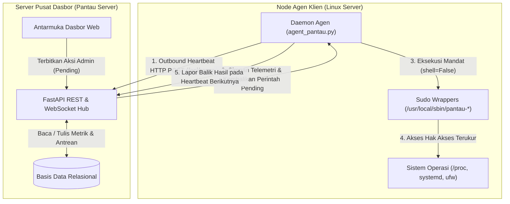
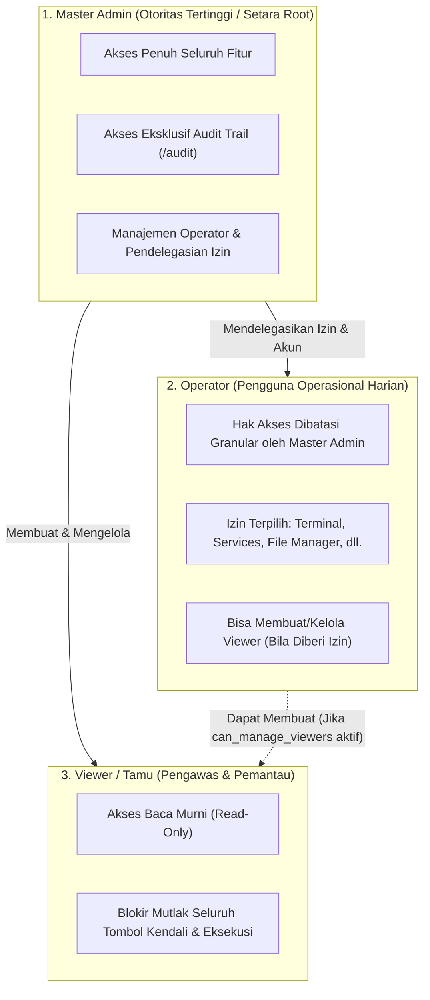

# Dokumentasi Pengembangan & Standar Arsitektur Pantau Server

Dokumen ini merupakan panduan teknis resmi bagi pengembang dan administrator sistem yang merangkum seluruh prinsip fundamental, standar arsitektur, filosofi keamanan, metodologi retensi data, serta praktik terbaik (*best practices*) dalam pengembangan ekosistem **Pantau Server** dan **Agen Pantau**.

---

# Bagian I: Prinsip Fundamental, Standar Desain & Praktik Terbaik (Best Practices)

## 1. Arsitektur Komunikasi Multi-Server (Pull-Based Inverted Heartbeat)

### Filosofi Desain: Outbound Pull vs Inbound Push
Dalam merancang sistem pemantauan dan pengendalian terdistribusi multi-server, keputusan arsitektur paling mendasar adalah arah inisiasi koneksi. Sistem lama (atau pemantauan ad-hoc berbasis SSH) umumnya mengandalkan server pusat yang membuka sesi SSH masuk (*inbound SSH*) ke tiap server klien. Pendekatan tersebut memiliki kelemahan kritis:
1. **Eksposur Port & Permukaan Serangan Luas**: Mengharuskan port SSH atau port agen terbuka ke internet/jaringan luar pada setiap mesin klien.
2. **Kerapuhan NAT & Topologi Jaringan**: Memerlukan VPN rumit, port forwarding, atau IP publik statis untuk server-server di balik NAT, firewall korporat, atau VPC cloud yang berbeda.
3. **Penyimpanan Kredensial Terpusat Berisiko Tinggi**: Server monitoring harus menyimpan kunci privat SSH atau kredensial root untuk seluruh server target. Jika server monitoring terkompromi, seluruh armada server klien jatuh ke tangan peretas.

**Prinsip Desain Pantau Server:**
Pantau Server mengadopsi model **Pull-Based Inverted Heartbeat** yang sepenuhnya terbalik (*inversion of control*):
- **Agen Menginisiasi Koneksi Keluar (*Outbound Only*)**: Agen klien secara periodik (setiap 5–10 detik) mengirim permintaan HTTP POST keluar (`/api/report`) ke server dasbor pusat.
- **Tanpa Port Masuk (*Zero Inbound Ports*)**: Agen klien tidak membuka port listening apa pun ke jaringan publik. Server klien dapat berada di balik NAT bertingkat atau firewall ketat selama memiliki akses keluar (*egress*) ke server dasbor.
- **Kredensial Terisolasi Per-Server**: Setiap agen hanya memiliki token API spesifik (`api_key`) yang di-hash dengan SHA-256 di basis data server (`sha256:<hash>`). Kunci agen tidak memiliki wewenang pada server lain.



### Siklus Hidup Perintah Asinkron (Asynchronous Command Lifecycle)
Karena koneksi bersifat outbound-pull, eksekusi perintah (seperti restart layanan, terminasi proses, modifikasi firewall, penambahan user, push OTA) ditangani melalui antrean perintah asinkron (*asynchronous command queue*):
1. **Penerbitan (*Issue*)**: Operator memicu tindakan dari antarmuka web. Server dasbor memvalidasi hak akses dan memasukkan perintah ke tabel [`commands`](file:///home/bos/rj45/server/models.py#L88-L111) dengan status `pending`.
2. **Pengambilan (*Polling/Heartbeat*)**: Saat agen melakukan siklus heartbeat berikutnya, server menyertakan perintah tertunda dalam payload respon JSON.
3. **Eksekusi Lokal**: Agen memproses perintah secara lokal, menjalankan biner yang bersangkutan melalui wrapper sudo terisolasi, dan menyimpan status serta hasil keluaran (*stdout/stderr*).
4. **Pelaporan Hasil (*Callback Report*)**: Pada heartbeat berikutnya, agen melaporkan balik hasil eksekusi (`success` atau `failed`) beserta keluaran log ke server untuk diperbarui di database dan disajikan di antarmuka web.

### Agen Mandiri Tanpa Dependensi Luar (Zero-Dependency Python Agent)
Agen klien ([`agent/agent_pantau.py`](file:///home/bos/rj45/agent/agent_pantau.py)) dibangun dengan prinsip **Zero External Dependencies**:
- Hanya menggunakan pustaka standar Python 3 (`urllib.request`, `subprocess`, `json`, `os`, `sys`, `platform`, `hashlib`, `shutil`, `socket`).
- Tidak menggunakan pustaka pihak ketiga seperti `psutil` yang memerlukan kompilasi C (`gcc`, `python3-dev`) dan rentan gagal saat dipasang pada instalasi Linux minimalis.
- Metrik sistem dibaca langsung dari pseudo-filesystem Linux (`/proc/stat`, `/proc/meminfo`, `/proc/loadavg`, `/proc/net/dev`, `/proc/diskstats`, `/sys/class/net/`) dan utilitas standar sistem Linux (`df`, `systemctl`, `journalctl`, `ss`, `ufw`).
- Hal ini menjamin agen dapat dipasang seketika di semua distro Linux modern (Ubuntu 18.04+, Debian 10+, CentOS 7+, RHEL, AlmaLinux, Rocky Linux) dalam hitungan detik.

---

## 2. Model Keamanan & Hak Akses Minimal (Principle of Least Privilege)

### Isolasi Akun Tanpa Hak Istimewa (Unprivileged Daemon)
- Agen Pantau tidak pernah dijalankan sebagai pengguna `root`.
- Agen beroperasi di bawah pengguna sistem terisolasi `pantau` (`User=pantau`, `Group=pantau`) yang dibuat otomatis oleh installer [`package/install.sh`](file:///home/bos/rj45/package/install.sh).
- Berkas konfigurasi agen (`/etc/pantau/config.json`) diamankan dengan izin `0600` milik `pantau:pantau`.

### Pencegahan Injeksi Shell Berbahaya (`shell=False` & Argument Vectors)
- Standar mutlak kode agen melarang penggunaan `subprocess.run(..., shell=True)` atau `os.system(...)`.
- Semua pemanggilan biner sistem diwajibkan menggunakan vektor argumen (`list` of strings):
  ```python
  # BENAR (Aman dari injeksi shell):
  subprocess.run(["/usr/local/sbin/pantau-user", "lock", username], shell=False, check=True)

  # DILARANG KERAS (Rentan Command Injection):
  # subprocess.run(f"/usr/local/sbin/pantau-user lock {username}", shell=True)
  ```
- Pendekatan ini meniadakan sepenuhnya celah eksekusi perintah liar melalui karakter metakarakter shell (seperti `;`, `&&`, `|`, `` ` ``, `$()`, `\n`).

### Granularitas Sudo Wrapper Khusus (`/usr/local/sbin/pantau-*`)
Untuk menjalankan tindakan administratif sistem tanpa memberikan hak sudo root penuh (`ALL=(ALL) ALL`), Agen Pantau menggunakan skrip pembungkus (*wrapper*) terisolasi di `/usr/local/sbin/`. Konfigurasi sudoers di [`/etc/sudoers.d/pantau-agent`](file:///home/bos/rj45/package/etc/sudoers.d/pantau-agent) hanya mengizinkan eksekusi tanpa kata sandi untuk berkas-berkas ini:
- [`pantau-service`](file:///home/bos/rj45/package/usr/local/sbin/pantau-restart): Mengontrol status layanan systemd (start, stop, restart, reload) dengan validasi whitelist unit.
- [`pantau-user`](file:///home/bos/rj45/package/usr/local/sbin/pantau-user): Manajemen akun pengguna Linux (pembuatan akun, penguncian akun via `usermod -L`, pembukaan kunci via `usermod -U`, penghapusan via `userdel`).
- [`pantau-cron`](file:///home/bos/rj45/package/usr/local/sbin/pantau-cron): Penambahan, pengaktifan/penonaktifan, penghapusan, dan eksekusi instan tugas crontab.
- [`pantau-firewall`](file:///home/bos/rj45/package/usr/local/sbin/pantau-firewall): Pengendalian firewall UFW (enable, disable, reload, block IP, unblock IP, rule audit).
- [`pantau-ssl`](file:///home/bos/rj45/package/usr/local/sbin/pantau-ssl): Pembacaan dan inspeksi sertifikat SSL/TLS lokal menggunakan OpenSSL CLI.
- [`pantau-apt`](file:///home/bos/rj45/package/usr/local/sbin/pantau-apt): Pembaruan cache repositori (`apt-get update`) dan peningkatan paket (`apt-get upgrade -y`).
- [`pantau-host`](file:///home/bos/rj45/package/usr/local/sbin/pantau-host): Perintah reboot OS dan shutdown terjadwal dengan penundaan aman agar laporan status berhasil terkirim sebelum mesin padam.
- [`pantau-file`](file:///home/bos/rj45/package/usr/local/sbin/pantau-file): Operasi berkas aman dengan batasan direktori.

### Proteksi Proses Kritis Sistem (Anti-Shooting-In-The-Foot Guardrails)
Sistem memiliki mekanisme perlindungan ganda (pada dashboard dan agen) yang secara mutlak menolak perintah terminasi (*kill*) atau modifikasi terhadap komponen kritis:
1. **PID 1 (`init` / `systemd`)**: Tidak dapat dihentikan atau diubah sinyalnya.
2. **Daemon SSH (`sshd`)**: Tidak dapat dimatikan melalui manajer tugas untuk mencegah operator terkunci dari server.
3. **Proses Agen Pantau (`agent_pantau`)**: Dilindungi dari penghentian paksa melalui antarmuka web guna menjaga kontinuitas pengawasan.
4. **Port Kunci (Port 22 SSH, 80/443 Web, 8400 Pantau)**: Sebelum aturan firewall UFW diaktifkan, sistem secara otomatis memastikan aturan izin (*allow*) untuk port-port ini sudah terpasang.

### Pengamanan File Manager Berbasis Web
- **Guardrails Jalur Sistem**: Akses langsung ke direktori sensitif kernel dan perangkat keras (`/proc`, `/sys`, `/dev`, `/boot`) dibatasi secara ketat.
- **Cadangan Berkas Otomatis Bertanda Waktu**: Setiap kali berkas teks disunting dan disimpan melalui antarmuka web, berkas asli secara otomatis dicadangkan ke berkas `.bak.<timestamp>` sebelum penimpaan dilakukan.

### Model Kontrol Akses Berbasis Peran 3-Tingkat (3-Tier RBAC Architecture)
Untuk mendukung tata kelola keamanan perusahaan (*enterprise governance*), Pantau Server menerapkan sistem otorisasi berbasis peran 3 tingkat dengan pemisahan tugas yang tegas (*segregation of duties*):



1. **Master Administrator (`master_admin`)**:
   - **Kedudukan**: Satu-satunya akun dengan hak istimewa mutlak setara *root* sistem.
   - **Hak Khusus**:
     - Satu-satunya peran yang memiliki visibilitas atas kartu statistik dan baris akun Master Admin di tabel pengguna.
     - Akses penuh catatan audit kepatuhan ([`/audit`](file:///home/bos/rj45/server/templates/audit.html)).
     - Hak membuat, mengedit izin granular/sudo, dan mengunci akun Operator serta Viewer.
     - Memiliki hak kontrol tak terbatas atas seluruh armada server, terminal, file manager, dan eksekusi instruksi.
   - **Proteksi Kekebalan & Kerahasiaan (*Immunity & Invisibility*)**: Akun Master Admin tidak dapat dihapus, diturunkan perannya (*demote*), atau dinonaktifkan melalui antarmuka web. Keberadaan akun Master Admin sepenuhnya disembunyikan dari antarmuka pengguna Operator dan Viewer.

2. **Operator (`operator`)**:
   - **Kedudukan**: Pengguna harian untuk tim operasional/SRE. Akun dibuat dan dikonfigurasi langsung oleh Master Admin atau Operator berwenang sudo.
   - **Konsep Otoritas Penuh Setara Sudo (*Sudo-like Operator Authority*)**:
     Seperti prinsip user biasa di Linux yang tergabung dalam grup `sudo` (*wheel*), Master Admin dapat memberikan wewenang penuh kepada Operator (termasuk akses audit trail dan manajemen pengguna) sehingga akun Master Admin tidak perlu digunakan setiap hari. Akun Operator yang diberi hak sudo penuh dapat mengelola operasional armada server dan akun pengguna lain secara mandiri.
   - **Prinsip Kerahasiaan Master Admin (*Zero-Knowledge of Master Admin*)**:
     Operator sama sekali tidak mengetahui keberadaan pengguna Master Admin:
     - Kartu statistik jumlah Master Admin disembunyikan dari Operator.
     - Baris akun Master Admin tidak muncul pada tabel pengguna yang diakses Operator.
     - Jika Operator mencoba memanipulasi ID Master Admin secara sengaja via API/POST (`/delete`, `/toggle-active`, `/edit`), sistem secara netral merespons `"Pengguna tidak ditemukan"` guna mencegah *account enumeration*.
     - Pada halaman Audit Trail, aktivitas Master Admin disamarkan sebagai `"Sistem"`.
   - **Matriks Izin Granular (*Granular Delegated Permissions*)**:
     Setiap Operator memiliki kemampuan eksekusi yang diatur melalui matriks izin granular atau preset **⚡ Hak Sudo Penuh**:
     - `can_terminal`: Akses terminal web PTY interaktif xterm.js.
     - `can_file_manager`: Penjelajahan, penyuntingan, dan pengelolaan berkas web.
     - `can_manage_servers`: Menambah, mengubah nama, memodifikasi ambang batas, atau menghapus server dari sistem.
     - `can_services`: Menjalankan start, stop, restart, dan reload layanan systemd.
     - `can_processes`: Menghentikan atau mematikan proses (*kill process*) di task manager.
     - `can_firewall`: Menambah aturan port, memblokir/membuka IP, dan me-reload firewall UFW.
     - `can_users_sys`: Membuat, mengunci, membuka kunci, atau menghapus akun sistem Linux host.
     - `can_cron`: Menambah, mengaktifkan, menonaktifkan, mengeksekusi instan, atau menghapus tugas cron.
     - `can_ssl`: Mengatur jalur sertifikat kustom SSL/TLS.
     - `can_server_control`: Mengeksekusi restart OS (*reboot*) atau mematikan daya mesin (*poweroff*).
     - `can_apt`: Memperbarui indeks repositori dan menjalankan upgrade paket APT sistem.
     - `can_ota`: Memublikasikan perintah pembaruan agen massal (*Over-The-Air update*).
     - `can_audit`: Akses membaca catatan audit kepatuhan dan log aktivitas keamanan sistem ([`/audit`](file:///home/bos/rj45/server/templates/audit.html)).
     - `can_manage_users`: Mengelola akun pengguna (Operator & Viewer), mereset kata sandi, mengubah username, serta mengatur izin wewenang akun lain.
     - `can_manage_viewers`: Wewenang terbatas untuk membuat, mengunci, atau menghapus akun Viewer (tamu pemantau).
   - **Batasan Mutlak & Proteksi Kekebalan**: Operator **tidak dapat** menghapus akun Master Admin, tidak dapat mengunci/menonaktifkan Master Admin, tidak dapat mengubah username/password Master Admin, serta tidak dapat mengangkat akun siapa pun menjadi `master_admin`.

3. **Viewer / Tamu (`viewer`)**:
   - **Kedudukan**: Akun pengawas pasif untuk pemangku kepentingan (*stakeholders*), manajemen, auditor luar, atau tim monitoring murni.
   - **Isolasi Mutlak (*Zero Administrative Authority & Information Isolation*)**:
     - Pengguna Viewer sama sekali tidak mengetahui keberadaan pengguna Operator maupun Master Admin.
     - Tidak memiliki menu **Profil & Keamanan** di antarmuka web, dan seluruh rute `/profile` memblokir akses Viewer secara permanen (dialihkan ke `/`).
     - Viewer tidak dapat mengubah kata sandi, profil, atau 2FA sendiri. Seluruh kredensial akun Viewer dikendalikan dari luar oleh Master Admin atau Operator.
     - Seluruh tombol kendali, eksekusi, terminal, file manager, dan formulir modifikasi disembunyikan dan diblokir secara mutlak pada level backend. Viewer murni hanya memiliki hak observasi metrik (*read-only*).

---

### Unifikasi Manajemen Pengguna ke Menu Profil & Keamanan
1. **Navigasi Bersih & Terpadu**:
   - Menu tersendiri "Pengguna" di bilah navigasi utama (*sidebar*) dihapus guna menjaga antarmuka tetap ringkas dan terfokus.
   - Seluruh fungsionalitas manajemen pengguna dan pendelegasian wewenang disatukan langsung ke dalam halaman **Profil & Keamanan** ([`/profile`](file:///home/bos/rj45/server/templates/profile.html)) melalui antarmuka tab responsif:
     - **Tab 1: Profil & Keamanan Saya**: Informasi identitas, ganti kata sandi pribadi, dan manajemen 2FA (TOTP) serta kode pemulihan darurat.
     - **Tab 2: Manajemen Pengguna & Hak Akses**: Tampil otomatis bagi Master Admin atau Operator dengan wewenang kelola pengguna (`can_manage_users` / `can_manage_viewers`).
2. **Antarmuka Tabel Pengguna Interaktif**:
   - **Tombol "👁️ Lihat"**: Membuka modal inspeksi detail profil akun dan visualisasi matriks wewenang (status per-izin: *✔ Diizinkan* vs *✖ Tidak Diizinkan*).
   - **Tombol "✏️ Edit"**: Membuka modal komprehensif untuk menyunting username akun, menyetel ulang (*reset*) kata sandi baru sesuai standar NIST, mengubah peran, serta mengatur checklist izin dengan tombol instan **⚡ Hak Sudo Penuh**.
   - **Tombol "🔒 Kunci / 🔓 Buka"**: Penguncian akun instan dengan pemutusan sesi seketika.
   - **Tombol "🗑️ Hapus"**: Penghapusan akun permanen dengan proteksi kekebalan Master Admin.

---

### Pengerasan Keamanan Akun & Autentikasi Modern (Authentication Hardening)

1. **Standar Kompleksitas Kata Sandi (NIST SP 800-63B)**:
   - Panjang minimum **12 karakter**.
   - Wajib mengandung kombinasi **huruf besar (A-Z)**, **huruf kecil (a-z)**, **angka (0-9)**, dan **simbol khusus (!@#$%^&*...)**.
   - Penolakan otomatis terhadap kata sandi umum, kamus tebakan, dan nama akun (*blacklist dictionary validation*).
   - Indikator kekuatan kata sandi visual secara real-time pada formulir web.

2. **Autentikasi Dua Langkah (2FA / TOTP RFC 6238)**:
   - Dukungan penuh aplikasi autentikator standar industri (**Google Authenticator**, **Aegis**, **Authy**, **1Password**, dsb.).
   - Pembangkitan kunci rahasia Base32 berkekuatan 160-bit secara kriptografis.
   - Integrasi penyajian Kode QR instan berbasis format standar `otpauth://totp/...`.
   - Algoritma verifikasi berbasis interval waktu 30 detik dengan toleransi pergeseran waktu (*drift window* ±1 interval) untuk mengantisipasi ketidaksinkronan jam perangkat pengguna.
   - **8 Kode Cadangan Darurat (Single-Use Recovery Codes)**:
     - Diberikan saat aktivasi 2FA pertama kali untuk situasi darurat ketika perangkat hilang/rusak.
     - Setiap kode berformat 8 karakter alfanumerik yang di-hash dengan **bcrypt** di basis data.
     - Kode cadangan bersifat sekali pakai (*single-use*) dan otomatis hangus seketika setelah berhasil digunakan untuk login.

3. **Alur Login Dua Tahap Terisolasi (Two-Stage Pre-Auth Flow)**:
   - Ketika pengguna dengan 2FA aktif memasukkan kredensial yang valid, sistem **tidak langsung memberikan cookie sesi aplikasi utama**.
   - Server menerbitkan token sementara bertanda tangan kriptografis HMAC (`preauth_session`) dengan batas waktu kedaluwarsa 5 menit.
   - Pengguna dialihkan ke halaman verifikasi [`/login/2fa`](file:///home/bos/rj45/server/templates/login_2fa.html). Sesi login dasbor penuh baru diterbitkan setelah token TOTP atau kode cadangan valid dimasukkan.

4. **Pencabutan Sesi Seketika & Proteksi Sesi Aktif**:
   - **Pencabutan Sesi Ganti Sandi**: Setiap kali pengguna mengubah kata sandinya di menu profil ([`/profile`](file:///home/bos/rj45/server/templates/profile.html)), seluruh sesi login yang sedang aktif di perangkat lain secara otomatis dicabut dari basis data untuk mencegah pembajakan sesi lampau.
   - **Penguncian Akun Instan**: Jika Master Admin menonaktifkan suatu akun melalui antarmuka pengguna ([`/users`](file:///home/bos/rj45/server/templates/users.html)), seluruh sesi yang terhubung dengan akun tersebut seketika dimatikan pada detik yang sama.

5. **Utilitas Pemulihan Darurat CLI (Emergency Seed & Recovery Tool)**:
   - Tersedia skrip administrasi server lokal ([`server/seed_admin.py`](file:///home/bos/rj45/server/seed_admin.py)) yang beroperasi langsung di tingkat baris perintah mesin server dasbor.
   - Mampu menyetel kredensial Master Admin, membuat peran khusus, mengganti username akun lama (`--rename-from`), hingga mereset status 2FA darurat (`--reset-2fa`) jika administrator terkunci dari ponselnya.

---

## 3. Pembaruan Agen Otomatis Jarak Jauh (Enterprise Over-The-Air / OTA Update)

Pembaruan armada agen pada puluhan atau ratusan server tidak boleh bergantung pada login manual per-server atau eksekusi skrip unduh mentah yang rentan kegagalan dan sabotase. Pantau Server menerapkan standar industri **Enterprise OTA Update**:

### Protokol Transmisi Kriptografis
1. **Penerbitan Hash Resmi**: Server dasbor mengetahui berkas biner agen resmi beserta hash kriptografi **SHA-256**-nya.
2. **Instruksi Terautentikasi**: Ketika pembaruan dipicu (melalui tombol `Push Update (OTA)`), dasbor mengirimkan payload terstruktur ke antrean perintah:
   ```json
   {
     "action": "update_agent",
     "url": "https://dashboard.domain.com/api/agent/download",
     "sha256": "386f3e7b2354c7d0d0840b3ff646e29783f609b185e493e9bbf04ae78f6920f0",
     "version": "4.0.0"
   }
   ```

### Verifikasi Integritas & Uji Pra-Pemasangan di Sisi Klien
Agen klien mematuhi prosedur verifikasi berlapis sebelum berkas biner aktif digantikan:
1. **Unduhan Temporer**: Berkas baru diunduh ke lokasi sementara (`/opt/pantau/agent/agent_pantau.py.tmp`).
2. **Verifikasi Hash SHA-256**: Agen menghitung checksum SHA-256 dari berkas temporer dan membandingkannya dengan hash yang dikirimkan dasbor:
   - Jika hash **COCOK**: Proses dilanjutkan.
   - Jika hash **TIDAK COCOK** (akibat transmisi terputus atau serangan *man-in-the-middle*): Berkas temporer langsung dimusnahkan seketika, pembaruan dibatalkan, dan insiden peringatan keamanan (*Security Alert*) dilaporkan ke audit trail.
3. **Validasi Sintaks Python (`py_compile`)**:
   - Agen menguji kelayakan kode baru menggunakan modul `py_compile.compile()` sebelum instalasi.
   - Jika berkas mengalami galat sintaks (*syntax error*), pembaruan dibatalkan agar layanan agen tidak mengalami crash fatal (*bricked agent*).
4. **Penggantian Berkas Atomik (`os.replace`) & Izin Akses**:
   - Berkas diganti secara atomik (`os.replace`) ke `/opt/pantau/agent/agent_pantau.py` dengan izin `0755` milik `pantau:pantau`. Penggantian atomik memastikan tidak ada celah di mana berkas berada dalam keadaan setengah tertulis (*half-written corruption*).
5. **Watchdog Restart & Pelaporan Otomatis**:
   - Agen menjadwalkan restart dirinya sendiri melalui systemd.
   - Pada siklus awal setelah restart, agen melapor dengan atribut `agent_version` baru. Dasbor mendeteksi versi baru, menghapus banner versi usang secara real-time, dan mencatat keberhasilan pembaruan pada riwayat dan audit trail.

---

## 4. Strategi Retensi Data & Siklus Hidup Metrik Bertingkat (Tiered Retention & Downsampling)

Aplikasi pemantauan server yang mengumpulkan metrik setiap 5–10 detik dari banyak node menghadapi risiko ledakan data (*database bloat*) yang dapat menurunkan performa kueri secara drastis. Pantau Server menerapkan **Strategi Retensi Bertingkat 4-Tier** dan **Dynamic Query Downsampling**:

### Arsitektur Retensi Data 4-Tier
| Tingkat (*Tier*) | Tabel Basis Data | Granularitas Data | Masa Retensi | Frekuensi Pembersihan (*Pruning*) | Tujuan & Peruntukan |
| :--- | :--- | :--- | :--- | :--- | :--- |
| **Tier 1 (Raw Snapshots)** | [`sys_snapshots`](file:///home/bos/rj45/server/models.py#L113-L138) | Penuh (setiap 5–10 detik) | **24 Jam** | Setiap siklus laporan agen (`cutoff = now - 24h`) | Diagnosis real-time, grafik granularitas tinggi 1h/6h/24h, dan investigasi spike mendadak. |
| **Tier 2 (Hourly Rollups)** | [`sys_snapshots_hourly`](file:///home/bos/rj45/server/models.py#L140-L170) | 1 sampel agregat per jam | **90 Hari** | Dihitung idempotent per jam; dipangkas jika `bucket < now - 90d` | Perencanaan kapasitas (*capacity planning*), grafik jangka panjang (7 hari & 30 hari) dengan hemat storage. |
| **Tier 3 (Service Metrics)** | [`metrics`](file:///home/bos/rj45/server/models.py#L70-L86) | Status per-laporan layanan | **7 Hari** | Dibatasi pembersihannya setiap 24 jam sekali (`now - 7d`) | Pelacakan uptime, status koneksi aktif, dan latensi respons layanan individual. |
| **Tier 4A (Audit Logs)** | [`audit_logs`](file:///home/bos/rj45/server/models.py#L262-L281) | Rekam jejak operator | **365 Hari (1 Tahun)** | Dijalankan per jam oleh daemon latar belakang | Kepatuhan audit regulasi dan investigasi forensik operasional. |
| **Tier 4B (Riwayat Perintah)** | [`commands`](file:///home/bos/rj45/server/models.py#L88-L111) | Perintah sukses / gagal | **180 Hari** | Dijalankan per jam oleh daemon latar belakang | Riwayat tindakan pemeliharaan sistem per server. |
| **Tier 4C (Insiden Selesai)** | [`server_problems`](file:///home/bos/rj45/server/models.py#L196-L227) | Tiket masalah resolved | **90 Hari** | Dijalankan per jam oleh daemon latar belakang | Riwayat penanganan masalah dan analisis MTTR (*Mean Time To Resolution*). |
| **Tier 4D (Sesi & Rate Limit)** | [`sessions`](file:///home/bos/rj45/server/models.py#L283-L299), [`login_attempts`](file:///home/bos/rj45/server/models.py#L301-L309) | Autentikasi & Brute-force | **12 Jam / 1 Hari** | Dibersihkan per jam secara berkala | Efisiensi keamanan login dan pembersihan token kedaluwarsa. |

### Downsampling Dinamis Sisi Kueri (Dynamic Query Downsampling)
Saat pengguna membuka grafik riwayat kinerja pada rentang waktu 24 jam, 7 hari, atau 30 hari, mengirimkan ratusan ribu baris data ke browser akan membuat peramban membeku (*lag/freeze*).
Fungsi kueri riwayat di [`server/main.py`](file:///home/bos/rj45/server/main.py#L5822-L5920) menerapkan **Downsampling Adaptif**:
- **Penyatuan Historis & Terkini**: Data rentang waktu lama ditarik dari rollup [`sys_snapshots_hourly`](file:///home/bos/rj45/server/models.py#L140-L170), sementara jam berjalan ditarik dari [`sys_snapshots`](file:///home/bos/rj45/server/models.py#L113-L138).
- **Sampling Interval SQL Adaptif**: Resolusi langkah dihitung matematis berdasarkan durasi rentang grafik:
  $$\text{step\_secs} = \max\left(\left\lfloor \frac{\text{span\_seconds}}{120} \right\rfloor, 30\right)$$
- SQL melakukan pengelompokan bucket waktu langsung di database engine:
  ```sql
  SELECT (FLOOR(UNIX_TIMESTAMP(timestamp) / :step_secs) * :step_secs) AS tb,
         AVG(cpu), MAX(cpu), AVG(mem_used), ...
  FROM sys_snapshots
  GROUP BY tb ORDER BY tb ASC;
  ```
- Hasil: Browser selalu menerima tepat sekitar **~120 titik data**, payload JSON sangat ramping (< 50 KB), dan grafik dirender instan dan halus di perangkat apa pun.

### Daemon Pembersihan Latar Belakang Non-Blocking ([`_retention_loop`](file:///home/bos/rj45/server/main.py#L7073-L7081))
- Pembersihan data usang (Tier 4) dijalankan oleh thread latar belakang terpisah ([`_retention_loop`](file:///home/bos/rj45/server/main.py#L7073-L7081)) setiap 1 jam sekali melalui fungsi [`_retention_prune`](file:///home/bos/rj45/server/main.py#L7049-L7071).
- Menggunakan parameter `synchronize_session=False` pada kueri penghapusan SQLAlchemy untuk memaksimalkan throughput penghapusan dan mencegah penguncian tabel (*table lock*) yang dapat mengganggu operasi agen.

---

## 5. Manajemen Siklus Hidup Insiden & Pencegahan Alarm Palsu (Incident Management & Anti-Flapping)

Sistem pemantauan yang baik harus dipercaya oleh tim operator. Alarm yang berbunyi terus-menerus tanpa alasan valid (*alert fatigue*) menyebabkan operator mengabaikan insiden kritis yang sebenarnya.

### Toleransi Anti-Flapping
- Layanan yang mengalami kegagalan respons transien satu kali tidak langsung memicu status bahaya darurat.
- Sistem menerapkan jendela tenang (*quiet window*) dan batas toleransi (30–45 detik) sebelum masalah diklasifikasikan sebagai insiden aktif (`danger`).

### Penyelarasan Status Sinkron pada Penghapusan Layanan
- Saat suatu layanan yang sedang bermasalah (*down*) dihapus dari daftar konfigurasi pemantauan oleh operator:
  1. Masalah terkait langsung ditutup secara sinkron dengan catatan resolusi khusus: `Dihapus dari konfigurasi`.
  2. Catatan audit trail mencatat penghapusan layanan dengan akurat.
  3. Sistem **tidak** mengklaim secara keliru bahwa layanan "telah normal kembali" atau "terselesaikan secara ajaib".

### Mode Pemeliharaan (Maintenance Mode) & Pembungkaman Fleksibel
- **Mode Pemeliharaan Global Server**: Operator dapat menjadwalkan mode pemeliharaan pada server tertentu saat pekerjaan perbaikan besar sedang dilakukan. Seluruh notifikasi darurat diredam selama mode ini aktif.
- **Pembungkaman Layanan Fleksibel (*Muting / Ignore Alert*)**: Peringatan untuk layanan individual dapat dibisukan sementara (2 jam, 24 jam, 7 hari, 30 hari) atau permanen, sehingga pengujian layanan non-kritis tidak mengotori dasbor utama.

---

## 6. Telemetri Real-Time, Streaming WebSocket & Terminal Interaktif

### Terminal Shell PTY Standar Industri
- Pantau Server mengintegrasikan akses terminal web langsung ke sesi Pseudo-Terminal (PTY) Linux `/bin/bash`.
- Menggunakan modul standar Python `pty` dan `os.openpty()` yang dihubungkan melalui dispatcher streaming WebSocket.
- Menyediakan emulasi terminal VT100/ANSI lengkap, mendukung warna teks, navigasi kursor, auto-completion tombol `Tab`, serta penyesuaian ukuran jendela (`SIGWINCH / resize`) secara interaktif melalui pustaka `xterm.js`.

### Pemisahan Kanal Komunikasi
- Lalu lintas data streaming terminal dan streaming journal log dialirkan melalui jalur koneksi WebSocket khusus.
- Pemisahan ini mencegah interferensi atau peningkatan latensi pada jalur HTTP REST API yang bertugas menerima laporan telemetri kesehatan server.

---

## 7. Transparansi & Kepatuhan Audit Trail (Accountability & Audit Compliance)

### Prinsip Keterlacakan Penuh (End-to-End Traceability)
Setiap tindakan operasional yang dapat mengubah status atau konfigurasi sistem wajib memiliki rekam jejak yang tidak dapat diubah:
- **Siapa (*Actor*)**: Username operator yang mengeksekusi tindakan.
- **Kapan (*Timestamp*)**: Waktu presisi UTC saat tindakan diajukan dan diselesaikan.
- **Di mana (*Target*)**: Server target, unit layanan, nama user, port, atau berkas yang dipengaruhi.
- **Apa (*Action*)**: Jenis aksi spesifik (`restart_service`, `kill_process`, `block_ip`, `update_agent_ota`, `edit_cron`, `save_file`, dll.).
- **Hasil (*Outcome*)**: Status keberhasilan (`success` / `failed`) dan ringkasan keluaran atau alasan kegagalan.

### Normalisasi Target Audit & Penyensoran Data Sensitif
- Setiap aksi audit dinormalisasi format teks targetnya agar mudah difilter dan dicari.
- Parameter perintah yang mengandung informasi rahasia (seperti kata sandi pengguna atau token privat) disensor secara otomatis sebelum dicatat ke tabel [`audit_logs`](file:///home/bos/rj45/server/models.py#L262-L281).

### Fitur Audit Pengguna & Investigasi Forensik (User Activity Auditing)
Untuk keperluan pengawasan kepatuhan dan akuntabilitas tim operasional:
- **Penyaringan Berdasarkan Pengguna (*User-Centric Auditing*)**:
  Halaman Audit Trail ([`/audit`](file:///home/bos/rj45/server/templates/audit.html)) kini dilengkapi pemilih dropdown pengguna mandiri (`?user=username`), tautan nama pengguna interaktif di setiap baris tabel audit, serta kotak pencarian teks bebas (`?q=`).
- **Pintasan Audit dari Manajemen Pengguna**:
  Pada tab Manajemen Pengguna ([`/profile?tab=users`](file:///home/bos/rj45/server/templates/profile.html)), tersedia tombol aksi cepat **`📋 Audit`** di samping tombol `Lihat` dan `Edit`, serta tombol **`📋 Lihat Riwayat Jejak Audit`** di dalam modal detail wewenang. Master Admin atau Operator dengan wewenang `can_audit` dapat mengklik tombol ini untuk mengisolasi dan meninjau seluruh riwayat tindakan yang pernah dijalankan oleh operator bersangkutan seketika.
- **Rincian Data Audit Terpadu**:
  Setiap catatan audit mencakup waktu presisi UTC, pelaksana (aktor), server target, jenis tindakan, entitas sasaran, status hasil eksekusi (`Berhasil`/`Gagal`), serta rekaman detail respons keluaran perintah remote.

---

## 8. Konsistensi Pengalaman Pengguna (UX) & Standar Bahasa Baku

### Standardisasi Bahasa Indonesia Baku (Anti Gado-Gado)
- **Eliminasi Total Alih Bahasa Dinamis**: Seluruh sistem alih bahasa runtime (regex DOM walker, kamus terjemahan parsial) telah dihapus dari kode. Penggunaan injeksi kamus regex terbukti merusak struktur visual dan menghasilkan teks gado-gado yang membingungkan operator.
- **Bahasa Indonesia Formal & Lugas**: 100% antarmuka dasbor, tabel metrik, tombol aksi, modal konfirmasi, pesan toast, dan teks dokumentasi menggunakan Bahasa Indonesia baku yang profesional dan konsisten, terkecuali nama merek aplikasi **Pantau Server** dan istilah teknis standar yang telah lazim (seperti *CPU*, *RAM*, *I/O*, *PID*, *UFW*, *SSL*).

### Hierarki Informasi Alur Kerja Sysadmin
Tata letak dan urutan tab antarmuka dirancang mengikuti alur investigasi insiden seorang administrator sistem:
$$\text{Kinerja Ringkas} \longrightarrow \text{Riwayat \& Masalah} \longrightarrow \text{Layanan \& Proses} \longrightarrow \text{Konfigurasi Sistem (User, Port, Firewall, SSL, Cron)} \longrightarrow \text{Logging \& Diagnostik}$$

### Indikator Visual Tegas & Presisi
- **Hijau (`success`)**: Sistem/layanan beroperasi optimal tanpa masalah.
- **Kuning (`warning`)**: Peringatan awal, utilisasi mendekati batas, atau masa berlaku SSL mendekati habis.
- **Merah (`danger`)**: Insiden kritis, layanan down, atau serangan keamanan terdeteksi.
- **Biru Neon (`#38bdf8`)**: Aksen fokus navigasi dan elemen interaktif aktif.
- Peniadaan animasi berkedip liar yang tidak esensial untuk menjaga ketenangan visual dan konsentrasi kerja operator.

---

# Bagian II: Catatan Riwayat Perubahan Versi (Changelog)


## Versi 4.0.0

- **Label Rilis (Release Label):** None
- **Tipe Rilis:** Rilis Mayor (*Major Release*)

### Ringkasan Rilis
Pembaruan versi 4.0.0 menandai transformasi fundamental pada arsitektur keamanan, tata kelola akses pengguna, dan mesin pemantauan Pantau Server:

1. **Arsitektur Keamanan RBAC 3-Tier & Model Otoritas Terdelegasi (*Enterprise Sudo Privilege*)**:
   - Memperkenalkan pemisahan peran yang tegas antara **Master Admin**, **Operator** (dengan wewenang terdelegasi), dan **Viewer**.
   - Model wewenang *sudo-like*: Master Admin dapat mendelegasikan wewenang khusus kepada Operator (seperti manajemen server, kontrol layanan, akses terminal interaktif, file manager, dan administrasi pengguna) tanpa harus membagikan kredensial Master Admin.
   - Proteksi Mutlak Master Admin: Operator dengan izin penuh sekalipun tidak dapat menghapus atau menurunkan hak akses akun Master Admin.
   - **Prinsip Isolasi Hierarki**:
     - Pengguna Operator dan Viewer diisolasi total dari informasi akun Master Admin (kartu ringkasan jumlah Master Admin disembunyikan sepenuhnya).
     - Pengguna Viewer diisolasi total dari keberadaan Operator dan tidak memiliki akses ke menu Profil & Keamanan. Kredensial Viewer dikelola sepenuhnya oleh Master Admin atau Operator berwenang.
   - Tombol inspeksi wewenang interaktif (**"Lihat"**) untuk meninjau detail izin pengguna, serta formulir penyuntingan (**"Edit"**) untuk mengatur hak akses, nama pengguna, dan kata sandi.

2. **Autentikasi Dua Faktor (2FA) TOTP RFC 6238 & Pemulihan Darurat**:
   - Dukungan autentikasi berbasis waktu (*Time-based One-Time Password*) yang kompatibel dengan aplikasi authenticator standar (Google Authenticator, Microsoft Authenticator, Aegis, 1Password, Bitwarden).
   - Alur Login Dua Tahap Terisolasi (*Two-Stage Pre-Auth Flow*) menggunakan token HMAC sementara (`preauth_session`) dengan masa berlaku 5 menit sebelum penerbitan sesi penuh.
   - Penyediaan 10 kode cadangan pemulihan sekali pakai (*one-time recovery codes*) yang di-hash dengan SHA-256.
   - Fitur pembuatan ulang kode cadangan pemulihan (*Regenerate Backup Codes*) interaktif dengan modal konfirmasi kata sandi, tombol salin instan, dan opsi unduh berkas teks yang selaras dengan tema sistem.
   - Utilitas administrasi CLI darurat (`seed_admin.py --reset-2fa`) untuk memulihkan akses administrator jika perangkat authenticator hilang.

3. **Penyatuan Menu Pengguna ke "Profil & Keamanan"**:
   - Eliminasi menu terpisah "Users" pada navigasi utama dan konsolidasi penuh seluruh manajemen pengguna ke dalam halaman **Profil & Keamanan** (`/profile`).
   - Tampilan dinamis berbasis hak akses: Master Admin dan Operator berwenang dapat mengelola akun pengguna langsung dari halaman profil.
   - Penambahan halaman **Audit Aktivitas Pengguna** (`/users/{id}/activity`) untuk melacak rekam jejak setiap tindakan administratif pengguna secara terperinci.

4. **Manajemen Sistem Interaktif Klien (Host Management)**:
   - **Manajemen Akun Pengguna Sistem (System Users)**: Pembuatan akun Linux baru, penguncian akun (*lock*), pembukaan kunci (*unlock*), penghapusan akun, dan proteksi akun sistem/root.
   - **Manajemen Tugas Terjadwal (Cron Jobs)**: Penambahan tugas cron baru, aktivasi/deaktivasi (*toggle*), penghapusan, dan eksekusi instan (*Run Now*).
   - **Manajemen Port Terbuka (Listening Ports)**: Terminasi proses pendudukan port (*Kill Process*) dan pemblokiran port instan via UFW (*Block Port*).
   - **Manajemen Sertifikat SSL**: Penambahan dan penghapusan jalur pantauan sertifikat SSL kustom.
   - Peningkatan wrapper sudo agen (`pantau-user`, `pantau-cron`, `pantau-ssl`, `pantau-firewall`) untuk eksekusi perintah aman berprinsip *least privilege*.

5. **Responsivitas Antarmuka Layanan & Perbaikan Siklus Hidup (Minor & Patch)**:
   - **Optimistic UI Service Control**: Tombol tindakan layanan (Start, Stop, Restart) pada tab Layanan memberikan umpan balik visual instan tanpa menunggu siklus polling.
   - **Fast Polling Cascade**: Percepatan polling status ke interval 1 detik secara berjenjang setelah tindakan pengguna, memastikan status visual di dasbor segera mencerminkan status riil unit systemd.
   - **Auto-Unignore Service Recovery**: Pendeteksian cerdas saat layanan yang sebelumnya diabaikan (*ignored*) pulih menjadi aktif (misalnya dijalankan manual via SSH di terminal), otomatis mencabut status pengabaian dan mencatat riwayat tindakan keberhasilan pemulihan.
   - **Standardisasi Status Riwayat Tindakan**: Penyeragaman status riwayat tindakan menjadi nilai biner tegas (**Berhasil** / **Gagal**) dengan rincian kolom hasil/keterangan yang jelas dan deskriptif.
   - Penyelarasan tema visual tombol aksi, modal konfirmasi, dan tombol unduh/salin kode cadangan.

---

## Versi 3.23.0

### Fitur Baru & Peningkatan
- **Pembaruan Agen Otomatis Jarak Jauh (Enterprise Over-The-Air / OTA Update):**
  - Penambahan tombol aksi **`⚡ Push Update (OTA)`** pada banner deteksi versi agen usang di halaman Rincian Server.
  - **Protokol Transmisi Kriptografis Aman**: Dashboard mengirimkan URL unduhan kode agen terbaru, target versi, dan hash kriptografi **SHA-256** ke agen klien.
  - **Verifikasi Integritas SHA-256 Ketat**: Agen mengunduh berkas dan memverifikasi checksum SHA-256; jika hash tidak cocok dengan instruksi dashboard (akibat transmisi terkorupsi atau interferensi tak sah), proses langsung dibatalkan seketika dengan peringatan keamanan (*Security Alert*).
  - **Validasi Sintaks Python Pra-Pemasangan**: Pengujian sintaks melalui `py_compile` untuk memastikan berkas baru bebas dari galat sebelum diterapkan.
  - **Penggantian Berkas Atomik & Restart Otomatis**: Berkas `/opt/pantau/agent/agent_pantau.py` diganti secara atomik dengan hak akses `0755`, dilanjutkan penjadwalan restart otomatis via systemd watchdog tanpa memutus data historis.
- **Pencatatan Jejak Audit Trail & Riwayat Komprehensif:**
  - Seluruh aktivitas pembaruan agen tercatat secara transparan baik pada **Audit Trail** global maupun tabel **Riwayat Tindakan** per server dengan label `Pembaruan Agen (OTA)`, target versi dan potongan hash (`OTA v3.23.0 (SHA: 386f3e7b…)`), serta status dan respon keluaran agen.
- **Siklus Hidup Visual Real-time (Auto-Polling & Banner State):**
  - Tombol `⚡ Push Update (OTA)` dilengkapi transisi animasi status pemuatan (*Mengirim Push OTA…*) dan toast konfirmasi.
  - Mekanisme *auto-polling* di latar belakang otomatis mendeteksi laporan pertama agen versi baru dan menghilangkan banner peringatan versi usang seketika setelah agen pulih.
- **Penyelarasan Siklus Hidup Insiden pada Penghapusan Layanan:**
  - Saat layanan yang bermasalah dihapus dari konfigurasi pemantauan, status insiden terkait langsung dibersihkan dan riwayat tindakan mencatat penghapusan layanan dengan benar (tidak mengklaim masalah terselesaikan secara keliru).
- **Paginasi Komprehensif pada Tab Riwayat & Masalah:**
  - Penambahan kontrol batas tampilan ganda (di bagian atas dan bawah tabel) untuk tabel **Status Masalah** dengan opsi 5 masalah (bawaan), 10 masalah, 25 masalah, 50 masalah, dan Semua masalah.
  - Penambahan kontrol batas tampilan ganda untuk tabel **Riwayat Tindakan** dengan opsi 10 tindakan (bawaan), 25 tindakan, 50 tindakan, 100 tindakan, dan Semua tindakan.
  - Navigasi halaman terpadu yang dilengkapi tombol *Sebelumnya*, nomor *Halaman*, tombol *Berikutnya*, serta informasi jumlah data yang ditampilkan.
- **Pembersihan Efek Visual Tab Aktif:**
  - Penghapusan animasi titik berkedip pada tab yang sedang aktif untuk menyajikan tampilan yang lebih bersih, tenang, dan profesional.
- **Modernisasi Sub-Tombol Logging:**
  - Penyelarasan tampilan tombol sub-panel *Log Layanan* dan *Log Sistem (Journal)* dengan tema biru neon modern.
- **Pembersihan Total Fitur Alih Bahasa & Standardisasi Bahasa Indonesia Baku:**
  - Penghapusan seluruh mesin alih bahasa dinamis regex, kamus DOM, dan pengamat mutasi (*MutationObserver*) untuk mengeliminasi ambiguitas dan teks campuran (*gado-gado*).
  - Standardisasi seluruh teks antarmuka, judul tabel, kartu metrik, dan notifikasi dalam Bahasa Indonesia baku yang lugas, konsisten, dan nyaman dibaca.

---

## Versi 3.22.0

### Peningkatan Antarmuka & UX
- **Restrukturisasi Urutan Tab Sysadmin:**
  - Tab *Riwayat & Masalah* ditempatkan tepat setelah tab *Kinerja* agar operator dapat langsung meninjau insiden penting setelah memeriksa performa server.
  - Susunan tab: *Kinerja* | *Riwayat & Masalah* | *Layanan* | *Manajer Tugas* | *Akun Pengguna* | *Port Listening* | *Firewall* | *Sertifikat SSL* | *Tugas Terjadwal* | *Logging*.
- **Pengurutan Kolom Interaktif pada Manajer Tugas:**
  - Pengurutan langsung dilakukan dengan mengeklik header kolom tabel (*PID*, *User*, *Nama Perintah / Proses*, *Status*, *%CPU*, *%Memori*) dengan indikator panah naik (▲) dan turun (▼).
- **Paginasi Ganda Manajer Tugas:**
  - Penyediaan menu pilihan batas baris di bagian atas dan bawah tabel proses secara tersinkronisasi.
- **Akurasi Indikator Peringatan Tab Logging:**
  - Titik merah berkedip pada tab *Logging* hanya diaktifkan jika terdapat catatan galat sistem berkategori kritis (*priority* $\le$ 3) dalam rentang 2 jam terakhir untuk menghindari alarm palsu dari log lama.

---

## Versi 3.21.0

### Fitur Baru
- **Penyatuan Logging Sistem & Layanan:**
  - Penggabungan log unit systemd dan log journald ke dalam satu tab terpadu dengan navigasi tombol alih cepat.
- **Standardisasi Tema Visual Biru Neon:**
  - Penyeragaman warna aksen seluruh tab aktif menggunakan palet biru neon (`#38bdf8`) dengan efek pendar halus.
- **Indikator Titik Peringatan Berkedip pada Tab:**
  - Penambahan penanda visual pada tab yang mendeteksi anomali (beban tinggi pada tab Kinerja, layanan down pada tab Layanan, insiden terbuka pada tab Riwayat & Masalah, firewall nonaktif pada tab Firewall, dan sertifikat kedaluwarsa pada tab SSL).

---

## Versi 3.20.1

### Perbaikan Sistem
- **Perbaikan Sintaks Templat services.html:**
  - Menutup blok kondisional `` yang terpotong pada pengorganisasian kartu layanan untuk mengatasi galat *Internal Server Error (500)* pada halaman rincian server.

---

## Versi 3.20.0

### Fitur Baru
- **Manajer Tugas Interaktif (Task Manager ala btop):**
  - Perubahan nama tab *Proses Teratas* menjadi *Manajer Tugas*.
  - Tampilan awal 10 proses dengan opsi paginasi modern (10, 25, 50, 100, atau Semua proses).
  - Indikator status siklus hidup proses Linux (*Running*, *Sleeping*, *Stopped*, *Zombie*).
  - Kontrol sinyal proses langsung dari web: penangguhan proses sementara (*SIGSTOP* / Pause), pelanjutan proses (*SIGCONT* / Resume), dan penghentian proses (*SIGTERM* / *SIGKILL*).
- **Penyatuan Tab Riwayat Tindakan & Masalah:**
  - Memindahkan audit rekam jejak tindakan dari tab Layanan ke tab Masalah sehingga tab Layanan lebih bersih dan fokus.

---

## Versi 3.19.0

### Fitur Baru
- **Manajemen Penghentian Proses Interaktif (Kill Manager):**
  - Tombol tindakan penghentian pada tabel proses teratas pemakan CPU dan Memori.
  - Dialog pemilihan sinyal antara penghentian normal (*SIGTERM*) dan pemaksaan (*SIGKILL*).
  - Proteksi pengaman sistem untuk mencegah penghentian proses kritis (*PID 1*, *sshd*, dan *agent_pantau*).

---

## Versi 3.18.0

### Fitur Baru
- **Kontrol Visual Firewall:**
  - Penambahan tombol visual untuk mengaktifkan, menonaktifkan, dan memuat ulang aturan firewall UFW.
  - Fitur penguncian otomatis port krusial (SSH 22, Web 80/443, Dashboard 8400) sebelum aktivasi firewall guna mencegah terputusnya akses server.
  - Penambahan formulir pemblokiran alamat IP sumber secara manual dan tombol buka blokir langsung per baris tabel.

---

## Versi 3.17.0

### Fitur Baru & Pemantauan Mendalam
- **Pemantauan Utilisasi & Throughput Disk I/O:**
  - Pembacaan metrik laju baca/tulis (*KB/s*), frekuensi operasi (*IOPS*), dan persentase utilisasi disk (*% I/O util*) tanpa ketergantungan modul eksternal.
- **Audit Log Galat Sistem Kritis:**
  - Penyajian kejadian galat kritis sistem (*emerg*, *alert*, *crit*, *err*) dari systemd journald.
- **Audit Port Listening:**
  - Pemeriksaan socket aktif, proses pemilik, PID, dan klasifikasi akses (Publik vs Lokal).
- **Pelacakan Masa Berlaku Sertifikat SSL/TLS:**
  - Pemeriksaan berkas sertifikat lokal, domain SAN, penerbit (CA), dan peringatan dini sebelum masa aktif berakhir.
- **Pengawasan Tugas Terjadwal (Cron & Systemd Timers):**
  - Pemantauan berkala terhadap jadwal crontab sistem dan timer aktif.
- **Penyegaran Tampilan Antarmuka 2026:**
  - Pembaruan tema gelap modern dengan grafik riwayat kinerja berbasis gradien bercahaya.

---

## Versi 3.16.0

### Fitur Baru
- **Dukungan Socket Activation Layanan (SSH):**
  - Penanganan unit socket pendamping (`ssh.socket`) saat layanan dihentikan atau dijalankan ulang sehingga port socket benar-benar tertutup saat layanan nonaktif.
- **Pengabaian Peringatan Layanan Fleksibel:**
  - Fitur pembungkaman alarm untuk layanan tertentu secara permanen maupun berdasarkan batas waktu (2 jam, 24 jam, 7 hari, 30 hari).
- **Transparansi Status Layanan pada Dasbor:**
  - Penambahan rincian jumlah layanan berjalan, terhenti, dan dibisukan pada tabel dasbor utama.

---

## Versi 3.15.0

### Fitur Baru & Kesiapan Produksi
- **Snapshot 20 Proses Teratas:**
  - Pengumpulan data proses lokal pemakai CPU dan RAM tertinggi pada agen klien dan penyajian ringkas di antarmuka.
- **Mode Pemeliharaan (Maintenance Mode):**
  - Meredam kemunculan alarm tiket masalah saat server sedang dalam perbaikan terencana.
- **Normalisasi Unit Systemd & Cgroup:**
  - Pemetaan nama unit asli melalui pembacaan cgroup untuk akurasi pelacakan layanan.
- **Konfigurasi Produksi:**
  - Penyediaan templat reverse proxy Nginx dengan dukungan WebSocket SSL dan rotasi log Uvicorn.
  - Pembersihan otomatis tiket masalah lampau yang telah selesai.

---

## Versi 3.14.0

### Fitur Baru
- **Terminal Web Berbasis WebSocket & xterm.js:**
  - Migrasi antarmuka terminal ke pustaka standar xterm.js dengan latensi rendah.
  - Streaming data dua arah menggunakan WebSocket dispatcher.
  - Penyesuaian ukuran jendela terminal secara dinamis (*resize*).

---

## Versi 3.13.0

### Fitur Baru
- **File Manager Berbasis Web:**
  - Penjelajahan direktori, penyuntingan berkas teks, pengunggahan, dan pengunduhan berkas.
  - Batasan pengaman sistem (*guardrail*) pada direktori inti sistem dan pembuatan cadangan otomatis bertanda waktu saat berkas diedit.

---

## Versi 3.11.0 – 3.12.0

### Fitur Baru
- **Integrasi Terminal Shell PTY Asli:**
  - Penggunaan modul PTY Python standar untuk membuka shell `/bin/bash` dengan emulasi kontrol karakter VT100.

---

## Versi 3.7.0 – 3.10.0

### Fitur Baru & Pengerasan Keamanan
- **Pembaruan OS Jarak Jauh:**
  - Eksekusi pembaruan dan upgrade paket (*apt*) dari web dashboard.
  - Pengerasan hak akses sudo agen klien (*least privilege*) dan proteksi token CSRF.

---

## Versi 3.6.0

### Fitur Baru
- **Kendali Host (Reboot OS & Power Off):**
  - Penambahan perintah restart dan matikan mesin dengan eksekusi tertunda agar laporan konfirmasi berhasil terkirim sebelum sistem padam.

---

## Versi 1.0.0 – 3.5.0

### Fondasi Awal
- Pembangunan dasbor monitoring berbasis FastAPI dan basis data relasional.
- Pengembangan agen klien Python standar untuk pengumpulan metrik CPU, Memori, Swap, Disk, dan Jaringan.
