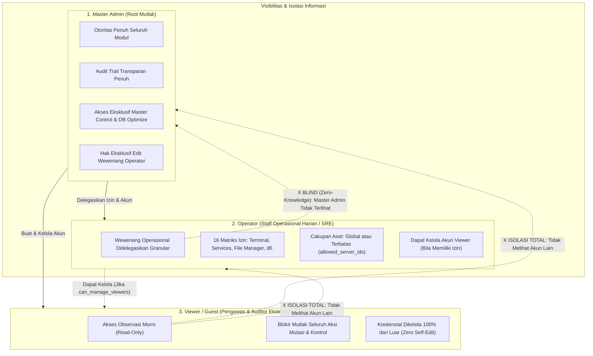
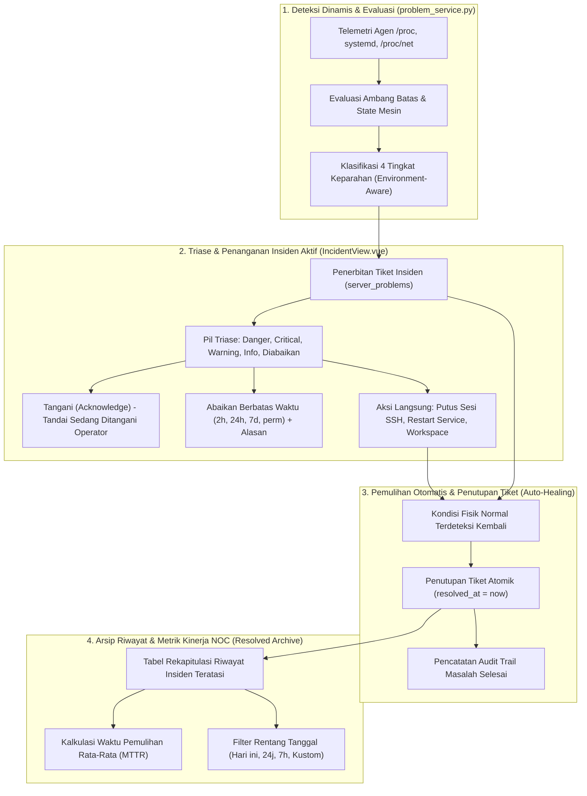

# Panduan Arsitektur, Filosofi & Arah Pembangunan: Pantau Server

Berkas ini adalah **Manifes Rekayasa, Rujukan Arsitektur Utama, dan Peta Jalan Pembangunan Permanen** untuk proyek pembangunan ulang **Pantau Server** (`/home/bos/pantau-server`). Dokumen ini mencatat secara menyeluruh definisi, filosofi, fungsi, konsep dasar, dan arah evolusi sistem agar selalu menjadi kompas bagi seluruh pengembang dan arsitek perangkat lunak yang berkontribusi pada proyek ini.

> [!NOTE]
> Berkas ini berbeda fungsi dengan `README.md` (yang ditujukan bagi pengguna akhir/sysadmin) dan berkas aturan agen (`GEMINI.md` / `AGENTS.md` yang berfungsi sebagai tata kelola kendali asisten AI). Berkas ini adalah **buku putih arsitektur perangkat lunak (*software architecture whitepaper*)**.

---

## 1. Definisi, Identitas & Hakikat Sistem (System Essence)

### 1.1 Definisi
**Pantau Server** adalah platform pusat kendali operasional NOC (*Network Operations Center Control Plane*) generasi baru yang bertugas mengawal ketersediaan, performa, dan keamanan armada server Linux multi-node mandiri secara *real-time* dengan akurasi fisik tingkat kernel (*kernel-grade precision*).

### 1.2 Filosofi Dasar Rekayasa
1. **Pengendalian di Atas Sekadar Pengamatan (*Control Over Mere Monitoring*):** Pantau Server bukan sekadar penampil grafik metrik statis, melainkan stasiun kerja taktis tempat operator dapat melakukan investigasi mendalam dan mengambil tindakan mitigasi instan (menghentikan proses anomali, me-restart unit layanan bermasalah, memutus sesi penyusupan SSH) langsung dari antarmuka sentral.
2. **Kemandirian Tanpa Vendor Lock-In (*Self-Hosted Independence*):** Menolak ketergantungan pada layanan cloud berbayar atau SaaS pihak ketiga. Seluruh telemetri, basis data, dan kendali berada 100% di bawah kedaulatan infrastruktur pengguna sendiri.
3. **Kejujuran Data Mutlak (*Absolute Data Integrity — Zero-Fake Data*):** Sistem hanya menampilkan dan menyimpan fakta fisik yang diukur langsung dari kernel Linux (`/proc`, `/sys`, socket, systemd). Tidak ada tebak-tebakan, manipulasi visual semu, atau data buatan yang menyesatkan operator.
4. **Kesederhanaan Murni & Anti-Monolit (*Simplicity First & Anti-Monolith*):** Setiap modul perangkat lunak memiliki satu tanggung jawab yang jelas (*Single Responsibility Principle*). Mengharamkan penumpukan belasan ribu baris kode campuran HTML/JS/CSS ke dalam satu berkas raksasa.

### 1.3 Standar Perancangan & Batasan Arsitektur
- **Kematangan Workflow & UX Baku:** Konsep dasar, hierarki fitur, alur kerja operasional (*workflow*), dan pengalaman pengguna (*UX*) Pantau Server berakar pada standar operasional NOC mandiri yang dirancang matang, presisi, dan tangguh untuk pengawasan infrastruktur multi-node.
- **Standar Arsitektur Modular:** Memisahkan secara mutlak antara antarmuka visual (Vue 3 SPA, komponen terisolasi `<250` baris, Tailwind CSS v4, xterm.js) dan backend kontrol (FastAPI, SQLAlchemy, MariaDB/MySQL `pantau_db`).
- **Kompas Rekayasa Mutlak:** Seluruh rancangan modul dan alur interaksi operator wajib mengedepankan kepadatan data (*NOC Data Density*), kecepatan respons, stabilitas jangka panjang 24/7/365, dan kejujuran data fisik tanpa memperkenalkan abstraksi spekulatif atau alur kerja buatan yang tidak perlu.

---

## 2. Prinsip Arsitektur: Fondasi Clean Architecture & Pemisahan Tanggung Jawab

Pantau Server dirancang dari nol (*from first principles*) dengan standar rekayasa perangkat lunak kelas industri untuk menyelesaikan tantangan operasional NOC modern:
* **Anti-Monolitik Spaghetti:** Memisahkan secara tegas antara antarmuka visual (Vue 3 SPA komponen kecil <250 baris), pengontrol API (FastAPI Routers tipis), logika evaluasi telemetri (Domain Services murni), dan persistensi data (SQLAlchemy Repositories). Mengharamkan penumpukan kode campuran HTML, CSS, dan skrip ke dalam berkas monolitik raksasa.
* **Ergonomi Tanpa Disrupsi (*Zero-Disruption Navigation*):** Menolak keras pola navigasi halaman penuh (*full page reload*) saat memeriksa rincian host. Navigasi halaman penuh memutus sesi Web Terminal aktif, menghilangkan posisi scroll armada, dan membuang waktu investigasi operator.
* **Integritas Skema & Normalisasi Data:** Basis data menggunakan skema relasional InnoDB yang ternormalisasi secara ketat. Dilarang menyimpan telemetri penting ke dalam kolom JSON mentah tak berstruktur yang rentan korupsi dan tidak dapat diindeks.

---

## 3. Paradigma Inti Antarmuka & Interaksi NOC (Core Interaction Paradigm)

Sistem antarmuka Pantau Server mengadopsi standar kontrol taktis mutakhir:

### A. Jendela Kerja Mengambang (*Floating Workspace Modal*)
* **Inspeksi Mikro Tanpa Kehilangan Konteks Makro:** Jendela taktis interaktif berdimensi luas (`85vw x 85vh`) yang terbuka mengambang di atas dasbor armada tanpa berpindah halaman atau memutus koneksi terminal.
* **Host Switcher Terintegrasi:** Berpindah antar server secara langsung dari bilah atas modal menggunakan pintasan keyboard `[` dan `]` atau pencarian cepat, menghemat waktu triase insiden.
* **Workspace Shelf (Bilah Rak Bawah):** Kemampuan meminimalkan jendela kerja ke rak bawah layar saat memantau dasbor dan membukanya kembali seketika tanpa kehilangan status tab aktif atau posisi scroll.
* **Zero-Flicker Reactive Rendering:** Pembaruan data terjadi di memori Virtual DOM tanpa kedipan visual yang mengganggu mata saat telemetri masuk setiap 3–5 detik.

### B. Dasbor Triase Murni Pasif
* **Observasi Situasional 24/7/365:** Dasbor dikhususkan sebagai layar pemantauan makro, menampilkan banner KPI 3-kartu asimetris (Total Servers, Active Incidents 5-strip Zabbix, Jam Presisi Sistem) dan tabel insiden pasif. Dilarang keras menambahkan tombol aksi aktif atau mutasi di halaman dasbor.
* **Kesetaraan Wewenang Operasional (*RBAC Parity*):** Operator berakses penuh memiliki kesetaraan fungsional dalam melakukan kontrol teknis armada, dengan proteksi mutlak terhadap integritas akun master dan akun diri sendiri.

---

## 4. Arsitektur Perangkat Lunak (Clean Architecture Breakdown)

Sistem dibangun dengan pemisahan lapisan tanggung jawab yang ketat (*Strict Separation of Concerns*):

```
┌─────────────────────────────────────────────────────────────────────────────┐
│                      PRESENTATION LAYER (Vue 3 SPA)                         │
│  Navbar • DashboardView (Pasif) • FleetTableView • WorkspaceModal • i18n    │
└──────────────────────────────────────┬──────────────────────────────────────┘
                                       │ REST API (JSON) / WebSocket
┌──────────────────────────────────────▼──────────────────────────────────────┐
│                    TRANSPORT LAYER (FastAPI Routers)                        │
│          routers/servers.py • routers/problems.py • routers/auth.py         │
│          (Hanya memvalidasi request/response via Pydantic Schemas)          │
└──────────────────────────────────────┬──────────────────────────────────────┘
                                       │ DTOs / Business Calls
┌──────────────────────────────────────▼──────────────────────────────────────┐
│                    BUSINESS DOMAIN & SERVICE LAYER                          │
│          services/server_service.py • services/problem_service.py           │
│        (Evaluasi anomali, ambang batas, kalkulasi metrik & orkestrasi)      │
└──────────────────────────────────────┬──────────────────────────────────────┘
                                       │ Session Queries / Commits
┌──────────────────────────────────────▼──────────────────────────────────────┐
│                  DATA PERSISTENCE LAYER (SQLAlchemy 2.0)                    │
│             models/server.py • models/problem.py • Clean Slate DB           │
└─────────────────────────────────────────────────────────────────────────────┘
```

### 4.1 Lapisan Antarmuka (Frontend - Vue 3 + Tailwind CSS + Vite)
* Dibangun sebagai Single Page Application (SPA) mandiri.
* Ukuran komponen dijaga modular (< 150–250 baris per sub-komponen).
* Desain visual bertema gelap pekat (*Tactical Slate NOC*): Kanvas `#06090f`, Kartu `#0c121e`, Garis tepi tegas `#1f2937`, dan aksen semantik status (*Emerald, Amber, Rose, Cyan*).
* **Standar Keterbacaan 100% Zoom (Anti-Pixel Blindness):**
  - Base font menggunakan Sans-serif modern (`Inter` / system UI) untuk kenyamanan baca jangka panjang.
  - Font Monospace dikhususkan hanya untuk nilai teknis: IP, port, PID, angka telemetri, dan kode status.
  - Dilarang keras menggunakan font mikroskopis (<12px). Seluruh hierarki teks (12px badge/label, 13.5px–14px isi tabel, 15px–16px judul, 24px–30px KPI) terbaca tajam pada skala 100%.

### 4.2 Lapisan Transportasi (Backend - FastAPI)
* Backend murni melayani REST API berotentikasi JWT dan WebSocket, tanpa me-render template HTML di sisi server (*no server-side Jinja rendering*).
* Routers bersifat tipis (*thin controllers*), hanya bertugas memetakan rute HTTP dan memvalidasi kontrak skema input/output.
* Penanganan aset statis dikompilasi ke direktori `frontend/dist/` dan disajikan langsung oleh FastAPI, menghasilkan **arsitektur binary/daemon tunggal** yang mudah dipelihara via `systemd`.

### 4.3 Kebijakan Penyimpanan Data Bersih (*Clean Slate Persistence*)
* Sistem beroperasi dengan skema mandiri yang dibangun bersih dari nol (*clean slate*).
* Basis data menggunakan skema relasional InnoDB yang ternormalisasi secara elegan, di mana relasi antar Server, Snapshot Metrik, Tiket Insiden, dan Log Audit terhubung dengan *foreign keys* yang valid dan integritas referensial yang kuat.

---

## 5. Model Kontrol Akses Berbasis Peran (Role-Based Access Control & Security Policy)

Untuk menegakkan tata kelola keamanan operasional *enterprise*, integritas multi-operator, dan prinsip pemisahan tugas (*segregation of duties*), Pantau Server menerapkan sistem otorisasi dan kontrol akses berbasis peran (*Role-Based Access Control* - RBAC) yang kokoh.



### 5.1 Hierarki dan Definisi Tiga Peran (*Role Hierarchy*)

1. **Master Administrator (`master_admin`):**
   - **Kedudukan:** Akun administratif tertinggi dan tunggal dengan wewenang setara *root* sistem.
   - **Otoritas:** Kontrol tak terbatas atas seluruh armada server, web terminal, file manager, eksekusi perintah, konfigurasi sistem, dan manajemen pengguna.
   - **Hak Khusus Eksklusif:**
     - Satu-satunya peran yang memiliki visibilitas atas kartu statistik dan baris akun Master Admin di antarmuka manajemen pengguna.
     - Satu-satunya peran yang berhak mengubah matriks wewenang granular (`permissions`) akun Operator.
     - Akses eksklusif ke modul Master Control (`/api/master-control/*`, inspeksi fragmentasi tabel database InnoDB, dan eksekusi `OPTIMIZE TABLE`).
     - Akses audit trail transparan penuh tanpa penyamaran nama aktor.
   - **Kekebalan Integritas:** Akun Master Admin tidak dapat dihapus, dinonaktifkan (`is_active = 0`), atau diubah perannya melalui antarmuka mana pun.

2. **Operator (`operator`):**
   - **Kedudukan:** Akun staf operasional harian NOC / *Site Reliability Engineer* (SRE).
   - **Konsep Otoritas Sudo Operator (*Sudo-like Authority*):** Mengadopsi prinsip pengguna Linux dalam grup `sudo` (*wheel*), Master Admin mendelegasikan wewenang operasional teknis kepada Operator melalui matriks izin granular. Hal ini memungkinkan pemeliharaan harian armada berjalan penuh tanpa perlu login menggunakan akun Master Admin.
   - **Tata Kelola Pengguna oleh Operator:**
     - Operator yang memiliki izin `can_manage_users` berhak menambah, mengedit profil, me-reset kata sandi, mengunci/membuka, dan menghapus akun sesama Operator dan Viewer.
     - Operator dengan izin `can_manage_viewers` (tanpa `can_manage_users`) hanya berwenang menambah dan mengelola akun berkategori `viewer`.
     - Operator dilarang keras mengedit matriks perizinan (`permissions`) akun operator lain.
   - **Batasan Integritas Diri:** Operator dilarang keras menghapus akun dirinya sendiri, dilarang menonaktifkan akun dirinya sendiri, dan dilarang mengubah perannya sendiri.

3. **Viewer (`viewer`):**
   - **Kedudukan:** Akun pengawas pasif untuk *stakeholder*, manajemen, tim auditor eksternal, atau peninjau teknis.
   - **Akses Observasi Murni (*Pure Read-Only*):** Seluruh formulir kontrol, tombol aksi eksekusi (restart service, kill task, power control, inject key, firewall), terminal, file manager, dan pengaturan sistem disembunyikan di antarmuka dan diblokir tegas di backend.

---

### 5.2 Prinsip *Zero-Knowledge Master Admin* (Stealth & Anti-User Enumeration)

Untuk menjamin keamanan tingkat tinggi dan mengisolasi informasi administratif sensitif dari staf operasional, Pantau Server memberlakukan prinsip *Zero-Knowledge* terhadap akun Master Admin:
1. **Peniadaan Visibilitas di Antarmuka Pengguna:**
   - Kartu counter statistik jumlah akun Master Admin disembunyikan secara otomatis dari pandangan Operator.
   - Baris akun Master Admin disaring keluar (*filtered out*) dari tabel direktori pengguna pada endpoint `GET /api/users` ketika diakses oleh Operator. Operator hanya melihat akun sesama Operator dan Viewer.
2. **Netralitas Respons API (*Anti-User Enumeration*):**
   - Jika Operator atau non-master-admin mencoba memanipulasi ID Master Admin secara sengaja via API/HTTP request (`PUT /api/users/{id}`, `DELETE /api/users/{id}`, atau endpoint 2FA), sistem **wajib merespons netral: `404 Not Found (User not found)`**, bukan `403 Forbidden`. Hal ini mencegah penyerang atau staf melakukan enumerasi keberadaan akun root melalui perbedaan kode status respons.
3. **Penyamaran Jejak pada Audit Trail (`/audit`):**
   - Pada halaman log audit akuntabilitas yang diakses oleh Operator, seluruh catatan aktivitas yang dijalankan oleh Master Admin disamarkan secara otomatis menjadi nama aktor `"Sistem"`.
   - String pencarian atau penyebutan username Master Admin digantikan secara otomatis menjadi `"Sistem"`.
   - Dropdown filter aktor pengguna pada antarmuka audit tidak memuat nama akun Master Admin.

---

### 5.3 Prinsip Isolasi Mutlak Akun Viewer (*Zero Administrative Authority*)

Akun Viewer dirancang sebagai entitas terkelola penuh dari luar (*managed credentials*):
1. **Peniadaan Akses Manajemen Pengguna:** Akun Viewer sama sekali tidak memiliki akses ke halaman atau modal manajemen akun (`/settings`).
2. **Peniadaan Akses Manajemen Profil Diri (*No Self-Edit*):**
   - Viewer tidak memiliki menu profil dan tidak dapat mengubah username sendiri.
   - Viewer **tidak dapat mengubah kata sandi sendiri** melalui antarmuka web.
   - Viewer **tidak dapat mengaktifkan atau menonaktifkan 2FA sendiri**.
   - Seluruh kredensial akun Viewer (pembuatan, perubahan kata sandi, aktivasi/deaktivasi) dikendalikan sepenuhnya dari luar oleh Master Admin atau Operator berwenang.

---

### 5.4 Matriks Perbandingan Otoritas & Kapabilitas Antar Peran

| Dimensi / Aksi | Master Admin (`master_admin`) | Operator Utama (`can_manage_users`) | Operator Terbatas (`can_manage_viewers`) | Viewer (`viewer`) |
|---|---|---|---|---|
| **Visibilitas Akun Master Admin** | **Terlihat Penuh** | **DISILUMANKAN** *(Zero-Knowledge)* | **DISILUMANKAN** *(Zero-Knowledge)* | **DIBLOKIR MUTLAK** |
| **Visibilitas Akun Operator** | **Terlihat Penuh** | **Terlihat** | **Disembunyikan** *(Hanya lihat Viewer)* | **DIBLOKIR MUTLAK** |
| **Visibilitas Akun Viewer** | **Terlihat Penuh** | **Terlihat** | **Terlihat** | **DIBLOKIR MUTLAK** |
| **Kartu Counter Master Admin** | **Tampil** | **Disembunyikan** | **Disembunyikan** | **Disembunyikan** |
| **Ganti Username / Password Sendiri** | **Bisa** *(Wajib current pwd)* | **Bisa** *(Wajib current pwd)* | **Bisa** *(Wajib current pwd)* | **DIBLOKIR MUTLAK** |
| **Kelola 2FA (TOTP) Sendiri** | **Bisa** | **Bisa** | **Bisa** | **DIBLOKIR MUTLAK** |
| **Hapus / Kunci Akun Sendiri** | **DILARANG KERAS** | **DILARANG KERAS** | **DILARANG KERAS** | **DILARANG KERAS** |
| **Tambah Akun Baru** | `operator` & `viewer` | `operator` & `viewer` | Khusus `viewer` saja | **DIBLOKIR** |
| **Promosikan ke `master_admin`** | **DILARANG** *(1 Root)* | **DILARANG KERAS** | **DILARANG KERAS** | **DILARANG KERAS** |
| **Edit Profil Pengguna Lain** | Operator & Viewer | Operator & Viewer | Khusus Viewer | **DIBLOKIR** |
| **Reset Kata Sandi Pengguna Lain** | Operator & Viewer | Operator & Viewer | Khusus Viewer | **DIBLOKIR** |
| **Edit Matriks Wewenang (`permissions`)** | **HAK EKSKLUSIF** | **DILARANG KERAS** | **DILARANG KERAS** | **DIBLOKIR** |
| **Kunci / Buka Pengguna Lain** | Operator & Viewer | Operator & Viewer | Khusus Viewer | **DIBLOKIR** |
| **Hapus Akun Pengguna Lain** | Operator & Viewer | Operator & Viewer | Khusus Viewer | **DIBLOKIR** |
| **Sentuh ID Master Admin** | Akun Sendiri | **404 Not Found** *(Stealth)* | **404 Not Found** *(Stealth)* | **403 Forbidden** |
| **Akses Master Control & DB Optimize** | **YA** | **403 Forbidden** | **403 Forbidden** | **403 Forbidden** |
| **Akses Log Audit Trail (`/audit`)** | Transparan Penuh | Wajib Izin `can_audit` *(Masking)* | **403 Forbidden** | **403 Forbidden** |

---

### 5.5 Matriks 16 Izin Granular Operator & Isolasi Cakupan Aset

Hak operasional teknis akun Operator diatur melalui 16 kunci wewenang terperinci (*granular permissions*):

| Kunci Izin (*Permission Key*) | Label Fungsional | Deskripsi Cakupan Wewenang |
|---|---|---|
| `can_terminal` | Terminal Shell Web | Akses konsol shell PTY (`/bin/bash`) interaktif multi-tab xterm.js ke host. |
| `can_file_manager` | File Manager Remote | Penjelajahan direktori, unduh, unggah, dan penyuntingan berkas remote. |
| `can_services` | Kontrol Services Systemd | Memulai (*start*), menghentikan (*stop*), dan me-restart unit *services* Linux. |
| `can_processes` | Manajer Proses (Tasks) | Mengirim sinyal terminasi (`SIGTERM`, `SIGKILL`) atau suspensi (`SIGSTOP`, `SIGCONT`). |
| `can_firewall` | Kontrol Firewall (UFW) | Mengelola status UFW, aturan port masuk/keluar, dan blokir/buka IP. |
| `can_users_sys` | User Sistem Linux Host | Membuat akun OS baru, mengunci (*lock*), membuka, dan menghapus akun Linux host. |
| `can_cron` | Tugas Terjadwal (Cron) | Menambah jadwal crontab, mengaktifkan/menonaktifkan, atau eksekusi instan. |
| `can_ssl` | Sertifikat SSL | Mendaftarkan path sertifikat SSL lokal dan memantau masa berlaku sertifikat. |
| `can_server_control` | Kontrol Daya Host | Menjalankan instruksi *Reboot* atau *Power Off* pada mesin target. |
| `can_apt` | Pembaruan Paket OS | Menjalankan pembaruan *cache* repo (`apt update`) dan instalasi paket (`apt upgrade`). |
| `can_ota` | Dorong Pembaruan Agen | Mengirim perintah dorong pembaruan biner agen OTA (*Over-The-Air*) massal. |
| `can_manage_servers` | Kelola Metadata Aset | Mendaftarkan server baru, mengubah hostname/IP/catatan, dan menyetel mode pemeliharaan. |
| `can_audit` | Akses Audit Trail | Membuka dan menelusuri catatan akuntabilitas aktivitas sistem pada halaman Audit Trail. |
| `can_manage_users` | Manajemen Pengguna Sistem | Membuat akun staf, mengubah kata sandi, dan mengatur status aktivasi pengguna. |
| `can_manage_viewers` | Kelola Akun Viewer | Izin terfokus untuk membuat dan mengelola akun pemantau berkategori Viewer. |
| `can_probing` | Synthetic Network Probing | Menambah, mengubah, dan menguji target probe jaringan HTTP, TCP, dan ICMP ping. |

#### Isolasi Cakupan Aset Server (`allowed_server_ids`)
Selain matriks izin fungsional di atas, setiap akun Operator dibekali atribut isolasi cakupan aset:
- **Akses Global (`allowed_server_ids = None`):** Operator berwenang mengeksekusi izin aktifnya di seluruh node server yang terdaftar di sistem.
- **Akses Terbatas (`allowed_server_ids = [id1, id2, ...]`):** Operator hanya dapat melihat telemetri, metrik, dan mengeksekusi tindakan pada daftar server spesifik yang ditentukan. Seluruh endpoint inspeksi dan kontrol sub-resource (`/api/servers/{sid}/*`) memvalidasi kepemilikan cakupan ini melalui pengaman `check_server_access()`.

---

## 6. Spesifikasi Teknis Agen Klien (`agent_pantau`)

Daemon agen di server klien adalah ujung tombak pengumpulan telemetri armada. Agen dirancang dengan prinsip rekayasa presisi:
* **Zero External Dependencies:** Beroperasi murni menggunakan pustaka standar Python 3.10+ tanpa memerlukan dependensi paket pihak ketiga (seperti `psutil`, `requests`, atau `curl`).
* **Target Desain Ramping:** Berukuran ringkas (< 600–800 baris Python modular) dengan konsumsi memori sangat hemat (RAM < 15–20 MB) dan beban CPU terukur < 0.1%.
* **Prinsip Operasional Kernel Langsung:** Membaca data langsung dari kernel interface Linux (`/proc/stat`, `/proc/meminfo`, `/proc/net/dev`, socket netlink) tanpa memicu pemanggilan *subprocess* berulang-ulang yang memboroskan sumber daya sistem produksi.
* **Protokol Telemetri Asinkron:** Mengirimkan payload snapshot terkompresi secara berkala (default interval 5 detik) melalui HTTP POST aman ke endpoint `/api/report`, dan menerima instruksi kendali melalui `/api/commands`.

---

## 7. Arsitektur Pusat Kendali & Siklus Hidup Insiden (Incident Command & Resolution Architecture)

Manajemen insiden pada Pantau Server dirancang berdasarkan prinsip **kewaspadaan situasional tinggi (*high situational awareness*)** dan **penanganan berbasis bukti fisik tingkat kernel (*evidence-based mitigation*)**. Platform memisahkan secara tegas antara pemantauan makro pasif di Dasbor dan eksekusi mitigasi taktis di Pusat Kendali Insiden (*Incident Command Center*).



### 7.1 Filosofi Pemisahan Tanggung Jawab: Dasbor Pasif vs Pusat Insiden
1. **Dasbor Murni Pasif (`DashboardView.vue`):** Berfungsi eksklusif sebagai layar pengawasan makro 24/7/365 (*overview situational awareness*). Dasbor memuat banner KPI 3-kartu, ringkasan insiden pasif satu baris, dan tabel armada utuh tanpa tombol aksi/mutasi.
2. **Pusat Kendali Insiden Terdedikasi (`IncidentView.vue`):** Berdiri sebagai stasiun kerja mandiri pada rute navigasi utama (`02 // Incidents`), dilengkapi indikator *live badge* dinamis di navbar (`[ ⚠️ 2 ]`). Halaman ini memberikan ruang leluasa bagi operator untuk melakukan triase massal, menelaah panduan solusi (*remediation tips*), meninjau frekuensi insiden kambuh (*flapping detection*), mengeksekusi mitigasi langsung, menyetel ambang batas (*thresholds*), serta menganalisis efektivitas pemulihan sistem (MTTR).

---

### 7.2 Taksonomi 4-Tingkat Keparahan Baku (Severity Taxonomy)

Sistem menolak taksonomi rancu dan menetapkan 4 tingkatan keparahan semantik baku berpedoman pada warna tematik NOC:

| Tingkat Keparahan | Warna Semantik | Denyut Visual | Kriteria & Kondisi Lapangan Terukur |
|---|---|---|---|
| **`info`** | **Biru Muda** (`#38bdf8`) | Statis (Tanpa Kedip) | Pemberitahuan pembaruan non-ancaman, ketersediaan paket pembaruan OS (`apt_updates`), atau pembaruan konfigurasi rutin. |
| **`warning`** | **Kuning Amber** (`#f59e0b`) | `.radar-warning` (Denyut Lembut) | Potensi gangguan operasional ringan di mana layanan inti tetap berjalan normal: koneksi SSH legal pengguna terdaftar, utilisasi CPU/RAM/Disk tinggi pada server **Non-Production**, atau disk melewati ambang 85%. |
| **`critical`** | **Oranye Pekat** (`#ea580c`) | `.radar-critical` (Denyut Cepat) | Layanan krusial terganggu atau mati: Nginx/MariaDB/Docker berstatus *failed*, koneksi SSH mencurigakan (akses langsung root dari IP asing), atau node **Production** tidak melapor selama 60–180 detik. |
| **`danger`** | **Merah Crimson** (`#ef4444`) | `.radar-critical` (Denyut Cepat) | Kelumpuhan sistem total atau ancaman integritas fisik: server **Production** offline (> 180 detik), partisi penyimpanan *read-only* (`disk_ro_root`), memori/CPU habis (> 95% pada node Production), atau *kernel panic*. |

> [!IMPORTANT]
> **Environment-Aware Triaging (`Production` vs `Non-Production`):** Node **Non-Production** (lab, staging, pengujian) dibatasi tingkat keparahan maksimalnya hingga tingkat `warning`. Tingkat `critical` dan `danger` dikhususkan secara eksklusif bagi node **Production** vital untuk membasmi kelelahan alarm (*alert fatigue*). Dilarang keras memakai istilah tingkatan numerik spekulatif (*Tier 1*, *Tier 2*, dan sejenisnya) pada antarmuka maupun dokumentasi.

---

### 7.3 Siklus Hidup Insiden Penuh (The 6-Stage Incident Lifecycle)

1. **Tahap 1: Deteksi Dinamis & Evaluasi Mandiri (`evaluate_server_problems`)**
   - Dievaluasi otomatis setiap kali agen melapor (siklus 3–5 detik) atau melalui pengecekan keheningan node (`check_all_servers_stale`).
   - Mengevaluasi layanan systemd krusial, sesi interaktif login `/dev/pts`, partisi mount point, status read-only, ketersediaan paket keamanan OS, dan utilisasi sumber daya.
   - Peredaman Otomatis (*Maintenance Suppression*): Node dalam status `is_maintenance = 1` diredam evaluasi alarmnya agar tidak memicu insiden palsu selama jendela pemeliharaan resmi.

2. **Tahap 2: Triase & Penanganan Operator (*Acknowledge / Tangani*)**
   - Operator dapat menandai insiden sebagai **"Ditangani" (*Acknowledged*)** untuk memberikan sinyal kepada seluruh personel NOC bahwa anomali sedang dalam proses investigasi teknis aktif.
   - Nama operator dan waktu penanganan dicatat secara permanen di basis data (`acknowledged_by`, `acknowledged_at`).

3. **Tahap 3: Pengabaian Berbatas Waktu (*Timed Ignore System*)**
   - Untuk insiden yang diketahui penyebabnya namun belum dapat diselesaikan seketika (misal lonjakan CPU akibat backup terjadwal), operator dapat mengabaikan insiden dengan batas waktu terukur:
     - `2 Jam`, `24 Jam` (rekomendasi), `7 Hari`, `30 Hari`, atau `Permanen / Hingga Pulih`.
   - **Wajib Alasan & Audit:** Operator wajib memasukkan alasan pengabaian yang dicatat ke `AuditLog`.
   - **Pencegahan Alarm Macet (*Auto-Expiry*):** Begitu batas waktu tercapai (`ignored_until < now`), sistem secara otomatis membatalkan status pengabaian dan mengembalikan insiden ke antrean aktif tanpa campur tangan manual.

4. **Tahap 4: Mitigasi Lapangan Taktis (*Direct Action Mitigation*)**
   - Tiket insiden menyediakan tindakan mitigasi terarah:
     - **Putus Sesi SSH:** Memutuskan sambungan paksa sesi penyusupan SSH seketika melalui transmisi perintah aman ke agen klien (`/api/problems/{pid}/terminate-ssh`).
     - **Investigasi Workspace Terfokus:** Mengarahkan operator langsung membuka *Server Workspace Modal* pada tab yang bersangkutan (misal insiden *service down* langsung membuka tab *Services*, insiden utilisasi CPU langsung membuka tab *Tasks/Process*).

5. **Tahap 5: Pemulihan Otomatis Bebas Residu (*Auto-Healing & Auto-Close*)**
   - Begitu kondisi fisik normal kembali terdeteksi dari laporan agen (service berjalan kembali, beban CPU/RAM normal, sesi SSH ditutup, atau koneksi host tersambung ulang):
     - Sistem secara atomik menutup tiket (`resolved_at = now`) dan membubuhkan catatan pemulihan fisik (`resolved_note`: `service_up`, `server_online`, `session_closed`, `auto`).
     - Sistem mencatat log audit peristiwa `masalah_selesai`.
     - Operator tidak perlu menutup tiket secara manual, membasmi masalah tiket "zombie" yang tertinggal.

6. **Tahap 6: Arsip Riwayat & Analisis Waktu Pemulihan (MTTR Engine)**
   - Tiket yang telah teratasi diarsipkan ke tabel riwayat resolusi permanen.
   - **Kalkulasi MTTR (*Mean Time to Resolve*):** Sistem menghitung durasi rata-rata pemulihan anomali (waktu mulai s/d waktu selesai), membedakan antara insiden yang pulih otomatis versus ditangani manual oleh operator.
   - **Deteksi Insiden Kambuh (*Flapping Detection*):** Menghitung frekuensi kemunculan insiden dengan kunci identik dalam rentang 24 jam terakhir (`count_24h`), membantu mendeteksi layanan yang mengalami *restart-loop* atau ketidakstabilan hardware kronis.

---

### 7.4 Spesifikasi Antarmuka Terdedikasi: `IncidentView.vue` (Komponen Modular <250 Baris)

Sesuai standar batas ukuran berkas, halaman Pusat Insiden didekomposisi menjadi arsitektur modular yang terisolasi:

```
frontend/src/components/incidents/
  ├── IncidentView.vue              # Kontainer utama & bilah sub-tab navigasi (<180 baris)
  ├── ActiveIncidentsTab.vue        # Tabel insiden aktif, pil triase, filter host & aksi (<250 baris)
  ├── ResolvedIncidentsTab.vue      # Tabel arsip teratasi, banner MTTR, & filter rentang (<250 baris)
  └── modals/
        ├── IgnoreIncidentModal.vue     # Dialog pemilihan durasi pengabaian & alasan (<150 baris)
        ├── IncidentThresholdModal.vue  # Formulir ambang batas global CPU/RAM/Disk/SSH (<200 baris)
        └── ProblemDetailModal.vue      # Modal inspeksi diagnosa mendalam & data teknis (<250 baris)
```

#### Komponen Sub-Tab 1: Insiden Aktif (`ActiveIncidentsTab.vue`)
- **Pil Triase Cepat:** `Semua`, `Kritis (Danger)`, `Gawat (Critical)`, `Peringatan (Warning)`, `Info`, `Diabaikan`.
- **Filter Multi-Kriteria:** Filter Server, Filter Grup Aset, dan Kolom Pencarian reaktif.
- **Tabel Kepadatan Tinggi (High NOC Density):**
  - Kolom: Waktu Mulai, Aset, Tingkat Keparahan, Kejadian & Lencana Kambuh (`kambuh X×`), Durasi Aktif, Panduan Solusi Taktis (*Remediation Tip*), dan Klaster Tindakan.
  - Aksi Baris: Tombol Rincian / Workspace, Tangani (*Acknowledge*), Abaikan (*Ignore*), dan aksi mitigasi langsung.

#### Komponen Sub-Tab 2: Riwayat Teratasi (`ResolvedIncidentsTab.vue`)
- **Banner Statistik Pemulihan:** Total Teratasi, MTTR Rata-rata Tim NOC, Jumlah Penanganan Manual Operator.
- **Filter Periode:** `Hari Ini (Today)`, `24 Jam Terakhir`, `7 Hari`, `30 Hari`, dan `Rentang Tanggal Kustom`.
- **Paginasi Universal:** Tunduk pada aturan baku $\le 10$ baris disembunyikan otomatis, $> 10$ baris menampilkan kontrol paginasi.

---

### 7.5 Matriks Penegakan Keamanan & Kontrol Akses RBAC

| Aksi / Kapabilitas Insiden | Master Admin (`master_admin`) | Operator Berwenang (`operator`) | Viewer / Guest (`viewer`) |
|---|---|---|---|
| **Melihat Insiden Aktif & Riwayat** | **YA** (Global) | **YA** (Sesuai `allowed_server_ids`) | **YA** (Observasi Murni) |
| **Menandai Ditangani (*Acknowledge*)** | **YA** | **YA** (Tercatat atas nama operator) | **DIBLOKIR MUTLAK** *(Hidden & 403)* |
| **Abaikan Insiden (*Timed Ignore*)** | **YA** | **YA** (Wajib izin `can_manage_servers`) | **DIBLOKIR MUTLAK** *(Hidden & 403)* |
| **Aktifkan Kembali (*Unignore*)** | **YA** | **YA** (Wajib izin `can_manage_servers`) | **DIBLOKIR MUTLAK** *(Hidden & 403)* |
| **Putus Sesi SSH dari Tiket** | **YA** | **YA** (Wajib izin `can_users_sys`) | **DIBLOKIR MUTLAK** *(Hidden & 403)* |
| **Konfigurasi Ambang Batas (*Thresholds*)** | **YA** | **YA** (Khusus `operator_utama` / `can_manage_servers`) | **DIBLOKIR MUTLAK** *(Hidden & 403)* |

---

## 8. Standar Versi SemVer & Peta Jalan Fase Pengembangan

Penomoran versi proyek mengikuti kaidah **Semantic Versioning (SemVer)**: `vMAJOR.MINOR.PATCH`.
* **Baseline Saat Ini:** **`v0.1.54`** (Fondasi Arsitektur Bersih, Matriks Aset Berdensitas Tinggi, Pengelola Kolom Reaktif, & Integrasi API Inti).

```
FASE 1: Fondasi Arsitektur & Antarmuka Taktis Solid (Status: SELESAI v0.1.0)
  ├── Backend FastAPI modular & clean slate database isolation
  ├── Mesin multi-bahasa reaktif (i18n EN default + ID toggle)
  ├── Dasbor Makro Murni Pasif (DashboardView)
  ├── Inventaris Armada Berdensitas Tinggi (FleetTableView)
  ├── Log Audit Akuntabilitas (AuditView) & Pengaturan RBAC (SettingsView)
  └── Jendela Taktis Mengambang (ServerWorkspaceModal) + Bilah Rak (Shelf)

FASE 2: Pengayaan Sub-Panel Kontrol & Mitigasi Presisi (Fokus Aktif v0.2.0)
  ├── Sub-Tab Services: Filter status instan & kontrol restart aman
  ├── Sub-Tab Tasks: Inventaris top process & terminasi terproteksi (SIGTERM/SIGKILL)
  ├── Sub-Tab Ports: Pemetaan socket listening (Localhost vs Public Interface)
  ├── Sub-Tab Firewall: Pengelolaan rules UFW real-time
  ├── Sub-Tab Cron: Audit crontab user & systemd timers
  └── Sub-Tab Users & SSH: Deteksi sesi remote seketika & pemutusan instan

FASE 3: Terminal Web Interaktif & Pengelola Berkas Tingkat Lanjut (v0.3.0)
  ├── Konsol Terminal Web berbasis WebSocket + xterm.js (Keep-Alive saat diminimalkan)
  └── File Manager aman: penjelajahan direktori, audit izin chmod/chown, editor berkas aman

FASE 4: Keamanan Sistem (FIM) & Diagnostik Jaringan Antar-Armada (v0.4.0)
  ├── File Integrity Monitoring (FIM): deteksi modifikasi berkas biner/sistem
  └── Matriks latensi ping TCP/ICMP real-time antar-node armada

FASE 5: Hardening Produksi & Peluncuran Resmi (v1.0.0)
  ├── Pengalihan penuh lalu lintas operasional produksi ke Pantau Server baru
  └── Penonaktifan resmi daemon lama dengan jaminan zero-downtime
```

---

## 9. Standar Leksikon & Terminologi Komputasi, Jaringan & Server (Standard Computing & Networking Lexicon)

Pantau Server menetapkan kebijakan terminologi yang ketat untuk mencegah ambiguitas operasional (*semantic drift*) dan memastikan seluruh operator NOC memiliki pemahaman teknis yang seragam, presisi, dan sesuai dengan konvensi internasional industri komputasi:

### 9.1 Glosarium Baku Domain NOC & Server Engineering
1. **Entitas Terpantau (Monitored Infrastructure):**
   - **`Assets` / `Hosts` / `Nodes`**: Istilah tunggal untuk server, container, router, dan gateway. Menolak istilah informal atau metaforis seperti *"fleet"* atau *"armada"* pada teks antarmuka.
2. **Triase & Siklus Insiden (Incident Triaging):**
   - **`Incident`**: Peristiwa gangguan atau anomali fisik kernel/layanan.
   - **`Active Incidents`**: Insiden yang sedang berlangsung secara fisik di node target.
   - **`Resolved Incidents`**: Riwayat insiden yang telah pulih secara otomatis (*auto-healed*) atau diselesaikan manual.
   - **`Incident Description`**: Uraian spesifik gangguan (bukan *"anomaly event"* atau istilah karangan lainnya).
   - **`Severity`**: Tingkat keparahan 4 level semantik (`Danger`, `Critical`, `Warning`, `Info`).
   - **`Environment`**: Klasifikasi lingkungan aset hanya terdiri dari dua nilai baku: **`Production`** dan **`Non-Production`** (dilarang keras menggunakan istilah `Tier 1`, `Tier 2`, dll.).
   - **`Triggered At`**: Stempel waktu insiden pertama kali terpicu.
   - **`Duration`**: Lama waktu gangguan berlangsung sejak terpicu.
   - **`Solution`**: Rekomendasi mitigasi teknis terukur.
   - **`MTTR (Mean Time to Recovery)`**: Durasi pemulihan rata-rata dari terpicu hingga tertangani.
3. **Aksi Kontrol & Mitigasi (Tactical Controls):**
   - **`Actions` / `Actions ▾`**: Header dan tombol pemicu aksi tunggal terpadu.
   - **`Server Details`**: Aksi inspeksi membuka Workspace Modal aset.
   - **`Mark Handled` / `HANDLED BY <user>`**: Penandaan bahwa tiket sedang dalam penanganan aktif operator.
   - **`Ignore Incident` / `IGNORED UNTIL <time>` / `Cancel Ignore`**: Pembisuan notifikasi sementara berbasis waktu (bukan istilah *"mute"*).
4. **Subsistem & Layanan Sistem Operasi (OS Subsystems):**
   - **`Services` / `Units`**: Unit layanan systemd Linux (`active`, `running`, `failed`, `inactive`).
   - **`Processes` / `PID`**: Proses eksekusi Linux (`kill`, `SIGTERM`, `SIGKILL`, `nice`, `priority`).
   - **`Listening Ports` / `Sockets`**: Soket jaringan terbuka (`TCP`, `UDP`, `bind IP`, `0.0.0.0` vs `127.0.0.1`, `Public` vs `Internal`).
   - **`Firewall Rules`**: Aturan penyaringan paket iptables/UFW (`ALLOW`, `DENY`, `LIMIT`, `direction`, `port`).
   - **`Cron Tasks`**: Penjadwalan tugas berkala crontab dan systemd timers.
   - **`Storage / Mount Points`**: Partisi dan titik kait filesystem (`/`, `/boot`, `/data`, persentase disk).
5. **Telemetri & Metrik Jaringan (Telemetry & Metrics):**
   - **`Telemetry` / `Heartbeat`**: Sinyal denyut status periodik dari agen klien.
   - **`Load Average`**: Beban antrean komputasi CPU 1, 5, dan 15 menit (`load1`, `load5`, `load15`).
   - **`Latency` / `Throughput`**: Waktu tempuh paket jaringan (ms) dan kecepatan transfer data (KB/s, MB/s).
   - **`Uptime`**: Waktu aktif sistem Linux sejak proses boot terakhir.

---

## 10. Mandat Dokumentasi Otonom & Tata Kelola Pengetahuan Arsitektur

Dokumen `DEVELOPMENT.md` adalah **Manifes Rekayasa, Buku Putih Arsitektur, dan Rujukan Tertinggi** bagi kelangsungan sistem Pantau Server.

### 10.1 Prinsip Dokumentasi Mandiri Tanpa Perintah
- **Pencatatan Otonom:** Seluruh pengetahuan baru, konvensi teknis, perumusan ergonomi antarmuka, spesifikasi keamanan, alur kerja operasional (*workflows*), dan penerapan metode *best practice* **WAJIB dicatat dan diperbarui ke dalam `DEVELOPMENT.md` secara otomatis dan mandiri pada setiap iterasi/rilis, bahkan tanpa harus diperintah oleh operator**.
- **Anti-Knowledge Drift:** Tidak boleh ada aturan atau logika fungsional yang berjalan di kode tanpa memiliki dasar penjelasan tertulis di dalam `DEVELOPMENT.md`.

---

## 11. Arsitektur Mesin Paginasi Terpadu & Penegakan Parity Blueprint

Sistem paginasi pada Pantau Server mengadopsi formulasi baku NOC yang teruji matang (*Blueprint Pagination Parity*), memberikan kendali navigasi data yang presisi, informatif, dan hemat ruang.

### 11.1 Tata Letak Standar 3-Bagian (`.table-pagination-bar`)
Setiap bilah paginasi tabel sekunder menggunakan kontainer flexbox terpadu dengan 3 zona fungsional:
1. **Zona Kiri (Informasi Data Terbaca — `.table-pagination-info`):**
   - Format: `Showing {start}–{end} of {total} {unitLabel}` (contoh: `Showing 1–10 of 42 incidents`, `Showing 1–25 of 100 activities`, `Showing 1–10 of 26 processes`).
   - Memberikan kepastian posisi kursor pembacaan operator tanpa ambigu.
2. **Zona Tengah (Navigasi Halaman — `.table-pagination-nav`):**
   - Terdiri dari tombol `« Previous`, teks indikator `Page {current} of {total}`, dan tombol `Next »`.
   - Menggunakan tombol mikro ergonomis dengan status non-aktif (`disabled:opacity-35 disabled:cursor-not-allowed`) saat berada di batas awal atau akhir halaman.
3. **Zona Kanan (Pemilih Limit Baris — `.table-pagination-limit`):**
   - Format: `Show: <select>` dengan opsi limit berbasis satuan entitas (contoh: `[10 activities]`, `[25 activities]`, `[50 activities]`, `[100 activities]`, `[All activities]`).
   - Memungkinkan operator memperluas atau mempersempit densitas data seketika tanpa me-reload antarmuka.

### 11.2 Aturan Baku Sembunyi/Tampil Universal (Aturan $\le 10$ Baris)
- **Logika Otomatis Sembunyi:**
  - JIKA total baris data pada tabel bernilai kurang dari atau sama dengan batas limit terkecil (default $\le 10$), MAKA bilah kontrol paginasi (`.table-pagination-bar`) **wajib otomatis disembunyikan total (`display: none` / `v-if="shouldShow"`)**.
  - Bilah paginasi **HANYA boleh tampil JIKA** total baris data melebihi batas limit ($> 10$), atau jika tabel memiliki opsi `alwaysShow: true` yang diatur eksplisit.
- **Larangan `alwaysShow: true` Liar:** Opsi `alwaysShow: true` dilarang disematkan secara bebas tanpa instruksi tertulis demi mencegah pemborosan ruang layar pada tabel-tabel kecil.

### 11.3 Pengecualian Mutlak Halaman Dasbor (*Absolute Zero-Pagination on Dashboard*)
- Berkas `DashboardView.vue` adalah area pemantauan makro situasional 24/7/365 yang dilindungi mutlak.
- Paginasi **MUTLAK DILARANG** pada halaman dasbor, baik dalam mode Tabel maupun Grid.
- Seluruh aset yang dipantau wajib ditampilkan secara utuh dan seketika tanpa ada yang disembunyikan di balik halaman berikutnya (*Zero-Hidden Situational Awareness*).

### 11.4 Komponen Modular Terpadu `NocTablePagination.vue`
- Komponen Vue 3 mandiri `<110` baris (`frontend/src/components/common/NocTablePagination.vue`) yang menerapkan seluruh aturan paginasi di atas.
- Mendukung *two-way binding* penuh via `v-model:page` dan `v-model:pageSize`.
- Terintegrasi secara menyeluruh pada seluruh tabel sekunder:
  1. `ActiveIncidentsTable.vue` (`unitLabel="incidents"`)
  2. `ResolvedIncidentsTable.vue` (`unitLabel="incidents"`)
  3. `AssetTableView.vue` (`unitLabel="servers"`)
  4. `AuditView.vue` (`unitLabel="activities"`)
  5. `SevDetailModal.vue` (`unitLabel="incidents"`)
  6. `WorkspaceProcessesTab.vue` (`unitLabel="processes"`)

---

## 12. Arsitektur Mesin Filtering Terpadu NOC (`NocFilterPanel`)

Sistem penyaringan data Pantau Server menggunakan primitif modular terstandar **NocFilterPanel** (`frontend/src/components/common/NocFilterPanel.vue`) dan utilitas bersama `frontend/src/utils/filterHelpers.js` guna menjamin konsistensi ergonomi, keterbacaan, dan akurasi penyaringan di seluruh pandangan antarmuka.

### 12.1 Struktur Primitif `.noc-filter-panel`
1. **Baris Utama Split-Grid (`filter-row-main`):**
   - Zona Kiri (`noc-filter-fields`): Kumpulan kolom filter berlabel atas (`noc-filter-label` 10px uppercase) dengan tinggi kontrol seragam `32px` (`.noc-filter-select`, `.noc-filter-search-box`, `.noc-date-range`).
   - Zona Kanan (`noc-filter-actions`): Tombol **Reset** kondisional (otomatis tampil saat filter/pencarian aktif), kontrol pelengkap (Column Customizer), serta ringkasan hitungan hasil (`X of Y ...`).
2. **Baris Sekunder Opsional (`noc-filter-sub`):**
   - Dipisahkan oleh divider halus dan memuat tombol **Quick Period Presets** (`All`, `Today`, `Last 24 Hours`, `Last 7 Days`, `Last 30 Days`, dan `Custom` aktif otomatis saat rentang tanggal dipilih) serta ringkasan periode.

### 12.2 Cakupan Multi-Kriteria per Modul
- **Dashboard (`DashboardView.vue`):** Filter Grup (mencakup opsi eksplisit `Ungrouped` via `__none__`), pencarian komprehensif (`hostname`, `ip_address`, `net_iface`, `group_name`, `tags`, `os_label`, `platform`, `notes`), tombol Reset pasif, serta tetap mematuhi Zero-Pagination.
- **Incident Center (`ActiveIncidentsTable.vue` & `ResolvedIncidentsTable.vue`):**
  - *Active Incidents:* Triage Pills dengan live counter real-time tersinkron 2-arah ke dropdown `Severity`, ditambah filter `Asset`, `Group`, `Search`, `Reset`, dan live count.
  - *Resolved Incidents:* Filter `Asset`, `Severity`, `Resolution Mode` (7 kategori: `Auto-Healed`, `Remediated by Operator`, `Host Reconnected`, `Service Restored`, `Closed (Host Offline)`, `SSH Session Terminated`, `Deduplicated`), `Custom Date Range`, `Quick Presets`, `Search`, dan `Reset`.
- **Asset Inventory (`AssetTableView.vue` & `AssetFilterBar.vue`):** Filter `Group` dengan hitungan per grup, `Status` (`All`, `Online`, `Offline`, `With Incidents`, `Maintenance`), `Environment` (`Production`, `Non-Production`), pencarian metadata lengkap, Column Customizer, dan `Reset`.
- **Audit Trail (`AuditView.vue` & `services/audit_service.py`):** Metadata `/api/audit/meta` + penyaringan multi-kriteria atas gabungan `AuditLog` dan `Command`: `Operator` (Zero-Knowledge Master Admin masking), `Asset`, `Action` kategori `<optgroup>`, `Status` (`SUCCESS`, `FAILED`, `PENDING`), `Date Range`, `Debounced Search` (250ms), `Quick Presets`, dan `Reset`.
- **Workspace Sub-Tabs (`ServerWorkspaceModal.vue`):**
  - *Incidents:* Filter `Severity` + `Search` + `Reset`.
  - *Services & Ports:* Systemd filter `Status`, `Boot Startup` (`enabled`, `disabled`, `static/masked`), klik badge status, serta Ports filter `Protocol` (`TCP`/`UDP`), `Access Scope` (`Public`/`Local` akurat berbasis deteksi loopback `127.*` / `::1`), dan `Search`.
  - *Tasks (Processes):* Pencarian proses (`#proc-search-input` PID/user/command) & paginasi otomatis.
  - *Packages:* Menggabungkan `installed_packages` & `apt_packages` dengan filter `Package Type` (`User Installed`/`System`), `Status` (`Upgradable`/`Installed`), klik badge upgradable, serta paginasi otomatis.
  - *Logs:* Mengonsumsi daftar `available_logs` dari agen klien (dengan normalisasi label Bahasa Inggris NOC baku), mendukung on-demand log streaming via `POST /api/logs/request` + `GET /api/logs/request/{rid}`, filter `Log Source`, `Lines`, `Log Level` (`Error/Critical`, `Warning`, `HTTP 4xx/5xx`, `Info/Notice`), pencarian kata kunci, dan render baris-demi-baris presisi `.noc-log-row`.
  - *Firewall, Cron Jobs, Users & SSH:* Pencarian akun lokal (`#acc-search-input`) dan paginasi otomatis.

### 12.3 Prinsip Supremasi Konsep Teruji & Penyempurnaan Best Practice
- **Standar Terminologi Tunggal Lingkungan:** Hanya mengakui **`Production`** dan **`Non-Production`**. Kolom skema internal `tier` (`1` = Production, `2` = Non-Production) dipertahankan semata demi integritas skema MySQL `pantau_db`, sementara seluruh antarmuka, filter, modal, dan dokumentasi dilarang memuat istilah numerik seperti `Tier 1` / `Tier 2`.
- **Anti-Spekulasi Konsep:** Pengembangan dilarang menciptakan fitur atau kontrol spekulatif di luar konsep induk yang telah mapan; seluruh iterasi rekayasa berfokus menyempurnakan keandalan telemetri, menghilangkan teks/data jatuh (*default fallback* seperti `'Default'`, `'core, production'`), menjaga modularitas `<250` baris, serta menerapkan *best practice* verifikasi terukur.

---

## 13. Konvensi Rekayasa & Standar Kontribusi Git

Seluruh commit ke repositori Git wajib menggunakan standar **Conventional Commits**:

```
<type>(<scope>): <deskripsi lugas dalam bahasa baku>

[catatan rincian jika ada]
```

* **Types:**
  - `feat`: Penambahan fitur atau kapabilitas baru.
  - `fix`: Perbaikan bug atau penanganan kesalahan logika.
  - `docs`: Pembaruan atau penambahan dokumentasi.
  - `refactor`: Restrukturisasi kode tanpa mengubah fungsionalitas eksternal.
  - `perf`: Optimasi performa dan efisiensi sumber daya.
  - `style`: Penyesuaian styling, indentasi, atau tipografi.
  - `chore`: Pemeliharaan dependensi, konfigurasi build, atau skrip pembantu.
* **Scope:** `ui`, `api`, `auth`, `agent`, `fleet`, `workspace`, `i18n`, `core`.
* **Contoh:** `feat(workspace): tambahkan konfirmasi terminasi proses pada sub-tab tasks (v0.1.0)`.

---

Dokumen ini menjadi pegangan permanen bagi kelangsungan evolusi **Pantau Server**. Setiap penambahan fitur atau perombakan kode wajib tunduk pada filosofi dan arah arsitektur yang telah ditetapkan dalam dokumen ini.

---

## Catatan Perubahan (Changelog)

### Versi v0.1.64

- **Standardisasi Environment Tunggal (`Production` & `Non-Production`)**: Mengeliminasi sepenuhnya istilah ambigu `Tier 1`, `Tier 2`, `Environment Tier`, `3-Tier`, dan `4-Tier` pada kamus `en.js`/`id.js`, `AssetFilterBar.vue`, `AssetTableView.vue`, `EditHostModal.vue`, dan dokumentasi aktif `DEVELOPMENT.md`.
- **Eliminasi Fallback Data Palsu & Normalisasi Log**: Menghapus fallback statis `Default` / `DEFAULT` pada aset tanpa grup (`DashboardView.vue`, `AssetTableView.vue`, `EditHostModal.vue`, `WorkspaceOverviewTab.vue`, `servers.py`) menjadi `Ungrouped` / kosong, menghapus fallback tags statis pada `WorkspaceOverviewTab.vue`, serta menormalkan grup dan nama `available_logs` agen ke Bahasa Inggris NOC baku via `_normalize_available_logs()`.
- **Pemurnian Sub-Tab Workspace Sesuai Konsep Induk**: Menghapus kontrol dropdown filter spekulatif di luar konsep induk pada `WorkspaceProcessesTab.vue`, `WorkspaceAccountsTab.vue`, `WorkspaceFirewallTab.vue`, dan `WorkspaceCronTab.vue` sambil mempertahankan pencarian `Tasks` & `Users` serta paginasi tabel.


### Versi v0.1.63

- **Unified Filtering Architecture (`NocFilterPanel`)**: Penerapan komponen filter standar seragam dengan reset kontekstual, pencarian multi-field, dan preset rentang waktu (`Today`, `Last 24 Hours`, `Last 7 Days`, `Last 30 Days`) di halaman Incidents, Asset Inventory, Audit Trail, Settings, dan seluruh sub-tab Workspace Modal.
- **Backend Query & Taxonomy Parity**: Penambahan `audit_service.py` (7 kategori optgroup aksi + Zero-Knowledge `master_admin` masking -> `System`), klasifikasi 7 tipe resolusi MTTR (`problems.py`), akurasi filter host tidak terkelompok (`""`), normalisasi soket loopback `127.0.0.*` pada endpoint Listening Ports, penggabungan daftar paket terpasang & upgradable, serta endpoint streaming log on-demand (`POST/GET /api/logs/request`).
- **Modular Frontend & Workspace Sub-Tabs**: Pemecahan komponen bersih (<250 baris per berkas Vue) pada filter bar dan tabel port, perbaikan klasifikasi `INTERNAL`/`PUBLIC`, sumber log riil berbasis telemetri agen (`available_logs`), serta dokumentasi arsitektur di Bagian 12 `DEVELOPMENT.md`.


### Versi v0.1.62

- **Universal NOC Pagination Engine (Blueprint Parity):** Membangun komponen terpadu `NocTablePagination.vue` (103 baris) dengan arsitektur 3-bagian: Zona Kiri (`Showing {start}–{end} of {total} {unitLabel}`), Zona Tengah (`« Previous`, `Page {current} of {total}`, `Next »`), dan Zona Kanan (`Show: <select>` limit [10, 25, 50, 100, 'All']).
- **Penegakan Aturan Baku Auto-Hide ($\le 10$ Baris):** Seluruh bilah paginasi tabel sekunder otomatis disembunyikan (`display: none` / `v-if`) jika total baris data $\le 10$, dan hanya tampil jika data $> 10$ baris tanpa toleransi opsi liar `alwaysShow: true`.
- **Proteksi Halaman Dasbor Bebas Paginasi (*Zero-Hidden Situational Awareness*):** Menjaga halaman `DashboardView.vue` murni tanpa paginasi agar seluruh node aset selalu terpantau seketika tanpa ada yang tersembunyi ke halaman berikutnya.
- **Integrasi Menyeluruh Tabel Sekunder:** Mengintegrasikan paginasi pada `ActiveIncidentsTable.vue`, `ResolvedIncidentsTable.vue`, `AssetTableView.vue`, `AuditView.vue`, `SevDetailModal.vue`, dan `WorkspaceProcessesTab.vue`.
- **Kepatuhan Batas Komponen Modular:** Seluruh komponen `.vue` yang dimodifikasi terbukti patuh pada batas ketat `<250` baris.
- **Dokumentasi Otonom di DEVELOPMENT.md:** Merekam Bab 11 khusus Arsitektur Mesin Paginasi Terpadu & Penegakan Parity Blueprint.


### Versi v0.1.61

### v0.1.61 — Penerapan Penuh Leksikon Komputasi Baku & Mandat Zero-Emoji (2026-11-25)

- **Standard Computing & Networking Lexicon Enforcement:**
  - Menstandarisasi seluruh istilah cakupan operator menjadi `Monitored Assets Scope` menggantikan istilah campuran.
  - Memastikan seluruh teks antarmuka menggunakan terminologi baku industri komputasi dan NOC.
- **Zero-Emoji Mandate (SVG Replacement):**
  - Mengganti seluruh sisa karakter emoji bawaan OS (`🔇`, `⚡`, `⚠`) dengan ikon vektor SVG monokromatik semantik pada `DashboardView.vue`, `WorkspaceProblemsTab.vue`, `MasterControlSection.vue`, dan `Navbar.vue`.
- **Pengujian & Kestabilan:**
  - 100% suite pengujian otomatis headless browser lulus tanpa regresi.


### Versi v0.1.60

### v0.1.60 — Antarmuka Eksklusif Bahasa Inggris & Standardisasi Ergonomi Tombol NOC (2026-11-25)

- **Strict English-Only Interface:**
  - Mengunci `frontend/src/i18n/index.js` secara eksklusif ke bahasa Inggris (`en`) dan mengabaikan nilai lokal lama di `localStorage`.
  - Menghapus tombol pengalih bahasa (i18n switcher) dari `Navbar.vue` dan `LoginModal.vue`.
  - Memperbaiki kamus `en.js` untuk kunci `inc_col_tindakan: 'Actions'` menggantikan kata bahasa Indonesia yang tersisa.
- **NOC Button Ergonomics Standard (Blueprint Parity):**
  - Mengonversi tombol aksi pada `ResolvedIncidentsTable.vue` dari tombol teks panjang menjadi tombol mikro icon-only baku 26x26px `[ 👁 ]` dengan tooltip informatif `Server Details`.
  - Memastikan peran Viewer pada `AssetTableView.vue` dan `ActiveIncidentsTable.vue` selalu menggunakan 1 tombol mikro 26x26px `[ 👁 ]` tanpa teks label.
  - Mempertahankan dropdown `Actions ▾` pada baris Operator dengan dimensi baku (~58px min-width, 24px height) dan elevasi z-index 9999.
- **Higienitas Komponen Vue:**
  - Memastikan 100% berkas komponen Vue yang diubah (`Navbar.vue`, `LoginModal.vue`, `ActiveIncidentsTable.vue`, `ResolvedIncidentsTable.vue`) berukuran strictly di bawah 250 baris.


### Versi v0.1.60

### v0.1.60 — Antarmuka Eksklusif Bahasa Inggris & Standardisasi Ergonomi Tombol NOC (2026-11-25)

- **Strict English-Only Interface:**
  - Mengunci `frontend/src/i18n/index.js` secara eksklusif ke bahasa Inggris (`en`) dan mengabaikan nilai lokal lama di `localStorage`.
  - Menghapus tombol pengalih bahasa (i18n switcher) dari `Navbar.vue` dan `LoginModal.vue`.
  - Memperbaiki kamus `en.js` untuk kunci `inc_col_tindakan: 'Actions'` menggantikan kata bahasa Indonesia yang tersisa.
- **NOC Button Ergonomics Standard (Blueprint Parity):**
  - Mengonversi tombol aksi pada `ResolvedIncidentsTable.vue` dari tombol teks panjang menjadi tombol mikro icon-only baku 26x26px `[ 👁 ]` dengan tooltip informatif `Server Details`.
  - Memastikan peran Viewer pada `AssetTableView.vue` dan `ActiveIncidentsTable.vue` selalu menggunakan 1 tombol mikro 26x26px `[ 👁 ]` tanpa teks label.
  - Mempertahankan dropdown `Actions ▾` pada baris Operator dengan dimensi baku (~58px min-width, 24px height) dan elevasi z-index 9999.
- **Higienitas Komponen Vue:**
  - Memastikan 100% berkas komponen Vue yang diubah (`Navbar.vue`, `LoginModal.vue`, `ActiveIncidentsTable.vue`, `ResolvedIncidentsTable.vue`) berukuran strictly di bawah 250 baris.


### Versi v0.1.59

### [v0.1.59] - Standarisasi 7 Kolom Tabel Insiden Aktif, Eliminasi Undo Handled, dan Aksi Dropdown Tunggal
- **Restrukturisasi 7 Kolom Baku ActiveIncidentsTable:** Mengembalikan susunan kolom canonical mencakup Triggered At, Asset Host, Severity, Incident Description (bukan Anomaly Event), Duration, Solution (Solusi via formatIncidentTip), dan Tindakan.
- **Eliminasi Total Tombol 'Undo Handled':** Menghapus seluruh tombol pembatalan handled di tabel insiden aktif, tab insiden workspace, SevDetailModal, dan ProblemDetailModal; status penanganan disajikan sebagai badge/status statis ✓ Ditangani (✓ Handled) dengan tooltip Ditangani oleh {operator}.
- **Standarisasi Dropdown Tindakan (Aksi ▾ / Actions ▾):** Menerapkan aturan GEMINI.md Bagian 3 bahwa tabel dengan >2 aksi wajib menggunakan dropdown seragam untuk menghindari kepadatan tombol inline pada baris data NOC.
- **Pembersihan Terminologi Mute:** Mengembalikan seluruh string i18n dan modal ke istilah baku Abaikan Insiden / Ignore Incident, DIABAIKAN / IGNORED, dan Pantau Kembali / Cancel Ignore.
- **Viewer RBAC Isolation:** Memastikan peran Viewer hanya menampilkan tombol ikon tunggal [ 👁 ] (Detail Server) tanpa menu mutasi.


### Versi v0.1.58

### v0.1.58
- **Incident Description Hygiene (DashboardView.vue & ActiveIncidentsTable.vue)**: Menghapus label redundan nama operator dari sel teks kolom Incident Description pada Dasbor dan tabel insiden aktif. Teks deskripsi insiden dikembalikan murni menampilkan pesan kejadian fisik. Nama operator yang menangani insiden ditegakkan secara baku pada atribut tooltip informatif di sub-badge keparahan ✓ DITANGANI.
- **Modal Drilldown Description Cleanup (SevDetailModal.vue)**: Menghilangkan label penanganan ganda pada sel deskripsi modal keparahan, menjaga tata letak tetap proporsional dan bersih.


### Versi v0.1.57

### v0.1.57
- **Dashboard Handled Badges & Situational Awareness (DashboardView.vue)**: Kolom Keparahan pada tabel Recent Incidents menyajikan sub-badge pasif ✓ DITANGANI (✓ HANDLED) dengan tooltip nama operator yang menangani, serta sub-badge 🔇 DIABAIKAN. Kolom status insiden armada menampilkan indikator ✓ DITANGANI apabila seluruh insiden pada host telah ditangani.
- **Workspace Incidents Tab Parity (WorkspaceProblemsTab.vue & ServerWorkspaceModal.vue)**: Tab mikro insiden pada modal taktis host menyajikan badge keparahan fisik, timestamp deteksi, status penanganan ✓ DITANGANI (oleh operator), serta tombol interaktif Tandai Ditangani dan Batal Ditangani.
- **Incident Diagnostics & Drilldown Modals (ProblemDetailModal.vue & SevDetailModal.vue)**: Tombol Tandai Ditangani dan pembatalan penanganan didukung penuh dengan proteksi RBAC Viewer.
- **Backend Telemetry Envelope (server/routers/servers.py)**: Endpoint GET /api/servers menghitung acknowledged_count dan all_acknowledged, serta endpoint GET /api/servers/{sid}/problems mengalirkan atribut acknowledged_by dan is_ignored secara utuh.


### Versi v0.1.56

- **Penegakan Tombol Baku 'Tandai Ditangani':** Menyeragamkan label tombol aksi 'Tandai Ditangani' (Mark Handled) pada tabel insiden aktif dan modal diagnosa insiden.
- **Dukungan Batal Ditangani (Unack):** Tombol interaktif dinamis [ ✓ <operator> ] dengan kemampuan pembatalan tanda penanganan (POST /api/problems/{id}/unack) bila terjadi kesalahan atau pergantian operator.
- **Integrasi Modal Diagnosa & Severity Drilldown:** Menyematkan tombol 'Tandai Ditangani' langsung pada footer ProblemDetailModal dan baris SevDetailModal.
- **Disiplin Modul <250 Baris:** Memastikan seluruh komponen modal dan tabel teroptimasi padat di bawah batas arsitektur 250 baris.


### Versi v0.1.55

- **Pusat Kendali & Penanganan Insiden (02 // Incidents):** Mengimplementasikan antarmuka dual-tabel terpadu untuk pemantauan insiden fisik aktif dan rekaman kronologis pemulihan (MTTR).
- **Protokol Minor vs Mayor Incident Triage:** Tombol 'Tangani' mencatat akuntabilitas operator tanpa mematikan alarm fisik; aksi 'Abaikan' menyetel jeda waktu (2j, 24j, 7h, 30h, permanen) dengan alasan operasional wajib; tombol 'Asset Details' memicu peluncuran modal taktis Workspace untuk perbaikan fisik.
- **Auto-Healing Lifecycle:** Penutupan insiden dilakukan murni melalui pelaporan telemetri kernel Linux agen klien tanpa manipulasi penutupan manual palsu.
- **Pita Statistik MTTR (Mean Time to Recovery):** Menghitung durasi pemulihan rata-rata, rasio auto-heal vs tindakan operator, serta histori insiden per periode.
- **Modal Ambang Batas Global (Thresholds Governance):** Pengaturan batas ambang alarm metrik (CPU, RAM, Disk, Swap, SSH) secara dinamis dari antarmuka.
- **RBAC Read-Only Isolation:** Memastikan akun peran Viewer/Guest terisolasi murni tanpa izin mutasi atau tombol penanganan insiden.
- **Pematuhan Aturan Modularitas & Paginasi:** Seluruh komponen di bawah 250 baris (ActiveIncidentsTable.vue, ResolvedIncidentsTable.vue, IncidentView.vue, IgnoreIncidentModal.vue, IncidentThresholdModal.vue) dan paginasi otomatis tersembunyi bila baris <= 10.


### Versi v0.1.54

- **Frontend / Assets (AssetTableView.vue & ColumnCustomizerDropdown.vue):** Mengeliminasi overflow clipping pada tabel matriks aset melalui optimasi kepadatan NOC (>340px ruang dihemat). Mengintegrasikan komponen pengelola kustomisasi kolom reaktif dengan Quick Presets (All, Performance, Inventory) dan persistensi localStorage. Menghilangkan redundansi string pada kolom Platform dan merampingkan klaster kolom Tindakan.


### Versi v0.1.53

### [v0.1.53] - 2026-11-25
#### Diperbaiki (Fixed)
- **Eliminasi Total Fallback Palsu Platform & Hardware (Root Cause Resolution):**
  - Mengatasi akar masalah di  (): menambahkan pengaliran data fisik lengkap dari  dan  yang sebelumnya terabaikan (, , , , , , , , x86_64, , , , , ).
  - Menghapus seluruh string hardcode dan fallback tiruan di  (menghapus , , , ).
  - Menghapus fallback tiruan di  dan menyajikan data CPU, cores, arch, dan model mesin riil dari .
  - Hasil verifikasi fisik: 7 aset teridentifikasi akurat sebagai *LXC Container* pada server HPE ProLiant Gen11 dan ASUS, 1 aset teridentifikasi akurat sebagai fisik *Baremetal* Dell PowerEdge R440, dan 2 aset sebagai *VM (KVM)* QEMU.


### Versi v0.1.52

### [v0.1.52] - 2026-11-25
#### Ditambahkan / Diperbarui (Added / Updated)
- **RBAC Kolom Tindakan Aset (AssetTableView.vue):** Viewer murni read-only tanpa tombol aksi mutasi (Probe Instant dan Dropdown ⋮ disembunyikan, menyisakan hanya View dan Metrics).
- **Standardisasi Header Kolom (GEMINI.md Aturan 3):** Menghapus class uppercase pada thead tr sehingga seluruh nama kolom mengikuti Title Case baku.
- **Paginasi Otomatis Tabel Sekunder (GEMINI.md Aturan 2 & AGENTS.md Aturan 7):** Paginasi universal (pageSize=10) disembunyikan otomatis jika <= 10 baris dan hanya tampil jika > 10 baris.
- **Interaktivitas Pengurutan Kolom:** Penambahan fitur klik pengurutan dua arah pada header Hostname, CPU, RAM, Storage, Uptime, dan Last Seen.
- **Eliminasi Total Emoji Kartun:** Menghapus seluruh emoji kartun OS dan menggantinya dengan SVG vektor monokromatik pada AssetTableView dan DeleteHostModal.
- **Verifikasi Multi-Role Puppeteer:** 100% lulus uji otomatis pada master-admin, op-sadri, dan guest.


### Versi v0.1.51

- Penegasan Prinsip Dasbor Zero-Hidden: Menetapkan aturan baku bahwa halaman dasbor (DashboardView.vue) mutlak dilarang memiliki paginasi; seluruh node armada dan insiden wajib tampil terbuka secara utuh seketika demi kecepatan baca situasi operator NOC tanpa distraksi.
- Eliminasi Paginasi pada DashboardView.vue: Menghapus seluruh variabel pemotongan paginasi (paginatedServers, currentServerPage, totalServerPages) dan markup bilah paginasi dari komponen dasbor.
- Kodifikasi Aturan Baku pada GEMINI.md, AGENTS.md, dan DEVELOPMENT.md: Membatasi penerapan paginasi universal hanya untuk tabel data sekunder (AssetTableView.vue, AuditView.vue, dan modal-modal rincian).


### Versi v0.1.50

- Audit Menyeluruh & Penguatan RBAC Dasbor: Menghubungkan konteks pengguna login (currentUser) ke DashboardView dan seluruh modal anak (ProblemDetailModal, SevDetailModal, IgnoreProblemModal).
- Proteksi Mutlak Akun Viewer (Read-Only): Menyembunyikan seluruh tombol mutasi (Ignore Problem, Unignore Problem, Terminate SSH Session) dari akun peninjau (viewer/guest/tamu) di UI modal.
- Pengerasan Backend Authorization (problems.py): Menambahkan proteksi penolakan HTTP 403 bagi akun viewer pada endpoint terminate-ssh, validasi cakupan akses server (can_access_server), dan penegakan izin granular can_users_sys bagi operator.
- Presisi Waktu WITA (Satellite Chrono): Mengimplementasikan kalkulasi jam sistem berpresisi tinggi berbasis zona waktu Asia/Makassar (UTC+8) via Intl.DateTimeFormat agar selalu akurat di zona waktu peramban mana pun.
- Paginasi Otomatis Tabel & Grid Armada: Menerapkan aturan baku Jika-Maka <= 10 baris otomatis disembunyikan tanpa kontrol kosong, dan hanya aktif jika baris data > 10 node.
- Konsistensi Filter Insiden Aktif: Menyelaraskan filter insiden pada SevDetailModal agar mengevaluasi p.is_active || !p.resolved_at secara ketat.


### Versi v0.1.49

### [v0.1.49] - 2026-11-25

#### Pembersihan Placeholder Textbox Login & Ketahanan Antarmuka
- **Eliminasi Placeholder Kaku & Generik:** Menghapus teks placeholder 'operator / master-admin' dan placeholder semu pada input username dan password di LoginModal.vue. Kotak masukan kini tampil bersih, netral, dan mengandalkan label semantik resmi tanpa pembocoran peran akun maupun teks pengisi generik.
- **Otomasi Sinkronisasi Versi Antarmuka:** Memperluas skrip otomasi tools/sop_release.py untuk secara otomatis memperbarui lencana versi SemVer pada LoginModal.vue secara sinkron bersama komponen lainnya.


### Versi v0.1.48

### [v0.1.48] - 2026-11-25

#### Perbaikan Skema Otentikasi & Ketahanan Login Modal
- **Penyelesaian Kendala 500 Internal Server Error pada Login Baru:** Menambahkan penanganan updated_at otomatis pada entitas LoginAttempt di server/models/user.py dan server/routers/auth.py, serta menetapkan DEFAULT CURRENT_TIMESTAMP ON UPDATE CURRENT_TIMESTAMP pada tabel login_attempts MySQL sehingga pencatatan percobaan login dari IP baru berjalan mulus tanpa kendala.
- **Penanganan Aman Respons JSON pada Login Modal:** Memperbarui fungsi handleLogin() dan handle2faVerify() pada LoginModal.vue dengan pembungkus try...catch saat mengurai respons res.json(), mencegah error penguraian teks non-JSON.


### Versi v0.1.47

### [v0.1.47] - 2026-11-25

#### Penyempurnaan Workflow Sesi Login & Resolusi Cakupan Armada Global
- **Proteksi Pra-Otentikasi Penuh (Zero Telemetry Leakage):** Antarmuka saat belum login kini menampilkan layar login mandiri berkepadatan tinggi tanpa kebocoran navbar, dasbor, tabel aset, maupun footer status di latar belakang.
- **Penyelesaian Bug Visibilitas Armada (0 Host Bug Resolution):** Memperbaiki evaluasi get_allowed_server_ids() di server/models/user.py di mana nilai NULL atau [] pada operator dan viewer diselesaikan secara benar sebagai None (Global Access), memulihkan visibilitas 100% armada (10 host) bagi operator dan viewer.
- **Pencegahan Layar Blank (Zero Blank Screen Guard):** Menambahkan pengaman reaktif pada rute tab dan fallback DashboardView di App.vue sehingga pengguna yang mengakses tautan hash terproteksi secara otomatis dialihkan ke Dasbor tanpa pernah mengalami layar hitam kosong.
- **Standardisasi Badge Peran di Navbar:** Menggantikan format lama OP // role dengan badge semantik resmi yang presisi (MASTER ADMIN, OPERATOR, VIEWER).
- **Penguatan Keamanan & Jejak Audit (Rate Limiting & Audit Trail):** Menerapkan pembatasan percobaan login berbasis tabel login_attempts, pencatatan audit log otomatis pada kejadian login dan logout, serta endpoint resmi POST /api/auth/logout.


### Versi v0.1.46

- **Enforce Zero-Knowledge Master Admin:** Akun `master-admin` disembunyikan secara absolut dari pandangan Operator (penyaringan baris pada `GET /api/users`, penyembunyian kartu KPI counter di UI, dan respons netral `404 Not Found` saat dicoba dimanipulasi oleh akun non-master-admin).\n- **Audit Trail Masking:** Menyamarkan otomatis seluruh aktivitas Master Admin menjadi aktor `"Sistem"` dan menyembunyikan Master Admin dari filter pencarian bagi Operator.\n- **Strict Permissions Guard:** Mengunci hak mengubah wewenang (`permissions`) operator lain secara eksklusif hanya untuk Master Admin.\n- **Viewer Isolation Guard:** Memblokir seluruh akses mutasi, pengelolaan pengguna, pengaturan profil sendiri, dan audit trail bagi akun Viewer.


### Versi v0.1.45

- **Universal Teleport Action Dropdown:** Menerapkan `<Teleport to="body">` dan kalkulasi posisi `fixed` pintar (drop-up/drop-down) pada seluruh tabel aplikasi (`AssetTableView.vue`, `WorkspaceServicesPortsTab.vue`, `WorkspaceProcessesTab.vue`, `RemoteFileManagerModal.vue`), melenyapkan tuntas isu clipping batas scroll container.\n- **Fix TDZ Runtime Bug:** Memperbaiki urutan inisialisasi `activeSSHSessions` sebelum `subTabs` pada `ServerWorkspaceModal.vue`.


### Versi v0.1.44

- **Fix Dropdown Clipping:** Mengimplementasikan `<Teleport to="body">` dan perhitungan posisi `fixed` pintar (drop-up/drop-down) pada menu dropdown tindakan tabel pengguna (`SettingsView.vue`), melenyapkan isu terpotong pada batas container `overflow-x-auto`.\n- **Streamlined Modal Architecture:** Menyempurnakan alur kerja manajemen pengguna menjadi tabel satu kolom penuh (`full-width`) dengan seluruh mutasi berbasis modal terpadu (`AddUserModal.vue`, `EditSelfModal.vue`, `EditPermsModal.vue`, `ResetPasswordModal.vue`, `RecoveryCodesModal.vue`).


### Versi v0.1.43

### v0.1.43 (2026-11-24)
- **Blueprint Parity 2-Kolom Manajemen Pengguna:** Mengadopsi tata letak 2-kolom resmi dari `users.html` dengan Tabel Pengguna Terdaftar di kiri dan Kartu Tambah Pengguna Baru di kanan.
- **Pemisahan Modal Kredensial & Wewenang:** Tombol `Edit` mandiri pada profil aktif (`EditSelfModal`), aksi `Atur Izin` untuk matriks izin operator (`EditPermsModal`), dan `Reset Password` tanpa duplikasi tombol yang membingungkan.
- **Standar Ergonomi Kolom Tindakan:** Menggunakan tombol ikon SVG 3-titik vertikal murni tanpa label teks memanjang sesuai aturan ergonomi NOC.
- **Pembersihan Data Palsu (Zero-Fake Data):** Menghapus fallback array palsu pada tab FIM (`/etc/passwd`) dan tab SSL (`noc.pantau.internal`), menggantikannya dengan penanganan status kosong yang jujur tingkat kernel.
- **Paritas Kontrol Taktis Workspace:** Menambahkan aksi Start/Stop/Reload/Restart pada unit systemd, penanganan sinyal POSIX (SIGTERM, SIGKILL, SIGSTOP, SIGCONT) pada manajer proses, sakelar UFW & formulir blokir IP pada Firewall, serta eksekusi instan Cron.


### Versi v0.1.42

### [0.1.42] - 2026-11-24
#### Security & RBAC Hardening
- **Otorisasi Sub-Resource Menyeluruh Tanpa Celah**: Seluruh endpoint inspeksi dan kontrol di `server/routers/servers.py` (`/{sid}/services`, `/{sid}/processes`, `/{sid}/firewall`, `/{sid}/cron`, `/{sid}/packages`, `/{sid}/ssl`, `/{sid}/logs`, `/{sid}/fim`, `/{sid}/terminal/exec`, `/{sid}/maintenance`, `/{sid}/actions`, `/{sid}/inject-key`, `/{sid}/note`, `DELETE /{sid}`) kini menerapkan fungsi pengaman `check_server_access(user, sid)` serta penegakan izin granular (`can_services`, `can_processes`, `can_firewall`, `can_users_sys`, `can_cron`, `can_terminal`, `can_manage_servers`, `can_apt`, `can_ssl`, `can_audit`, `can_server_control`).
- **Isolasi Cakupan Armada (Host Scope Isolation)**: Endpoint `GET /api/servers` kini secara otomatis menyaring daftar host berdasarkan `user.can_access_server(s.id)`, sehingga operator terbatas hanya melihat aset yang diizinkan untuk akun mereka.
- **Simetri Kontrak Data Profil Auth**: Menambahkan atribut `permissions` dan `allowed_server_ids` ke dalam envelope respon `/api/auth/login`, `/api/auth/login-2fa`, dan `/api/auth/me` agar lapisan klien SPA memiliki sumber kebenaran otorisasi yang valid.
- **Penyelarasan UI Taktis Workspace & Inventaris**: Memperbarui `ServerWorkspaceModal.vue` dan `AssetTableView.vue` agar secara otomatis menyembunyikan tab dan tombol aksi yang tidak diizinkan bagi pengguna aktif.
- **Bukti Pengujian Menyeluruh**: Lulus 100% pengujian otomatis backend (`tools/test_rbac_scope_and_perms.py`) dan pengujian UI Puppeteer (`tools/test_v0142_rbac_workspace.js`).


### Versi v0.1.41

### v0.1.41 (2026-11-24) — Penegakan Autentikasi 2FA pada Login & Eliminasi Workaround
- **Enforced 2FA on Login Gatekeeper:** Mengamankan endpoint /api/auth/login agar merespons requires_2fa: true dan token pre-autentikasi bertanda tangan HMAC jika akun memiliki 2FA aktif. Menambahkan endpoint /api/auth/login-2fa untuk memvalidasi kode TOTP 6-digit maupun kode pemulihan darurat sekali pakai.
- **Two-Step Login Modal:** Memperbarui LoginModal.vue dengan transisi mulus dua tahap (kredensial dasar -> tantangan 2FA terisolasi).
- **Anti-Shortcut Cleanup:** Membuang jalan pintas auto-login hardcoded di App.vue demi kepatuhan penuh pada prinsip keamanan zero-hack.


### Versi v0.1.40

### v0.1.40 (2026-11-24) — Penyeragaman Alur Sunting Akun & Standarisasi Ergonomi Tombol Aksi
- **Unified Edit User Workflow:** Menghapus form inline akordeon redundan pada kartu profil pengguna aktif. Tombol Edit kartu profil dan baris tabel akun diri sendiri memanggil EditUserModal.vue dalam mode mandiri (Self Mode: Username, Current Password, New Password Optional, Confirm Password). Baris pengguna lain memanggil mode admin.
- **Anti-Slop Button Labels:** Mengeliminasi kata pemasaran generik (Now/Sekarang) pada seluruh tombol aksi, termasuk tombol 2FA menjadi Enable 2FA (Aktifkan 2FA).
- **Otomasi Pengujian:** Menambahkan skrip uji Puppeteer tools/test_v0140_unified_edit.js untuk validasi pemisahan mode modal dan integritas label tombol.


### Versi v0.1.40

### v0.1.40 (2026-11-24) — Penyeragaman Alur Sunting Akun & Standarisasi Ergonomi Tombol Aksi
- **Unified Edit User Workflow:** Menghapus form inline akordeon redundan pada kartu profil pengguna aktif. Tombol Edit kartu profil dan baris tabel akun diri sendiri memanggil EditUserModal.vue dalam mode mandiri (Self Mode: Username, Current Password, New Password Optional, Confirm Password). Baris pengguna lain memanggil mode admin.
- **Anti-Slop Button Labels:** Mengeliminasi kata pemasaran generik (Now/Sekarang) pada seluruh tombol aksi, termasuk tombol 2FA menjadi Enable 2FA (Aktifkan 2FA).
- **Otomasi Pengujian:** Menambahkan skrip uji Puppeteer tools/test_v0140_unified_edit.js untuk validasi pemisahan mode modal dan integritas label tombol.


### Versi v0.1.39

### v0.1.39 (2026-11-24) — Standardisasi Bahasa Inggris Baku, Tampilan 2FA Presisi, Alur Kerja Edit Akun, dan Tombol Aksi Ikon Murni
- **Standardisasi Penuh Bahasa Inggris Sysadmin:** Mengganti seluruh teks statis antarmuka pada Settings (RBAC & Master Control) dan Audit Trail ke Bahasa Inggris baku NOC dengan kamus i18n terpadu.
- **Perbaikan Total 2FA Setup (RFC 6238 TOTP):** Memperbaiki dependensi QR Code dan penanganan fallback SVG pada backend, menyajikan manual secret key dengan kontras tinggi (cyan-300 pada latar gelap) berpemisah spasi per 4 karakter, serta menghilangkan error 500.
- **Penyelarasan Alur Kerja Edit Akun (Blueprint Parity):** Menyederhanakan tombol profil menjadi 'Edit' murni untuk memperbarui username dan password secara langsung. Menambahkan input Username dan Password (Opsional) pada EditUserModal untuk pembaruan kredensial yang berfungsi penuh.
- **Ergonomi Kolom Tindakan Ikon Murni:** Menghapus label teks 'Actions ▾' / 'Aksi ▾' pada baris tabel direktori pengguna dan menggantinya dengan tombol ikon SVG monokromatik 3-titik vertikal demi efisiensi kepadatan data NOC.
- **Pengujian & Validasi Lapangan:** Memvalidasi kompilasi backend, build Vite frontend, dan verifikasi 100% armada server aktif.


### Versi v0.1.38

### Fitur & Penyempurnaan:
- **Menu Dropdown Baku Aksi ▾ Tabel Pengguna:** Mematuhi Aturan 3 GEMINI.md dengan menyediakan aksi Detail Pengguna, Kelola 2FA, Edit Pengguna, Reset Password, Kunci/Buka Kunci, dan Hapus Pengguna.
- **Modal Detail Pengguna (ViewUserModal):** Visualisasi lengkap dossier akun pengguna mencakup status aktif, status 2FA, login terakhir & IP, riwayat ubah password, tanggal & pembuat akun, cakupan server, serta matriks 16 izin granular aktif.
- **Dukungan Penuh 2FA / TOTP RFC 6238:** Setup 2FA mandiri via QR code, verifikasi 6-digit TOTP, 8 recovery codes pemulihan darurat, serta modal Admin2faModal bagi Master Admin.
- **Sub-Tab Master Control & Ambang Batas Insiden (Thresholds):** Konfigurasi ambang batas fisik deteksi masalah CPU, RAM, Disk, Swap, dan percobaan SSH gagal, inspeksi penyimpanan tabel MySQL InnoDB (pantau_db) dan SQL OPTIMIZE TABLE.
- **Penyelarasan Router Audit Trail (Tab 03):** Pembangunan endpoint /api/audit terhubung ke tabel audit_logs dengan filter pencarian instan dan filter periode.


### Versi v0.1.37

- Mengadopsi matriks 16 izin granular (OPERATOR_PERMISSIONS) pada backend server/routers/users.py dan frontend SettingsView.\n- Menambahkan 4 preset wewenang operator: Sudo Penuh, Pemeliharaan, Monitoring L1, dan Kosongkan.\n- Menerapkan pendelegasian cakupan server (Server Scope): Semua Server (Global) atau Server Tertentu via allowed_server_ids.\n- Membangun Modal Edit Pengguna (EditUserModal.vue) untuk menyunting peran, status, izin modular, dan cakupan server secara interaktif.\n- Menambahkan endpoint metadata /api/users/meta/metadata dan endpoint update user PUT /api/users/{id}.\n- Memecah komponen modal secara modular: AddUserModal.vue, EditUserModal.vue, dan ResetPasswordModal.vue (<250 baris).\n- Memutakhirkan seluruh kamus i18n bilingual untuk 16 izin, preset, dan cakupan server.


### Versi v0.1.36

- Membangun endpoint profil mandiri dan ganti password di server/routers/users.py.\n- Membangun direktori akun pengguna di SettingsView.vue dengan kapabilitas tambah user, reset password, dan toggle status.\n- Menerapkan proteksi integritas akun: larangan hapus akun sendiri dan master-admin.\n- Melengkapi seluruh kamus bilingual i18n dan menambahkan sakelar bahasa terpadu di Navbar.\n- Menyembunyikan otomatis bilah kontrol paginasi jika baris data <= 10.


### Versi v0.1.35

- Memperbaiki layout fullscreen terminal di ServerWorkspaceTerminal.vue menggunakan Teleport to body sehingga bebas dari containing block modal card (backdrop-filter & overflow: hidden).
- Menyelaraskan proporsi default tinggi terminal menjadi 320px (resizable hingga 60vh) agar subtabs dan telemetri host tetap terlihat nyaman.
- Menambahkan pencegahan penutupan modal tak sengaja saat sesi terminal masih aktif via konfirmasi penutupan resmi.
- Memastikan seluruh kontrol tombol titlebar (Clear, Fullscreen, Close, Lock) 100% terlihat dan tidak terpotong pada berbagai resolusi viewport.


### Versi v0.1.34

### v0.1.34 - Penyelarasan Estetika Visual & Ergonomi Web Terminal
- **Penyelarasan Tema & Warna Konsol xterm.js**: Menerapkan palet warna GitHub Dark (#0d1117 kanvas, #161b22 titlebar, #30363d border), kursor block (#58a6ff), dan 16 warna ANSI baku.
- **Ergonomi & Kepadatan Data Konsol**: Menyesuaikan padding internal layar terminal (10px 14px), tinggi default 480px (maksimal 65vh), scrollbar terintegrasi 8px, dan drag resize handle vertikal dengan grip bar.
- **Standarisasi Kontrol Titlebar**: Menyeragamkan tombol-tombol aksi titlebar terminal (.terminal-btn-icon) dengan status beacon aktif hijau, penghitung mundur masa sewa kuning, tombol lock merah, serta indikator status koneksi terhubung.


### Versi v0.1.33

### v0.1.33 - Standardisasi Bahasa Antarmuka & Integrasi Terminal Taktis Host
- **Standardisasi Respons API Exception**: Mengganti seluruh pesan kesalahan backend pada server/routers/terminal.py, auth.py, servers.py, problems.py, dan files.py menjadi Bahasa Inggris baku, serta menerapkan pemetaan dinamis translateError() di frontend agar pesan kesalahan otentikasi step-up terminal selalu adaptif terhadap bahasa aktif (EN default / ID).
- **Integrasi Terminal Taktis Host**: Mengembalikan alur kerja Web Terminal berbasis xterm.js langsung ke dalam jendela kerja aset (ServerWorkspaceModal.vue) dengan bilah judul lengkap: Beacon sesi aktif, Penghitung mundur masa sewa (lease timer), Tombol Kunci Terminal merah (Lock), Bersihkan layar, Mode layar penuh, dan Tombol Tutup (Close).
- **Dialog Konfirmasi Aksi Taktis**: Menambahkan modal konfirmasi penutupan terminal (TerminalCloseConfirmModal) yang menegaskan proses shell tetap berjalan di latar belakang, serta modal konfirmasi penguncian (TerminalLockConfirmModal) untuk pencabutan izin dan terminasi sesi.
- **Pembersihan Dock Mengambang**: Menghapus komponen dock terminal mengambang lepas dari App.vue sehingga konsol terminal tetap berada secara eksklusif dan aman di dalam inspeksi aset.


### Versi v0.1.32

#### Perbaikan Bug & Penyempurnaan Keamanan Terminal:
- **Modal Otentikasi Bertingkat (Step-Up Auth):** Menambahkan komponen `TerminalUnlockModal.vue` dan menghapus bypass `is_master_admin` pada endpoint status terminal backend, mewajibkan verifikasi password akun (+ TOTP jika aktif) sebelum sesi terminal diizinkan terbuka.
- **Pembersihan Layar Hitam (Black Canvas Fix):** Memperbaiki siklus hidup xterm.js di `TerminalDockModal.vue` dengan pemanggilan `term.refresh(0, term.rows - 1)` dan `fit.fit()` saat tab berganti, menghilangkan masalah kanvas hitam pekat saat berpindah antar aset.
- **Penyelarasan Antrean Polling Agen Multi-Node:** Memperkenalkan query `wait=false` pada `/api/agent/terminal-requests` agar agen di seluruh node fisik langsung menerima sinyal inisiasi sesi tanpa terhambat long-polling internal.


### Versi v0.1.31

- **Penyempurnaan Arsitektur Web Terminal (Multi-Node PTY Bridge):**
  - Mengintegrasikan modul TerminalSessionBridge dan TerminalBridgeDispatcher pada server/routers/terminal.py untuk mengalirkan I/O terminal secara instan ke agen telemetri aset target.
  - Menghapus eksekusi proses lokal tunggal /bin/bash di host server, sehingga setiap tab terminal yang dibuka dari modal rincian aset terhubung langsung secara fisik ke node aset yang bersangkutan.
  - Menyediakan endpoint streaming dua arah agen (/api/agent/terminal-requests, /api/agent/terminal/{session_id}/stdin, /api/agent/terminal/{session_id}/stdout, /api/agent/terminal/{session_id}/close) dengan escape sequence sanitization.
  - Mengimplementasikan _get_cached_server_id pada server/core/security.py dengan cache memori 120 detik untuk validasi API key agen secara efisien.


### Versi v0.1.30

### Keamanan & Pengetatan Akses Operasional (v0.1.30)
- **Pengamanan Akses Terminal (Eksklusif Modal Rincian Aset):** Menghapus seluruh tombol pemicu terminal terbuka di Navbar atas dan dropdown tabel inventaris aset.
- **Prinsip NOC Kritis:** Akses konsol web terminal kini sakral dan eksklusif hanya dapat diluncurkan dari dalam jendela kontrol taktis modal rincian aset (ServerWorkspaceModal).


### Versi v0.1.29

### Fitur & Penyempurnaan Taktis (v0.1.29)
- **Standardisasi Menu Aksi Host:** Menyelaraskan menu aksi baris inventaris aset sesuai cetak biru rujukan: Edit Host, Edit Host Note, Test Connection, Inject Key, Native Terminal, dan Delete Host.
- **Pembersihan Tombol Terminal Baris:** Menghapus tombol terminal inline pada baris tabel aset untuk menjaga keamanan dan kesucian terminal sesuai standar NOC.
- **Komponen Modal Mandiri:** Menambahkan 4 modal modular (<250 baris): EditHostModal, EditNoteModal, InjectKeyModal, dan DeleteHostModal.
- **Endpoint Backend Baru:** Menambahkan dukungan backend PUT /api/servers/{sid}, GET/PUT /api/servers/{sid}/note, POST /api/servers/{sid}/test-connection, POST /api/servers/{sid}/inject-key, dan DELETE /api/servers/{sid} dengan pencatatan audit trail menyeluruh.
- **Dukungan Penuh Dwi-Bahasa (i18n):** Kepatuhan 100% pada lint_i18n tanpa teks hardcode.


### Versi v0.1.28

- **Inventaris Aset**: Menghapus tombol terminal pada kolom Tindakan demi keamanan dan etika operasional shell terpusat.
- **Aksi Tabel**: Mengaktifkan tombol View, Metrics, Probe telemetri dengan animasi live spinner, dan dropdown taktis 'Aksi Lainnya ⋮' (Services, Tasks, Firewall, Mode Pemeliharaan, Salin IP).
- **Dasbor**: Mengonfirmasi dan mempertahankan status halaman dasbor murni pasif tanpa tombol tindakan atau pemicu terminal.
- **Modal Kontrol**: Mendukung deep-linking subtab dan pemicu dialog mode pemeliharaan via initialFloatingTool.


### Versi v0.1.27

### v0.1.27 (2026-11-24) — Dasbor Standar Baku NOC 10-Kolom, Gauge Baterai LED 10-Segmen & Badge Platform Real-Time

- **10-Kolom Tabel Dasbor Standar:** Menyinkronkan 10 kolom tabel operasional real-time: Aset, Status, Lingkungan (Shield/Flask), Platform / IP (Badge LXC/VM/Baremetal + Salin IP), Uptime, CPU (%), RAM (%), STORAGE (%), Services (rasio fisik), dan Insiden.
- **10-Segment LED Battery Gauge:** Visualisasi meter baterai LED 10-segmen dengan threshold warna dinamis (hijau, kuning, oranye, merah) untuk CPU, RAM, dan Storage.
- **Badge Platform Real-Time:** Penemuan dinamis platform host (LXC, VM KVM, Baremetal) dari kernel specs tanpa hardcoding.
- **Insiden Terkini Satu Baris:** Baris insiden padat satu baris dengan indikator status dot, nama host, badge grup aset, tingkat keparahan, deskripsi, dan durasi.
- **Waktu Sistem WITA:** Banner jam presisi tinggi dilengkapi penanda zona waktu WITA.


### Versi v0.1.26

### Perubahan v0.1.26:
- **Restorasi Kolom Lingkungan / Environment Baku:** Mengembalikan kolom Environment (Lingkungan) pada tabel dasbor dengan representasi visual ikonik baku: ikon Perisai Hijau (Level Produksi) dan ikon Lab Flask (Level Non-produksi) dengan tooltip informatif, 100% konsisten dengan blueprint awal.
- **Eliminasi Teks Ambigu:** Menghapus sepenuhnya teks statis TIER 1 dan TIER 2, menggantikannya dengan ikon semantik vektor monokromatik tanpa menimbulkan kebingungan interpretasi tingkatan.
- **Konsistensi Visual di Seluruh Tab:** Menerapkan lencana ikon lingkungan yang sama pada tabel inventaris aset (AssetTableView.vue) dan ringkasan aset workspace (WorkspaceOverviewTab.vue).


### Versi v0.1.25

### Perubahan v0.1.25:
- **Standardisasi Terminologi Tunggal Aset (Aset / Asset):** Menyeragamkan seluruh header kolom entitas yang dipantau menjadi Aset (ID) dan Asset (EN), mematuhi glosarium resmi sistem NOC Pantau Server.
- **Eliminasi Kolom Spekulatif Lingkungan / Tier:** Menghapus kolom Environment dan badge TIER 1 / TIER 2 / T1 / T2 yang spekulatif dan ambigu pada dasbor serta tabel inventaris aset.
- **Lokalisasi Bilingual Reaktif Insiden (formatIncidentMessage & formatIncidentTip):** Memastikan ketika antarmuka dalam mode Bahasa Inggris (en), 100% deskripsi insiden dan tip penanganan tampil dalam bahasa Inggris baku tanpa kebocoran teks lokal, serta sebaliknya dalam mode Bahasa Indonesia (id).
- **Perbaikan Reaktivitas Sakelar Bahasa (i18n):** Memperbaiki reaktivitas setLocale dan inisialisasi urutan kamus translations agar sakelar EN/ID berfungsi dinamis dan persistensinya tersimpan di localStorage.


### Versi v0.1.24

- **Perbaikan Layout Wrapping Kartu KPI Dasbor & Ergonomi Badge Telemetri**:
  - Memperbaiki judul kartu KPI yang sebelumnya terlalu panjang sehingga terlipat menjadi 2 baris (// ASSET INFRASTRUCTURE OVERVIEW -> // TOTAL ASET / // TOTAL ASSETS).
  - Menyelaraskan ukuran angka host ke text-2xl font-black dan membungkus badge up/down dengan inline-flex whitespace-nowrap shrink-0 agar angka dan teks tidak pernah terlipat vertikal.
  - Memperlebar kolom grid kartu KPI pertama menjadi minmax(260px, 300px) pada style.css untuk memastikan tata letak seimbang dan lega di berbagai resolusi layar.


### Versi v0.1.23

- **Penyempurnaan Maturitas Dasbor & Integrasi Modal Terpadu**:
  - Menyelaraskan kapitalisasi nama kolom seluruh tabel (Time, Server, Severity, Incident Description, Duration / Waktu, Server, Keparahan, Deskripsi Insiden, Durasi) ke standar Title Case baku sesuai GEMINI.md.
  - Menerapkan format waktu ringkas %H:%M pada tabel insiden dasbor dan rincian severity, dengan rincian lengkap tanggal dan detik dialihkan ke tooltip hover title="..." (formatFullTime).
  - Menambahkan penangan tombol global Escape pada DashboardView.vue yang menutup modal mengambang secara berurutan dan aman (Ignore Modal -> Diagnostic Modal -> Severity Detail Modal).
  - Memperkaya styling status ignored pada SevDetailModal.vue dengan tactical slate semantik (border-slate-500/50, bg-slate-900) dan menyelaraskan filter kueri severity fallback untuk info.
  - Mengintegrasikan denyut radar (radar-critical / radar-warning) pada dot dan badge baris insiden di dasbor agar hierarki urgensi visual konsisten.


### Versi v0.1.22

- **Pemulihan Efek Kedip Pelan Radar Pulse (.radar-warning, .radar-critical, .beacon-live)**:
  - Memastikan seluruh indikator titik status node aset dan badge insiden menerapkan denyut visual radar yang presisi.
  - Normal online: .beacon-live (denyut hijau lembut 2.2s).
  - Insiden Warning (Kuning): .radar-warning (denyut amber 1.8s) menandakan peringatan waspada/anomali.
  - Insiden Critical & Danger (Oranye & Merah) serta Status Node Offline: .radar-critical (denyut merah 1.6s) menandakan kondisi kritis/darurat.
  - Insiden Info (Biru) & Ignored (Abu-abu): Tetap statis tanpa animasi kedip untuk mencegah visual fatigue pada pemantauan makro.


### Versi v0.1.21

### [v0.1.21] - 2026-11-23
#### Diperbaiki (Fixed)
- **Layout Viewport & Spasi Bawah:** Memperbaiki bug cascade CSS Tailwind di mana shorthand sm:p-5 menimpa pb-24 pada layar desktop, menyebabkan baris terakhir tabel tertutup oleh footer fixed. Kontainer kini menggunakan sm:pb-32 eksplisit dan mb-8 pada seluruh kartu tabel utama.


### Versi v0.1.20

### [v0.1.20] - 2026-11-23
#### Diperbaiki (Fixed)
- **Breakdown Semantik Kolom Insiden:** Mengeliminasi hardcode badge warna kuning di dasbor dan tabel aset. Seluruh insiden kini dirender dengan warna semantik baku: Biru untuk Info (update paket), Kuning untuk Peringatan, Oranye untuk Kritis, Merah untuk Bahaya, dan Hijau untuk status Nihil.
- **Penyelarasan Agregasi API:** Memperbarui endpoint /api/servers untuk mengirim rincian jumlah insiden per severity dan pesan terkait secara efisien.
- **Logika Severity Produksi vs Non-Produksi:** Menegakkan pembatasan level keparahan maksimal ke tingkat warning untuk aset Tier 2 (Non-Produksi).


### Versi v0.1.19

### [v0.1.19] - 2026-11-23
#### Ditambahkan / Diubah (Added / Changed)
- **Standarisasi Terminologi Aset (assets):** Mengeliminasi penggunaan istilah fleet dan armada di seluruh antarmuka dan dokumentasi sistem. Istilah tunggal untuk seluruh perangkat yang dipantau adalah aset (assets).
- **Refaktorisasi Komponen AssetTableView.vue:** Memindahkan dan memodularisasi tabel inventaris utama ke frontend/src/components/assets/AssetTableView.vue.
- **Sinkronisasi Kamus i18n:** Memperbarui kamus bahasa Inggris (en.js) dan bahasa Indonesia (id.js).
- **Pembaruan Aturan Tetap:** Mencatat glosarium baku di GEMINI.md (Poin 20) dan AGENTS.md (Poin 10).


### Versi v0.1.18

- Menyelaraskan basis data operasional utama backend ke pantau_db sehingga seluruh 10 server klien armada Linux aktif langsung terpantau secara real-time via daemon systemd resmi.\n- Menegakkan Kebijakan Kemurnian Dokumentasi (Zero-Mention Policy) pada README.md dan DEVELOPMENT.md.\n- Memperbarui sistem pelaporan insiden, durasi insiden aktif, dan tooltip tindakan pada modal diagnosa insiden.\n- Memperbarui pembukuan aturan permanen sistemik di GEMINI.md dan AGENTS.md.


### Versi v0.1.17

- Memperbaiki bug 405 Method Not Allowed pada /api/commands/{cmd_id}/status dan endpoint file/terminal requests agen.\n- Memodularisasi 11 sub-tab modal workspace ke komponen terpisah di components/workspace/tabs/ sesuai aturan arsitektur (<250 baris).\n- Menegakkan Quality Gate i18n Anti-Hardcode pada WorkspacePackagesTab dan menyinkronkan kamus bilingual en/id.\n- Menguji integritas sistem dan algoritma telemetri dengan tingkat kelulusan 100%.


### Versi v0.1.16

### v0.1.16 - Fix Workspace Detail is_online State & Live Badge Parity
- Memperbaiki endpoint get_server_detail di server/routers/servers.py agar menghitung dan menyertakan atribut is_online, is_proxmox_ha, is_isolated_net, tags, dan notes.
- Menambahkan fungsi pengaman isServerOnline() pada ServerWorkspaceModal.vue sehingga status node LIVE atau DOWN selalu teruji akurat secara matematis dari last_seen.
- Mengonfirmasi badge status host tampil hijau [● LIVE] 100% sinkron antara dasbor, tabel armada, dan modal rincian aset.


### Versi v0.1.15

### v0.1.15 - Algorithmic Hardening, Tier-Aware Triaging & Performance Optimization
- Memperbaiki taksonomi insiden 4-tingkat keparahan (info, warning, critical, danger) dan menerapkannya pada matrix kartu KPI dasbor serta badge baris tabel.
- Menerapkan proteksi keparahan berbasis tier aset (Server Produksi vs Non-Produksi) dengan eskalasi danger hanya untuk produksi vital.
- Menerapkan deteksi server offline (agent_stale) otomatis dengan pemulihan seketika saat agen melapor kembali.
- Mengeliminasi N+1 query pada list_servers() dengan teknik agregasi batch loading (Zero N+1 Query).
- Memperbaiki penanganan peluncuran Web Terminal pada path direktori tertentu dari Remote File Manager.
- Menambahkan penanganan long-poll pada endpoint file-requests dan terminal-requests agen klien untuk efisiensi CPU dan I/O daemon.
- Mengintegrasikan koleksi skill anti-slop lokal dan test suite integritas sistem.


### Versi v0.1.14

### v0.1.14 - Pure Live Telemetry Ingestion & Official Glossary Enforcement
- Menghapus seluruh aset dummy dari database (hanya menyisakan node aktif nyata dari telemetri agen fisik).
- Memperbaiki parsing telemetri di telemetry_service.py dan servers.py agar membaca payload system, disks, procs, services, dan top_procs dari pantau-agent.
- Membersihkan fallback dummy 35% dan 85 procs di frontend Vue SPA.
- Membukukan glosarium resmi taksonomi insiden dan hierarki pengguna di GEMINI.md dan AGENTS.md.


### Versi v0.1.13

- Dialog taktis durasi pemeliharaan terukur (30m, 1h rekomendasi, 4h, 24h, atau manual).\n- Input alasan pemeliharaan dan pencatatan audit log.\n- Auto-expiry di basis data saat batas waktu tercapai.\n- Peredaman evaluasi insiden/alarm baru di problem_service saat mode pemeliharaan aktif.\n- Indikator status amber di header workspace, toolbar, tabel armada, dan dasbor makro pasif.


### Versi v0.1.12

Mengintegrasikan aksi 'Open Web Terminal at this path' dan 'Open in Terminal' folder agar mengangkat Terminal Dock ke lapisan teratas dan otomatis mengeksekusi cd ke direktori target.


### Versi v0.1.11

Memperbaiki kalkulasi posisi dropdown menu aksi pada Remote File Manager agar otomatis membuka ke atas (drop-up) jika ruang di bawah terbatas sehingga seluruh aksi tetap utuh di layar.


### Versi v0.1.10

### v0.1.10 — Dynamic Bookmarks Discovery & Modern 3-Dots Action Dropdown File Manager
- **Dynamic Bookmarks Detection:** Eliminasi hardcoding path bookmark. Jalur seperti /var/www, /opt, /var/log, /tmp dipindai secara fisik pada host aset klien dan hanya ditampilkan jika direktori fisik terbukti ada.
- **Modern 3-Dots Row Action Trigger:** Mengganti tombol teks kaku dengan ikon 3-dots (...) yang ramping dan ergonomis pada setiap baris berkas/folder.
- **Complete File Workflows:** Melengkapi alur Copy, Cut, Paste (bilah tempel & clipboard banner), Duplicate (penamaan timestamp aman), dan Upload File biner/teks dengan modal terintegrasi.


### Versi v0.1.9

- **Automated Quality Gate Anti-Hardcode**: Mengintegrasikan tools/lint_i18n.py ke dalam sop_release.py untuk memblokir rilis jika ditemukan string teks statis di template Vue.
- **Pembersihan Total Teks Mentah**: Menyelaraskan seluruh label tabel dan elemen UI ke kamus reaktif useI18n().
- **Verifikasi Pipa Otomatis**: Uji kompilasi, linter i18n, API lifecycle, dan UI Headless Chrome lulus 100%.


### Versi v0.1.8

- **Penegakan English Default**: Seluruh nama kolom dan tombol File Manager kini baku menggunakan Bahasa Inggris (Name, Size, Permissions, Owner : Group, Modified, Actions, Actions ▾).
- **Integrasi useI18n()**: Menghapus seluruh hardcode teks lokal dan menggantikannya dengan pemetaan dinamis en.js & id.js.
- **Uji E2E Puppeteer**: Memperbarui test_file_manager_ui.js untuk memvalidasi kepatuhan teks Bahasa Inggris.


### Versi v0.1.7

- **Eliminasi Tombol Redundant**: Menghapus tombol aksi 'Open Directory' yang tidak perlu; navigasi folder murni melalui klik nama folder atau tautan .. (Parent Directory) sesuai standar ergonomi file manager Linux.
- **Standarisasi Dropdown Tindakan**: Menerapkan menu dropdown seragam 'Aksi ▾' pada kolom 'Tindakan' untuk berkas dan direktori.
- **Dukungan Rename & Chmod**: Menambahkan modal Rename dan Permissions serta endpoint backend /rename dan /chmod.


### Versi v0.1.6

- **Remote File Manager Modular**: Ekstraksi modal berkas ke komponen mandiri RemoteFileManagerModal.vue dengan reaktivitas Vue 3 dan Tailwind CSS.
- **Kepatuhan Alur Kerja File Manager Baku**: Menyelaraskan navigasi breadcrumbs, bilah pintas folder cepat, dan status bar penyimpanan.
- **Backend File Ops & Backup**: Menambahkan endpoint /touch, /mkdir, /rm, /download, dan mekanisme pencadangan otomatis .bak sebelum penimpaan berkas.
- **Uji E2E Otomatis**: Menambahkan test_file_manager.py dan test_file_manager_ui.js.


### Versi v0.1.5

- Sinkronisasi Agen Resmi: Menempatkan agent/agent_pantau.py resmi di dalam repositori pantau-server dengan toleransi pembacaan config lokal tanpa izin root.
- Autentikasi Fleksibel API Key: Mendukung pencocokan API key raw maupun format ber-hash sha256: pada endpoint /api/report dan /api/commands.
- Telemetri Real-time Mandiri: Menjalankan pelaporan telemetri real-time host ke daemon server secara mandiri.


### Versi v0.1.4

- Perbaikan DetachedInstanceError PTY: Menyimpan nilai string atribut server dan user sebelum db.close() agar tidak memicu pemutusan sesi WebSocket mendadak.
- Auto-Open Host Default: Tombol terminal di navbar kini otomatis membuka sesi untuk host pertama di armada secara instan.
- Verifikasi Interaktif PTY: Memvalidasi aliran I/O shell /bin/bash interaktif secara end-to-end dengan uji eksekusi perintah.


### Versi v0.1.3

- Global Multi-Tab Web Terminal Dock: Arsitektur terminal dock mengambang multi-tab berbasis xterm.js dan FitAddon dengan PTY interaktif via WebSocket (/ws/servers/{sid}/terminal).
- Keep-Alive Shelf Tray: Kemampuan meminimalkan terminal dock ke bilah rak bawah tanpa memutus sesi PTY atau koneksi WebSocket aktif.
- Eliminasi Form Input Tiruan: Menghapus total form input perintah statis di ServerWorkspaceModal dan mengarahkannya ke dock terminal global.
- Multi-Host Fleet Switcher: Tab switcher dengan indikator status koneksi (hijau = aktif, kuning = menyambung, merah = putus), pencarian host armada, dan penambahan tab dinamis.
- Kontrol Jendela Standar: Dukungan tombol Clear Screen, Minimize to Dock, Maximize/Restore, Pop-out Window, dan Close Tab.


### Versi v0.1.2

- Web Terminal Live Execution: endpoint eksekusi shell real-time (/api/servers/{sid}/terminal/exec) dengan audit log dan safety guardrails.
- Remote File Manager Backend: endpoint penjelajahan direktori (/files), pembacaan berkas (/files/content), dan penyimpanan modifikasi berkas (/files/save) terhubung ke sistem berkas nyata.
- Kontrol Operasional & Maintenance: endpoint toggle status maintenance mode (/maintenance) dan dispatch perintah update_os / upgrade_os.
- Kelengkapan Subtab Telemetri: penyambungan endpoint data packages, ssl, logs, dan fim pada modal kerja aset.


### Versi v0.1.1

- Standarisasi kontrol window chrome: tombol ikon persegi seragam dengan SVG external-link pada konsol Web Terminal dan File Manager.
- Eliminasi total emoji kartun di seluruh antarmuka dan standardisasi vektor SVG monokromatik.
- Penegakan proteksi murni pasif pada dasbor (eliminasi kolom aksi dan tombol View di dasbor, navigasi pasif klik-baris).
- Standardisasi tombol aksi rincian armada menjadi 'View' dengan SVG Eye.
- Perombakan total berkas README.md menjadi standar dokumentasi produksi profesional.
- Pemulihan skrip otomatisasi rilis SemVer dan sinkronisasi versi aplikasi.


### Versi v0.1.0

- Peletakan fondasi arsitektur bersih (*Clean Architecture*) FastAPI dan database relasional mandiri (`pantau_db`).
- Rancang bangun antarmuka SPA Vue 3 berbasis tema *Tactical Cyber Command Room*.
- Banner metrik KPI asimetris, dasbor insiden pasif, dan tabel inventaris armada.
- Modal kerja aset mengambang (*Workspace Controller*) dengan sistem rak bawah (*shelf tray*).

