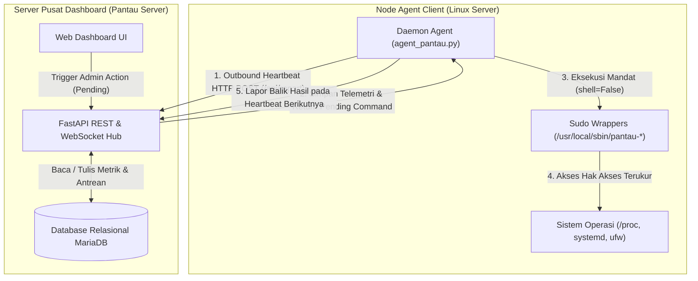
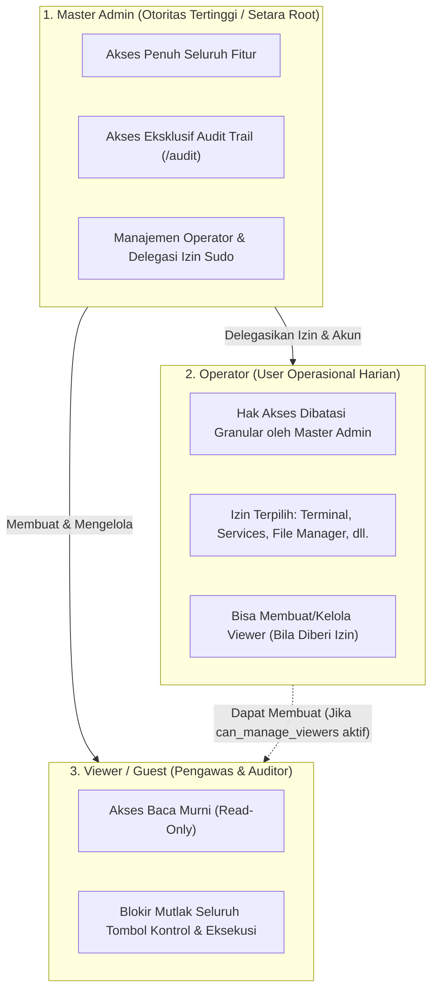

# Dokumentasi Pengembangan & Standar Arsitektur Pantau Server

Dokumen ini merupakan panduan teknis resmi bagi developer dan system administrator (sysadmin) yang merangkum seluruh prinsip fundamental, standar arsitektur, filosofi keamanan, metodologi data retention, serta best practices dalam pengembangan ekosistem **Pantau Server** dan **Agent Pantau**.

---

# Bagian I: Prinsip Fundamental, Standar Desain & Best Practices

## 1. Arsitektur Komunikasi Multi-Server (Pull-Based Inverted Heartbeat)

### Filosofi Desain: Outbound Pull vs Inbound Push
Dalam merancang sistem monitoring dan kontrol terdistribusi multi-server, keputusan arsitektur paling mendasar adalah arah inisiasi koneksi. Sistem monitoring lawas atau berbasis script ad-hoc umumnya mengandalkan server monitoring pusat yang membuka sesi SSH masuk (*inbound SSH*) ke setiap server client. Pendekatan tersebut memiliki kelemahan kritis:
1. **Eksposur Port & Attack Surface Luas**: Mengharuskan port SSH atau port agent terbuka ke internet/jaringan publik pada setiap mesin client.
2. **Kerapuhan NAT & Topologi Jaringan**: Memerlukan VPN rumit, port forwarding, atau IP publik statis untuk server-server di balik NAT, firewall korporat, atau VPC cloud yang terisolasi.
3. **Penyimpanan Kredensial Terpusat Berisiko Tinggi**: Server monitoring harus menyimpan private key SSH atau password root untuk seluruh server target. Jika server monitoring terkompromi, seluruh armada server client ikut jatuh ke tangan attacker.

**Prinsip Desain Pantau Server:**
Pantau Server mengadopsi model **Pull-Based Inverted Heartbeat** yang sepenuhnya terbalik (*inversion of control*):
- **Agent Menginisiasi Koneksi Keluar (*Outbound Only*)**: Agent client secara periodik (setiap 5–10 detik) mengirim HTTP POST request (`/api/report`) ke server dashboard pusat.
- **Zero Inbound Ports**: Agent client tidak membuka listening port apapun ke jaringan publik. Server client dapat berada di balik NAT bertingkat atau firewall ketat selama memiliki akses keluar (*egress*) ke server dashboard.
- **Kredensial Terisolasi Per-Server**: Setiap agent hanya memegang token API spesifik (`api_key`) yang di-hash dengan SHA-256 di database server (`sha256:<hash>`). Key agent tidak memiliki hak akses pada server lain.



### Siklus Hidup Perintah Asinkron (Asynchronous Command Lifecycle)
Karena koneksi bersifat outbound-pull, eksekusi perintah (seperti restart service, kill process, modifikasi firewall, add user, push update OTA) ditangani melalui antrean perintah asinkron (*asynchronous command queue*):
1. **Penerbitan (*Issue*)**: Operator memicu aksi dari web dashboard. Server dashboard memvalidasi permission dan memasukkan perintah ke tabel [`commands`](file:///home/bos/rj45/server/models.py#L88-L111) dengan status `pending`.
2. **Pengambilan (*Polling/Heartbeat*)**: Saat agent melakukan heartbeat berikutnya, server menyertakan pending command dalam payload response JSON.
3. **Eksekusi Lokal**: Agent memproses command secara lokal, menjalankan binary terkait melalui sudo wrapper terisolasi, dan menangkap status serta output (*stdout/stderr*).
4. **Pelaporan Hasil (*Callback Report*)**: Pada heartbeat berikutnya, agent melaporkan balik hasil eksekusi (`success` atau `failed`) beserta output log ke server untuk di-update di database dan ditampilkan di web dashboard.

### Agent Mandiri Tanpa Dependensi Eksternal (Zero-Dependency Python Agent)
Agent client ([`agent/agent_pantau.py`](file:///home/bos/rj45/agent/agent_pantau.py)) dibangun dengan prinsip **Zero External Dependencies**:
- Hanya menggunakan Python standard library (`urllib.request`, `subprocess`, `json`, `os`, `sys`, `platform`, `hashlib`, `shutil`, `socket`).
- Tidak menggunakan third-party library seperti `psutil` yang membutuhkan compiler C (`gcc`, `python3-dev`) dan rentan gagal saat dipasang pada instalasi distro Linux minimalis.
- Metrik sistem dibaca langsung dari pseudo-filesystem Linux (`/proc/stat`, `/proc/meminfo`, `/proc/loadavg`, `/proc/net/dev`, `/proc/diskstats`, `/sys/class/net/`) dan utilitas core Linux (`df`, `systemctl`, `journalctl`, `ss`, `ufw`).
- Hal ini menjamin agent dapat di-deploy seketika di semua distro Linux modern (Ubuntu 18.04+, Debian 10+, CentOS 7+, RHEL, AlmaLinux, Rocky Linux) dalam hitungan detik.

---

## 2. Model Keamanan & Hak Akses Minimal (Principle of Least Privilege)

### Isolasi Akun Tanpa Hak Istimewa (Unprivileged Daemon)
- Agent Pantau tidak pernah dijalankan sebagai user `root`.
- Agent beroperasi di bawah system user terisolasi `pantau` (`User=pantau`, `Group=pantau`) yang dibuat otomatis oleh installer [`package/install.sh`](file:///home/bos/rj45/package/install.sh).
- File konfigurasi agent (`/etc/pantau/config.json`) diamankan dengan permission `0600` milik `pantau:pantau`.

### Pencegahan Shell Injection (`shell=False` & Argument Vectors)
- Standar mutlak kode agent melarang penggunaan `subprocess.run(..., shell=True)` atau `os.system(...)`.
- Semua eksekusi binary sistem diwajibkan menggunakan argument vector (`list` of strings):
  ```python
  # BENAR (Aman dari shell injection):
  subprocess.run(["/usr/local/sbin/pantau-user", "lock", username], shell=False, check=True)

  # DILARANG KERAS (Rentan Command Injection):
  # subprocess.run(f"/usr/local/sbin/pantau-user lock {username}", shell=True)
  ```
- Pendekatan ini mengeliminasi sepenuhnya celah eksekusi perintah liar melalui metakarakter shell (seperti `;`, `&&`, `|`, `` ` ``, `$()`, `\n`).

### Granularitas Sudo Wrapper Khusus (`/usr/local/sbin/pantau-*`)
Untuk menjalankan tindakan administratif sistem tanpa memberikan hak sudo root penuh (`ALL=(ALL) ALL`), Agent Pantau menggunakan script wrapper terisolasi di `/usr/local/sbin/`. Konfigurasi sudoers di [`/etc/sudoers.d/pantau-agent`](file:///home/bos/rj45/package/etc/sudoers.d/pantau-agent) hanya mengizinkan eksekusi tanpa password untuk file-file ini:
- [`pantau-service`](file:///home/bos/rj45/package/usr/local/sbin/pantau-restart): Mengontrol status service systemd (start, stop, restart, reload) dengan whitelist validasi unit.
- [`pantau-user`](file:///home/bos/rj45/package/usr/local/sbin/pantau-user): Manajemen user Linux (buat user, lock user via `usermod -L`, unlock user via `usermod -U`, delete user via `userdel`).
- [`pantau-cron`](file:///home/bos/rj45/package/usr/local/sbin/pantau-cron): Tambah, enable/disable, delete, dan eksekusi instan cron job.
- [`pantau-firewall`](file:///home/bos/rj45/package/usr/local/sbin/pantau-firewall): Manajemen firewall UFW (enable, disable, reload, block IP, unblock IP, rule audit).
- [`pantau-ssl`](file:///home/bos/rj45/package/usr/local/sbin/pantau-ssl): Pembacaan dan inspeksi sertifikat SSL/TLS lokal via OpenSSL CLI.
- [`pantau-apt`](file:///home/bos/rj45/package/usr/local/sbin/pantau-apt): Update cache repository (`apt-get update`) dan upgrade paket (`apt-get upgrade -y`).
- [`pantau-host`](file:///home/bos/rj45/package/usr/local/sbin/pantau-host): Reboot OS dan shutdown terjadwal dengan safety delay agar status report sempat terkirim sebelum mesin mati.
- [`pantau-file`](file:///home/bos/rj45/package/usr/local/sbin/pantau-file): Operasi file aman dengan batasan path directory.

### Guardrail Proteksi Proses Kritis Sistem
Sistem memiliki guardrail perlindungan ganda (di dashboard dan agent) yang menolak mutlak perintah kill atau modifikasi pada komponen kritis:
1. **PID 1 (`init` / `systemd`)**: Tidak dapat dihentikan atau dikirimi sinyal terminasi.
2. **Daemon SSH (`sshd`)**: Tidak dapat di-kill melalui task manager agar sysadmin tidak terkunci dari server.
3. **Daemon Agent Pantau (`agent_pantau`)**: Dilindungi dari kill paksa via web UI guna menjaga kontinuitas monitoring.
4. **Port Kunci (Port 22 SSH, 80/443 Web, 8400 Pantau)**: Sebelum firewall UFW diaktifkan, sistem secara otomatis memastikan rule allow untuk port-port ini sudah terpasang.

### Pengamanan Web File Manager
- **Guardrails System Path**: Akses langsung ke directory sensitif kernel dan hardware (`/proc`, `/sys`, `/dev`, `/boot`) diblokir ketat.
- **Auto Backup File Berstempel Waktu**: Setiap kali file teks diedit dan disimpan via web UI, file original otomatis dibackup ke `.bak.<timestamp>` sebelum file ditimpa.

### Model Kontrol Akses Berbasis Role 3-Tier (3-Tier RBAC Architecture)
Untuk mendukung tata kelola keamanan enterprise, Pantau Server menerapkan sistem otorisasi berbasis role 3-tier dengan prinsip segregation of duties:



1. **Master Administrator (`master_admin`)**:
   - **Kedudukan**: Satu-satunya akun dengan hak istimewa mutlak setara *root* sistem.
   - **Hak Khusus**:
     - Satu-satunya role yang memiliki visibilitas atas kartu counter dan data akun Master Admin di tabel user.
     - Akses penuh catatan audit trail ([`/audit`](file:///home/bos/rj45/server/templates/audit.html)).
     - Hak membuat, mengedit izin granular/sudo, dan me-lock akun Operator serta Viewer.
     - Kontrol tak terbatas atas seluruh armada server, terminal, file manager, dan eksekusi command.
   - **Proteksi Kekebalan & Zero-Knowledge**: Akun Master Admin tidak dapat dihapus, di-demote, atau dinonaktifkan via web UI. Keberadaan akun Master Admin sepenuhnya disembunyikan dari UI akun Operator dan Viewer.

2. **Operator (`operator`)**:
   - **Kedudukan**: Akun harian tim operasional/SRE. Akun dibuat dan dikonfigurasi langsung oleh Master Admin atau Operator dengan wewenang sudo.
   - **Konsep Otoritas Sudo Operator (*Sudo-like Authority*)**:
     Seperti prinsip user biasa di Linux yang tergabung dalam grup `sudo` (*wheel*), Master Admin dapat mendelegasikan wewenang penuh kepada Operator (termasuk akses audit trail dan user management) sehingga akun Master Admin tidak perlu digunakan setiap hari. Akun Operator dengan hak sudo penuh dapat mengelola operasional armada server dan user lain secara mandiri.
   - **Prinsip Zero-Knowledge Master Admin**:
     Operator sama sekali tidak mengetahui keberadaan user Master Admin:
     - Counter kartu statistik jumlah Master Admin disembunyikan dari Operator.
     - Baris akun Master Admin tidak muncul pada tabel user yang diakses Operator.
     - Jika Operator mencoba memanipulasi ID Master Admin secara sengaja via API/POST (`/delete`, `/toggle-active`, `/edit`), sistem merespons netral `"User tidak ditemukan"` untuk mencegah user enumeration.
     - Pada halaman Audit Trail, aktivitas Master Admin disamarkan sebagai `"Sistem"`.
   - **Matriks Izin Granular (*Granular Delegated Permissions*)**:
     Setiap Operator memiliki hak eksekusi yang diatur via permission matrix atau preset **⚡ Hak Sudo Penuh**:
     - `can_terminal`: Akses web terminal PTY interaktif xterm.js.
     - `can_file_manager`: Browse directory, edit file, dan manajemen file remote.
     - `can_manage_servers`: Add server, rename, edit threshold, atau delete server.
     - `can_services`: Start, stop, restart, dan reload service systemd.
     - `can_processes`: Kill dan stop process di task manager.
     - `can_firewall`: Manage port rule, block/unblock IP via UFW.
     - `can_users_sys`: Add user Linux, lock, unlock, dan delete user host.
     - `can_cron`: Add, toggle, delete, dan run now cron job.
     - `can_ssl`: Manage custom SSL path monitoring.
     - `can_server_control`: Reboot OS dan poweroff mesin host.
     - `can_apt`: Update repository cache dan upgrade paket APT.
     - `can_ota`: Trigger push update agent massal (OTA update).
     - `can_audit`: Akses membaca audit trail dan log aktivitas keamanan ([`/audit`](file:///home/bos/rj45/server/templates/audit.html)).
     - `can_manage_users`: Manage akun user (Operator & Viewer), reset password, ganti username, dan set permission.
     - `can_manage_viewers`: Izin terbatas untuk membuat, mengunci, atau menghapus akun Viewer (tamu monitoring).
   - **Batasan Mutlak**: Operator **tidak dapat** menghapus Master Admin, tidak dapat me-lock Master Admin, tidak dapat mengganti username/password Master Admin, serta tidak dapat mempromosikan user manapun menjadi `master_admin`.

3. **Viewer (`viewer`)**:
   - **Kedudukan**: Akun pengawas pasif untuk stakeholder, manajemen, external auditor, atau tim monitoring murni.
   - **Isolasi Mutlak (*Zero Administrative Authority & Information Isolation*)**:
     - User Viewer sama sekali tidak mengetahui keberadaan user Operator maupun Master Admin.
     - Tidak memiliki menu **Profil & Keamanan** di web UI, dan seluruh akses ke `/profile` diblokir permanen (redirect ke `/`).
     - Viewer tidak dapat mengubah password, profil, atau 2FA sendiri. Seluruh kredensial akun Viewer dikelola dari luar oleh Master Admin atau Operator.
     - Seluruh tombol kontrol, aksi eksekusi, terminal, file manager, dan form modifikasi disembunyikan dan di-block di backend. Viewer murni hanya memiliki hak read-only metrik.

---

### Unifikasi User Management ke Menu Profil & Keamanan
1. **Navigasi Terpadu**:
   - Menu terpisah "User" di sidebar utama dihapus agar navigasi tetap ringkas dan terfokus.
   - Manajemen user dan delegasi wewenang disatukan ke dalam halaman **Profil & Keamanan** ([`/profile`](file:///home/bos/rj45/server/templates/profile.html)):
     - **Tab 1: Profil & Keamanan Saya**: Info identitas, ganti password pribadi, dan manajemen 2FA (TOTP) serta backup recovery codes.
     - **Tab 2: Manajemen User & Hak Akses**: Muncul otomatis untuk Master Admin atau Operator yang memiliki wewenang user management (`can_manage_users` / `can_manage_viewers`).
2. **Antarmuka Tabel User Interaktif**:
   - **Tombol "👁️ Lihat"**: Modal inspeksi profil akun dan visualisasi matriks izin (*✔ Diizinkan* vs *✖ Ditolak*).
   - **Tombol "✏️ Edit"**: Modal untuk edit username, reset password sesuai standar NIST, ganti role, serta checklist permission dengan preset instan **⚡ Hak Sudo Penuh**.
   - **Tombol "🔒 Kunci / 🔓 Buka"**: Lock user instan dengan revoke session seketika.
   - **Tombol "🗑️ Hapus"**: Delete akun permanen dengan proteksi kekebalan Master Admin.

---

### Pengerasan Keamanan Akun & Autentikasi (Authentication Hardening)

1. **Standar Kompleksitas Password (NIST SP 800-63B)**:
   - Panjang minimum **12 karakter**.
   - Wajib kombinasi huruf besar (A-Z), huruf kecil (a-z), angka (0-9), dan simbol (!@#$%^&*...).
   - Validasi blacklist dictionary terhadap password pasaran dan nama username.
   - Visual password strength meter realtime di form web.

2. **Two-Factor Authentication (2FA / TOTP RFC 6238)**:
   - Support aplikasi authenticator standar (Google Authenticator, Aegis, Authy, 1Password, Bitwarden).
   - Secret key Base32 160-bit cryptographically secure.
   - QR code generator otomatis dengan URI `otpauth://totp/...`.
   - Time-step 30 detik dengan drift window toleransi ±1 step.
   - **10 Backup Recovery Codes (Single-Use)**:
     - Diberikan saat aktivasi 2FA untuk situasi darurat ketika device authenticator hilang.
     - Disimpan dalam bentuk hash SHA-256 / bcrypt di database.
     - Sekali pakai (*single-use*) dan otomatis hangus setelah dipakai login.
   - **Regenerate Backup Codes**: Fitur pembuatan ulang 10 recovery codes baru via web modal dengan konfirmasi password tanpa harus reset 2FA.

3. **Alur Login Dua Tahap Terisolasi (Two-Stage Pre-Auth Flow)**:
   - Setelah username dan password valid, server **tidak langsung memberikan session cookie aplikasi utama**.
   - Server menerbitkan temporary HMAC signed token (`preauth_session`) dengan masa berlaku 5 menit.
   - User diredirect ke [`/login/2fa`](file:///home/bos/rj45/server/templates/login_2fa.html). Session dashboard penuh baru diterbitkan setelah token TOTP atau recovery code valid dimasukkan.

4. **Revoke Session Seketika & Proteksi Akun**:
   - **Revoke Session saat Ganti Password**: Setiap kali user mengganti password di [`/profile`](file:///home/bos/rj45/server/templates/profile.html), seluruh active session di device lain otomatis di-revoke dari database untuk mencegah pembajakan session lama.
   - **Lock User Instan**: Ketika admin me-lock akun user melalui [`/profile`](file:///home/bos/rj45/server/templates/profile.html), seluruh session aktif user tersebut langsung dimatikan pada detik yang sama.

5. **CLI Emergency Seed & Recovery Tool**:
   - Script administrasi lokal ([`server/seed_admin.py`](file:///home/bos/rj45/server/seed_admin.py)) untuk eksekusi via terminal server dashboard: create master admin, ganti username (`--rename-from`), hingga emergency reset 2FA (`--reset-2fa`).

---

## 3. Remote OTA Agent Update (Enterprise Over-The-Air Update)

Update armada agent pada puluhan server tidak boleh bergantung pada SSH manual per-server:

### Protokol Transmisi Kriptografis
1. **Penerbitan Hash Resmi**: Dashboard mengetahui file binary agent resmi dan hash SHA-256 nya.
2. **Instruksi Terautentikasi**: Ketika trigger OTA diklik (`Push Update (OTA)`), dashboard mengirim payload terstruktur ke command queue:
   ```json
   {
     "action": "update_agent",
     "url": "https://dashboard.domain.com/api/agent/download",
     "sha256": "386f3e7b2354c7d0d0840b3ff646e29783f609b185e493e9bbf04ae78f6920f0",
     "version": "4.2.4"
   }
   ```

### Verifikasi Integritas & Safety Check di Sisi Client
1. **Download Sementara**: File baru di-download ke temporary path (`/opt/pantau/agent/agent_pantau.py.tmp`).
2. **Validasi Hash SHA-256**: Agent mencocokkan checksum SHA-256 file temporary dengan hash dari dashboard. Jika tidak cocok, file langsung dihapus dan security alert dilaporkan ke audit trail.
3. **Validasi Sintaks Python (`py_compile`)**: Agent menguji file via `py_compile.compile()` sebelum instalasi agar tidak terjadi bricked agent jika script error syntax.
4. **Penggantian File Atomik (`os.replace`) & Permission**: File diganti secara atomik (`os.replace`) ke `/opt/pantau/agent/agent_pantau.py` dengan permission `0755` milik `pantau:pantau`.
5. **Watchdog Restart & Auto Report**: Agent me-restart servicenya via systemd watchdog dan melapor dengan `agent_version` baru pada heartbeat berikutnya.

---

## 4. Strategi Retensi Data & Dynamic Query Downsampling

Untuk mencegah database bloat pada pengumpulan metrik periodik:

### Arsitektur Data Retention 4-Tier
| Tier | Tabel Database | Granularitas Data | Retensi | Frekuensi Pruning | Peruntukan |
| :--- | :--- | :--- | :--- | :--- | :--- |
| **Tier 1 (Raw Snapshots)** | [`sys_snapshots`](file:///home/bos/rj45/server/models.py#L113-L138) | Penuh (5–10 detik) | **24 Jam** | Tiap laporan agent (`now - 24h`) | Realtime metric, grafik 1h/6h/24h, spike investigation. |
| **Tier 2 (Hourly Rollups)** | [`sys_snapshots_hourly`](file:///home/bos/rj45/server/models.py#L140-L170) | 1 sampel per jam | **90 Hari** | Dihitung per jam; prune `> 90d` | Capacity planning, grafik 7d & 30d hemat storage. |
| **Tier 3 (Service Metrics)** | [`metrics`](file:///home/bos/rj45/server/models.py#L70-L86) | Status per-laporan | **7 Hari** | Pruning tiap 24 jam (`now - 7d`) | Uptime tracking, status service, latency history. |
| **Tier 4A (Audit Logs)** | [`audit_logs`](file:///home/bos/rj45/server/models.py#L262-L281) | Audit trail user | **365 Hari (1 Tahun)** | Hourly background prune | Kepatuhan audit regulasi dan investigasi forensik. |
| **Tier 4B (Command History)**| [`commands`](file:///home/bos/rj45/server/models.py#L88-L111) | History command | **180 Hari** | Hourly background prune | History maintenance remote per server. |
| **Tier 4C (Resolved Incidents)** | [`server_problems`](file:///home/bos/rj45/server/models.py#L196-L227) | Tiket resolved | **90 Hari** | Hourly background prune | MTTR (*Mean Time To Resolution*) analytics. |
| **Tier 4D (Sessions & Rate Limit)**| [`sessions`](file:///home/bos/rj45/server/models.py#L283-L299), [`login_attempts`](file:///home/bos/rj45/server/models.py#L301-L309) | Auth session | **12 Jam / 1 Hari** | Hourly background prune | Keamanan auth dan pembersihan token kedaluwarsa. |

### Dynamic Query Downsampling
Grafik riwayat kinerja 24h, 7d, atau 30d menggunakan downsampling SQL adaptif di database engine sehingga browser selalu menerima payload ringan (~120 data points, < 50 KB) tanpa browser lag.

---

## 5. Manajemen Siklus Hidup Insiden & Anti-Flapping

- **Toleransi Anti-Flapping**: Alert service tidak langsung membunyikan alarm pada kegagalan transien tunggal. Ada quiet window (30–45 detik) sebelum berstatus `danger`.
- **Auto-Resolve saat Hapus Service**: Menghapus service bermasalah dari monitoring langsung menutup insiden secara sinkron dengan note `Dihapus dari konfigurasi` tanpa klaim palsu service pulih.
- **Maintenance Mode & Service Mute**: Support server-wide maintenance mode untuk mematikan alert saat maintenance OS, serta opsi Mute service individual (2h, 24h, 7d, 30d, atau permanen).

---

## 6. Telemetri Real-Time & Web Terminal

- **PTY Linux Terminal**: Direct `/bin/bash` Pseudo-Terminal via Python standard `pty` dan streaming WebSocket dispatcher. Full ANSI color, VT100 control sequences, auto-completion, dan dynamic window resize (`SIGWINCH`).
- **Dedicated WebSocket Channel**: Traffic terminal dan journal stream dipisahkan dari HTTP REST reporting agar tidak mengganggu metrik sistem.

---

## 7. Audit Trail & Investigasi Forensik

- **End-to-End Traceability**: Setiap tindakan administratif mencatat Actor (username), Timestamp UTC, Target (server/service/user/file/port), Action (`restart_service`, `kill_process`, `block_ip`, dll.), dan Outcome (`success`/`failed` + output log).
- **Sensitive Parameter Redaction**: Password dan secret key otomatis disensor sebelum disimpan ke tabel [`audit_logs`](file:///home/bos/rj45/server/models.py#L262-L281).
- **User Activity Auditing**: Tab Manajemen User menyediakan tombol `📋 Audit` cepat dan modal inspect untuk mengisolasi riwayat aksi per operator di [`/users/{id}/activity`](file:///home/bos/rj45/server/templates/user_activity.html).

---

## 8. UX Sysadmin & Standar Bahasa Teknis

- **Bahasa Sysadmin Natural**: Menggunakan terminologi standar dunia IT dan sysadmin: *server*, *user*, *service*, *file*, *folder*, *username*, *password*, *root*, *sudo*, *terminal*, *CPU*, *RAM*, *I/O*, *UFW*, *SSL*, *cron job*, *reboot*, *kill process*.
- **Hierarki Navigasi Alur Sysadmin**:
  `Kinerja Ringkas → Riwayat & Masalah → Service & Process → Konfigurasi (User, Port, Firewall, SSL, Cron) → Logging & Diagnostik`.
- **Status Visual Tegas**:
  - Hijau (`success`): Service/host sehat dan normal.
  - Kuning (`warning`): Warning threshold atau SSL mendekati expired.
  - Merah (`danger`): Critical incident, service down, brute-force alert.
  - Biru Neon (`#38bdf8`): Aksen navigasi dan elemen aktif.

---

# Bagian II: Catatan Riwayat Perubahan Versi (Changelog)

## Versi 4.2.19

- **Release Label:** None
- **Tipe Rilis:** Rilis Patch (*Patch Release*) — Optimasi Layout Tab Manajemen Pengguna & Hak Akses: Kartu Tambah Pengguna Diperkecil, Tabel Pengguna Terdaftar Muat Penuh Tanpa Scroll Samping

### Struktur Rilis SemVer (Major.Minor.Patch)

```
v4.2.19
 │
 ├── 4  (Mayor) : Restrukturisasi Keamanan & Arsitektur RBAC 3-Tier, 2FA TOTP RFC 6238, dan Isolasi Akun
 ├── 2  (Minor) : Sistem Insiden Kritis Global, Emergency Alert Modal, Telemetri Spek Hardware Mendalam, Dukungan Proxy/Cloudflare & Instalasi Interaktif
 └── 19 (Patch) : Optimasi Layout Tab Manajemen Pengguna (Asymmetric Grid 1fr 330px, Aksi Kompak, Zero Horizontal Scroll)
```

---

### Perbaikan Masalah & Peningkatan UX — Versi 4.2.19 (Patch Release)

1. **Perkecil Ukuran Kartu Tambah Pengguna Baru:**
   - Mengubah layout grid dari pembagian seimbang 50%/50% (`repeat(auto-fit, minmax(420px, 1fr))`) menjadi grid asimetris cerdas: tabel utama mendapatkan porsi maksimal (`minmax(0, 1fr)`) dan kartu form diset ramping tetap pada lebar `330px`.
   - Mengurangi padding kartu dari `24px` menjadi `16px 18px`, merapikan spasi antar form group dari `14px-16px` menjadi `10px`, serta membatasi tinggi checklist wewenang operator (`max-height: 220px`) agar kartu form tampak ringkas dan proporsional.
   - Menambahkan breakpoint responsif (`@media (max-width: 1080px)`) agar tata letak otomatis bertumpuk 1 kolom penuh di layar tablet dan perangkat mobile.

2. **Perbaikan Tabel Kartu Daftar Pengguna Terdaftar (Bebas Scroll Samping):**
   - **Akar Masalah:** Tombol aksi pada setiap baris pengguna sebelumnya memuat teks panjang lengkap side-by-side (*Lihat*, *Setup 2FA* / *Reset 2FA* + *Matikan 2FA*, *Audit*, *Edit*, *Kunci*, *Hapus*) yang menyita lebih dari 430px sendiri, menyebabkan lebar total tabel menembus batas kartu dan memaksa scroll samping.
   - **Solusi:**
     - Menata tombol aksi menjadi lebih kompak: tombol aman primer (*Lihat*, *Edit*, *Audit*, *+2FA* / *Reset*) menggunakan teks ringkas bersanding dengan icon, sedangkan tombol toggle/destruktif (*Kunci*, *Buka*, *Hapus*, *Matikan 2FA*) menggunakan icon button presisi dengan tooltip deskriptif (`title="..."`).
     - Lebar kolom aksi berhasil dirampingkan dari ~430px menjadi ~230px tanpa menghilangkan fungsi apa pun.
     - Lebar total tabel menyusut rapi menjadi ~660px, sehingga dapat tertampung sempurna di dalam kartu tanpa memicu scroll horizontal (scroll samping) pada tampilan desktop.

---

## Versi 4.2.18

- **Release Label:** None
- **Tipe Rilis:** Rilis Patch (*Patch Release*) — Eskalasi Presisi Peringatan Gawat Darurat (Zero-Bypass Escalation), Ticker Realtime 1 Detik Durasi Terputus Tanpa Reload, dan Sinkronisasi Timestamp Dimulai Sejak Kehilangan Kontak

### Struktur Rilis SemVer (Major.Minor.Patch)

```
v4.2.18
 │
 ├── 4  (Mayor) : Restrukturisasi Keamanan & Arsitektur RBAC 3-Tier, 2FA TOTP RFC 6238, dan Isolasi Akun
 ├── 2  (Minor) : Sistem Insiden Kritis Global, Emergency Alert Modal, Telemetri Spek Hardware Mendalam, Dukungan Proxy/Cloudflare & Instalasi Interaktif
 └── 18 (Patch) : Eskalasi Presisi Alert Gawat Darurat (Warning -> Average -> Danger), Durasi Terputus Live Realtime Ticker, dan Fix Waktu Hilang Kontak Agen
```

---

### Perbaikan Masalah & Peningkatan UX — Versi 4.2.18 (Patch Release)

1. **Eskalasi Presisi Peringatan Gawat Darurat (Zero-Bypass Escalation):**
   - **Akar Masalah:** Sebelumnya endpoint `/api/alerts` memuat klausa `or_(ServerProblem.severity == 'danger', ServerProblem.key == 'agent_stale')` serta menambahkan setiap server stale (> 15 detik) ke `danger_hosts`. Hal ini mengakibatkan modal popup *"PERINGATAN GAWAT DARURAT — DIPERLUKAN TINDAKAN SEGERA"* langsung muncul pada detik ke-16 saat agen baru pertama kali terlambat mengirimkan sinyal, melangkahi tahapan eskalasi normal.
   - **Solusi:** Endpoint `/api/alerts` kini secara ketat dan konsisten hanya menyaring insiden dengan `ServerProblem.severity == 'danger'`. Tahapan eskalasi 3 tingkat kini dihormati penuh:
     - **0–119 detik (15s–2m):** Severity `Warning` (Peringatan Awal) — tidak memicu popup gawat darurat atau banner merah.
     - **120–299 detik (2m–5m):** Severity `Average` (Server Down / Offline) — tidak memicu popup gawat darurat atau banner merah.
     - **>= 300 detik (5m+):** Severity `Danger` (Kritis / Gawat Darurat) — barulah modal darurat dan banner merah ditampilkan ke operator.

2. **Perbaikan Waktu Terputus Presisi (`started_at`):**
   - Menetapkan `event_at` pada insiden `agent_stale` persis merujuk pada `srv.last_seen` naive UTC (waktu aktual saat kontak komunikasi hilang), bukan saat loop deteksi dijalankan (`now`).
   - Mencegah durasi awal terputus muncul sebagai "0 dtk" palsu.
   - Menyertakan akhiran ISO `Z` pada serialisasi timestamp agar parsing browser `Date.parse()` selalu memperlakukan waktu sebagai UTC tanpa pergeseran zona waktu lokal.

3. **Ticker Realtime Dinamis 1 Detik pada UI Tanpa Reload Halaman:**
   - **Akar Masalah:** Komponen tabel modal alert tidak memiliki atribut pengait waktu dan siklus render memblokir pembaruan HTML jika ID dan status acknowledged tidak berubah, menyebabkan tulisan "Durasi Terputus" beku selamanya di "0 dtk" tanpa reload browser.
   - **Solusi:**
     - Mengimplementasikan ticker interval client-side 1 detik (`tickAllDurations()`) di `base.html` yang secara aktif memperbarui seluruh elemen dengan atribut `[data-start]`.
     - Menambahkan atribut `data-start` pada kolom durasi terputus di modal peringatan darurat serta tabel kartu masalah di dashboard.
     - Durasi bertambah naik secara mulus setiap detik (contoh: *5 mnt 1 dtk*, *5 mnt 2 dtk*, dst.) secara live realtime tanpa kedipan dan tanpa memerlukan reload halaman browser.

---

## Versi 4.2.17

- **Release Label:** None
- **Tipe Rilis:** Rilis Patch (*Patch Release*) — Deteksi Otomatis Platform (LXC, VM, Baremetal), Koreksi Telemetri Storage Kontainer LXC (rootfs vs host sda), Heuristik Deteksi Auto-Revive Proxmox HA, dan Redaksi Komunikasi Sysadmin Profesional

### Struktur Rilis SemVer (Major.Minor.Patch)

```
v4.2.17
 │
 ├── 4  (Mayor) : Restrukturisasi Keamanan & Arsitektur RBAC 3-Tier, 2FA TOTP RFC 6238, dan Isolasi Akun
 ├── 2  (Minor) : Sistem Insiden Kritis Global, Emergency Alert Modal, Telemetri Spek Hardware Mendalam, Dukungan Proxy/Cloudflare & Instalasi Interaktif
 └── 17 (Patch) : Deteksi Platform Presisi (LXC / VM / Baremetal), Perbaikan Alokasi Disk Kontainer LXC, Auto-Revive Heuristic Proxmox HA, dan Standardisasi Pesan Profesional Sysadmin
```

---

### Perbaikan Masalah & Peningkatan UX — Versi 4.2.17 (Patch Release)

1. **Deteksi Otomatis Platform Host (LXC Container vs VM vs Baremetal):**
   - **Agent Telemetry:** Mengimplementasikan inspeksi mendalam pada `agent_pantau.py` via `systemd-detect-virt`, pembacaan descriptor `/run/systemd/container`, dan `/proc/1/environ` untuk mendeteksi tipe platform secara presisi: `LXC Container`, `VM (KVM/QEMU/dll)`, atau `Baremetal` (server fisik).
   - **Tampilan Badge Platform pada Seluruh Tampilan:**
     - Menampilkan badge platform berwarna cerah (`📦 LXC`, `☁️ VM (KVM)`, `🖥️ Baremetal`) pada hero header halaman detail server (`services.html`), tabel server utama (`servers.html`), tabel dasbor (`dashboard.html`), dan grid kartu dasbor.
     - Mengintegrasikan kata kunci platform ke dalam filter pencarian adaptif (`data-srv-filter`) di tabel server.

2. **Koreksi Telemetri Storage Kontainer LXC (Rootfs vs Disk Fisik Host):**
   - **Masalah:** Pada kontainer unprivileged LXC, eksekusi `lsblk` membaca disk fisik host Proxmox (mis. HPE ProLiant DL380 Gen11 RAID `sda 7.6T`), bukan kuota alokasi sebenarnya yang diberikan ke kontainer (mis. `97.9G`).
   - **Solusi:** Agen mendeteksi apakah lingkungan berjalan di kontainer LXC. Jika LXC, agen mengumpulkan alokasi partisi container (`statvfs('/')`) dan menampilkannya sebagai `rootfs` berkapasitas presisi, bukan disk blok fisik host.
   - **Backend Fallback:** Dashboard server secara cerdas mendeteksi dan mengoreksi data riwayat kontainer LXC yang masih mencatat disk blok host, memastikan tampilan kapasitas penyimpanan kontainer langsung akurat seketika.

3. **Heuristik Deteksi Otomatis Proxmox HA (Auto-Revive Detection):**
   - **Mekanisme Otomatis:** Ketika operator mengeksekusi perintah `poweroff_host` pada VM atau kontainer, jika mesin tersebut hidup kembali dan melapor dalam waktu < 5 menit dengan uptime rendah (< 180 detik), Pantau Server secara otomatis menandai `is_proxmox_ha = 1` tanpa memerlukan konfigurasi manual operator.
   - **Audit Trail:** Mencatat entri otomatis pada `audit_logs` dengan aksi `proxmox_ha_detected`.

4. **Standardisasi Redaksi Pesan Profesional Sysadmin:**
   - Menghapus redaksi penjelasan berlebih (*"mencegah loop restart"*) sesuai standar profesional operator NOC/sysadmin.
   - Menyeragamkan seluruh tooltip, alert penolakan, banner konfirmasi, dan modal proteksi Proxmox HA menjadi satu kalimat tegas dan profesional:
     > *"Server terproteksi Proxmox HA. Matikan langsung pada dashboard Proxmox VE (state: stopped)."*

---

## Versi 4.2.16

- **Release Label:** None
- **Tipe Rilis:** Rilis Patch (*Patch Release*) — Proteksi Proxmox HA (High Availability), Disable Tombol Power OFF + Tooltip Edukatif, dan Mitigasi Siklus Auto-Revive Hypervisor

### Struktur Rilis SemVer (Major.Minor.Patch)

```
v4.2.16
 │
 ├── 4  (Mayor) : Restrukturisasi Keamanan & Arsitektur RBAC 3-Tier, 2FA TOTP RFC 6238, dan Isolasi Akun
 ├── 2  (Minor) : Sistem Insiden Kritis Global, Emergency Alert Modal, Telemetri Spek Hardware Mendalam, Dukungan Proxy/Cloudflare & Instalasi Interaktif
 └── 16 (Patch) : Proteksi Proxmox HA Terintegrasi (is_proxmox_ha), Disable Tombol Power OFF dengan Tooltip Edukatif, Penolakan Guardrail Backend & Audit Log, dan Tampilan Badge HA pada Dasbor
```

---

### Perbaikan Masalah & Peningkatan UX — Versi 4.2.16 (Patch Release)

1. **Proteksi & Mitigasi Siklus Auto-Revive Proxmox HA (High Availability):**
   - Mengidentifikasi dan memitigasi perilaku kontainer LXC / VM yang dikelola oleh Proxmox HA (`pve-ha-crm`/`pve-ha-lrm`): ketika dimatikan dari dalam OS (`systemctl poweroff`), Proxmox HA menganggap kontainer mati akibat *crash* tak terduga dan membangkitkannya kembali secara otomatis dalam siklus ±5 detik.
   - Menambahkan kolom database `is_proxmox_ha TINYINT(1) DEFAULT 0` pada tabel `servers` dan model `Server`.
   - **Form Pengaturan Server:** Menambahkan toggle proteksi *"Terdaftar di Proxmox HA (High Availability)"* pada halaman tambah dan edit server (`server_form.html`).

2. **Frontend Guardrail & Edukasi UI/UX:**
   - **Penonaktifan Tombol Power OFF:** Pada server dengan flag Proxmox HA aktif, tombol **Power OFF** di hero banner dinonaktifkan (`disabled`, latar belakang transparan bergaris putus-putus, kursor `not-allowed`) untuk mencegah salah klik operator.
   - **Tooltip & Badge Informatif:** Menampilkan badge `[Proxmox HA]` dan tooltip panduan teknis yang menjelaskan bahwa pemadaman mesin HA harus dilakukan melalui host Proxmox VE (state `stopped`) agar tidak menyala kembali.
   - **Pemutakhiran Live Updater JS:** Memastikan skrip sinkronisasi realtime pada `services.html` tidak mengaktifkan kembali tombol yang dilindungi pembungkus `.ha-protected-wrapper`.
   - **Badge Dasbor & Filter:** Menampilkan badge penanda `HA` di samping nama host pada tabel `servers.html`, tabel dasbor, dan kartu rincian, serta mendukung filter pencarian `ha`.

3. **Keamanan & Guardrail Sisi Server (Backend):**
   - Menolak eksekusi `poweroff_host` di backend `_host_control` jika `server.is_proxmox_ha == 1`, baik untuk request form HTML (redirect dengan notifikasi banner peringatan kuning `action=poweroff_ha_blocked`) maupun pemanggilan API JSON (respons status 400 Bad Request).
   - Mencatat penolakan tindakan secara transparan ke dalam tabel `audit_logs`.
   - Tombol **Reboot OS** tetap diizinkan karena alur reboot memang bertujuan menyalakan kembali server.

---

## Versi 4.2.14

- **Release Label:** None
- **Tipe Rilis:** Rilis Patch (*Patch Release*) — Auto-Healing Wrapper Host Shutdown & Penanganan False-Positive Degraded State pada Proxmox LXC Container

### Struktur Rilis SemVer (Major.Minor.Patch)

```
v4.2.14
 │
 ├── 4  (Mayor) : Restrukturisasi Keamanan & Arsitektur RBAC 3-Tier, 2FA TOTP RFC 6238, dan Isolasi Akun
 ├── 2  (Minor) : Sistem Insiden Kritis Global, Emergency Alert Modal, Telemetri Spek Hardware Mendalam, Dukungan Proxy/Cloudflare & Instalasi Interaktif
 └── 14 (Patch) : Auto-Healing Wrapper pantau-host pada Sistem Degraded, Pengakuan Validitas Systemd di Proxmox LXC Container, dan Perbaikan Eksekusi Power Off
```

---

### Perbaikan Masalah & Peningkatan UX — Versi 4.2.14 (Patch Release)

1. **Auto-Healing Wrapper Host Control (`pantau-host`) pada Proxmox LXC & Status Degraded:**
   - Memperbaiki kegagalan perintah **Power OFF** dan **Reboot** pada instance Proxmox LXC Container (seperti `e-kinerja-clone`) yang sebelumnya dibatalkan dengan pesan salah *"systemd TIDAK berjalan sebagai host"*.
   - Penyebab akar: Klien yang diinstal sebelum v4.2.1 masih menggunakan skrip wrapper lama yang memeriksa `systemctl is-system-running`. Jika ada unit layanan berstatus *degraded*, evaluasi kode keluar menghasilkan nilai non-zero sehingga skrip keliru menganggap mesin tersebut bukan host.
   - Solusi: Agen kini mendeteksi direktori `/run/systemd/system`. Jika direktori tersebut ada, agen mengenali bahwa systemd aktif dan siap menerima shutdown (termasuk pada namespace LXC). Agen secara otomatis memperbarui (*auto-heal*) berkas `/usr/local/sbin/pantau-host` dengan skrip terbaru dan melanjutkan eksekusi pemadaman secara sukses.

---

## Versi 4.2.13

- **Release Label:** None
- **Tipe Rilis:** Rilis Patch (*Patch Release*) — Rincian Lengkap Kolom Waktu Riwayat Insiden dan Riwayat Tindakan (Tanggal, Jam, Menit, Detik)

### Struktur Rilis SemVer (Major.Minor.Patch)

```
v4.2.13
 │
 ├── 4  (Mayor) : Restrukturisasi Keamanan & Arsitektur RBAC 3-Tier, 2FA TOTP RFC 6238, dan Isolasi Akun
 ├── 2  (Minor) : Sistem Insiden Kritis Global, Emergency Alert Modal, Telemetri Spek Hardware Mendalam, Dukungan Proxy/Cloudflare & Instalasi Interaktif
 └── 13 (Patch) : Presisi Rinci Kolom Waktu Riwayat Insiden & Riwayat Tindakan (Tanggal, Jam, Menit, Detik tanpa Nama Hari), Format Tanggal Terpadu (_fmt_dt), dan Penguncian Lebar Kolom .col-time-detailed
```

---

### Perbaikan Masalah & Peningkatan UX — Versi 4.2.13 (Patch Release)

1. **Rincian Presisi Kolom Waktu Riwayat Insiden & Riwayat Tindakan:**
   - Memperbarui tampilan kolom waktu pada **Kartu Riwayat Insiden** (`prob-resolved-card` di menu Insiden) dan **Kartu Riwayat Tindakan** (`tbl-action-history` serta `acc-action-tbody` di menu Rincian Server) agar menampilkan tanggal, jam, menit, dan detik secara lengkap (contoh: `13 Okt 2026 10:15:32`).
   - Meniadakan nama hari (Senin/Selasa/dst.) guna mempertahankan tampilan ringkas, profesional, dan seragam.
   - Pada kartu riwayat insiden, waktu ditampilkan dengan label status yang jelas: waktu **Mulai** dan waktu **Selesai / Pulih** hingga satuan detik.

2. **Format Tanggal Terpadu Backend & Frontend (`_fmt_dt`):**
   - Menambahkan fungsi helper `_fmt_dt` di backend FastAPI dengan singkatan bulan bahasa Indonesia standar (`Jan`, `Feb`, `Mar`, `Apr`, `Mei`, `Jun`, `Jul`, `Agu`, `Sep`, `Okt`, `Nov`, `Des`) dan mendaftarkannya ke Jinja globals.
   - Memperbaiki serialisasi endpoint `/api/servers/{sid}/overview` agar data `time` riwayat tindakan tidak lagi terpotong menjadi hanya `HH:MM:SS` saat polling/live refresh.
   - Memperbarui fungsi JavaScript `fmtProbDate` agar mempertahankan format lengkap tanggal dan detik saat re-render interaktif.

3. **Gaya CSS Lebar Kolom `.col-time-detailed`:**
   - Menambahkan kelas CSS `.col-time-detailed` pada `base.html` dengan lebar proporsional (`width: 200px !important; min-width: 190px !important; white-space: nowrap !important; font-variant-numeric: tabular-nums !important;`) sehingga teks timestamp rinci tidak terpotong atau tertekan aturan `.col-time` lama.

---

## Versi 4.2.12

- **Release Label:** None
- **Tipe Rilis:** Rilis Patch (*Patch Release*) — Restorasi Presisi Lebar Kolom Hostname, Eliminasi Void Kosong Melebar, dan Keselarasan Vertikal Metrik Sistem

### Struktur Rilis SemVer (Major.Minor.Patch)

```
v4.2.12
 │
 ├── 4  (Mayor) : Restrukturisasi Keamanan & Arsitektur RBAC 3-Tier, 2FA TOTP RFC 6238, dan Isolasi Akun
 ├── 2  (Minor) : Sistem Insiden Kritis Global, Emergency Alert Modal, Telemetri Spek Hardware Mendalam, Dukungan Proxy/Cloudflare & Instalasi Interaktif
 └── 12 (Patch) : Restorasi Presisi Lebar Kolom Hostname (150px–180px), Eliminasi Peregangan Kolom Tak Wajar, Penyelarasan Posisi Metrik Terpusat, dan Proporsionalitas Tabel Dinamis
```

---

### Perbaikan Masalah & Peningkatan UX — Versi 4.2.12 (Patch Release)

1. **Restorasi Presisi Lebar Kolom Hostname & Server (*Eliminate Stretched Void*):**
   - Menghapus aturan `width: auto` pada kolom Hostname di tabel server dashboard (`dash-server-table`), daftar server (`servers-table`), dan kolom Server (`col-server`) pada seluruh tabel insiden. Aturan `width: auto` sebelumnya menyebabkan browser mengalokasikan seluruh ruang kosong horizontal tabel (hingga 600px–700px) hanya pada kolom Hostname.
   - Mengunci lebar kolom Hostname ke dimensi presisi dan proporsional:
     - Dashboard (`dash-server-table`): `width: 150px; min-width: 140px; max-width: 180px;`.
     - Daftar Server (`servers-table`): `width: 180px; min-width: 160px; max-width: 210px;` (cukup untuk nama host, dot status, dan badge versi agen tanpa terpotong).
     - Kolom Server pada Tabel Insiden (`.col-server`): `width: 150px; min-width: 135px; max-width: 180px;`.
   - Mengalihkan sifat fleksibel dinamis (`width: auto`) secara tepat hanya ke kolom deskriptif seperti **Kejadian / Deskripsi Masalah** pada tabel insiden dan **Keterangan** pada tabel layanan, sehingga teks penjelasan dapat membaca ruang bebas tanpa mendistorsi kolom identitas.

2. **Penyelarasan Vertikal Metrik Sistem Dashboard (*Center-Aligned Metric Values*):**
   - Menyelaraskan teks nilai sub-kolom metrik (CPU Core, RAM Total/Tersedia, Disk Total/Tersedia) dan mini-meter bar persentase secara terpusat (*center-aligned*) tepat di bawah judul sub-header masing-masing.
   - Tampilan visual tabel kini rapi, padat, simetris, dan mencerminkan antarmuka sistem monitoring kelas profesional.

---

## Versi 4.2.11

- **Release Label:** None
- **Tipe Rilis:** Rilis Patch (*Patch Release*) — Penataan Ulang Lebar Kolom Seluruh Tabel, Perampingan Kolom Grup & Uptime, serta Kolom Hostname Adaptif Fleksibel

### Struktur Rilis SemVer (Major.Minor.Patch)

```
v4.2.11
 │
 ├── 4  (Mayor) : Restrukturisasi Keamanan & Arsitektur RBAC 3-Tier, 2FA TOTP RFC 6238, dan Isolasi Akun
 ├── 2  (Minor) : Sistem Insiden Kritis Global, Emergency Alert Modal, Telemetri Spek Hardware Mendalam, Dukungan Proxy/Cloudflare & Instalasi Interaktif
 └── 11 (Patch) : Penataan Ulang Lebar Kolom Seluruh Tabel, Perampingan Kolom Grup & Uptime, Kolom Hostname Adaptif Bebas Truncation, dan Eliminasi Ruang Kosong Berlebih
```

---

### Perbaikan Masalah & Peningkatan UX — Versi 4.2.11 (Patch Release)

1. **Lebar Kolom Hostname Adaptif Sesuai Panjang Teks (*Adaptive Hostname Columns*):**
   - Menghapus pembatasan lebar kaku (fixed pixel constraint) pada kolom Hostname di tabel server dashboard (`dash-server-table`), daftar server (`servers-table`), dan tabel insiden (`probtable`).
   - Menerapkan `min-width: 130px; width: auto; white-space: nowrap;` sehingga lebar kolom Hostname dapat melebar secara proporsional dan elegan menyesuaikan panjang karakter nama host tanpa terpotong maupun memakan ruang kosong berlebih.

2. **Perampingan Kolom Grup dan Uptime (*Compact Group & Uptime Columns*):**
   - Merampingkan lebar kolom **Grup** dari `110px` menjadi `85px` (`min-width: 80px`) dengan badge teks terpusat (*center-aligned*) rapi.
   - Merampingkan lebar kolom **Uptime** dari `130px` menjadi `100px` (`min-width: 90px`) dengan penataan teks terpusat dan pemisahan dari aturan durasi insiden (`col-durasi`).

3. **Optimalisasi dan Standardisasi Lebar Seluruh Tabel Sistem:**
   - Menyelaraskan seluruh metrik sub-kolom (CPU Core, Beban CPU, RAM Total/Beban/Tersedia, Disk Total/Beban/Tersedia, Layanan, Insiden, Task Manager `%CPU` / `%Memori`, dan Ports) agar memiliki ruang margin yang pas, padat, dan proporsional.
   - Menghilangkan ruang kosong mubazir (*wasted whitespace*) di seluruh tabel aplikasi sehingga tampilan terlihat jauh lebih rapi, bersih, seimbang, dan profesional di berbagai resolusi layar.

---

## Versi 4.2.10

- **Release Label:** None
- **Tipe Rilis:** Rilis Patch (*Patch Release*) — Stabilisasi Lebar Kolom Tabel dan Eliminasi Efek Pergeseran Ukuran Dinamis (Anti-Jitter)

### Struktur Rilis SemVer (Major.Minor.Patch)

```
v4.2.10
 │
 ├── 4  (Mayor) : Restrukturisasi Keamanan & Arsitektur RBAC 3-Tier, 2FA TOTP RFC 6238, dan Isolasi Akun
 ├── 2  (Minor) : Sistem Insiden Kritis Global, Emergency Alert Modal, Telemetri Spek Hardware Mendalam, Dukungan Proxy/Cloudflare & Instalasi Interaktif
 └── 10 (Patch) : Stabilisasi Lebar Kolom Tabel (Anti-Jitter), Penguncian Dimensi Kolom Durasi, Penyelarasan Timer Global, dan Penerapan Tabular Figures
```

---

### Perbaikan Masalah & Patch — Versi 4.2.10 (Patch Release)

1. **Penguncian Permanen Lebar Kolom Durasi & Waktu (*Anti-Jitter Column Stabilization*):**
   - Mengatasi masalah kolom tabel yang terus membesar dan mengecil secara dinamis mengikuti panjang nilai teks durasi (contoh: transisi teks dari detik ke menit atau jam).
   - Menerapkan aturan lebar kolom terkunci (`width: 130px; min-width: 130px; max-width: 130px; white-space: nowrap`) pada seluruh sel durasi (`td.col-durasi`, `td[data-start]`) di tabel insiden terbuka, riwayat insiden teratasi, dan tab Riwayat & Masalah rincian server.
   - Mengaktifkan `font-variant-numeric: tabular-nums` pada font monospace agar setiap angka memiliki lebar glif yang identik, menghilangkan getaran mikro (*micro-jitter*) saat nilai waktu bertambah.

2. **Harmonisasi Timer Pembaruan Durasi Global:**
   - Menghilangkan konflik duplikasi `setInterval` lokal di halaman insiden dan layanan yang sebelumnya berebut memperbarui teks durasi dengan format yang berbeda dari timer sentral `base.html`.
   - Menyatukan kalkulasi dan penulisan teks durasi pada fungsi sentral `fmtDur(secs, isEn)` di template dasar (`base.html`), menghasilkan pembaruan realtime yang mulus, stabil, dan konsisten setiap 1 detik.

3. **Stabilisasi Lebar Kolom Tabel Lintas Modul:**
   - Menetapkan lebar pasti dan proporsional untuk kolom-kolom metrik dan informasi di seluruh tabel utama (Daftar Server, Daftar Layanan, Tabel Masalah Dasbor, dan Pemantau Server Utama) agar struktur tabel kokoh dan tidak bergeser saat data telemetri diperbarui via polling latar belakang.

---

## Versi 4.2.9

- **Release Label:** None
- **Tipe Rilis:** Rilis Patch (*Patch Release*) — Standarisasi Kolom Keparahan Seluruh Tabel Insiden dan Penyeragaman Kolom Host Server

### Struktur Rilis SemVer (Major.Minor.Patch)

```
v4.2.9
 │
 ├── 4 (Mayor) : Restrukturisasi Keamanan & Arsitektur RBAC 3-Tier, 2FA TOTP RFC 6238, dan Isolasi Akun
 ├── 2 (Minor) : Sistem Insiden Kritis Global, Emergency Alert Modal, Telemetri Spek Hardware Mendalam, Dukungan Proxy/Cloudflare & Instalasi Interaktif
 └── 9 (Patch) : Penyeragaman Menyeluruh Kolom Keparahan (Menggantikan Level & Tingkat) Serta Pembakuan Kolom Host Menjadi "Server" pada Ringkasan Dasbor
```

---

### Perbaikan Masalah & Patch — Versi 4.2.9 (Patch Release)

1. **Standarisasi Kolom Anomali & Insiden Menjadi "Keparahan":**
   - Menghilangkan variasi penamaan kolom penunjuk tingkat kegawatan insiden (`Level` dan `Tingkat`) pada antarmuka dashboard Pantau Server.
   - Membakukan seluruh judul kolom penunjuk urgensi masalah di tabel insiden terbuka (`/problems`), riwayat insiden teratasi, dan tab Riwayat & Masalah rincian server (`/servers/{id}/services`) menjadi **Keparahan** (dengan padanan bahasa Inggris: **Severity**).
   - Menyelaraskan opsi filter dropdown dari *Semua level* menjadi *Semua keparahan* (*All severities*) agar selaras secara kontekstual.

2. **Pembakuan Nama Kolom Host pada Kartu Masalah Dasbor Menjadi "Server":**
   - Mengubah judul kolom *Server Terkendala* pada tabel ringkasan masalah terbuka di halaman utama Dasbor (`/dashboard`) menjadi **Server** agar konsisten dengan struktur tabel insiden di seluruh menu lainnya.

---

## Versi 4.2.8

- **Release Label:** None
- **Tipe Rilis:** Rilis Patch (*Patch Release*) — Standarisasi Penuh Penamaan Kolom Aksi dan Penyederhanaan Sistem Tombol Berprinsip Semantik Konsisten

### Struktur Rilis SemVer (Major.Minor.Patch)

```
v4.2.8
 │
 ├── 4 (Mayor) : Restrukturisasi Keamanan & Arsitektur RBAC 3-Tier, 2FA TOTP RFC 6238, dan Isolasi Akun
 ├── 2 (Minor) : Sistem Insiden Kritis Global, Emergency Alert Modal, Telemetri Spek Hardware Mendalam, Dukungan Proxy/Cloudflare & Instalasi Interaktif
 └── 8 (Patch) : Standarisasi Seluruh Kolom Tombol Interaktif Menjadi "Aksi", Eliminasi Tombol Over-Designed (Mengadopsi Gaya Sederhana btn-ghost), dan Harmonisasi Bobot Tipografi Serta Ikon
```

---

### Perbaikan Masalah & Patch — Versi 4.2.8 (Patch Release)

1. **Standarisasi Menyeluruh Penamaan Kolom Tabel Interaktif Menjadi "Aksi":**
   - Menghilangkan ketidakkonsistenan penamaan kolom antara istilah "Tindakan" dan "Aksi" pada tabel-tabel di seluruh dashboard Pantau Server.
   - Seluruh kolom tabel yang memuat tombol operasi interaktif dibakukan menjadi **Aksi** (termasuk pada File Manager, Manajemen Pengguna, Sesi Profil, Status Masalah, Daftar Layanan, Blokir Firewall, Port Terbuka, dan Emergency Alert Overlay).
   - Kolom riwayat audit dan log masa lalu tetap mempertahankan label semantik deskriptif ("Tindakan") untuk merujuk pada jenis peristiwa/perintah yang telah tereksekusi.

2. **Penyederhanaan Sistem Tombol Masalah Berprinsip Semantik Bersih & Konsisten:**
   - Mengeliminasi gaya tombol kustom yang berlebihan (*over-designed*, gradien tebal, dan border kaku) pada tabel insiden/masalah, menggantikannya dengan desain sederhana, bersih, dan profesional yang identik dengan tombol `Log` dan `Abaikan` pada kartu Daftar Layanan (`.btn.btn-ghost.btn-sm` dengan border lembut dan latar transparan).
   - Menerapkan pembagian semantik warna dan bentuk yang memiliki filosofi jelas:
     - **Inspeksi / Netral:** `Log`, `Diagnosa`, `Rincian`, `Update Agen`, `Abaikan`, `Pantau Kembali` menggunakan varian netral `.btn.btn-ghost.btn-sm`.
     - **Operasi Aktif:** `Restart`, `Update OS` menggunakan varian aksen utama `.btn.btn-primary.btn-sm`.
     - **Operasi Kritis / Destruktif:** `Blokir IP`, `Hapus` menggunakan varian peringatan bahaya `.btn.btn-danger.btn-sm`.
     - **Penyelesaian / Triase:** `Ditangani` menggunakan varian status sukses `.btn.btn-success.btn-sm`.
   - Menyelaraskan ukuran font (12px), bobot teks semi-bold (600), dan dimensi ikon SVG monokrom inline (12px) secara presisi di seluruh elemen tombol agar kenyamanan visual dan pengalaman pengguna konsisten.

---

## Versi 4.2.7

- **Release Label:** None
- **Tipe Rilis:** Rilis Patch (*Patch Release*) — Restrukturisasi Tombol Layanan, Kedalaman Visual Modern, dan Harmonisasi Kolom Aksi Insiden Terbuka

### Struktur Rilis SemVer (Major.Minor.Patch)

```
v4.2.7
 │
 ├── 4 (Mayor) : Restrukturisasi Keamanan & Arsitektur RBAC 3-Tier, 2FA TOTP RFC 6238, dan Isolasi Akun
 ├── 2 (Minor) : Sistem Insiden Kritis Global, Emergency Alert Modal, Telemetri Spek Hardware Mendalam, Dukungan Proxy/Cloudflare & Instalasi Interaktif
 └── 7 (Patch) : Restrukturisasi Tombol Layanan Selalu Tampil (Disabled State), Peningkatan Kedalaman Visual (Non-Flat Glow), Penataan 2 Baris Insiden, dan Pembersihan Kolom Aksi Insiden Terbuka
```

---

### Perbaikan Masalah & Patch — Versi 4.2.7 (Patch Release)

1. **Restrukturisasi Total Kolom Aksi Daftar Layanan (*Always-Visible Action Buttons with Disabled States*):**
   - Menampilkan seluruh tombol kontrol layanan (`Restart`, `▶ Start`, `■ Stop`, `Log`, `🔕 Abaikan`/`🔔 Pantau`, `Hapus`) secara persisten pada tabel daftar layanan di Tab Layanan halaman Rincian Server, tanpa menyembunyikan tombol secara kondisional.
   - Mengaktifkan status *disabled* (`disabled`, opasitas redup, kursor *not-allowed*) beserta *tooltip* informatif ketika aksi tidak valid (contoh: tombol `Start` dinonaktifkan jika layanan sudah aktif/`up`, tombol `Stop` dinonaktifkan jika layanan sudah terhenti/`down`, tombol `Abaikan` dinonaktifkan jika layanan berjalan normal).
   - Menstandardisasi seluruh tombol aksi layanan dengan ikon SVG monokrom inline yang serasi (menghilangkan campuran emoji `🔕`/`🔔` dan karakter unicode mentah `▶`/`■`), menghasilkan tampilan kontrol yang simetris, seragam, dan profesional.

2. **Penggantian Nama Kolom "Kesehatan" Menjadi "Keterangan":**
   - Mengubah judul kolom tabel `Kesehatan` menjadi `Keterangan` pada kartu Daftar Layanan di Tab Layanan halaman Rincian Server untuk mencerminkan informasi diagnostik dan pesan status layanan secara lebih tepat dan lugas.

3. **Penyempurnaan Kedalaman Visual & Eliminasi Desain Flat (*Modern Depth & Neon Glow*):**
   - Memperbarui gaya tombol tindakan masalah (`.prob-btn`) dengan memberikan dimensi kedalaman visual (*gradient background*, *inner border highlight*, bayangan halus, dan pendaran neon halus sesuai kategori semantik).
   - Menghilangkan kesan "flat/dull gray" saat tombol berada dalam kondisi *idle*, sehingga setiap varian tombol (`primary`, `danger`, `warn`, `success`, dan badge `status-ack`) memiliki identitas visual yang kaya dan menyatu harmonis dengan tema gelap modern dashboard Pantau.

4. **Penataan Baku 2 Baris Kolom Tindakan Status Masalah (*Strict Two-Row Toolbar Layout*):**
   - Mengunci tata letak tombol tindakan pada kartu Riwayat & Masalah menjadi tepat 2 baris non-wrapping (`prob-act-tools` di Baris 1 dan `prob-act-ops` di Baris 2) untuk mencegah tombol memanjang ke samping atau patah menjadi 3–4 baris yang tidak beraturan.

5. **Pembersihan Kolom Aksi Kartu Insiden Terbuka Menu Insiden:**
   - Menghapus tombol `Diagnosa` dari kolom aksi tabel Insiden Terbuka di menu utama Insiden (`/problems`), menyisakan tombol navigasi `Rincian` dan tombol alur penanganan (`Ditangani`, `Abaikan`/`Pantau Kembali`) agar antarmuka ringkas dan terfokus pada triase insiden lintas server.

---

## Versi 4.2.6

- **Release Label:** None
- **Tipe Rilis:** Rilis Patch (*Patch Release*) — Harmonisasi Desain Bingkai & Standardisasi Ikon SVG Tombol Tindakan Status Masalah

### Struktur Rilis SemVer (Major.Minor.Patch)

```
v4.2.6
 │
 ├── 4 (Mayor) : Restrukturisasi Keamanan & Arsitektur RBAC 3-Tier, 2FA TOTP RFC 6238, dan Isolasi Akun
 ├── 2 (Minor) : Sistem Insiden Kritis Global, Emergency Alert Modal, Telemetri Spek Hardware Mendalam, Dukungan Proxy/Cloudflare & Instalasi Interaktif
 └── 6 (Patch) : Harmonisasi Bingkai Seragam, Standardisasi Ikon SVG Monokrom, dan Penataan Proporsional Tombol Tindakan Status Masalah
```

---

### Perbaikan Masalah & Patch — Versi 4.2.6 (Patch Release)

1. **Harmonisasi Desain Bingkai & Keserasian Tombol (*Unified Frame Design Language*):**
   - Menghilangkan disparitas visual pada tombol tindakan di mana sebelumnya terdapat perbedaan bingkai yang mencolok (sebagian tombol memiliki border cyan neon, tombol restart berwarna biru pekat kontras, dan tombol lainnya berwarna abu-abu transparan).
   - Menstandarkan seluruh tombol ke dalam sistem bingkai yang 100% serasi dan elegan:
     - Dimensi dan bentuk seragam: tinggi `26px`, border radius `6px`, padding `3px 9px`, font `11.5px (weight 500)`.
     - Permukaan awal netral: bingkai `1px solid rgba(255, 255, 255, 0.12)`, background `rgba(255, 255, 255, 0.04)`, dan warna teks konsisten `#e2e8f0`.
     - Interaksi hover semantik halus (*subtle micro-interaction*): tombol bertransformasi dengan aksen warna konteks (cyan untuk Diagnosa/Restart, putih untuk Log, merah untuk Blokir IP, hijau emerald untuk Ditangani, amber untuk Abaikan) tanpa merusak keserasian tata letak saat diam.

2. **Standardisasi Penuh Ikonografi SVG Monokrom (*Zero Mismatched Emojis*):**
   - Mengganti seluruh emoji campuran (`🔍`, `🔕`, `🔔`, `📋`) dan melengkapi tombol yang sebelumnya tanpa ikon (`Log`, `Restart`, `Ditangani`) dengan ikon SVG inline monokrom standar 13x13px (`stroke-width: 2`, `stroke="currentColor"`).
   - Setiap tombol kini memiliki anatomi seragam: `[ <svg 13px> <Label> ]` sehingga antarmuka tampak rapi, bersih, dan berkelas enterprise.
   - Badge status `Ditangani` diformat presisi dengan dimensi yang identik dengan tombol lainnya menggunakan aksen hijau lembut, menjaga keseimbangan baris tanpa lonjakan tinggi elemen.

3. **Penataan Bertingkat Proporsional & Ergonomis:**
   - Memisahkan secara logis antara tombol teknis insiden dan perbaikan sistem di Baris 1 (`Diagnosa`, `Log`, `Restart`/`Blokir IP`) dengan tombol alur penanganan status administratif di Baris 2 (`Ditangani`, `Abaikan`/`Pantau Kembali`).
   - Mencegah baris tabel meluber ke samping sekaligus menghilangkan ketimpangan susunan tombol, menciptakan tampilan yang nyaman dan sedap dipandang mata.

---

## Versi 4.2.5

- **Release Label:** None
- **Tipe Rilis:** Rilis Patch (*Patch Release*) — Restrukturisasi Tata Letak Tombol Aksi Status Masalah Menjadi Bertingkat Ringkas & Rapi

### Struktur Rilis SemVer (Major.Minor.Patch)

```
v4.2.5
 │
 ├── 4 (Mayor) : Restrukturisasi Keamanan & Arsitektur RBAC 3-Tier, 2FA TOTP RFC 6238, dan Isolasi Akun
 ├── 2 (Minor) : Sistem Insiden Kritis Global, Emergency Alert Modal, Telemetri Spek Hardware Mendalam, Dukungan Proxy/Cloudflare & Instalasi Interaktif
 └── 5 (Patch) : Restrukturisasi Tata Letak Tombol Tindakan Status Masalah Menjadi Bertingkat Ringkas, Bersih, dan Profesional
```

---

### Perbaikan Masalah & Patch — Versi 4.2.5 (Patch Release)

1. **Restrukturisasi Tata Letak Tombol Aksi Status Masalah (*Compact 2-Tier Incident Action Toolbar*):**
   - Mengatasi kendala tata letak tombol tindakan pada kartu **Status Masalah** di Tab Riwayat & Masalah ([`services.html`](file:///home/bos/rj45/server/templates/services.html)) serta tabel Insiden Terbuka ([`problems.html`](file:///home/bos/rj45/server/templates/problems.html)) yang sebelumnya tersusun memanjang secara horizontal (`white-space: nowrap`) hingga memakan lebar kolom lebih dari 400px dan menekan kolom informasi lainnya.
   - Mengelompokkan tombol ke dalam dua tingkat terstruktur (*2-tier layout*):
     - **Tingkat 1 (Investigasi & Observabilitas - Aman/Read-Only):** Tombol `🔍 Diagnosa` dan `Log` (atau `Log auth`) dengan desain *ghost accent* modern.
     - **Tingkat 2 (Remediasi & Status Triage):** Tombol tindakan operasional (`Restart`, `Blokir IP`, `Update OS`, atau `Update Agen`) berdampingan secara harmonis dengan tombol penanganan status (`🔕 Abaikan`/`🔔 Pantau` dan `Ditangani`/badge `✓ Ditangani`).
   - Menyediakan class CSS khusus `.prob-act-cell`, `.prob-act-wrap`, `.prob-act-row`, `.prob-btn`, dan `.prob-badge-ack` di [`base.html`](file:///home/bos/rj45/server/templates/base.html) dengan dimensi kompak (tinggi 24px, padding 3px 8px, font 11.5px) yang membatasi lebar kolom tindakan stabil di kisaran 160–220px tanpa *overflow*.

2. **Konsistensi Visual Rendering SSR dan JavaScript Real-Time:**
   - Menyelaraskan struktur HTML antara *Server-Side Rendering* (SSR Jinja2) dan *Client-Side Rendering* (`renderProblemsTab` di `services.html` dan `renderLiveProblems` di `problems.html`), memastikan perpindahan status atau pembaruan berkala via WebSocket/AJAX mempertahankan tata letak bertingkat yang rapi.
   - Mempertahankan aturan keamanan peran **Viewer** secara ketat (tanpa tombol mutasi/kontrol tindakan, hanya menampilkan instrumen analisis dan badge status).

---

## Versi 4.2.4

- **Release Label:** None
- **Tipe Rilis:** Rilis Patch (*Patch Release*) — Standardisasi Ketersediaan Tombol Diagnosa Log Layanan untuk Seluruh Peran Pengguna & Penyelarasan Unit Log Dinamis

### Struktur Rilis SemVer (Major.Minor.Patch)

```
v4.2.4
 │
 ├── 4 (Mayor) : Restrukturisasi Keamanan & Arsitektur RBAC 3-Tier, 2FA TOTP RFC 6238, dan Isolasi Akun
 ├── 2 (Minor) : Sistem Insiden Kritis Global, Emergency Alert Modal, Telemetri Spek Hardware Mendalam, Dukungan Proxy/Cloudflare & Instalasi Interaktif
 └── 4 (Patch) : Standardisasi Tombol Log Layanan untuk Seluruh Peran Pengguna & Penyelarasan Unit Log Dinamis
```

---

### Perbaikan Masalah & Patch — Versi 4.2.4 (Patch Release)

1. **Standardisasi Akses Tombol Log Layanan untuk Seluruh Peran Pengguna:**
   - Memperbaiki ketidakkonsistenan tampilan tombol `Log` pada kartu Riwayat & Masalah Terbuka ([`services.html`](file:///home/bos/rj45/server/templates/services.html)).
   - Sebelumnya, tombol `Log` untuk pengguna non-viewer (Master Admin dan Operator) bersarang di dalam blok kondisional `p.action === 'restart' && CAN_SERVICES`. Akibatnya, jika suatu masalah layanan tidak memiliki aksi restart atau terjadi pada wewenang terbatas, tombol `Log` tidak muncul untuk admin/operator, sementara pada pengguna viewer tombol `Log` selalu muncul.
   - Tombol `Log` kini dipisahkan dari logika aksi kontrol dan diposisikan berdampingan dengan tombol `🔍 Diagnosa` sebagai instrumen observasi (*read-only*) standar yang dapat diakses oleh seluruh peran (**Master Admin, Operator, dan Viewer**).
   - Menambahkan tombol `Log` pada daftar layanan (Tab Layanan) untuk memudahkan penelusuran log journalctl setiap layanan secara langsung tanpa harus berpindah manual ke tab Logging.

2. **Penyelarasan Unit Log Layanan Otomatis (*Dynamic Service Log Unit Mapping*):**
   - Pada backend ([`server/main.py`](file:///home/bos/rj45/server/main.py)), penetapan `log_unit` untuk insiden `service_down:` dan `svc_no_data:` kini langsung diarahkan ke nama unit layanan sistem operasi, tidak lagi dibatasi oleh daftar statis `extra.units`.
   - Pada frontend ([`server/templates/base.html`](file:///home/bos/rj45/server/templates/base.html)), fungsi `jumpToLog(unit)` kini secara dinamis menambahkan opsi unit ke elemen dropdown `<select id="log-unit">` jika unit belum terdaftar, mencegah peringatan salah (*false alert*) unit tidak tersedia dan langsung memicu kueri log ke agen klien.

---

## Versi 4.2.3

- **Release Label:** None
- **Tipe Rilis:** Rilis Patch (*Patch Release*) — Perbaikan Sintaksis JavaScript Global Halaman Detail Server, Pemulihan Navigasi Tab Interaktif & Rendering Telemetri Kinerja

### Struktur Rilis SemVer (Major.Minor.Patch)

```
v4.2.3
 │
 ├── 4 (Mayor) : Restrukturisasi Keamanan & Arsitektur RBAC 3-Tier, 2FA TOTP RFC 6238, dan Isolasi Akun
 ├── 2 (Minor) : Sistem Insiden Kritis Global, Emergency Alert Modal, Telemetri Spek Hardware Mendalam, Dukungan Proxy/Cloudflare & Instalasi Interaktif
 └── 3 (Patch) : Perbaikan Deklarasi Dobel Lingkup Global JavaScript, Pemulihan Interaksi Tab, & Penanganan Sanitasi Karakter Template
```

---

### Perbaikan Masalah & Patch — Versi 4.2.3 (Patch Release)

1. **Perbaikan Kesalahan Fatal Sintaksis JavaScript Global (*Duplicate Identifier SyntaxError Fix*):**
   - Mengeliminasi deklarasi ganda `const IS_VIEWER` pada skrip halaman [`services.html`](file:///home/bos/rj45/server/templates/services.html) dan [`problems.html`](file:///home/bos/rj45/server/templates/problems.html).
   - Sebelumnya, keberadaan `const IS_VIEWER` di dalam berkas template anak memicu galat browser kritis `Uncaught SyntaxError: Identifier 'IS_VIEWER' has already been declared` karena konstanta ini telah dideklarasikan di lingkup global template induk [`base.html`](file:///home/bos/rj45/server/templates/base.html).
   - Galat sintaksis tersebut menyebabkan mesin JavaScript peramban menghentikan seluruh kompilasi blok skrip pada halaman detail server.
   - Dengan perbaikan ini, seluruh logika interaktif kembali berjalan normal:
     - Navigasi tab (*tab switching*) menggunakan tombol tab (`#detail-tabs .tab`) maupun parameter URL (`?tab=...`) pulih sepenuhnya.
     - Tab **Kinerja & Spesifikasi** kembali menampilkan data telemetri vital secara live (utilisasi CPU, RAM, Swap, Load, Disk, sparkline grafik, dan rincian perangkat keras).

2. **Sanitasi dan Pencegahan Escaping Entitas HTML pada Variabel JavaScript Template:**
   - Memperbaiki ekspresi variabel filter grup pada [`problems.html`](file:///home/bos/rj45/server/templates/problems.html) menjadi `{{ (filter_group or '') | tojson }}`.
   - Mencegah mekanisme autoescaping Jinja mengubah string kosong menjadi entitas HTML `&#39;&#39;` yang sebelumnya dapat memicu kegagalan parsing skrip `SyntaxError: Unexpected token '&'`.

3. **Peningkatan Keandalan Penanganan Event DOM (*Defensive Event Listener Guard*):**
   - Menambahkan pengecekan null (`if (pre)`) sebelum mendaftarkan pendengar event scroll pada elemen log viewer [`services.html`](file:///home/bos/rj45/server/templates/services.html) guna memastikan inisialisasi skrip tetap kokoh pada berbagai kondisi DOM.

---

## Versi 4.2.2

- **Release Label:** None
- **Tipe Rilis:** Rilis Patch (*Patch Release*) — Penguatan Isolasi Hak Akses Viewer (Zero-Control) & Pengelolaan 2FA TOTP Terkelola oleh Administrator

### Struktur Rilis SemVer (Major.Minor.Patch)

```
v4.2.2
 │
 ├── 4 (Mayor) : Restrukturisasi Keamanan & Arsitektur RBAC 3-Tier, 2FA TOTP RFC 6238, dan Isolasi Akun
 ├── 2 (Minor) : Sistem Insiden Kritis Global, Emergency Alert Modal, Telemetri Spek Hardware Mendalam, Dukungan Proxy/Cloudflare & Instalasi Interaktif
 └── 2 (Patch) : Isolasi Menyeluruh Hak Akses Akun Viewer & Pengelolaan 2FA TOTP Terkelola oleh Administrator
```

---

### Perbaikan Masalah & Patch — Versi 4.2.2 (Patch Release)

1. **Penguatan Menyeluruh Isolasi Hak Akses Akun Viewer (*Zero-Control Strict Viewer Isolation*):**
   - Menjamin seluruh akun dengan peran (*role*) `viewer` beroperasi murni sebagai pemantau (*read-only*) tanpa kemampuan melakukan kontrol operasional atau mengubah status sistem apapun.
   - **Proteksi Backend (FastAPI Guard):** Menambahkan verifikasi ketat `user.is_viewer()` yang melempar `HTTP 403 Forbidden` pada rute:
     - `POST /api/alerts/{pid}/ack` (Penanganan insiden / Acknowledge alert)
     - `POST /api/alerts/{pid}/resolve` (Penyelesaian insiden / Resolve alert)
     - `POST /api/alerts/{pid}/ignore` & `unignore` (Pengabaian alert insiden)
     - `POST /api/servers/{sid}/services/{svc_id}/ignore` & `unignore` (Pengabaian pemantauan service)
   - **Pembersihan Antarmuka Web (UI/UX):**
     - Menyembunyikan seluruh tombol aksi penanganan (*Abaikan, Pantau Kembali, Ditangani*) pada tabel Insiden Terbuka (`problems.html`) baik saat render SSR maupun rendering asinkron JavaScript (`IS_VIEWER`).
     - Menyembunyikan tombol aksi penanganan massal (*Ack All*) pada banner modal insiden kritis di layout utama (`base.html`).
     - Menyembunyikan seluruh kontrol aksi service (*Restart, Start, Stop, Ignore*) dan kontrol insiden pada halaman detail server (`services.html`).
     - Menampilkan indikator peran `Viewer` yang jelas dan informatif pada panel navigasi.

2. **Pengelolaan 2FA TOTP Terkelola untuk Pengguna Viewer oleh Administrator (*Managed 2FA by Admin*):**
   - Mengingat peran `viewer` tidak memiliki akses mandiri ke halaman profil/pengaturan akun (`/profile`), aktivasi dan konfigurasi 2FA TOTP (RFC 6238) kini dikelola langsung oleh administrator / operator utama via menu Manajemen Pengguna.
   - **Rute API Terproteksi Baru:**
     - `POST /api/users/{uid}/2fa/init`: Menghasilkan rahasia Base32 TOTP, QR code Data URL, dan teks kunci rahasia terformat untuk dipindai oleh aplikasi autentikator di ponsel pengguna viewer (Google Authenticator / Microsoft Authenticator).
     - `POST /api/users/{uid}/2fa/confirm`: Memverifikasi kode 6-digit pertama dari ponsel pengguna viewer, mengaktifkan status `totp_enabled = 1`, menerbitkan 8 kode pemulihan darurat (*recovery codes*), serta mencatat jejak audit `USER_2FA_ENABLED_BY_ADMIN`.
     - `POST /api/users/{uid}/2fa/disable`: Mematikan status 2FA pengguna jika diperlukan penggantian perangkat dengan pencatatan audit `USER_2FA_DISABLED_BY_ADMIN`.
   - **Modal Interaktif Manajemen Pengguna (`profile.html`):**
     - Menampilkan badge status 2FA (`● 2FA Aktif` / `● 2FA Nonaktif`) pada tabel daftar pengguna.
     - Menyediakan tombol aksi `🔐 Setup 2FA`, `🔄 Reset 2FA`, dan `🚫 Matikan 2FA` pada setiap baris pengguna.
     - Modal terstruktur 2 tahap: Tahap 1 menampilkan instruksi jelas, QR code terpusat, salin teks kunci, dan input verifikasi 6 digit; Tahap 2 menampilkan daftar kode pemulihan darurat dengan tombol salin dan unduh berkas teks.
   - **Autentikasi Login Terintegrasi:** Akun viewer dengan status 2FA aktif secara otomatis diwajibkan memasukkan kode 6 digit TOTP saat proses login (`/login/2fa`), memperkuat keamanan akun observasi dari potensi penyalahgunaan kredensial.

---

## Versi 4.2.1

- **Release Label:** None
- **Tipe Rilis:** Rilis Patch (*Patch Release*) — Pembaruan Mandiri Armada Agen Otomatis (Fleet Self-Update OTA), Perbaikan Preflight Reboot Host (Degraded State), Pembersihan Antrean Paket Macet, & Pencegahan Auto-Connect Terminal Root Shell

### Struktur Rilis SemVer (Major.Minor.Patch)

```
v4.2.1
 │
 ├── 4 (Mayor) : Restrukturisasi Keamanan & Arsitektur RBAC 3-Tier, 2FA TOTP RFC 6238, dan Isolasi Akun
 ├── 2 (Minor) : Sistem Insiden Kritis Global, Emergency Alert Modal, Telemetri Spek Hardware Mendalam, Dukungan Proxy/Cloudflare & Instalasi Interaktif
 └── 1 (Patch) : Fleet-Wide OTA Self-Update, Perbaikan Preflight Reboot Host (Degraded State), Auto-Expire Antrean APT, & Penertiban Terminal Shell
```

---

### Perbaikan Masalah & Patch — Versi 4.2.1 (Patch Release)

1. **Pembaruan Mandiri Armada Agen Otomatis (*Fleet-Wide Agent Self-Update OTA*):**
   - Mengeliminasi keharusan administrator menekan tombol update secara manual satu per satu di setiap server client.
   - Endpoint `/api/commands` kini secara cerdas mendeteksi apabila versi agen client (`extras.agent_version`) lebih lama dari versi dashboard (`settings.APP_VERSION`).
   - Server secara otomatis mengantrekan perintah `update_agent` dengan payload URL binary dan verifikasi hash SHA-256 resmi.
   - Agen client mengunduh, memverifikasi hash SHA-256, menguji kompilasi sintaks Python (`py_compile`), menimpa berkas secara atomik, dan me-restart dirinya sendiri via systemd watchdog.
   - Dilengkapi proteksi anti-looping: jika pembaruan gagal, sistem tidak akan mencoba ulang otomatis selama 15 menit.

2. **Perbaikan Pra-Pemeriksaan (*Preflight Check*) Reboot Host pada Sistem Degraded:**
   - Memperbaiki wrapper `package/usr/local/sbin/pantau-host` yang sebelumnya menolak perintah reboot dengan pesan *"systemd TIDAK berjalan sebagai host"* ketika status systemd mesin klien berstatus `degraded`.
   - Mengganti evaluasi kode keluar `systemctl is-system-running` dengan pengecekan direktori standar Linux `[ -d /run/systemd/system ]`.
   - Perintah reboot dan shutdown kini dieksekusi dengan andal di seluruh varian status operasional systemd (`running`, `degraded`, `starting`).

3. **Pembersihan Otomatis Antrean Paket Macet (*Auto-Expire APT Requests*):**
   - Menambahkan mekanisme kadaluwarsa otomatis (4–15 menit) untuk entri `LogRequest` pembaruan paket (`APT_UPDATE` / `APT_UPGRADE`).
   - Mencegah terjebaknya antrean status `executing` yang sebelumnya menyebabkan jendela terminal terus terbuka dan memicu proses pembaruan berulang saat halaman detail server dimuat ulang.

4. **Pencegahan Pembukaan Terminal Root Shell Otomatis:**
   - Memperbaiki siklus hidup terminal pada fungsi `resumeAfterApt()` di `services.html`.
   - Proses update paket yang selesai atau dibatalkan tidak lagi secara otomatis membuka sesi WebSocket root shell interaktif, menjaga kenyamanan dan keamanan operator.
   - Menambahkan proteksi pengecekan fungsi pada `getTerm().attach(...)`.

---

## Versi 4.2.0

- **Release Label:** None
- **Tipe Rilis:** Rilis Minor (*Minor Release*) — Penambahan Telemetri Spesifikasi Hardware Mendalam, Sistem Insiden Kritis & Emergency Overlay, Kompatibilitas Proxy/Cloudflare, dan Standardisasi Instalasi Fleksibel Interaktif

### Struktur Rilis SemVer (Major.Minor.Patch)

```
v4.2.0
 │
 ├── 4 (Mayor) : Restrukturisasi Keamanan & Arsitektur RBAC 3-Tier, 2FA TOTP RFC 6238, dan Isolasi Akun
 ├── 2 (Minor) : Sistem Insiden Kritis Global, Emergency Alert Modal, Telemetri Spek Hardware Mendalam, Dukungan Proxy/Cloudflare & Instalasi Interaktif
 └── 0 (Patch) : Initial Release Minor 4.2.0
```

---

### Perubahan Minor — Versi 4.2.0 (Minor Release)

1. **Telemetri Spesifikasi Hardware & Platform Mendalam (`hardware_specs`):**
   - **Zero-Dependency Native Inspection**: Agen mengumpulkan data perangkat keras dan sistem operasi tanpa paket library pihak ketiga:
     - **CPU**: Model prosesor (`model name`), frekuensi clock (`cpu MHz`), dan ukuran cache (`cache size`) langsung dari `/proc/cpuinfo`.
     - **Platform & Virtualisasi**: Deteksi hypervisor/virtualisasi platform via `systemd-detect-virt` dan DMI (`sys_vendor`, `product_name`, `bios_version`, `bios_date` dari `/sys/class/dmi/id/`).
     - **Kapasitas Memori**: Kapasitas total memori fisik (`MemTotal`) dan swap (`SwapTotal`) dari `/proc/meminfo`.
     - **Penyimpanan Blok**: Pemindaian block device storage melalui `lsblk` untuk mendeteksi tipe drive (`SSD` vs `HDD`), model, dan kapasitas partisi.
     - **Jaringan Host**: Default gateway dari `/proc/net/route`, server DNS dari `/etc/resolv.conf`, serta daftar antarmuka fisik (`/sys/class/net/*`) lengkap dengan MAC address dan link speed.
     - **Waktu Boot**: Kalkulasi tepat stempel waktu boot sistem dari `/proc/uptime`.
   - **Cache Throttling**: Caching selama 45 detik di sisi agen untuk memastikan beban I/O dan CPU tetap minimal.

2. **Sistem Insiden Kritis Global & Modal Peringatan Darurat (`alertOverlay`):**
   - **Eskalasi Insiden Bertingkat**: Otomasi eskalasi insiden agen terputus (*agent stale*):
     - Warning (> 3 menit) → Average (> 5 menit) → Critical (> 15 menit).
   - **Standardisasi Keterangan Insiden**: Penyeragaman pesan insiden global menjadi `"Agen tidak melapor (> X mnt)"` untuk seluruh tingkat keparahan insiden terputus.
   - **Emergency Alert Overlay**:
     - Modal siaga darurat berstatus Critical langsung muncul di dashboard secara realtime tanpa mewajibkan pengguna me-refresh halaman peramban.
     - Menampilkan judul baku `[CRITICAL] Agen Tidak Melapor`, ringkasan keterputusan telemetri (koneksi terputus, agen bermasalah, atau server offline), serta panduan mitigasi inspeksi fisik/virtual mesin langsung.
     - Tabel daftar server terdampak dengan kolom ringkas: *Server Terdampak | Durasi Terputus | Tindakan*.
     - Tombol penanganan langsung `[Tandai ditangani]` dengan konfirmasi API (`/api/incidents/{id}/acknowledge`) yang menyembunyikan modal sementara dari layar kerja tanpa menghapus catatan insiden.
     - Tombol diagnosa dieliminasi dari modal darurat dan tetap dipertahankan secara spesifik pada menu Insiden (`/problems` - Kartu Insiden Terbuka).

3. **Kompatibilitas Reverse Proxy & Cloudflare WAF (Custom User-Agent):**
   - Mengatasi galat `HTTP 403 Forbidden (Error 1010 / Browser Integrity Check)` dari Cloudflare saat agen atau installer mengakses dashboard melalui domain berproksi.
   - Menambahkan header `User-Agent: AgentPantau-Installer/4.2.0` pada skrip instalasi [`package/install.sh`](file:///home/bos/rj45/package/install.sh).
   - Menambahkan header `User-Agent: AgentPantau/4.2.0` pada fungsi request HTTP daemon agen [`package/opt/pantau/agent/agent_pantau.py`](file:///home/bos/rj45/package/opt/pantau/agent/agent_pantau.py) (`http_json_request`).

4. **Standardisasi Alur Instalasi Agen Satu Langkah Interaktif:**
   - Menjadikan alur instalasi interaktif sebagai panduan baku:
     `sudo curl -fsSL -o /tmp/pantau-install.sh https://raw.githubusercontent.com/azhuka/pantau-server/master/package/install.sh`
     `sudo bash /tmp/pantau-install.sh`
   - Installer memandu input URL Dashboard dan API Key secara interaktif tanpa mengharuskan pengguna melakukan hardcode argumen pada CLI.
   - Otomatisasi pengujian konektivitas soket dan validasi HTTP 200 API Key ke Dashboard sebelum file konfigurasi `/etc/pantau/config.json` disimpan.
   - Rekomendasi penggunaan alamat internal LAN/VPN (`http://<IP-LAN>:8400`) untuk komunikasi agen pada subnet privat yang sama.

---

## Versi 4.1.1

- **Release Label:** None
- **Tipe Rilis:** Rilis Patch (*Patch Release*) & Konsolidasi Rilis SemVer (Mayor 4, Minor 1, Patch 1)

### Struktur Rilis SemVer (Major.Minor.Patch)

```
v4.1.1
 │
 ├── 4 (Mayor) : Restrukturisasi Keamanan & Arsitektur RBAC 3-Tier
 ├── 1 (Minor) : Delegasi Izin Sudo Granular, User Activity Audit & Fast Polling Cascade
 └── 1 (Patch) : Bugfix Delay Service, Auto-Unignore SSH, dan Standardisasi Status Biner
```

---

### I. Perubahan Mayor — Versi 4.0.0 (Major Release)
Fokus pada perombakan fondasi keamanan, arsitektur hak akses (RBAC), dan isolasi akun:

1. **Arsitektur Keamanan RBAC 3-Tier (Enterprise Sudo Model):**
   - **Tiga Role Hierarkis**: Pengenalan role baku **Master Admin**, **Operator** (dengan wewenang terdelegasi), dan **Viewer**.
   - **Prinsip Zero-Knowledge Account Isolation**:
     - User Operator dan Viewer sama sekali tidak mengetahui keberadaan user Master Admin. Counter kartu statistik Master Admin, data akun, dan riwayat Master Admin disembunyikan sepenuhnya dari pandangan mereka.
     - User Viewer diisolasi total dari keberadaan Operator dan tidak memiliki akses ke menu Profil & Keamanan. Kredensial akun Viewer dikelola 100% oleh Master Admin atau Operator berwenang.
   - **Proteksi Akun Master Admin Mutlak**: Operator dengan izin tertinggi sekalipun dilarang keras mengubah username, mengubah role, me-lock, atau menghapus akun Master Admin (mirip proteksi akun root di Linux).

2. **Autentikasi Dua Faktor (2FA) TOTP RFC 6238:**
   - Standar Time-based One-Time Password yang kompatibel dengan seluruh aplikasi authenticator (Google Authenticator, Microsoft Authenticator, Aegis, Bitwarden, 1Password).
   - **Two-Stage Pre-Auth Flow**: Validasi username/password awal menerbitkan temporary HMAC token (`preauth_session`) 5 menit sebelum session dashboard utama diberikan.
   - **10 Backup Recovery Codes**: Dihasilkan secara acak kriptografis dan disimpan dalam format hash SHA-256 untuk login darurat saat handphone/authenticator tidak dapat diakses.
   - **Emergency CLI Seed**: Perintah `python3 seed_admin.py --reset-2fa` di server dashboard untuk membuka blokir darurat administrator.

3. **Penyatuan User Management ke Menu "Profil & Keamanan":**
   - Menghapus menu terpisah "User" dari sidebar navigasi dan menyatukan seluruh user management ke rute terpadu `/profile`.
   - Satu pintu untuk ganti password pribadi, setup 2FA, serta administrasi user bagi role yang memiliki izin.

4. **Host Management Suite (Manajemen Sistem Klien Interaktif):**
   - Manajemen user Linux lokal host (add user, lock/unlock via `usermod`, delete user, proteksi root).
   - Manajemen cron job (add, toggle enable/disable, delete, dan run now).
   - Manajemen listening port (kill process pemilik port dan block IP/port via UFW).
   - Manajemen custom path monitoring SSL dan update wrapper sudo berprinsip *least privilege*.

---

### II. Perubahan Minor — Versi 4.1.0 (Minor Release)
Fokus pada penambahan kapabilitas pendelegasian wewenang operator, audit jejak tindakan, dan akselerasi responsivitas UI:

1. **Delegasi Hak Akses Granular Operator (*Sudo-like Privileges*):**
   - Master Admin dapat mendelegasikan wewenang spesifik kepada Operator: manajemen server, kontrol service (Start/Stop/Restart), akses Web Terminal, File Manager, hingga user management.
   - **Modal Inspeksi Izin ("Lihat")**: Tombol untuk review permission matrix yang aktif pada akun user.
   - **Formulir Manajemen Granular ("Edit")**: UI terpadu untuk edit username, reset password standar NIST, ganti role, serta checklist izin dengan tombol instan **⚡ Hak Sudo Penuh**.

2. **User Activity Audit Trail Terdedikasi:**
   - Halaman pelacakan terdedikasi (`/users/{id}/activity`) untuk menginspeksi secara detail seluruh tindakan operasional yang dijalankan oleh masing-masing operator atau user.
   - Akuntabilitas penuh terhadap aksi stop service, ubah konfigurasi, eksekusi command terminal, dan penanganan insiden.

3. **Regenerate Backup Codes Mandiri:**
   - Fasilitas pembuatan ulang 10 recovery codes baru langsung dari web profile tanpa harus mematikan dan setup ulang 2FA.
   - Dilindungi verifikasi konfirmasi password sebelum recovery code baru digenerate.

4. **Optimistic UI Service Control & Fast Polling Cascade:**
   - **Optimistic UI**: Tombol Start, Stop, dan Restart pada Tab Service merespons klik seketika dengan loading spinner dan status visual transisi tanpa menunggu round-trip network.
   - **Fast Polling Cascade**: Dashboard mempercepat interval polling status service ke 1 detik secara berjenjang setelah user melakukan aksi, sehingga perubahan status unit systemd langsung tertangkap tanpa delay normal 10 detik.

---

### III. Perbaikan Masalah & Patch — Versi 4.1.1 (Patch Release)
Fokus pada eliminasi bug siklus hidup service, auto-unignore pemulihan SSH, dan perbaikan UI keamanan:

1. **Penyelesaian Masalah Delay Visual & Pencegahan Klik Ganda Service:**
   - Mengatasi desinkronisasi visual antara Tab Service dan Tab Riwayat & Masalah saat service dihentikan/dimulai.
   - Mencegah klik ganda beruntun oleh operator yang sebelumnya dapat memicu galat `Unit service not loaded. systemctl stop gagal`.

2. **Otomatisasi Pembatalan Pengabaian Service (*Auto-Unignore on Service Recovery*):**
   - Mengatasi anomali di mana service yang sebelumnya dihentikan dan diabaikan (*ignored*) dinyalakan kembali secara manual via SSH terminal oleh sysadmin, namun tombol "abaikan" tetap melekat di web UI.
   - Engine monitoring kini otomatis mendeteksi saat service pulih menjadi aktif (*active/running*), mencabut status pengabaian (*auto-unignore*) secara instan, dan mencatat riwayat pemulihan service ke riwayat tindakan.

3. **Standardisasi Status Riwayat Tindakan Menjadi Nilai Biner:**
   - Menghilangkan pencatatan status non-standar (seperti status bertuliskan "diabaikan" di kolom status riwayat tindakan).
   - Kolom status dibakukan secara tegas hanya memiliki 2 nilai biner: **Berhasil** (*success*) atau **Gagal** (*failed*), dengan rincian aksi dicatat pada kolom hasil/keterangan (misalnya: `"diabaikan (permanen)"`).

4. **Perbaikan Rute & Payload Dialog Regenerate Backup Code 2FA:**
   - Memperbaiki error `422 Unprocessable Entity` (`missing body password`) saat mengklik pembuatan ulang backup code 2FA.
   - Mengganti navigasi langsung peramban dengan alur modal dialog password interaktif dan request AJAX POST terautentikasi.

5. **Penyelarasan UX & Fungsi Tombol Salin/Unduh Backup Code:**
   - Memperbaiki tombol "Salin Semua Kode" dan "Unduh File Teks" agar berfungsi andal di seluruh browser.
   - Menyeragamkan seluruh visual tombol aksi di menu Profil & Keamanan dengan desain tombol standar aplikasi.

---

## Versi 3.23.0

### Fitur Baru & Peningkatan
- **Pembaruan Agent Otomatis Jarak Jauh (Enterprise Over-The-Air / OTA Update):**
  - Penambahan tombol aksi **`⚡ Push Update (OTA)`** pada banner deteksi versi agent usang di halaman Detail Server.
  - **Protokol Transmisi Kriptografis Aman**: Dashboard mengirimkan URL download kode agent terbaru, target versi, dan hash **SHA-256** ke agent client.
  - **Verifikasi Integritas SHA-256 Ketat**: Agent men-download file dan memverifikasi checksum SHA-256; jika hash tidak cocok, proses dibatalkan seketika dengan Security Alert di audit trail.
  - **Validasi Sintaks Python Pra-Pemasangan**: Pengujian sintaks melalui `py_compile` sebelum instalasi untuk mencegah bricked agent.
  - **Penggantian File Atomik & Auto-Restart**: File `/opt/pantau/agent/agent_pantau.py` diganti secara atomik (`chmod 0755`), dilanjutkan auto-restart via systemd watchdog tanpa memutus data historis.
- **Pencatatan Jejak Audit Trail & Riwayat Komprehensif:**
  - Seluruh aktivitas update agent tercatat pada **Audit Trail** global dan tabel **Riwayat Tindakan** per server dengan label `Pembaruan Agent (OTA)`, target versi dan potongan hash (`OTA v3.23.0 (SHA: 386f3e7b…)`), serta status dan response output agent.
- **Siklus Hidup Visual Realtime (Auto-Polling & Banner State):**
  - Tombol `⚡ Push Update (OTA)` dilengkapi animasi loading status (*Mengirim Push OTA…*) dan toast konfirmasi.
  - Auto-polling background otomatis mendeteksi report pertama agent versi baru dan menghilangkan banner versi usang seketika setelah agent aktif kembali.
- **Penyelarasan Siklus Hidup Insiden pada Hapus Service:**
  - Saat service yang bermasalah dihapus dari konfigurasi monitoring, status insiden terkait langsung dibersihkan dan riwayat tindakan mencatat penghapusan service dengan benar.
- **Paginasi Komprehensif pada Tab Riwayat & Masalah:**
  - Penambahan kontrol limit ganda (atas dan bawah tabel) untuk tabel **Status Masalah** (5, 10, 25, 50, Semua) dan tabel **Riwayat Tindakan** (10, 25, 50, 100, Semua).
- **Pembersihan Efek Visual Tab Aktif:**
  - Penghapusan animasi titik berkedip pada tab aktif untuk tampilan yang lebih bersih dan tenang.
- **Modernisasi Sub-Tombol Logging:**
  - Penyelarasan tampilan sub-panel *Log Service* dan *Log System (Journal)* dengan tema biru neon modern.
- **Standardisasi Bahasa Teknis & Eliminasi Dynamic Translation:**
  - Penghapusan mesin alih bahasa dinamis regex dan kamus DOM yang menyebabkan teks gado-gado.

---

## Versi 3.22.0

### Peningkatan Antarmuka & UX
- **Restrukturisasi Urutan Tab Sysadmin:**
  - Susunan tab: *Kinerja* | *Riwayat & Masalah* | *Service* | *Task Manager* | *User Host* | *Listening Port* | *Firewall* | *SSL Certificate* | *Cron Job* | *Logging*.
- **Sorting Kolom Interaktif pada Task Manager:**
  - Sorting langsung dengan klik header kolom (*PID*, *User*, *Command / Process Name*, *Status*, *%CPU*, *%Memory*) dengan indikator panah (▲/▼).
- **Dual Pagination Task Manager:**
  - Menu limit baris di bagian atas dan bawah tabel proses secara tersinkronisasi.
- **Akurasi Indikator Alert Tab Logging:**
  - Titik merah pada tab *Logging* hanya aktif jika terdapat error sistem kritis (priority $\le$ 3) dalam rentang 2 jam terakhir.

---

## Versi 3.21.0

### Fitur Baru
- **Penyatuan Logging System & Service:**
  - Penggabungan log unit systemd dan log journald ke dalam satu tab terpadu dengan switch button.
- **Standardisasi Tema Visual Biru Neon:**
  - Penyeragaman warna aksen tab aktif menggunakan palet biru neon (`#38bdf8`).
- **Indikator Warning Dot pada Tab:**
  - Penanda visual pada tab yang mendeteksi anomali (high load pada Kinerja, service down pada Service, insiden terbuka pada Masalah, firewall nonaktif pada Firewall, dan SSL expired pada SSL).

---

## Versi 3.20.1

### Perbaikan Sistem
- **Fix Template SyntaxError services.html:**
  - Menutup conditional block `` yang terpotong pada pengorganisasian kartu service.

---

## Versi 3.20.0

### Fitur Baru
- **Task Manager Interaktif (ala btop):**
  - Default 10 proses dengan opsi pagination modern (10, 25, 50, 100, Semua).
  - Status lifecycle proses Linux (*Running*, *Sleeping*, *Stopped*, *Zombie*).
  - Kontrol sinyal proses langsung dari web: pause (*SIGSTOP*), resume (*SIGCONT*), dan kill (*SIGTERM* / *SIGKILL*).
- **Penyatuan Tab Riwayat Tindakan & Masalah:**
  - Memindahkan audit riwayat tindakan dari tab Service ke tab Masalah agar tab Service lebih bersih dan fokus.

---

## Versi 3.19.0

### Fitur Baru
- **Process Kill Manager:**
  - Action button kill process pada tabel top process pemakan CPU & Memory.
  - Dialog pemilihan sinyal antara terminate (*SIGTERM*) dan force kill (*SIGKILL*).
  - Safety guardrail untuk melindungi proses kritis (*PID 1*, *sshd*, *agent_pantau*).

---

## Versi 3.18.0

### Fitur Baru
- **Visual Firewall Control:**
  - Kontrol visual untuk enable, disable, dan reload firewall UFW.
  - Auto-allow port krusial (SSH 22, Web 80/443, Dashboard 8400) sebelum aktivasi firewall.
  - Form manual block IP dan unblock IP langsung per baris tabel.

---

## Versi 3.17.0

### Fitur Baru & Monitoring Mendalam
- **Monitoring Throughput Disk I/O:**
  - Metrik read/write speed (*KB/s*), IOPS, dan persentase utilisasi disk (*% I/O util*).
- **Journal Error Log Tracking:**
  - Monitoring error kritis sistem (*emerg*, *alert*, *crit*, *err*) dari systemd journald.
- **Audit Listening Port:**
  - Socket aktif, process owner, PID, dan klasifikasi akses (Public vs Local).
- **SSL/TLS Expiry Tracking:**
  - File certificate lokal, domain SAN, CA issuer, dan warning sebelum expired.
- **Cron Jobs & Systemd Timers Monitoring:**
  - Monitoring crontab sistem dan systemd active timer.
- **Dark Theme 2026:**
  - Tema gelap modern dengan grafik area gradient glow.

---

## Versi 3.16.0

### Fitur Baru
- **Socket Activation Support (SSH):**
  - Support unit socket pendamping (`ssh.socket`) saat service dihentikan atau direstart.
- **Flexible Service Muting:**
  - Mute alert service secara permanen atau temporary (2h, 24h, 7d, 30d).
- **Status Counter Service di Dashboard:**
  - Counter service running, stopped, dan muted pada tabel dashboard utama.

---

## Versi 3.15.0

### Fitur Baru & Production Readiness
- **Top 20 Process Snapshot:**
  - Pengumpulan data proses pemakai CPU & RAM tertinggi pada agent client.
- **Maintenance Mode:**
  - Mute alert insiden saat server sedang dalam scheduled maintenance/reboot.
- **Normalisasi Unit Systemd & Cgroup:**
  - Resolusi nama unit asli via cgroup lookup untuk akurasi tracking service.
- **Production Configs:**
  - Nginx reverse proxy template (WebSocket TLS) dan logrotate Uvicorn.
  - Auto pruning tiket masalah yang sudah selesai.

---

## Versi 3.14.0

### Fitur Baru
- **WebSocket Terminal via xterm.js:**
  - Web terminal berbasis xterm.js dengan latensi rendah dan dynamic resize.

---

## Versi 3.13.0

### Fitur Baru
- **Web File Manager:**
  - Directory browser, text file editor (auto backup `.bak`), file upload, dan download.
  - Safety guardrails pada directory core sistem Linux.

---

## Versi 3.11.0 – 3.12.0

### Fitur Baru
- **Native Linux PTY Shell Integration:**
  - Membuka shell `/bin/bash` dengan emulasi VT100 control sequences via Python `pty`.

---

## Versi 3.7.0 – 3.10.0

### Fitur Baru & Keamanan
- **Remote OS Update:**
  - Eksekusi `apt update` dan `apt upgrade` via web dashboard.
  - Pengerasan sudo permission agent (*least privilege*) dan validasi token CSRF.

---

## Versi 3.6.0

### Fitur Baru
- **Host Control (Reboot OS & Power Off):**
  - Command reboot dan poweroff dengan delayed execution agar report terkirim sebelum host mati.

---

## Versi 1.0.0 – 3.5.0

### Fondasi Awal
- Pembangunan dashboard monitoring berbasis FastAPI dan MariaDB.
- Pengembangan agent client Python standar untuk telemetri metrik CPU, Memory, Swap, Disk, dan Network.
